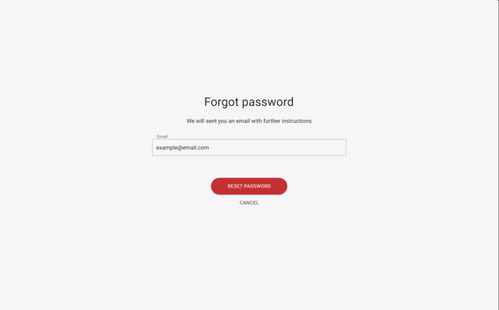

# Forgot Password Page

> **Group:** Authorisation · **Source:** CV Builder Wiki Frontend (Notion)

## Purpose

Allows users to initiate the password recovery process by requesting a password reset email.

---

## Scope

This page is available to all unauthenticated users.

The page behavior and content are identical for all user types.

---

## Behavior

The page allows users to:

- Enter the email address associated with their account
- Request a password reset email
- Return to the previous authentication page

---

## Design Reference

Figma: CV Builder – Forgot Password

---

## Layout

- Password recovery form must be centered on the page
- Supports Light and Dark themes
- Layout must be fully responsive on desktop and tablet devices
- Form elements must maintain consistent spacing and alignment

---

## Content

### Page Header

Title: Forgot password

Subtitle: We will send you an email with further instructions

Requirements:

- Must be centered above the form
- Text must remain readable across supported themes

---

### Email Field

Input field: Email

Requirements:

- Accepts email address input
- Supports:
  - default
  - hover
  - focus
  - error states

Validation:

- Field is required
- Value must be a valid email address

Example validation messages:

- Email is required
- Please enter a valid email address

---

### Primary Action

Button: RESET PASSWORD

Requirements:

- Submits password reset request
- Sends password recovery instructions to the specified email address
- Supports:
  - default
  - hover
  - pressed
  - disabled states

---

### Secondary Action

Button: CANCEL

Requirements:

- Navigates user back to the Sign In page
- Supports:
  - default
  - hover
  - focus
  - disabled states

---

## Validation & Error Handling

- Validation messages must be displayed inline when possible
- Failed requests must not clear entered values
- Server errors must display a user-friendly error message

Example error messages:

- No account found with this email address
- Something went wrong. Please try again later

---

## Accessibility & Responsiveness

- Full keyboard navigation support is required
- Interactive elements must provide visible focus states
- Form fields must include accessible labels
- Text must remain readable in all supported themes
- Layout and controls must scale correctly across supported screen sizes

---

## Acceptance Criteria

| ID | Description |
| --- | --- |
| AC-1 | Forgot Password page is accessible to unauthenticated users |
| AC-2 | Page displays title and instructional text |
| AC-3 | Email field accepts valid email addresses |
| AC-4 | Email field validation is displayed for invalid input |
| AC-5 | Clicking RESET PASSWORD submits password reset request |
| AC-6 | Password reset instructions are sent to the specified email address |
| AC-7 | Clicking CANCEL navigates to the Sign In page |
| AC-8 | User-friendly error messages are displayed when requests fail |
| AC-9 | Page supports Light and Dark themes |
| AC-10 | Page is responsive across supported devices |
