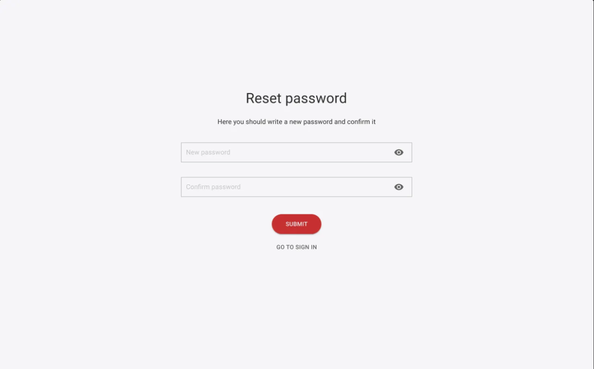

# Reset Password Page

> **Group:** Authorisation · **Source:** CV Builder Wiki Frontend (Notion)

## Purpose

Allows users to create a new password after initiating the password recovery process.

---

## Scope

This page is available to users who have successfully accessed the password reset flow.

The page behavior and content are identical for all user types.

---

## Behavior

The page allows users to:

- Enter a new password
- Confirm the new password
- Show or hide password values
- Submit a password reset request
- Automatically sign in after a successful password reset
- Navigate to the Sign In page

---

## Design Reference

Figma: CV Builder – Reset Password

---

## Layout

- Password reset form must be centered on the page
- Supports Light and Dark themes
- Layout must be fully responsive on desktop and tablet devices
- Form elements must maintain consistent spacing and alignment

---

## Content

### Page Header

Title: Reset password

Subtitle: Here you should write a new password and confirm it

Requirements:

- Must be centered above the form
- Text must remain readable across supported themes

---

### New Password Field

Input field: New Password

Requirements:

- Field is masked by default
- Includes password visibility toggle
- Supports:
  - default
  - hover
  - focus
  - error states

Validation:

- Field is required
- Password must contain at least 6 characters

Example validation messages:

- Password is required
- Password must be at least 6 characters long

---

### Confirm Password Field

Input field: Confirm Password

Requirements:

- Field is masked by default
- Includes password visibility toggle
- Supports:
  - default
  - hover
  - focus
  - error states

Validation:

- Field is required
- Value must match the New Password field

Example validation messages:

- Confirm Password is required
- Passwords do not match

---

### Primary Action

Button: SUBMIT

Requirements:

- Submits password reset request
- Updates the user's password
- Automatically authenticates the user after successful password reset
- Redirects authenticated user to the application after successful password reset
- Supports:
  - default
  - hover
  - pressed
  - disabled states

---

### Secondary Action

Button: GO TO SIGN IN

Requirements:

- Navigates user to the Sign In page
- Supports:
  - default
  - hover
  - focus states
  - disabled states

---

## Validation & Error Handling

- Validation messages must be displayed inline when possible
- Failed requests must not clear entered values
- Invalid or expired reset links must display a user-friendly error message
- Server errors must display a user-friendly error message

Example error messages:

- Passwords do not match
- Password must be at least 6 characters long
- This password reset link has expired
- Something went wrong. Please try again later

---

## Accessibility & Responsiveness

- Full keyboard navigation support is required
- Interactive elements must provide visible focus states
- Form fields must include accessible labels
- Text must remain readable in all supported themes
- Layout and controls must scale correctly across supported screen sizes

---

## Acceptance Criteria

| ID | Description |
| --- | --- |
| AC-1 | Reset Password page is accessible through the password recovery flow |
| AC-2 | Page displays title and instructional text |
| AC-3 | New Password field is masked by default |
| AC-4 | Confirm Password field is masked by default |
| AC-5 | Password must contain at least 6 characters |
| AC-6 | Confirm Password must match New Password |
| AC-7 | Password visibility toggle functions correctly |
| AC-8 | Validation messages are displayed for invalid input |
| AC-9 | Clicking SUBMIT updates the user's password |
| AC-10 | Successful password reset automatically authenticates the user |
| AC-11 | Successful password reset redirects the user to the application |
| AC-12 | Clicking GO TO SIGN IN navigates to the Sign In page |
| AC-13 | User-friendly error messages are displayed when requests fail |
| AC-14 | Page supports Light and Dark themes |
| AC-15 | Page is responsive across supported devices |
