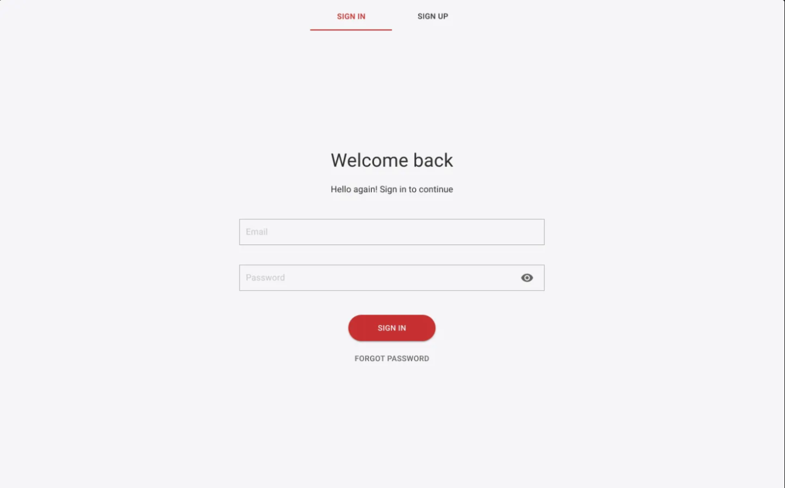

# Sign In Page

> **Group:** Authorisation · **Source:** CV Builder Wiki Frontend (Notion)

## Purpose

Allows existing users to authenticate and access the CV Builder application.

---

## Scope

This page is available to all unauthenticated users.

The page behavior and content are identical for all user types.

---

## Behavior

The page allows users to:

- Enter account credentials
- Sign in to the application
- Show or hide password value
- Navigate to the Sign Up page
- Navigate to the Forgot Password flow

---

## Design Reference

Figma: CV Builder – Sign In

---

## Layout

- Authentication form must be centered on the page
- Supports Light and Dark themes
- Layout must be fully responsive on desktop and tablet devices
- Form elements must maintain consistent spacing and alignment
- The Sign In tab must be active by default

---

## Content

### Authentication Tabs

Tabs:

- SIGN IN
- SIGN UP

Requirements:

- SIGN IN is selected by default
- Clicking SIGN UP navigates to the Sign Up page
- Active tab must be visually distinguished
- Tabs must support:
  - default
  - hover
  - active states

---

### Welcome Message

Title: Welcome back

Subtitle: Hello again! Sign in to continue

Requirements:

- Must be centered above the authentication form
- Text must remain readable across supported themes

---

### Email Field

Input field: Email

Requirements:

- Accepts email address input
- Supports:
  - default
  - hover
  - focus
  - error states

Validation:

- Field is required
- Value must be a valid email address

Example validation messages:

- Email is required
- Please enter a valid email address

---

### Password Field

Input field: Password

Requirements:

- Field is masked by default
- Includes password visibility toggle
- Supports:
  - default
  - hover
  - focus
  - error states

Validation:

- Field is required
- Password must contain at least 6 characters

Example validation messages:

- Password is required
- Password must be at least 6 characters long

---

### Primary Action

Button: SIGN IN

Requirements:

- Submits authentication request
- Remains disabled until all required fields are valid
- Supports:
  - default
  - hover
  - active
  - disabled states

---

### Forgot Password

Link: FORGOT PASSWORD

Requirements:

- Navigates user to the password recovery flow
- Must be keyboard accessible
- Supports:
  - default
  - hover
  - focus
  - disabled states

---

## Validation & Error Handling

- Invalid credentials must display an error message
- Validation messages must be displayed inline when possible
- Failed authentication requests must not clear entered values
- Server errors must display a user-friendly error message

Example error messages:

- Invalid email or password
- Something went wrong. Please try again later

---

## Accessibility & Responsiveness

- Full keyboard navigation support is required
- Interactive elements must provide visible focus states
- Form fields must include accessible labels
- Text must remain readable in all supported themes
- Layout and controls must scale correctly across supported screen sizes

---

## Acceptance Criteria

| ID | Description |
| --- | --- |
| AC-1 | Sign In page is accessible to unauthenticated users |
| AC-2 | Sign In tab is active by default |
| AC-3 | Sign Up tab navigates to the Sign Up page |
| AC-4 | Email field accepts valid email addresses |
| AC-5 | Password field is masked by default |
| AC-6 | Password visibility toggle functions correctly |
| AC-7 | Password must contain at least 6 characters |
| AC-8 | Validation messages are displayed for invalid input |
| AC-9 | Clicking SIGN IN submits authentication request |
| AC-10 | Invalid credentials display an error message |
| AC-11 | Forgot Password link navigates to forgot password page |
| AC-12 | Page supports Light and Dark themes |
| AC-13 | Page is responsive across supported devices |
