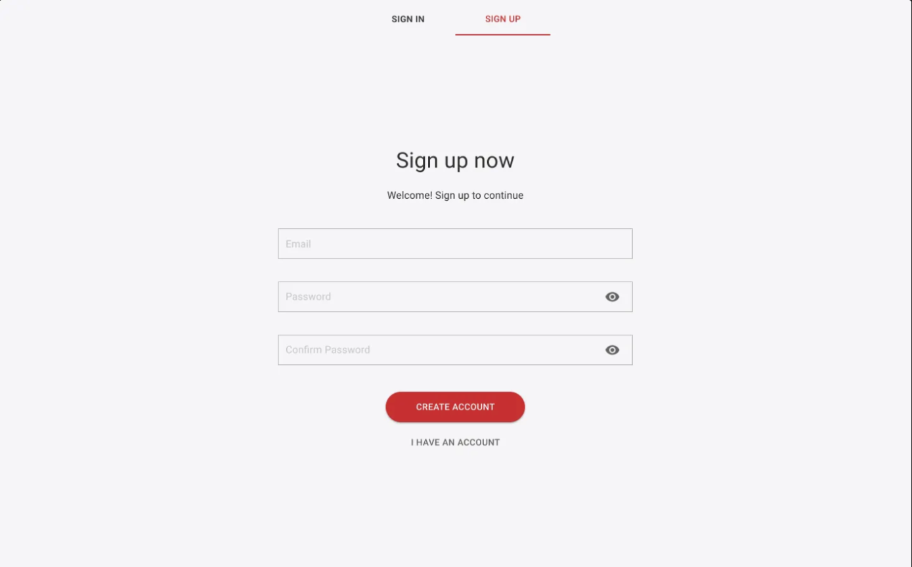

# Sign Up Page

> **Group:** Authorisation · **Source:** CV Builder Wiki Frontend (Notion)

## Purpose

Allows new users to create an account and access the CV Builder application.

---

## Scope

This page is available to all unauthenticated users.

The page behavior and content are identical for all user types.

---

## Behavior

The page allows users to:

- Create a new account
- Enter registration credentials
- Confirm password before account creation
- Show or hide password values
- Navigate to the Sign In page
- Proceed to the account verification page after successful registration

---

## Design Reference

Figma: CV Builder – Sign Up

---

## Layout

- Registration form must be centered on the page
- Supports Light and Dark themes
- Layout must be fully responsive on desktop and tablet devices
- Form elements must maintain consistent spacing and alignment
- The Sign Up tab must be active by default

---

## Content

### Authentication Tabs

Tabs:

- SIGN IN
- SIGN UP

Requirements:

- SIGN UP is selected by default
- Clicking SIGN IN navigates to the Sign In page
- Active tab must be visually distinguished
- Tabs must support:
  - default
  - hover
  - active states

---

### Welcome Message

Title: Sign up now

Subtitle: Welcome! Sign up to continue

Requirements:

- Must be centered above the registration form
- Text must remain readable across supported themes

---

### Email Field

Input field: Email

Requirements:

- Accepts email address input
- Supports:
  - default
  - hover
  - focus
  - error states

Validation:

- Field is required
- Value must be a valid email address

Example validation messages:

- Email is required
- Please enter a valid email address

---

### Password Field

Input field: Password

Requirements:

- Field is masked by default
- Includes password visibility toggle
- Supports:
  - default
  - hover
  - focus
  - error states

Validation:

- Field is required
- Password must contain at least 6 characters

Example validation messages:

- Password is required
- Password must be at least 6 characters long

---

### Confirm Password Field

Input field: Confirm Password

Requirements:

- Field is masked by default
- Includes password visibility toggle
- Supports:
  - default
  - hover
  - focus
  - error states

Validation:

- Field is required
- Value must match the Password field

Example validation messages:

- Confirm Password is required
- Passwords do not match

---

### Primary Action

Button: CREATE ACCOUNT

Requirements:

- Submits registration request
- Creates a new user account
- Redirects user to the account verification page after successful registration
- Supports:
  - default
  - hover
  - pressed
  - disabled states

---

### Secondary Action

Button: I HAVE AN ACCOUNT

Requirements:

- Navigates user to the Sign In page
- Supports:
  - default
  - hover
  - focus
  - disabled states

---

## Validation & Error Handling

- Email must be unique within the system
- Validation messages must be displayed inline when possible
- Failed registration requests must not clear entered values
- Server errors must display a user-friendly error message

Example error messages:

- An account with this email already exists
- Something went wrong. Please try again later

---

## Accessibility & Responsiveness

- Full keyboard navigation support is required
- Interactive elements must provide visible focus states
- Form fields must include accessible labels
- Text must remain readable in all supported themes
- Layout and controls must scale correctly across supported screen sizes

---

## Acceptance Criteria

| ID | Description |
| --- | --- |
| AC-1 | Sign Up page is accessible to unauthenticated users |
| AC-2 | Sign Up tab is active by default |
| AC-3 | Sign In tab navigates to the Sign In page |
| AC-4 | Email field accepts valid email addresses |
| AC-5 | Password must contain at least 6 characters |
| AC-6 | Confirm Password must match Password |
| AC-7 | Password visibility toggle functions correctly |
| AC-8 | Validation messages are displayed for invalid input |
| AC-9 | Clicking CREATE ACCOUNT submits registration request |
| AC-10 | Successful registration redirects user to the verification page |
| AC-11 | I HAVE AN ACCOUNT navigates to the Sign In page |
| AC-12 | Page supports Light and Dark themes |
| AC-13 | Page is responsive across supported devices |
