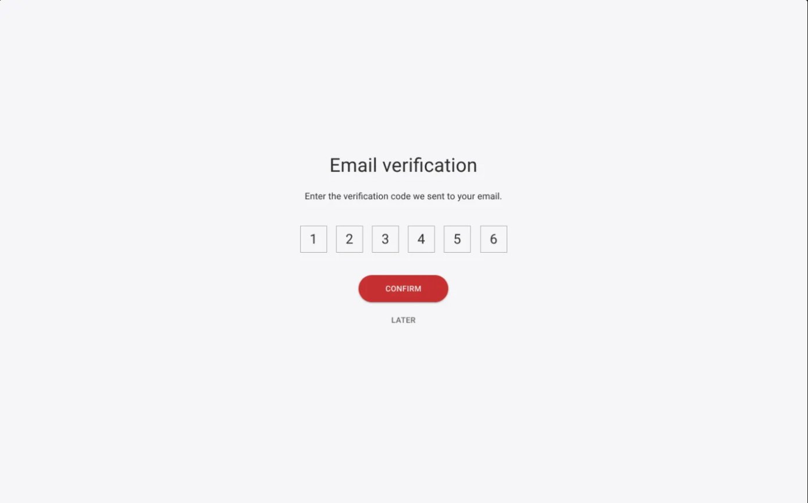

# Verification Page

> **Group:** Authorisation · **Source:** CV Builder Wiki Frontend (Notion)

## Purpose

Allows users to verify their email address using a one-time verification code sent to their email.

---

## Scope

This page is available to users who have successfully completed the account registration process.

The page behavior and content are identical for all user types.

---

## Behavior

The page allows users to:

- Enter a verification code received by email
- Confirm email ownership
- Complete the account verification process
- Skip verification and continue to the application
- Automatically activate the account after successful verification

---

## Design Reference

Figma: CV Builder – Email Verification

---

## Layout

- Verification form must be centered on the page
- Supports Light and Dark themes
- Layout must be fully responsive on desktop and tablet devices
- Form elements must maintain consistent spacing and alignment

---

## Content

### Page Header

Title: Email verification

Subtitle: Enter the verification code we sent to your email.

Requirements:

- Must be centered above the form
- Text must remain readable across supported themes

---

### Verification Code Field

Input: OTP Code

Requirements:

- Accepts a 6-digit numeric verification code
- Supports OTP-style input fields
- Automatically moves focus to the next input when a digit is entered
- Supports pasting a complete 6-digit code
- Supports:
  - default
  - focus
  - error states

Validation:

- Verification code is required
- Verification code must contain exactly 6 digits
- Verification code expires after 2 hours

Example validation messages:

- Verification code is required
- Please enter a valid 6-digit code
- Verification code has expired

---

### Primary Action

Button: CONFIRM

Requirements:

- Submits verification request
- Verifies the user's email address
- Activates the account upon successful verification
- Redirects the user to the application after successful verification
- Supports:
  - default
  - hover
  - pressed
  - disabled states

---

### Secondary Action

Button: LATER

Requirements:

- Navigates user to the application's main page
- Does not complete email verification
- Supports:
  - default
  - hover
  - focus states

---

## Validation & Error Handling

- Validation messages must be displayed inline when possible
- Failed verification attempts must not clear entered values
- Expired verification codes must display an error message
- Invalid verification codes must display an error message
- Server errors must display a user-friendly error message

Example error messages:

- Invalid verification code
- Verification code has expired
- Something went wrong. Please try again later

---

## Accessibility & Responsiveness

- Full keyboard navigation support is required
- Interactive elements must provide visible focus states
- OTP inputs must be keyboard accessible
- Text must remain readable in all supported themes
- Layout and controls must scale correctly across supported screen sizes

---

## Acceptance Criteria

| ID | Description |
| --- | --- |
| AC-1 | Email Verification page is accessible after successful registration |
| AC-2 | Page displays title and instructional text |
| AC-3 | OTP input accepts only a 6-digit verification code |
| AC-4 | Verification code expires after 2 hours |
| AC-5 | OTP input supports entering and pasting a complete code |
| AC-6 | Validation messages are displayed for invalid or expired codes |
| AC-7 | Clicking CONFIRM submits the verification request |
| AC-8 | Successful verification activates the account |
| AC-9 | Successful verification redirects the user to the application |
| AC-10 | Clicking LATER navigates the user to the application's main page |
| AC-11 | User-friendly error messages are displayed when verification fails |
| AC-12 | Page supports Light and Dark themes |
| AC-13 | Page is responsive across supported devices |
