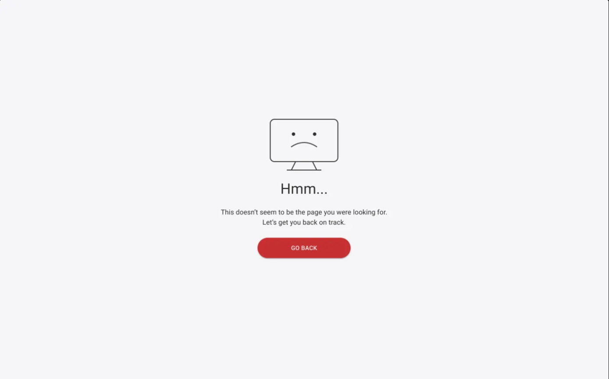

# Not Found Page

> **Group:** Errors & Settings · **Source:** CV Builder Wiki Frontend (Notion)

## Purpose

Displayed when a user navigates to a page that does not exist or is no longer available (404).

---

## Scope

This page applies to both Admin and User roles.

There are no role-based differences in layout, content, or behavior.

---

## Behavior

Page is shown when:

- User navigates to an invalid or non-existent URL
- A route is not defined in the application
- The requested page has been removed or is no longer available
- A routing mismatch or navigation error occurs (404)

---

## Design Reference

Figma: CV Builder – Not found

---

## Content

### Error Icon

- Display a product-consistent illustration for missing or broken navigation

### Message

This doesn’t seem to be the page you were looking for. Let’s get you back on track.

- Must be clear, concise, and user-friendly
- Center-aligned
- First phrase may be visually emphasized

### Primary Action

Button: GO BACK

- Returns user to previous page
- Must have states: default / hover / pressed

---

## Accessibility & Responsiveness

- Text must remain readable in both themes
- Full keyboard navigation support
- Clear visual feedback for interactive elements
- Layout must scale and remain centered across devices

---

## Acceptance Criteria

| ID | Description |
| --- | --- |
| AC-1 | Page is displayed for invalid URL / missing route / removed page |
| AC-2 | Page contains a missing-page illustration/icon |
| AC-3 | Page shows error message and GO BACK button |
| AC-4 | GO BACK returns user to previous page |
| AC-5 | Supports Light and Dark themes |
| AC-6 | Fully responsive on all devices |
| AC-7 | Content is centered on screen |
