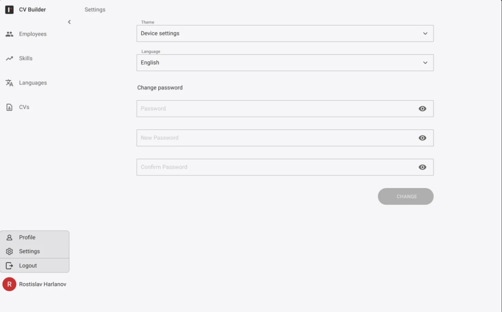

# Settings Page

> **Group:** Errors & Settings · **Source:** CV Builder Wiki Frontend (Notion)

## Purpose

Allows users to manage application preferences and account credentials.

---

## Scope

This page applies to both Admin and User roles.

There are no differences in layout, content, or behavior between Admin and User roles.

---

## Behavior

The page allows users to:

- Change application theme preferences
- Select application language
- Update account password
- Show or hide password values using visibility toggle icons
- Submit password changes through the primary action button

---

## Design Reference

Figma: CV Builder – Settings

---

## Layout

- Page must follow the standard application layout structure
- Sidebar navigation remains visible and accessible
- Settings content is displayed in a centered content area
- Layout must be fully responsive across desktop, tablet, and mobile devices
- Supports Light and Dark themes

---

## Content

### Navigation

The page includes:

- Logo with app name section
- Sidebar navigation menu
- User profile section in the sidebar footer

### Profile Menu

Clicking the user profile section opens a contextual navigation menu containing:

- Profile
- Settings
- Logout

Requirements:

- Menu must open above the profile section
- Menu closes when:
  - user clicks outside the menu
  - navigation item is selected
- Menu supports:
  - hover states
  - focus states

---

### Theme Selector

Select field: Theme

Requirements:

- Allows selecting application theme
- Includes available theme options:
  - Light
  - Dark
  - Device settings
- Selected value must persist after changing state

---

### Language Selector

Select field: Language

Requirements:

- Allows changing application language
- Displays currently selected language
- Available language options:
  - English
  - French
  - German
  - Italian
  - Polish
  - Portuguese
  - Russian
  - Spanish
  - Ukrainian
- Selected value must persist after changing state

---

### Change Password Section

Fields:

- Password
- New Password
- Confirm Password

Requirements:

- All password fields must be masked by default
- Each field includes a visibility toggle icon
- Visibility toggle switches between hidden and visible password states
- Inputs support:
  - default
  - hover
  - focus
  - error

### Password Validation

Validation messages must be displayed inline below the corresponding field.

Validation rules:

- Password is required
- New Password is required
- Confirm Password is required
- New Password and Confirm Password must match
- Password must meet application security requirements

Examples of validation messages:

- Current password is incorrect
- Password is required
- Passwords do not match

---

### Primary Action

Button: CHANGE

Requirements:

- Submits password update request
- Must remain disabled until required fields are valid
- Includes:
  - default
  - hover
  - pressed
  - disabled states

---

## Validation & Error Handling

- Password update failures must display a system error message
- Server validation errors must be displayed inline when possible
- Failed requests must not clear entered form values

---

## Accessibility & Responsiveness

- All text must remain readable in both themes
- Full keyboard navigation support is required
- Interactive elements must provide visible focus states
- Form fields must include accessible labels
- Layout and controls must scale correctly across screen sizes

---

## Acceptance Criteria

| ID | Description |
| --- | --- |
| AC-1 | Settings page is accessible for both Admin and User roles |
| AC-2 | Theme selector displays available theme options |
| AC-3 | Selected theme persists after page changing state |
| AC-4 | Language selector displays available languages |
| AC-5 | Selected language persists after changing state |
| AC-6 | Password fields are masked by default |
| AC-7 | Password visibility toggle works for each password field |
| AC-8 | Inline validation messages are displayed for invalid password input |
| AC-9 | Profile menu opens from the sidebar profile section |
| AC-10 | Profile menu contains Profile, Settings, and Logout actions |
| AC-11 | CHANGE button submits password update request |
| AC-12 | CHANGE button remains disabled until form is valid |
| AC-13 | Page supports Light and Dark themes |
| AC-14 | Page is fully responsive across devices |
