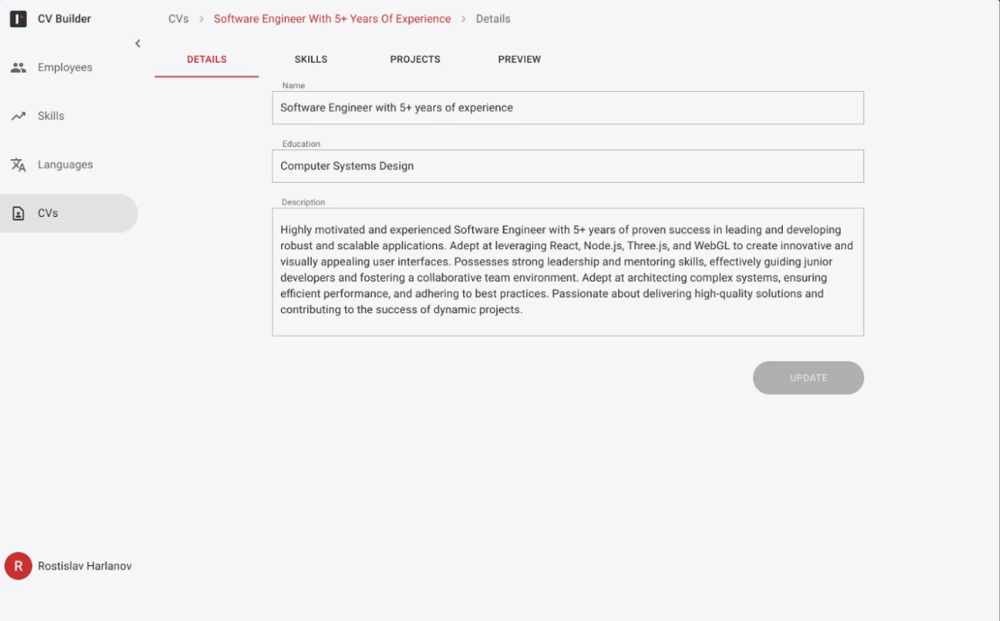

# CV Details Page

> **Group:** CVs · **Source:** CV Builder Wiki Frontend (Notion)

## Purpose

Allows users to view and update general CV information.

The page contains the main CV metadata and serves as the entry point for managing CV content.

Available tabs:

- Details
- Skills
- Projects
- Preview

---

## Scope

The CV Details page is available for:

- Admin
- Employee

Role-based permissions apply.

Users can access only CVs they are permitted to manage.

---

## Behavior

The page allows users to:

- View CV information
- Update CV information
- Navigate between CV tabs

The page displays:

- Name
- Education
- Description

Changes are saved using the Update action.

---

## Design Reference

Figma: CV Builder – CV Details

---

## Layout

Requirements:

- Page follows the standard CV Details layout
- Tab navigation is displayed at the top of the page
- Details tab is active by default
- Form content is displayed below the tab navigation
- Form fields are displayed in a vertical layout
- Update action is displayed below the form
- Layout must be responsive across desktop and tablet devices
- Supports Light and Dark themes

---

## Navigation

### Tabs

Available tabs:

- Details
- Skills
- Projects
- Preview

Requirements:

- Details tab is active by default
- Active tab must be visually highlighted
- Clicking a tab navigates to the corresponding CV section
- Current tab state must persist after page refresh when possible

### Breadcrumbs

Example: CVs > {CV Name} > Details

Requirements:

- Displays the current CV name
- Clicking CVs returns to the CVs page
- Current page is visually highlighted

---

## Content

### CV Information Form

The form contains the following fields.

#### Name

Text input

Requirements:

- Required
- Maximum length: 255 characters
- Pre-populated with the current CV value

#### Education

Text input

Requirements:

- Required
- Maximum length: 255 characters
- Pre-populated with the current CV value

#### Description

Textarea

Requirements:

- Required
- Pre-populated with the current CV value

---

## Validation

Validation messages must be displayed inline.

Rules:

- Name is required
- Education is required
- Description is required

Example messages:

- Name is required
- Education is required
- Description is required

---

## Update CV

### Trigger

Button: UPDATE

Requirements:

- Available for users who can manage the selected CV
- Disabled when no changes have been made
- Enabled when at least one field value differs from the saved data
- Disabled when validation errors exist

### Actions

Button: UPDATE

Requirements:

- Saves changes to the CV
- Remains disabled until the form contains modifications
- Displays loading state while the request is in progress
- Updates CV information after successful save
- Updated values remain visible after successful save

---

## Permissions

### Employee

Can:

- View own CVs
- Update own CVs

Cannot:

- Access CVs belonging to other users

### Admin

Can:

- View any CV
- Update any CV

---

## States

### Loading State

Displayed while CV information is being loaded.

Requirements:

- Form structure remains visible when possible
- Loading indicators or skeletons are displayed

### Saving State

Displayed while CV updates are being submitted.

Requirements:

- UPDATE button displays loading state
- Duplicate submissions are prevented
- Form remains visible during save operation

### Error State

Displayed when CV information cannot be loaded.

Example: Failed to load CV details

Requirements:

- Error message is shown
- Retry action is available

---

## Validation & Error Handling

Requirements:

- Validation errors must be displayed inline
- Failed update requests must display a system error
- Failed requests must not clear entered values
- User changes must remain visible after validation errors
- Failed save operations must not reset the form

---

## Accessibility & Responsiveness

Requirements:

- Full keyboard navigation support
- Visible focus states
- Accessible labels for all form controls
- Tab navigation is keyboard accessible
- Content remains readable in Light and Dark themes
- Layout scales correctly across supported screen sizes

---

## Acceptance Criteria

| ID | Description |
| --- | --- |
| AC-1 | CV Details page is available for authorized users |
| AC-2 | Details tab is active by default |
| AC-3 | Navigation tabs Details, Skills, Projects, and Preview are displayed |
| AC-4 | Page contains Name, Education, and Description fields |
| AC-5 | Name field is required |
| AC-6 | Education field is required |
| AC-7 | Description field is required |
| AC-8 | Name supports a maximum length of 255 characters |
| AC-9 | Education supports a maximum length of 255 characters |
| AC-10 | Existing CV values are pre-populated in the form |
| AC-11 | UPDATE button is disabled when no changes are made |
| AC-12 | UPDATE button becomes enabled after modifying form data |
| AC-13 | UPDATE button is disabled when validation errors exist |
| AC-14 | Clicking UPDATE saves CV information |
| AC-15 | Successful save updates displayed CV information |
| AC-16 | Validation errors are displayed inline |
| AC-17 | Failed updates display an error message |
| AC-18 | Loading, Saving, and Error states are supported |
| AC-19 | Page supports Light and Dark themes |
| AC-20 | Page is responsive across supported devices |
| AC-21 | Keyboard accessibility is fully supported |
