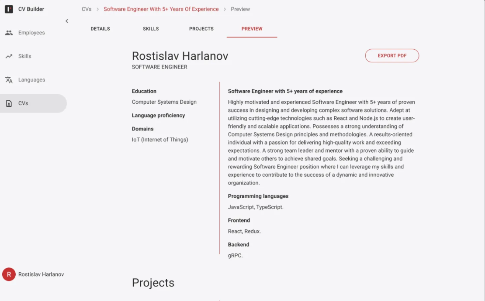

# CV Preview Page

> **Group:** CVs · **Source:** CV Builder Wiki Frontend (Notion)

## Purpose

Allows users to preview the generated CV before exporting or sharing it.

The Preview page aggregates information from all CV sections and displays it in a resume-like format.

Users cannot edit CV data directly on this page.

---

## Scope

The CV Details page is available for:

- Admin
- Employee

Role-based permissions apply.

---

## Behavior

The page allows users to:

- View the generated CV preview
- Review CV content before export
- Export CV as PDF

The preview is generated from:

- CV Details
- CV Skills
- CV Projects
- User Languages
- User Profile information

No editing functionality is available on this page.

---

## Layout

Requirements:

- Breadcrumb navigation is displayed at the top
- CV navigation tabs are displayed below breadcrumbs
- CV content is rendered in a printable resume layout
- Export PDF action is displayed in the page header
- Layout must be responsive across desktop and tablet devices
- Supports Light and Dark themes

---

## Navigation

### Breadcrumbs

Example: CVs > {CV name} > Preview

Requirements:

- Displays current CV name
- Clicking CVs returns to CVs page
- Current page is highlighted

---

## Tabs

Available tabs:

- Details
- Skills
- Projects
- Preview

Requirements:

- Preview tab is highlighted when active
- Switching tabs preserves current CV context

---

## Content

The page displays a generated CV document.

Content is divided into sections.

---

### Header Section

Displays:

- Full Name
- Position

Example:

- Rostislav Harlanov
- Software Engineer

Requirements:

- Data is loaded from the employee profile
- Position is loaded from the employee assignment

---

### General Information Section

#### Education

Displays:

- CV Education value

#### Language Proficiency

Requirements:

- Displays all languages assigned to the employee
- Displays proficiency level for each language

Example:

- English — C1
- German — B2

#### Domains

Requirements:

- Displays project domains associated with the CV
- Duplicate domains must not be repeated

Example:

- IoT
- FinTech
- Healthcare

---

### Summary Section

#### CV Name

Requirements:

- Displays CV Name

#### Description

Requirements:

- Displays CV Description

---

### Skills Section

Displays skills grouped by category.

Example groups:

- Programming Languages
- Frontend Technologies
- Backend Technologies
- Databases
- Cloud Technologies

Requirements:

- Only skills assigned to the CV are displayed
- Skills are grouped by category
- Categories without skills are hidden

---

### Projects Section

Displays all projects assigned to the CV.

For each project the following information is displayed.

#### Project Header

Displays:

- Project Name
- Project Description

Requirements:

- Loaded from project information

#### Project Details

##### Project Role

Requirements:

- Displays project roles
- Roles are loaded from the associated project
- Multiple roles are displayed when available
- Section is hidden when the project has no assigned roles

Examples:

- Team Lead
- Solution Architect
- Backend Developer

##### Period

Requirements:

- Displays participation dates from CV Project assignment

Format: MM.YYYY - MM.YYYY

If End Date is not specified: MM.YYYY - Present

##### Responsibilities

Requirements:

- Displays responsibilities entered in CV Project

If responsibilities are empty:

- Section is hidden

##### Environment

Requirements:

- Displays project technology stack
- Loaded from project data

---

### Professional Skills Section

Displays a skills table.

Columns:

| Column | Description |
| --- | --- |
| Skills Category | Skill category |
| Skill | Skill name |
| Experience in Years | Automatically calculated experience |
| Last Used | Automatically calculated last usage year |

Requirements:

- Displays only skills assigned to the CV
- Skills are grouped by category
- Categories are visually separated
- Table supports large datasets

---

### Experience in Years Calculation

Requirements:

- Calculated automatically for each skill specified by the candidate.
- For each candidate skill, check all projects included in the current CV.
- A skill is considered used in a project if it appears in the project's Environment.
- Experience is calculated only when there is an intersection between the candidate's skills and the skills listed in the project's Environment.
- For each matching skill, determine the earliest project where the skill appears in the Environment.
- Calculate experience from that project's Start Date until the current date.
- Display the result in full years.
- Round down to the nearest whole year.
- If a candidate skill does not appear in the Environment of any project, no experience is calculated for that skill.

Example:

Candidate skills in 2026: JavaScript, TypeScript, React, Angular

Project environments:

- Project 1 (01.03.2022): React, JavaScript
- Project 2 (01.06.2023): TypeScript, Node.js

Result:

- React → 4 years
- JavaScript → 4 years
- TypeScript → 3 years
- Angular → no experience
- Node.js → no experience

---

### Last Used Calculation

Requirements:

- Calculated automatically for each skill
- Determined using the most recent project included in the current CV where the skill appears in the Environment
- Uses the project's End Date
- If the project is currently active, the current year is displayed

Example:

Project A:

- React
- End Date: 12.2023

Project B:

- React
- End Date: 06.2025

Result: Last Used = 2025

If the skill is used in an active project:

Project:

- React
- End Date: Present

Result: Last Used = Current Year

---

### Skill Usage Source

Requirements:

- Skill usage is determined from project Environment values
- A skill is considered used if it exists in at least one project's Environment list
- Only projects assigned to the current CV participate in calculations

---

### Export PDF

#### Trigger

Button: EXPORT PDF

Requirements:

- Available for Admin and Employee users
- Visible on Preview page only

#### Behavior

Requirements:

- Generates PDF version of the displayed CV
- PDF content matches the preview content
- Download starts automatically after successful generation
- File name should include CV name

Example: software-engineer-with-5-years-of-experience.pdf

---

## Permissions

### Employee

Can:

- View Preview of own CVs
- Export own CVs as PDF

Cannot:

- Access CVs belonging to other users

### Admin

Can:

- View Preview of any CV
- Export any CV as PDF

---

## States

### Loading State

Displayed while CV preview data is being loaded.

Requirements:

- Page structure remains visible
- Loading indicators or skeletons are displayed

### Empty State

Displayed when required CV data is missing.

Example: CV preview is not available

Requirements:

- Export action is disabled

### Error State

Example: Failed to load CV preview

Requirements:

- Error message is displayed
- Retry action is available

---

## Acceptance Criteria

| ID | Description |
| --- | --- |
| AC-1 | Preview tab is available within CV Details |
| AC-2 | Preview displays employee name and position |
| AC-3 | Preview displays Education information |
| AC-4 | Preview displays employee languages and proficiency levels |
| AC-5 | Preview displays unique project domains |
| AC-6 | Preview displays CV Name and Description |
| AC-7 | Preview displays CV skills grouped by category |
| AC-8 | Categories without skills are hidden |
| AC-9 | Preview displays all projects assigned to the CV |
| AC-10 | Project period uses CV project participation dates |
| AC-11 | Project roles are displayed when available |
| AC-12 | Empty Roles sections are hidden |
| AC-13 | Responsibilities are displayed when provided |
| AC-14 | Empty Responsibilities sections are hidden |
| AC-15 | Environment is displayed for every project |
| AC-16 | Professional Skills table displays category, skill, experience years, and last used year |
| AC-17 | Experience in Years is calculated from the earliest project where the skill was used |
| AC-18 | Last Used is calculated from the most recent project where the skill was used |
| AC-19 | Only projects included in the current CV participate in skill calculations |
| AC-20 | Users can export CV as PDF |
| AC-21 | Exported PDF matches preview content |
| AC-22 | Exported file name contains the CV name |
| AC-23 | Employees can access only their own CV previews |
| AC-24 | Admins can access previews for all CVs |
| AC-25 | Loading, Empty, and Error states are supported |
| AC-26 | Export is disabled when preview data is unavailable |
| AC-27 | Page supports Light and Dark themes |
| AC-28 | Page is responsive across supported devices |
| AC-29 | Keyboard accessibility is fully supported |
