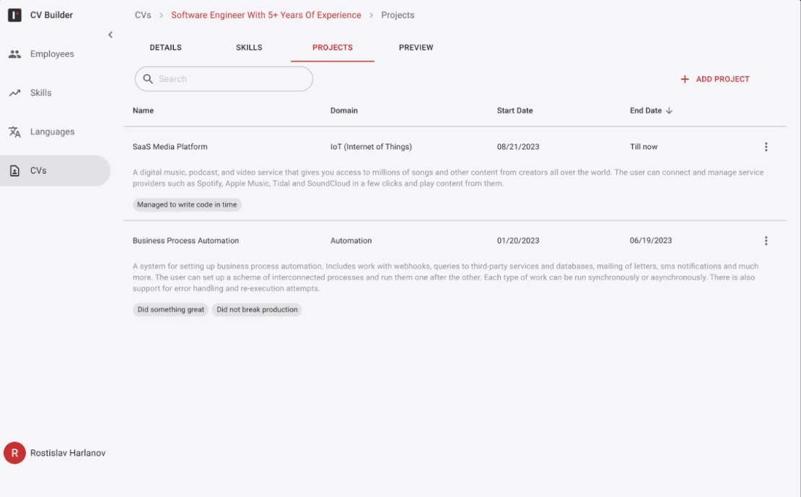

# CV Projects Page

> **Group:** CVs · **Source:** CV Builder Wiki Frontend (Notion)

## Purpose

Allows users to manage projects included in a specific CV.

Projects added to a CV are based on existing projects from the Projects catalog and contain CV-specific information such as:

- participation period
- roles
- responsibilities

The available functionality depends on the current user's permissions for the selected CV.

---

## Scope

The Projects tab is available on the CV Details page.

The page is available for:

- Admin
- Employee

Role-based permissions apply.

Users can manage only CVs they are permitted to edit.

---

## Behavior

The page allows users to:

- View projects assigned to the CV
- Search projects
- Sort projects
- Add projects to the CV
- Update CV project information
- Manage project roles within the CV
- Remove projects from the CV

Projects displayed on this page belong only to the selected CV.

---

## Design Reference

Figma: CV Builder – CV Projects

---

## Layout

Page must follow the standard CV Details layout.

Requirements:

- Breadcrumb navigation is displayed at the top
- CV navigation tabs are displayed below breadcrumbs
- Search field is displayed above the table
- ADD PROJECT action is displayed above the table
- Projects are displayed in a table layout
- Layout must be responsive across desktop and tablet devices
- Supports Light and Dark themes

---

## Navigation

### Breadcrumbs

Example: CVs > {CV name} > Projects

Requirements:

- Displays current CV name
- Clicking CVs returns to the CVs page
- Current page is visually highlighted

---

## Tabs

Available tabs:

- Details
- Skills
- Projects
- Preview

Requirements:

- Projects tab is highlighted when active
- Clicking another tab navigates to the corresponding section
- Active tab state persists during navigation

---

## Content

### Projects Table

The table displays the following columns:

| Column | Description |
| --- | --- |
| Name | Project name |
| Domain | Project domain |
| Responsibilities | CV-specific responsibilities |
| Start Date | Participation start date |
| End Date | Participation end date |

Requirements:

- Displays only projects assigned to the current CV
- Data is displayed in tabular format
- Supports sorting
- Supports empty state
- Supports loading state
- Supports error state

---

### Search

Search field placeholder: Search

Requirements:

- Filters projects by:
  - Name
  - Domain
- Search is case-insensitive
- Search updates results without page reload
- Empty search displays all CV projects

---

### Sorting

Supported columns:

- Name
- Start Date
- End Date

Requirements:

- Supports ascending order
- Supports descending order
- Current sort direction is visually indicated

---

### Actions Menu

Each project row contains a three-dot action menu.

Available actions:

- Update
- Delete

Requirements:

- Menu opens near the selected row
- Only one menu may be open at a time
- Menu closes when:
  - clicking outside
  - selecting an action
  - pressing Escape

---

## Add Project

### Trigger

Opened from: ADD PROJECT

---

## Add Project Modal

### Content

Title: Add project

#### Project

Select field

Label: Name

Requirements:

- Required
- Displays projects from the Projects catalog
- Selecting a project automatically populates:
  - Domain
  - Description
  - Environment
  - Project Start Date
  - Project End Date

#### Domain

Input field

Requirements:

- Required
- Auto-populated from selected project
- Disabled

#### Start Date

Date picker

Requirements:

- Required
- Editable
- Cannot be earlier than the selected project's start date
- Cannot be later than the selected project's end date

#### End Date

Date picker

Requirements:

- Editable
- Cannot be earlier than selected Start Date
- Cannot be later than the selected project's end date

#### Description

Textarea

Requirements:

- Required
- Auto-populated from selected project
- Disabled

#### Environment

Multi-select / tags field

Requirements:

- Required
- Auto-populated from selected project
- Disabled
- Displays project technology stack

#### Roles

Multi-select field

Requirements:

- Required
- Displays all active roles available in the system
- Supports selecting multiple roles

#### Responsibilities

Textarea

Requirements:

- Optional
- Editable
- Stores CV-specific responsibilities

### Validation

Validation messages must be displayed inline.

Rules:

- Project is required
- Start Date is required
- Start Date must be within project duration
- End Date must be within project duration
- End Date cannot be earlier than Start Date
- At least one role is required

Example messages:

- Project is required
- Start date is required
- Start date must be within project duration
- End date must be within project duration
- End date cannot be earlier than start date
- At least one role must be selected

### Actions

Buttons:

- CANCEL
- ADD

Requirements:

- ADD remains disabled until all required fields are valid
- Successful creation adds the project and selected roles to the CV
- Modal closes after successful creation

---

## Update Project

### Trigger

Opened from: Update

---

## Update Project Modal

### Content

Title: Update project

#### Project

Select field

Requirements:

- Displays selected project
- Disabled
- Cannot be changed

#### Domain

Input field

Requirements:

- Disabled
- Loaded from selected project

#### Description

Textarea

Requirements:

- Disabled
- Loaded from selected project

#### Environment

Multi-select / tags field

Requirements:

- Disabled
- Loaded from selected project

#### Start Date

Date picker

Requirements:

- Editable
- Must remain within project duration

#### End Date

Date picker

Requirements:

- Editable
- Must remain within project duration
- Cannot be earlier than Start Date

#### Roles

Multi-select field

Requirements:

- Required
- Displays all active roles available in the system
- Pre-populated with currently assigned roles
- Supports selecting multiple roles
- Editable

#### Responsibilities

Textarea

Requirements:

- Optional
- Editable

### Validation

Validation rules are identical to Add Project.

### Actions

Buttons:

- CANCEL
- SAVE

Requirements:

- SAVE remains disabled until at least one value is changed
- Successful update refreshes displayed data immediately
- Updated roles are saved with the CV Project
- Modal closes after successful update

---

## Delete Project

### Trigger

Opened from: Delete

---

## Delete Project Modal

### Content

Title: Remove project

Message: Are you sure you want to remove project {name}?

Where:

- {name} = selected project name

### Actions

Buttons:

- CANCEL
- CONFIRM

Requirements:

- CANCEL closes modal without changes
- CONFIRM removes the selected project from the CV
- Project is removed from the table immediately after successful deletion
- Modal closes after successful deletion

---

## Permissions

### Employee

Can:

- View projects in own CV
- Add projects to own CV
- Update projects in own CV
- Remove projects from own CV

Cannot:

- Access CVs belonging to other users

### Admin

Can:

- View projects in any CV
- Add projects to any CV
- Update projects in any CV
- Remove projects from any CV

---

## States

### Loading State

Displayed while CV projects are being loaded.

Requirements:

- Table remains visible when possible
- Loading indicators or skeletons are displayed

### Empty State

Example message: No projects added yet

Requirements:

- Empty state is displayed instead of table rows

### No Search Results State

Example message: No projects found

Requirements:

- Search value remains visible

### Error State

Displayed when projects cannot be loaded.

Requirements:

- Error message is shown
- Retry action is available

Example: Failed to load projects

---

## Validation & Error Handling

Requirements:

- Failed add requests must display a system error
- Failed update requests must display a system error
- Failed delete requests must display a system error
- Validation errors must be displayed inline
- Failed requests must not clear entered values

---

## Accessibility & Responsiveness

Requirements:

- Full keyboard navigation support
- Visible focus states
- Accessible labels for form controls
- Modal dialogs must trap keyboard focus
- Escape key closes action menus and modals
- Content remains readable in Light and Dark themes
- Layout scales correctly across supported screen sizes

---

## Acceptance Criteria

| ID | Description |
| --- | --- |
| AC-1 | Projects tab is available on the CV Details page |
| AC-2 | Only projects assigned to the selected CV are displayed |
| AC-3 | Projects table displays Name, Domain, Responsibilities, Start Date and End Date columns |
| AC-4 | Search filters projects by Name and Domain |
| AC-5 | Search is case-insensitive |
| AC-6 | Projects can be sorted by Name, Start Date and End Date |
| AC-7 | ADD PROJECT opens Add Project modal |
| AC-8 | Project selection automatically populates Domain, Description and Environment |
| AC-9 | Users can assign one or more roles to a CV project |
| AC-10 | Assigned roles can be updated |
| AC-11 | Domain field is disabled |
| AC-12 | Description field is disabled |
| AC-13 | Environment field is disabled |
| AC-14 | Project and Start Date are required fields |
| AC-15 | Project dates must remain within the selected project's duration |
| AC-16 | At least one role must be selected when adding or updating a CV Project |
| AC-17 | Responsibilities field is optional |
| AC-18 | Update action opens Update Project modal |
| AC-19 | Project field cannot be changed during update |
| AC-20 | SAVE button remains disabled until changes are made |
| AC-21 | Delete action opens Remove Project modal |
| AC-22 | Confirming deletion removes the project from the CV |
| AC-23 | Validation errors are displayed inline |
| AC-24 | Loading, Empty, No Search Results and Error states are supported |
| AC-25 | Page supports Light and Dark themes |
| AC-26 | Page is responsive across supported devices |
| AC-27 | Keyboard accessibility is fully supported |
