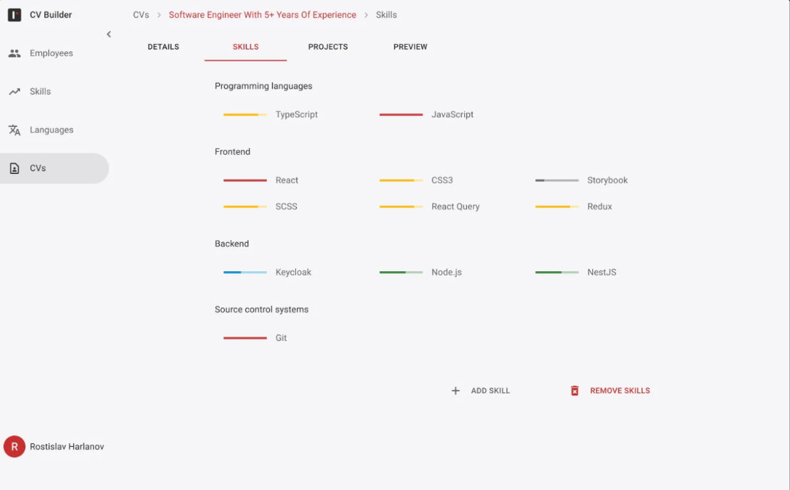

# CV Skills Page

> **Group:** CVs · **Source:** CV Builder Wiki Frontend (Notion)

## Purpose

Allows users to manage skills included in a specific CV.

The page displays only skills assigned to the selected CV.

Skills available for addition are limited to skills already assigned to the CV owner.

Available tabs:

- Details
- Skills
- Projects
- Preview

---

## Scope

The CV Skills page is available for:

- Admin
- Employee

Role-based permissions apply.

Users can manage only CVs they are permitted to edit.

---

## Behavior

The page allows users to:

- View CV skills
- Add skills to the CV
- Remove skills from the CV
- Navigate between CV tabs

The page displays skills grouped by category.

---

## Design Reference

Figma: CV Builder – CV Skills

---

## Layout

Requirements:

- Page follows the standard CV Details layout
- Tab navigation is displayed at the top of the page
- Skills tab is active
- Skills content is displayed below the tab navigation
- Skills are grouped by category
- Layout must be responsive across desktop and tablet devices
- Supports Light and Dark themes

---

## Navigation

### Tabs

Available tabs:

- Details
- Skills
- Projects
- Preview

Requirements:

- Skills tab is active when the page is opened
- Active tab must be visually highlighted
- Clicking another tab navigates to the corresponding section
- Current tab state must persist after page refresh when possible

### Breadcrumbs

Example: CVs > {CV Name} > Skills

Requirements:

- Displays the current CV name
- Clicking CVs returns to the CVs page
- Current page is visually highlighted

---

## Content

### Skill Groups

Skills are grouped by category.

Example categories:

- Programming Languages
- Frontend
- Backend
- Databases
- DevOps
- Source Control Systems

Requirements:

- Category name is displayed as a section header
- Skills belonging to the category are displayed below the header
- Categories without skills are not displayed

### Skill Item

Each skill displays:

- Skill Name
- Skill Mastery Level

Requirements:

- Skill mastery level is clearly visible
- Visual representation follows design specifications
- Clicking a skill opens the Update Skill modal

---

## Add Skill

### Trigger

Button: ADD SKILL

Requirements:

- Available for users who can edit the selected CV

### Add Skill Modal

#### Content

Title: Add skill

Fields:

##### Skill

Select field

Requirements:

- Required
- Displays only skills already assigned to the CV owner
- Skills already added to the current CV must not be available for selection

#### Validation

Validation messages must be displayed inline.

Rules:

- Skill is required

Example messages:

- Skill is required

#### Actions

Buttons:

- CANCEL
- ADD

Requirements:

- ADD remains disabled until all required fields are valid
- Successful creation adds the skill to the appropriate category
- Modal closes after successful creation

---

## Update Skill

### Trigger

Opened by clicking an existing skill.

Requirements:

- Available for users who can edit the selected CV

### Update Skill Modal

#### Content

Title: Update skill

Fields:

##### Skill

Select field

Requirements:

- Displays the current skill
- Required
- Displays only skills already assigned to the CV owner
- Skills already added to the current CV must not be available for selection

#### Actions

Buttons:

- CANCEL
- SAVE

Requirements:

- SAVE updates the selected skill
- Modal closes after successful update
- Updated value appears immediately in the list

---

## Remove Skills

### Trigger

Button: REMOVE SKILLS

Requirements:

- Available for users who can edit the selected CV

### Selection Mode

Requirements:

- Clicking REMOVE SKILLS enables selection mode
- Skills become selectable
- Multiple skills can be selected
- Selected skills are visually highlighted

Actions displayed:

- CANCEL
- REMOVE ({count})

Where:

- {count} = number of selected skills

Requirements:

- REMOVE remains disabled when no skills are selected

---

## Remove Skills Modal

### Content

Title: Remove skills

Message: Are you sure you want to remove {count} skills?

Where:

- {count} = number of selected skills

### Actions

Buttons:

- CANCEL
- CONFIRM

Requirements:

- CANCEL closes the modal without changes
- CONFIRM removes all selected skills from the CV
- Removed skills disappear immediately from the list
- Modal closes after successful removal
- Selection mode exits automatically

---

## Permissions

### Employee

Can:

- View own CV skills
- Add skills to own CV
- Update skills in own CV
- Remove skills from own CV

Cannot:

- Access CVs belonging to other users

### Admin

Can:

- View CV skills of any user
- Add skills to any CV
- Update skills in any CV
- Remove skills from any CV

---

## States

### Loading State

Displayed while CV skills are being loaded.

Requirements:

- Page structure remains visible when possible
- Loading indicators or skeletons are displayed

### Empty State

Displayed when the CV contains no skills.

Example: No skills added yet

Requirements:

- Empty state is displayed instead of skill groups

### Error State

Displayed when CV skills cannot be loaded.

Example: Failed to load skills

Requirements:

- Error message is shown
- Retry action is available

---

## Validation & Error Handling

Requirements:

- Validation errors must be displayed inline
- Failed add requests must display a system error
- Failed update requests must display a system error
- Failed remove requests must display a system error
- Failed requests must not clear entered values

---

## Accessibility & Responsiveness

Requirements:

- Full keyboard navigation support
- Visible focus states
- Accessible labels for form controls
- Modal dialogs must trap keyboard focus
- Escape key closes modals
- Content remains readable in Light and Dark themes
- Layout scales correctly across supported screen sizes

---

## Acceptance Criteria

| ID | Description |
| --- | --- |
| AC-1 | CV Skills page is available for authorized users |
| AC-2 | Skills tab is active when the page is opened |
| AC-3 | Navigation tabs Details, Skills, Projects, and Preview are displayed |
| AC-4 | Skills are grouped by category |
| AC-5 | Users can add skills to a CV |
| AC-6 | Skill selection contains only skills assigned to the CV owner |
| AC-7 | Skills already added to the CV cannot be selected again |
| AC-8 | Skill field is required |
| AC-9 | Clicking a skill opens Update Skill modal |
| AC-10 | Skill field is disabled during update |
| AC-11 | Users can update skill |
| AC-12 | Users can remove multiple skills |
| AC-13 | Remove Skills action enables selection mode |
| AC-14 | Remove confirmation displays the number of selected skills |
| AC-15 | Confirming removal deletes selected skills from the CV |
| AC-16 | Validation errors are displayed inline |
| AC-17 | Loading, Empty, and Error states are supported |
| AC-18 | Page supports Light and Dark themes |
| AC-19 | Page is responsive across supported devices |
| AC-20 | Keyboard accessibility is fully supported |
