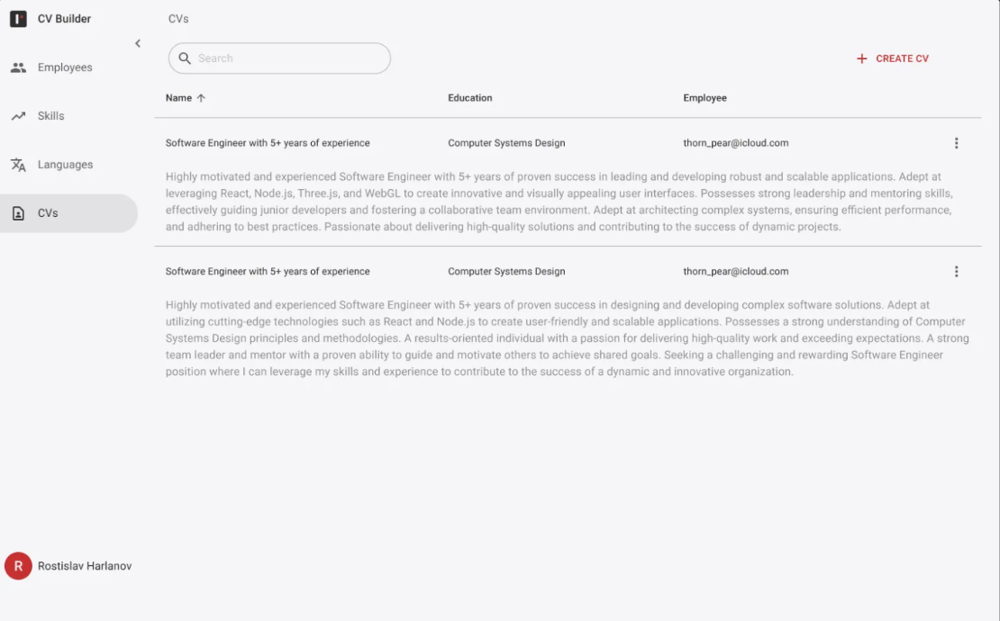

# CVs Page

> **Group:** CVs · **Source:** CV Builder Wiki Frontend (Notion)

## Purpose

Allows users to manage CVs.

The available functionality depends on the current user's role.

### Employee

Can:

- View own CVs
- Search own CVs
- Sort CVs
- Create CVs
- Update own CVs
- Delete own CVs

### Admin

Can:

- View all CVs
- Search CVs
- Sort CVs
- Create CVs
- Update any CV
- Delete any CV

---

## Scope

The CVs page is available for:

- Admin
- Employee

Role-based permissions apply.

---

## Behavior

The page allows users to:

- View CVs
- Search CVs
- Sort CVs
- Open CV details
- Create CVs
- Update CVs
- Delete CVs

The displayed dataset depends on user role.

---

## Design Reference

Figma: CV Builder – CVs page

---

## Layout

Requirements:

- Search field is displayed above the table
- Create CV action is displayed above the table
- CVs are displayed in a table layout
- Table supports sorting
- Layout must be responsive across desktop and tablet devices
- Supports Light and Dark themes

---

## Navigation

The page is available through: CVs

Requirements:

- Navigation item is visible for Admin and Employee users
- Active navigation item must be visually highlighted
- Navigation state must persist during page refresh

---

## Content

### CVs Table

The table displays the following columns:

| Column | Description |
| --- | --- |
| Name | CV name |
| Education | Education information |
| Employee | CV owner email |

Requirements:

- Data is displayed in tabular format
- Supports sorting by Name
- Supports pagination
- Supports loading state
- Supports empty state
- Supports error state

---

### Employee View

Requirements:

- Only CVs created by the current user are displayed
- Employee column displays the current user's email

---

### Admin View

Requirements:

- CVs belonging to all users are displayed
- Employee column displays the CV owner's email

---

### Search

Search field placeholder: Search

#### Employee

Requirements:

- Searches by Name only
- Search is case-insensitive
- Results update without page reload
- Empty search displays all user's CVs

#### Admin

Requirements:

- Searches by:
  - Name
  - Employee email
- Search is case-insensitive
- Results update without page reload
- Empty search displays all CVs

---

### Sorting

Sortable column: Name

Requirements:

- Sorts alphabetically
- Supports ascending order
- Supports descending order
- Current sort direction is visually indicated

---

## Create CV

### Trigger

Opened from: CREATE CV

Requirements:

- Available for Admin users
- Available for Employee users

### Create CV Modal

#### Content

Title: Create CV

Fields:

##### Name

Text input

Requirements:

- Required
- Maximum length: 255 characters

##### Education

Text input

Requirements:

- Required
- Maximum length: 255 characters

##### Description

Textarea

Requirements:

- Required

#### Validation

Validation messages must be displayed inline.

Rules:

- Name is required
- Education is required
- Description is required

Example messages:

- Name is required
- Education is required
- Description is required

#### Actions

Buttons:

- CANCEL
- CREATE

Requirements:

- CREATE remains disabled until all required fields are valid
- Successful creation adds the CV to the table
- Modal closes after successful creation

---

## CV Actions

Each CV row contains a three-dot action menu.

Available actions:

- View
- Edit
- Delete

Requirements:

- Actions menu is displayed for every CV row
- Menu opens near the selected row
- Only one menu may be open at a time
- Menu closes when:
  - clicking outside
  - selecting an action
  - pressing Escape

---

## View CV

### Trigger

Opened from: View

Requirements:

- Opens the selected CV Details page

### Behavior

Requirements:

- User is redirected to the CV Details page
- Selected CV data is loaded
- Full CV information is displayed

---

## Update CV

### Trigger

Opened from: Edit

Requirements:

- Available from the CV actions menu

### Update CV Modal

#### Content

Title: Update CV

Fields:

##### Name

Text input

Requirements:

- Required
- Pre-populated with current value

##### Education

Text input

Requirements:

- Required
- Pre-populated with current value

##### Description

Textarea

Requirements:

- Required
- Pre-populated with current value

#### Validation

Validation messages must be displayed inline.

Rules:

- Name is required
- Education is required
- Description is required

Example messages:

- Name is required
- Education is required
- Description is required

#### Actions

Buttons:

- CANCEL
- SAVE

Requirements:

- SAVE updates the selected CV
- Modal closes after successful update
- Updated values appear immediately in the table

---

## Delete CV

### Trigger

Opened from: Delete

Requirements:

- Available from the CV actions menu

### Delete CV Modal

#### Content

Title: Delete CV

Message: Are you sure you want to delete CV {name}?

Where:

- {name} = selected CV name

#### Actions

Buttons:

- CANCEL
- CONFIRM

Requirements:

- CANCEL closes the modal without changes
- CONFIRM deletes the selected CV
- Deleted CV is removed from the table immediately
- Modal closes after successful deletion

---

## Permissions

### Employee

Can:

- View own CVs
- Create CVs
- Update own CVs
- Delete own CVs

Cannot:

- Access CVs belonging to other users

### Admin

Can:

- View all CVs
- Create CVs
- Update any CV
- Delete any CV

---

## Pagination

Requirements:

- Available when results exceed page size
- Allows navigation between pages
- Current page must be visually highlighted
- Search and sorting must work together with pagination

---

## States

### Loading State

Displayed while CVs are being loaded.

Requirements:

- Table structure remains visible
- Loading indicators or skeletons are displayed

### Empty State

#### Employee

Example: You have no CVs yet

#### Admin

Example: No CVs found

Requirements:

- Empty state is displayed instead of table rows

### No Search Results State

Example: No CVs found

Requirements:

- Search value remains visible
- Existing filters remain applied

### Error State

Displayed when CVs cannot be loaded.

Example: Failed to load CVs

Requirements:

- Error message is shown
- Retry action is available

---

## Validation & Error Handling

Requirements:

- Failed create requests must display a system error
- Failed update requests must display a system error
- Failed delete requests must display a system error
- Validation errors must be displayed inline
- Failed requests must not clear entered values

---

## Accessibility & Responsiveness

Requirements:

- Full keyboard navigation support
- Visible focus states
- Accessible labels for form controls
- Modal dialogs must trap keyboard focus
- Escape key closes action menus and modals
- Content remains readable in Light and Dark themes
- Layout scales correctly across supported screen sizes

---

## Acceptance Criteria

| ID | Description |
| --- | --- |
| AC-1 | CVs page is available for Admin and Employee users |
| AC-2 | Employees see only their own CVs |
| AC-3 | Admins see CVs belonging to all users |
| AC-4 | CVs table displays Name, Education and Employee columns |
| AC-5 | Employee search works by Name only |
| AC-6 | Admin search works by Name and Employee email |
| AC-7 | CV list supports sorting by Name |
| AC-8 | Pagination is available when required |
| AC-9 | CREATE CV opens Create CV modal |
| AC-10 | Name, Education and Description are required fields |
| AC-11 | Users can create CVs |
| AC-12 | View action opens the CV Details page |
| AC-13 | Edit action opens Update CV modal |
| AC-14 | Users can update CVs they are permitted to manage |
| AC-15 | Delete action opens Delete CV confirmation modal |
| AC-16 | Delete confirmation displays the selected CV name |
| AC-17 | Confirming deletion removes the selected CV |
| AC-18 | Validation errors are displayed inline |
| AC-19 | Loading, Empty, No Search Results and Error states are supported |
| AC-20 | Page supports Light and Dark themes |
| AC-21 | Page is responsive across supported devices |
| AC-22 | Keyboard accessibility is fully supported |
