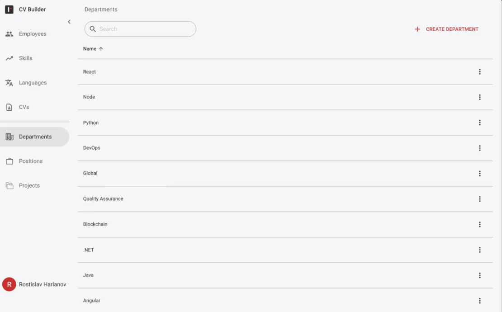

# Departments Page

> **Group:** Others · **Source:** CV Builder Wiki Frontend (Notion)

## Purpose

Allows administrators to manage departments used within the application.

Administrators can:

- View departments
- Search departments
- Sort departments
- Create departments
- Edit departments
- Delete departments

---

## Scope

This page is available only to users with the Admin role.

Users without Admin permissions must not have access to this page.

---

## Behavior

The page allows administrators to:

- View a paginated list of departments
- Search departments by name
- Sort departments by name
- Create new departments
- Edit existing departments
- Delete departments
- Navigate through pages of results

---

## Navigation

### Sidebar Navigation

Requirements:

- The Departments navigation item must be visible only for Admin users
- Selecting Departments opens the Departments page
- The active navigation item must be visually highlighted

---

## Design Reference

Figma: CV Builder – Departments

---

## Layout

- Page follows the standard application layout
- Sidebar navigation remains visible
- Department list is displayed in the content area
- Supports Light and Dark themes
- Fully responsive on desktop and tablet devices

---

## Content

### Page Header

Title: Departments

Requirements:

- Display page title above the department list

---

### Create Department Action

Button: CREATE DEPARTMENT

Requirements:

- Visible only to Admin users
- Opens the Create Department modal
- Includes default, hover, pressed and disabled states

---

### Search

Search field: Search

Requirements:

- Allows searching departments by name
- Search results update after entering a search value
- Search must be case-insensitive
- Search must work across all departments

---

### Sorting

Column: Name

Requirements:

- Departments can be sorted alphabetically
- Supports ascending and descending order
- Active sort direction must be visually indicated

---

### Departments Table

Columns:

- Name
- Actions

Requirements:

- Display department name
- Display action menu for each department
- Rows must remain readable across supported themes

---

### Row Actions

Action menu:

- Edit
- Delete

Requirements:

- Menu opens when clicking the actions icon
- Only one action menu can be opened at a time
- Menu closes when:
  - user clicks outside
  - action is selected

---

## Create Department Modal

Title: Create department

Fields:

- Department

Requirements:

- Department name is required
- Department name must be unique
- Modal includes CREATE and CANCEL

Behavior:

- CREATE creates a new department
- CANCEL closes the modal without saving

Validation examples:

- Department name is required
- Department already exists

---

## Edit Department Modal

Title: Edit department

Fields:

- Department

Requirements:

- Current department name is prefilled
- Department name is required
- Department name must be unique

Actions:

- SAVE
- CANCEL

Behavior:

- SAVE updates department data
- CANCEL closes the modal without saving

---

## Delete Department Modal

Title: Delete department

Message: Are you sure you want to delete department {Department Name}?

Requirements:

- Department name must be displayed in the confirmation message
- Modal includes CONFIRM and CANCEL

Behavior:

- CONFIRM permanently deletes the department
- CANCEL closes the modal without deleting
- Departments assigned to employees, positions, projects, or other system entities cannot be deleted

---

## Pagination

Requirements:

- Department list must support pagination
- Pagination is displayed when multiple pages exist
- User can navigate between pages
- Current page must be visually indicated

---

## Validation & Error Handling

- Department name is required
- Duplicate department names are not allowed
- Departments that are referenced by other entities cannot be deleted
- Validation messages must be displayed inline when possible
- Failed requests must not clear entered values
- Server errors must display a user-friendly error message

Example messages:

- Department name is required
- Department already exists
- Department cannot be deleted because it is currently in use
- Something went wrong. Please try again later

---

## Accessibility & Responsiveness

- Full keyboard navigation support is required
- Interactive elements must provide visible focus states
- Modal dialogs must trap keyboard focus while open
- Text must remain readable in all supported themes
- Layout and controls must scale correctly across supported screen sizes

---

## Acceptance Criteria

| ID | Description |
| --- | --- |
| AC-1 | Departments page is accessible only to Admin users |
| AC-2 | Departments navigation item is visible only to Admin users |
| AC-3 | Department list displays department names |
| AC-4 | Search filters departments by name |
| AC-5 | Departments can be sorted by name in ascending and descending order |
| AC-6 | Department list supports pagination |
| AC-7 | CREATE DEPARTMENT button opens the Create Department modal |
| AC-8 | New departments can be created successfully |
| AC-9 | Department names must be unique |
| AC-10 | Action menu is available for each department |
| AC-11 | Existing departments can be edited |
| AC-12 | Existing departments can be deleted through confirmation modal |
| AC-13 | Departments assigned to other entities cannot be deleted |
| AC-14 | Validation messages are displayed for invalid input |
| AC-15 | User-friendly error messages are displayed for failed requests |
| AC-16 | Page supports Light and Dark themes |
| AC-17 | Page is responsive across supported devices |
