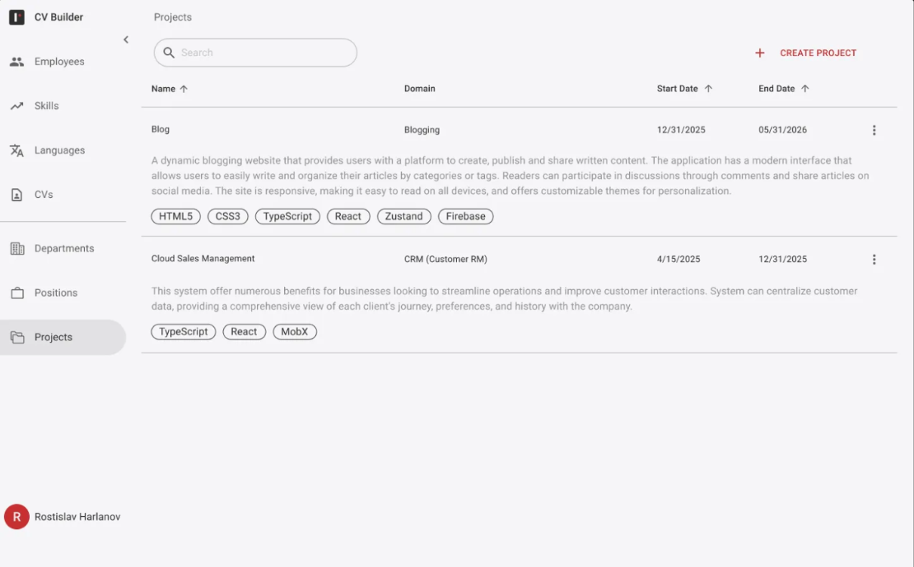

# Projects Page

> **Group:** Others · **Source:** CV Builder Wiki Frontend (Notion)

## Purpose

Allows administrators to manage projects that can be assigned to employee CVs and used within the application.

Administrators can:

- View projects
- Search projects
- Sort projects
- Create projects
- Edit projects
- Delete projects

---

## Scope

This page is available only to users with the Admin role.

Users without Admin permissions must not have access to this page.

---

## Behavior

The page allows administrators to:

- View a list of projects
- Search projects
- Sort projects
- Create new projects
- Edit existing projects
- Delete projects

---

## Navigation

### Sidebar Navigation

Requirements:

- The Projects navigation item must be visible only for Admin users
- Selecting Projects opens the Projects page
- The active navigation item must be visually highlighted
- The navigation item must appear in the left sidebar together with other administration sections

---

## Design Reference

Figma: CV Builder – Projects

---

## Layout

- Page follows the standard application layout
- Sidebar navigation remains visible
- Project list is displayed in the content area
- Supports Light and Dark themes
- Fully responsive on desktop and tablet devices

---

## Content

### Page Header

Title: Projects

Requirements:

- Display page title above the project list

---

### Create Project Action

Button: CREATE PROJECT

Requirements:

- Visible only to Admin users
- Opens the Create Project modal
- Includes default, hover and pressed states

---

### Search

Search field: Search

Requirements:

- Allows searching projects by:
  - project name
  - domain
- Search must be case-insensitive
- Search must work across all projects
- Search results update after entering a search value

---

### Sorting

Columns:

- Name
- Start Date
- End Date

Requirements:

- Projects can be sorted by Name, Start Date and End Date
- Supports ascending and descending order
- Active sort direction must be visually indicated

---

### Projects List

Columns:

- Name
- Domain
- Start Date
- End Date
- Actions

Requirements:

- Display project name
- Display project domain
- Display project start date
- Display project end date
- Display project description below the main row information
- Display project technologies/environment as tags
- Display action menu for each project
- Rows must remain readable across supported themes

---

### Environment Tags

Requirements:

- Display assigned technologies as tags/chips
- Tags must support long values without breaking layout
- Multiple tags must wrap correctly on smaller screens

Examples:

- HTML5
- CSS3
- TypeScript
- React
- Zustand
- Firebase

---

### Row Actions

Action menu:

- Edit
- Delete

Requirements:

- Menu opens when clicking the actions icon
- Only one action menu can be opened at a time
- Menu closes when:
  - user clicks outside
  - action is selected

---

## Create Project Modal

Title: Create project

Fields:

- Name
- Domain
- Start Date
- End Date
- Description
- Environment

Requirements:

### Name

- Required
- Maximum length: 100 characters

### Domain

- Required
- Maximum length: 100 characters

### Start Date

- Required
- Date picker is available

### End Date

- Required
- Date picker is available
- End Date cannot be earlier than Start Date

### Description

- Required
- Maximum length: 2000 characters

### Environment

- Optional
- Supports selecting multiple technologies
- Supports removing selected technologies
- Selected technologies are displayed as tags

Actions:

- CREATE
- CANCEL

Behavior:

- CREATE creates a new project
- CANCEL closes the modal without saving

Validation examples:

- Project name is required
- Domain is required
- Start date is required
- End date is required
- End date must be later than start date
- Description is required

---

## Edit Project Modal

Title: Update project

Fields:

- Name
- Domain
- Start Date
- End Date
- Description
- Environment

Requirements:

- All current project values must be prefilled
- Same validation rules as Create Project

Actions:

- UPDATE
- CANCEL

Behavior:

- UPDATE saves project changes
- CANCEL closes the modal without saving

---

## Delete Project Modal

Title: Delete project

Message: Are you sure you want to delete project {Project Name}?

Requirements:

- Project name must be displayed in the confirmation message
- Modal includes CONFIRM and CANCEL

Behavior:

- CONFIRM permanently deletes the project
- CANCEL closes the modal without deleting

---

## Validation & Error Handling

- Project name is required
- Domain is required
- Start date is required
- End date is required
- End date cannot be earlier than Start Date
- Description is required
- Validation messages must be displayed inline when possible
- Failed requests must not clear entered values
- Server errors must display a user-friendly error message

Example messages:

- Project name is required
- Domain is required
- Start date is required
- End date is required
- End date must be later than start date
- Description is required
- Something went wrong. Please try again later

---

## Accessibility & Responsiveness

- Full keyboard navigation support is required
- Interactive elements must provide visible focus states
- Modal dialogs must trap keyboard focus while open
- Text must remain readable in all supported themes
- Layout and controls must scale correctly across supported screen sizes

---

## Acceptance Criteria

| ID | Description |
| --- | --- |
| AC-1 | Projects page is accessible only to Admin users |
| AC-2 | Projects navigation item is visible only to Admin users |
| AC-3 | Project list displays project name, domain, start date, end date, description, and environment tags |
| AC-4 | Search filters projects by name and domain |
| AC-5 | Projects can be sorted by name in ascending and descending order |
| AC-6 | Projects can be sorted by start date in ascending and descending order |
| AC-7 | Projects can be sorted by end date in ascending and descending order |
| AC-8 | CREATE PROJECT button opens the Create Project modal |
| AC-9 | New projects can be created successfully |
| AC-10 | Project creation requires name, domain, start date, end date, and description |
| AC-11 | End date cannot be earlier than start date |
| AC-12 | Environment field supports selecting multiple technologies |
| AC-13 | Selected environment technologies are displayed as removable tags |
| AC-14 | Action menu is available for each project |
| AC-15 | Existing projects can be edited |
| AC-16 | Edit Project modal is prefilled with current project data |
| AC-17 | Existing projects can be deleted through a confirmation modal |
| AC-18 | Delete confirmation modal displays the selected project name |
| AC-19 | Validation messages are displayed for invalid input |
| AC-20 | User-friendly error messages are displayed for failed requests |
| AC-21 | Page supports Light and Dark themes |
| AC-22 | Page is responsive across supported devices |
| AC-23 | Keyboard navigation is supported for all interactive elements |
| AC-24 | Project rows remain readable across supported themes and screen sizes |
