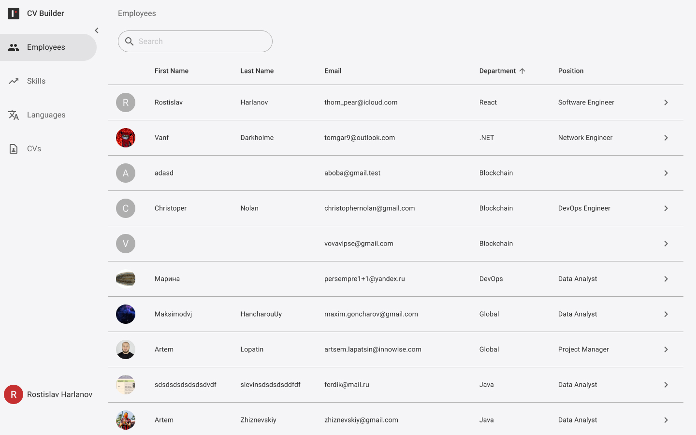

# Overview

Your task is to build a fullstack CV Builder application based on the functionality and requirements described in this CV Builder Wiki.

The project is designed to simulate a real production workflow and help trainees practice:

- team collaboration
- frontend and backend development
- architecture decisions
- API design and integration
- database design and data persistence
- authentication and authorization
- building scalable UI and backend services
- writing maintainable and testable code
> 💡 

The task is designed for teamwork of 2–3 trainees.

---

# Project Goal

The goal of the project is to build a modern fullstack CV Builder application that provides both a user-facing interface and a backend API.

Users should be able to:

- create and edit CVs
- manage profile information
- manage CV sections
- manage skills and languages
- manage projects
- customize resume content
- preview generated CVs
- communicate with the backend through GraphQL API
The application should include persistent data storage, authentication and authorization, server-side validation, business logic, and communication between the frontend and backend.

---

# Application Requirements

The application should include:

### Frontend

- responsive layouts
- reusable UI components
- routing and navigation
- form handling and client-side validation
- loading, empty, and error states
- API integration
- clean and maintainable code structure

### Backend

- GraphQL API
- authentication and authorization
- server-side validation
- business logic
- persistent data storage
- proper error handling
- secure handling of user data
- role-based access control where required

### Integration

- frontend and backend should communicate through the implemented GraphQL API
- API operations should be clearly defined
- client-side and server-side validation should work together
- authentication state should be handled consistently between frontend and backend
- API errors should be correctly handled and displayed by the frontend

---

# Design Reference

Figma: [CV Builder Design](https://www.figma.com/design/m3zxmLv79A6MsHCuAIQAoo/CV-Builder?node-id=0-1&t=1vQbOcTFjFtkBm7x-0&utm_source=chatgpt.com)

### Requirements

- The final implementation should be as close to the provided design as possible.
- The application must support responsive layouts across desktop and tablet.
- Both Light and Dark themes should be implemented if presented in design layouts.
- Minor animations and transitions may be simplified if necessary.

---

# Backend

The backend is part of the internship task and should be developed by the trainees.

The backend should provide the API required by the frontend application and handle:

- authentication and authorization
- users and user profiles
- skills and languages
- CVs and CV sections
- projects
- positions and departments
- user roles and permissions
- data validation
- business rules
- persistent data storage

### API

GraphQL should be used for all data operations.

The backend should provide:

- queries for retrieving application data
- mutations for creating, updating, and deleting data
- authentication and authorization mechanisms
- validation and meaningful error responses

### Database

The application should use a database for persistent data storage.

The team should:

- design the database schema
- define relationships between entities
- implement migrations or an equivalent schema management approach
- provide seed data where appropriate

---

# Technical Stack

Choose the frontend stack according to your internship direction.

## React Internship

Required stack:

- Next.js
- TypeScript
- Vitest
- React Testing Library
- GraphQL + Apollo
- Cypress or Playwright (optional)

## Angular Internship

Required stack:

- Angular
- Vitest
- TestBed
- GraphQL + Apollo
- Cypress or Playwright (optional)

## Vue Internship

Required stack:

- Nuxt.js
- TypeScript
- Vitest
- Vue Test Utils
- GraphQL + Apollo
- Cypress or Playwright (optional)

## Backend

Required stack:

- Node.js
- TypeScript
- NestJS
- GraphQL
- PostgreSQL
- Docker
- an ORM or query builder selected by the team
The team should also define:

- database schema
- API architecture
- authentication strategy
- authorization model
- validation approach
- error-handling strategy
> 💡 

If additional technologies are required (UI libraries, form validation libraries, logging tools, etc.), the team should decide independently.

---

# Testing Requirements

The project should include tests for both frontend and backend.

### Frontend

- unit tests
- component tests
- basic end-to-end tests (optional)

### Backend

- unit tests for business logic
- API/integration tests
- tests for validation and error handling
- tests for authentication and authorization
The team should cover the most important application and business scenarios rather than aiming for 100% code coverage.

---

# Team Workflow Recommendations

Recommended practices:

- use GitFlow or feature branches
- create pull requests for feature delivery
- perform code reviews within the team
- split tasks before implementation
- keep frontend and backend changes coordinated
- document important architecture decisions

---

# Evaluation Criteria

The following aspects will be considered during project evaluation:

### Frontend

- application architecture and folder structure
- code quality, readability, and maintainability
- component reusability
- responsive implementation quality
- consistency with the provided design
- proper state and API handling

### Backend

- backend architecture and project structure
- code quality, readability, and maintainability
- API design
- database design and data modeling
- business logic implementation
- authentication and authorization
- validation and error handling
- proper separation of responsibilities

### Fullstack Integration

- frontend and backend integration
- consistency between API and frontend requirements
- correct handling of loading, errors, and empty states
- correct handling of authentication and authorization
- overall application architecture

---

# Module Page Access

| Module Page |  | Access |
|---|---|---|
| Authentication | Sign In | Public |
| Authentication | Sign Up | Public |
| Authentication | Forgot Password | Public |
| Authentication | Reset Password | Public |
| Authentication | Email Verification | Public |
| System | Not Found (404) | Public |
| System | No Internet Error | Public |
| System | Unsupported Device | Public |
| Users | Users (Main Page) | User, Admin |
| Users | User Profile | User, Admin |
| Users | User Skills | User, Admin |
| Users | User Languages | User, Admin |
| Users | User CVs list | Admin |
| Skills | Skills (User Version) | User |
| Skills | Skills Management | Admin |
| Languages | Languages (User Version) | User |
| Languages | Languages Management | Admin |
| CVs | CV List | User, Admin |
| CVs | CV Details | User, Admin |
| CVs | CV Skills | User, Admin |
| CVs | CV Projects | User, Admin |
| CVs | CV Preview | User, Admin |
| Positions | Positions Management | Admin |
| Departments | Departments Management | Admin |
| Projects | Projects Management | Admin |
| Settings | Settings | User, Admin |

---

# Expected Result

By the end of the internship task, the team should deliver:

- a working fullstack application
- responsive UI implementation
- working frontend-backend integration
- implemented GraphQL API
- persistent database storage
- authentication and authorization
- server-side validation and business logic
- automated tests for frontend and backend
- clean and maintainable project structure
- documented setup and development instructions

---

# Submission Requirements

The final repository should include:

- frontend source code
- backend source code
- database configuration
- clear project setup and run instructions
- environment configuration example
- database setup and migration instructions
- testing instructions
- API documentation
- deployed application link (optional)
