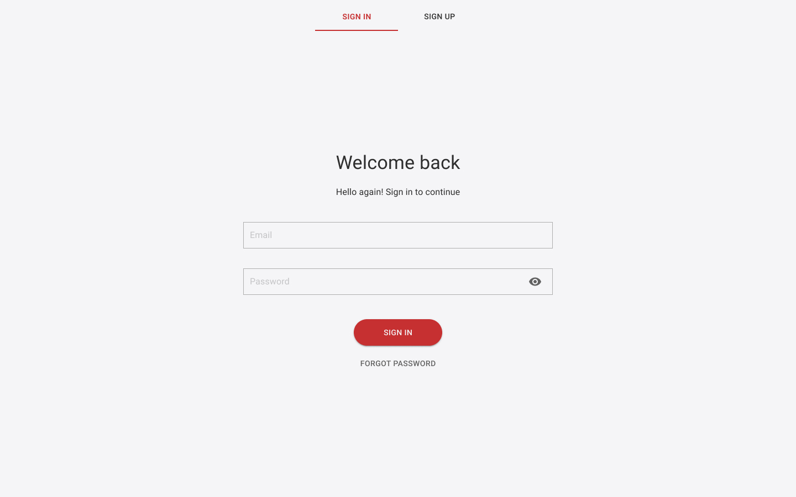

# Sign In Page

## Purpose

Allows existing users to authenticate and access the CV Builder application.

The page should provide both client-side and server-side authentication flow.

---

## Scope

This page is available to all unauthenticated users.

The page behavior and content are identical for all user types.

Authenticated users should not be able to access the Sign In page and should be redirected to the appropriate application page.

---

## Behavior

The page allows users to:

- Enter account credentials
- Sign in to the application
- Show or hide password value
- Navigate to the Sign Up page
- Navigate to the Forgot Password flow
After successful authentication:

- the authentication state must be established
- the user must be redirected to the appropriate authenticated area
- the application must be able to identify the authenticated user and their role
- protected pages and operations must become available according to the user's permissions

---

## Design Reference

Figma: CV Builder – [Sign In](https://www.figma.com/design/m3zxmLv79A6MsHCuAIQAoo/CV-Builder?node-id=21482-6516&t=shHYMaieyngmRTaD-0)

---

## Layout

- Authentication form must be centered on the page
- Supports Light and Dark themes
- Layout must be fully responsive on desktop and tablet devices
- Form elements must maintain consistent spacing and alignment
- The Sign In tab must be active by default

---

## Content

### Authentication Tabs

Tabs:

- `SIGN IN`
- `SIGN UP`
Requirements:

- `SIGN IN` is selected by default
- Clicking `SIGN UP` navigates to the Sign Up page
- Active tab must be visually distinguished
- Tabs must support:
  - default
  - hover
  - active states

---

### Welcome Message

Title:

`Welcome back`

Subtitle:

`Hello again! Sign in to continue`

Requirements:

- Must be centered above the authentication form
- Text must remain readable across supported themes

---

### Email Field

Input field: `Email`

Requirements:

- Accepts email address input
- Supports:
  - default
  - hover
  - focus
  - error states
Validation:

- Field is required
- Value must be a valid email address
Example validation messages:

- `Email is required`
- `Please enter a valid email address`

---

### Password Field

Input field: `Password`

Requirements:

- Field is masked by default
- Includes password visibility toggle
- Supports:
  - default
  - hover
  - focus
  - error states
Validation:

- Field is required
- Password must contain at least 6 characters
Example validation messages:

- `Password is required`
- `Password must be at least 6 characters long`

---

### Primary Action

Button: `SIGN IN`

Requirements:

- Submits authentication request
- Remains disabled until all required fields are valid
- Supports:
  - default
  - hover
  - active
  - disabled states
  - loading state
While the authentication request is being processed:

- the button must indicate a loading state
- duplicate authentication requests must be prevented
- entered form values must be preserved

---

### Forgot Password

Link: `FORGOT PASSWORD`

Requirements:

- Navigates user to the password recovery flow
- Must be keyboard accessible
- Supports:
  - default
  - hover
  - focus
  - disabled states

---

# Authentication API

The frontend must authenticate the user through the backend GraphQL API.

The authentication flow should include a GraphQL mutation for signing in.

The request should send the required credentials to the backend.

The backend should:

- validate the provided credentials
- verify that the user exists
- verify the password
- establish the authenticated session
- return the required authentication information
- return appropriate errors for failed authentication
The exact authentication mechanism and token/session storage strategy should be defined as part of the application architecture.

---

## Authentication State

After successful authentication:

- the frontend must store and maintain the authenticated state
- the authenticated user information must be available to the application
- protected routes must recognize the authenticated user
- the user's role must be available for authorization checks
- authentication state must survive page navigation and reloads according to the selected authentication strategy
If the authentication state becomes invalid or expires:

- the user must be handled according to the application's authentication flow
- protected operations must not be executed with invalid authentication credentials
- the user should be redirected to the Sign In page when re-authentication is required

---

## Validation & Error Handling

### Client-side validation

- Invalid input should be validated before sending the authentication request
- Validation messages must be displayed inline when possible
- The authentication request must not be sent when required fields are invalid

### Server-side validation

The backend must validate the authentication request independently of the frontend.

Client-side validation must not be treated as a security mechanism.

### Authentication errors

Invalid credentials must display an appropriate error message.

Example:

`Invalid email or password`

The application should not reveal whether the email exists when authentication fails.

### Server errors

Unexpected backend or network errors must display a user-friendly error message.

Example:

`Something went wrong. Please try again later`

Failed authentication requests must not clear entered values.

---

## Loading & Network States

The page must handle:

- authentication request in progress
- successful authentication
- invalid credentials
- validation errors
- network errors
- unexpected server errors
The user must receive appropriate visual feedback for each state.

---

## Security Requirements

- Password values must not be logged by the frontend or backend
- Password values must not be included in application logs or error messages
- Authentication credentials must be transmitted securely
- Authentication mechanisms must follow the security requirements defined by the backend architecture
- Protected backend operations must require valid authentication
- Authorization must be enforced on the backend and must not rely only on frontend route protection

---

## Accessibility & Responsiveness

- Full keyboard navigation support is required
- Interactive elements must provide visible focus states
- Form fields must include accessible labels
- Text must remain readable in all supported themes
- Layout and controls must scale correctly across supported screen sizes
- Validation and authentication errors must be accessible to assistive technologies

---

## Acceptance Criteria

| ID | Description |
|---|---|
| AC-1 | Sign In page is accessible to unauthenticated users |
| AC-2 | Authenticated users cannot access the Sign In page |
| AC-3 | Sign In tab is active by default |
| AC-4 | Sign Up tab navigates to the Sign Up page |
| AC-5 | Email field accepts valid email addresses |
| AC-6 | Password field is masked by default |
| AC-7 | Password visibility toggle functions correctly |
| AC-8 | Password must contain at least 6 characters |
| AC-9 | Validation messages are displayed for invalid input |
| AC-10 | Clicking `SIGN IN` sends the authentication request |
| AC-11 | Authentication request is sent through the GraphQL API |
| AC-12 | Loading state is displayed while authentication is in progress |
| AC-13 | Duplicate authentication requests are prevented |
| AC-14 | Valid credentials result in successful authentication |
| AC-15 | Successful authentication establishes the authenticated application state |
| AC-16 | Successful authentication redirects the user to the appropriate authenticated area |
| AC-17 | Invalid credentials display an appropriate error message |
| AC-18 | Unexpected server errors display a user-friendly error message |
| AC-19 | Entered values are preserved after a failed authentication request |
| AC-20 | Backend validates authentication requests independently of frontend validation |
| AC-21 | Backend protects authenticated operations |
| AC-22 | Forgot Password link navigates to the Forgot Password page |
| AC-23 | Page supports Light and Dark themes |
| AC-24 | Page is responsive across supported devices |
| AC-25 | Page supports keyboard navigation and visible focus states |

