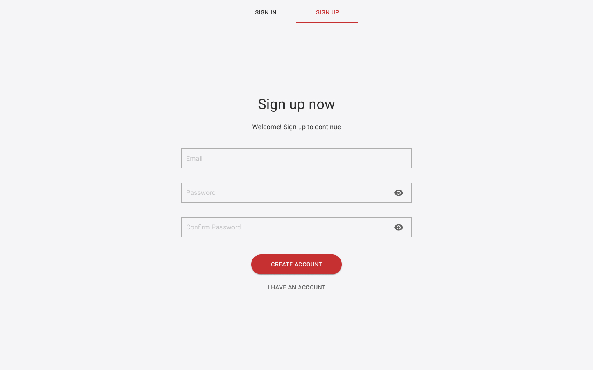

# Sign Up Page

## Purpose

Allows new users to create an account and access the CV Builder application.

The page should provide both client-side and server-side registration flow.

---

## Scope

This page is available to all unauthenticated users.

The page behavior and content are identical for all user types.

Authenticated users should not be able to access the Sign Up page and should be redirected to the appropriate authenticated application page.

---

## Behavior

The page allows users to:

- Create a new account
- Enter registration credentials
- Confirm password before account creation
- Show or hide password values
- Navigate to the Sign In page
- Proceed to the account verification page after successful registration
After successful registration:

- a new user must be created in the system
- the user's account must be marked as requiring email verification
- the user must be redirected to the account verification page
- the user must not receive access to protected application functionality until the required verification/authentication flow is completed

---

## Design Reference

Figma: CV Builder – [Sign Up](https://www.figma.com/design/m3zxmLv79A6MsHCuAIQAoo/CV-Builder?node-id=21482-6588&t=shHYMaieyngmRTaD-0)

---

## Layout

- Registration form must be centered on the page
- Supports Light and Dark themes
- Layout must be fully responsive on desktop and tablet devices
- Form elements must maintain consistent spacing and alignment
- The Sign Up tab must be active by default

---

## Content

### Authentication Tabs

Tabs:

- `SIGN IN`
- `SIGN UP`
Requirements:

- `SIGN UP` is selected by default
- Clicking `SIGN IN` navigates to the Sign In page
- Active tab must be visually distinguished
- Tabs must support:
  - default
  - hover
  - active states

---

### Welcome Message

Title:

`Sign up now`

Subtitle:

`Welcome! Sign up to continue`

Requirements:

- Must be centered above the registration form
- Text must remain readable across supported themes

---

### Email Field

Input field: `Email`

Requirements:

- Accepts email address input
- Supports:
  - default
  - hover
  - focus
  - error states
Validation:

- Field is required
- Value must be a valid email address
Example validation messages:

- `Email is required`
- `Please enter a valid email address`

---

### Password Field

Input field: `Password`

Requirements:

- Field is masked by default
- Includes password visibility toggle
- Supports:
  - default
  - hover
  - focus
  - error states
Validation:

- Field is required
- Password must contain at least 8 characters, with at least one letter and one digit (PLAN D33)
- Password must satisfy the password policy defined by the application
Example validation messages:

- `Password is required`
- `Password must be at least 8 characters long`
- `Password must contain at least one letter and one digit`

---

### Confirm Password Field

Input field: `Confirm Password`

Requirements:

- Field is masked by default
- Includes password visibility toggle
- Supports:
  - default
  - hover
  - focus
  - error states
Validation:

- Field is required
- Value must match the Password field
Example validation messages:

- `Confirm Password is required`
- `Passwords do not match`

---

### Primary Action

Button: `CREATE ACCOUNT`

Requirements:

- Submits registration request
- Sends registration data to the backend through the GraphQL API
- Supports:
  - default
  - hover
  - pressed
  - disabled states
  - loading state
While the registration request is being processed:

- the button must indicate a loading state
- duplicate registration requests must be prevented
- entered form values must be preserved
After successful registration:

- the user must be redirected to the account verification page

---

### Secondary Action

Button: `I HAVE AN ACCOUNT`

Requirements:

- Navigates user to the Sign In page
- Supports:
  - default
  - hover
  - focus
  - disabled states

---

# Registration API

The frontend must create the account through the backend GraphQL API.

The registration flow should include a GraphQL mutation for creating a user account.

The request should send the required registration data to the backend.

The backend should:

- validate the registration data
- validate the email format
- check whether the email is already registered
- validate the password according to the application password policy
- securely hash the password before storing it
- create the user in the database
- assign the appropriate default role
- initialize the user's email verification state
- trigger the required email verification flow
- return appropriate success or error information
The exact GraphQL schema and mutation structure should be defined by the team as part of the backend implementation.

---

## User Creation

When a registration request is successful:

- a new user record must be created in the database
- the user's email must be stored
- the password must never be stored in plain text
- the user must receive the default role defined by the application
- the user's email verification status must be initialized correctly
- the account must be associated with the appropriate default application state
The database must enforce email uniqueness to prevent duplicate accounts.

---

## Email Verification

After successful registration:

- the user must be redirected to the account verification page
- the backend must initiate the email verification flow
- the verification mechanism must use a secure verification process
- verification tokens or codes must have an appropriate expiration period
- verification data must not expose sensitive user information
The exact email delivery and verification implementation should be defined by the team.

---

## Validation & Error Handling

### Client-side validation

- Invalid input should be validated before sending the registration request
- Validation messages must be displayed inline when possible
- The registration request must not be sent when required fields are invalid

### Server-side validation

The backend must validate the registration request independently of the frontend.

Client-side validation must not be treated as a security mechanism.

The backend must validate:

- email format
- email uniqueness
- password requirements
- required fields
- password confirmation where applicable

### Duplicate Email

If an account with the provided email already exists, the application must display an appropriate error message.

Example:

`An account with this email already exists`

### Server Errors

Unexpected backend or network errors must display a user-friendly error message.

Example:

`Something went wrong. Please try again later`

Failed registration requests must not clear entered values.

---

## Loading & Network States

The page must handle:

- registration request in progress
- successful registration
- validation errors
- duplicate email
- network errors
- unexpected server errors
The user must receive appropriate visual feedback for each state.

---

## Security Requirements

- Passwords must never be stored in plain text
- Passwords must be securely hashed before being stored in the database
- Password values must not be logged by the frontend or backend
- Password values must not be included in error messages
- Registration credentials must be transmitted securely
- Verification tokens must be securely generated
- Verification tokens must expire
- Sensitive authentication information must not be exposed through GraphQL responses
- The backend must enforce authorization and account state independently of frontend restrictions

---

## Accessibility & Responsiveness

- Full keyboard navigation support is required
- Interactive elements must provide visible focus states
- Form fields must include accessible labels
- Text must remain readable in all supported themes
- Layout and controls must scale correctly across supported screen sizes
- Validation and registration errors must be accessible to assistive technologies

---

## Acceptance Criteria

| ID | Description |
|---|---|
| AC-1 | Sign Up page is accessible to unauthenticated users |
| AC-2 | Authenticated users cannot access the Sign Up page |
| AC-3 | Sign Up tab is active by default |
| AC-4 | Sign In tab navigates to the Sign In page |
| AC-5 | Email field accepts valid email addresses |
| AC-6 | Password must contain at least 8 characters, with at least one letter and one digit |
| AC-7 | Confirm Password must match Password |
| AC-8 | Password visibility toggle functions correctly |
| AC-9 | Validation messages are displayed for invalid input |
| AC-10 | Clicking `CREATE ACCOUNT` sends the registration request |
| AC-11 | Registration request is sent through the GraphQL API |
| AC-12 | Loading state is displayed while registration is in progress |
| AC-13 | Duplicate registration requests are prevented |
| AC-14 | Backend validates registration data independently of frontend validation |
| AC-15 | Email uniqueness is enforced by the backend and database |
| AC-16 | Password is securely hashed before being stored |
| AC-17 | Successful registration creates a new user in the database |
| AC-18 | A default user role is assigned to the newly created account |
| AC-19 | Newly created account is marked as requiring email verification |
| AC-20 | Successful registration initiates the email verification flow |
| AC-21 | Successful registration redirects the user to the verification page |
| AC-22 | Duplicate email displays an appropriate error message |
| AC-23 | Unexpected server errors display a user-friendly error message |
| AC-24 | Failed registration does not clear entered values |
| AC-25 | `I HAVE AN ACCOUNT` navigates to the Sign In page |
| AC-26 | Page supports Light and Dark themes |
| AC-27 | Page is responsive across supported devices |
| AC-28 | Page supports keyboard navigation and visible focus states |

