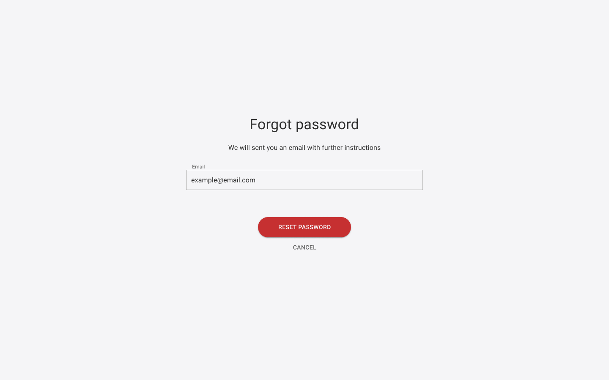

# Forgot Password Page

## Purpose

Allows users to initiate the password recovery process by requesting a password reset email.

The page should provide a secure password recovery flow through the backend GraphQL API.

---

## Scope

This page is available to all unauthenticated users.

The page behavior and content are identical for all user types.

Authenticated users should not normally need to access the password recovery flow.

---

## Behavior

The page allows users to:

- Enter the email address associated with their account
- Request a password reset email
- Return to the Sign In page
After submitting a valid password reset request:

- the backend should initiate the password recovery flow
- a password reset email should be sent when the account exists
- the user should be informed that further instructions have been sent
- the user should be able to proceed to the password reset flow using the received link or token
The application must not reveal whether the provided email address is registered in the system.

---

## Design Reference

Figma: CV Builder – [Forgot Password](https://www.figma.com/design/m3zxmLv79A6MsHCuAIQAoo/CV-Builder?node-id=21482-6626&t=shHYMaieyngmRTaD-0)

---

## Layout

- Password recovery form must be centered on the page
- Supports Light and Dark themes
- Layout must be fully responsive on desktop and tablet devices
- Form elements must maintain consistent spacing and alignment

---

## Content

### Page Header

Title:

`Forgot password`

Subtitle:

`We will send you an email with further instructions`

Requirements:

- Must be centered above the form
- Text must remain readable across supported themes

---

### Email Field

Input field: `Email`

Requirements:

- Accepts email address input
- Supports:
  - default
  - hover
  - focus
  - error states
Validation:

- Field is required
- Value must be a valid email address
Example validation messages:

- `Email is required`
- `Please enter a valid email address`

---

### Primary Action

Button: `RESET PASSWORD`

Requirements:

- Submits password reset request
- Sends the password recovery request to the backend through the GraphQL API
- Supports:
  - default
  - hover
  - pressed
  - disabled states
  - loading state
While the request is being processed:

- the button must indicate a loading state
- duplicate requests must be prevented
- the entered email value must be preserved
After the request is processed:

- the user should receive a confirmation message
- the confirmation message must not reveal whether an account exists for the provided email
Example:

`If an account with this email exists, you will receive password reset instructions.`

---

### Secondary Action

Button: `CANCEL`

Requirements:

- Navigates user back to the Sign In page
- Supports:
  - default
  - hover
  - focus
  - disabled states

---

# Password Reset API

The frontend must initiate the password recovery flow through the backend GraphQL API.

The API should provide a mutation for requesting a password reset.

The request should send the user's email address to the backend.

The backend should:

- validate the email address
- determine whether an account is associated with the email
- generate a secure, single-use password reset token or code when the account exists
- store the reset information securely
- assign an expiration time to the reset token or code
- send the password recovery email
- return a generic response that does not reveal whether the account exists
The exact GraphQL mutation and response structure should be defined by the team.

---

## Password Reset Token

When a password reset request is created for an existing account:

- the reset token or code must be generated securely
- it must be single-use
- it must have a limited expiration period
- it must not be reused after a successful password reset
- expired tokens must be rejected
- invalid tokens must be rejected
- reset tokens must not expose sensitive user information
The team should choose an appropriate strategy for securely storing reset credentials.

---

## Email Delivery

The backend should send a password reset email containing the information required to continue the password recovery flow.

The email should provide:

- clear instructions
- a link or token required to reset the password
- information about the expiration of the reset request where appropriate
The reset link should lead the user to the `Reset Password` page.

The email delivery mechanism should be implemented or integrated as part of the backend.

---

## Validation & Error Handling

### Client-side validation

- Invalid input should be validated before sending the request
- Validation messages must be displayed inline when possible
- The request must not be sent when required fields are invalid

### Server-side validation

The backend must validate the request independently of frontend validation.

Client-side validation must not be treated as a security mechanism.

### Account Enumeration Protection

The application must not reveal whether the submitted email address belongs to an existing account.

For both existing and non-existing email addresses, the user should receive a generic response.

Example:

`If an account with this email exists, you will receive password reset instructions.`

The API should avoid returning different user-facing responses based solely on whether the email exists.

### Server Errors

Unexpected backend or network errors must display a user-friendly error message.

Example:

`Something went wrong. Please try again later`

Failed requests must not clear the entered email address.

---

## Loading & Network States

The page must handle:

- password reset request in progress
- successful request processing
- validation errors
- network errors
- unexpected server errors
- rate limit responses
The user must receive appropriate visual feedback for each state.

---

## Security Requirements

- Password reset tokens must be cryptographically secure
- Reset tokens must expire
- Reset tokens must be single-use
- Reset tokens must not contain sensitive user information
- Password reset tokens must not be logged
- Password reset requests should be rate-limited to prevent abuse
- The API must not reveal whether an email address is registered
- Password reset credentials must be transmitted securely
- Password reset operations must be performed by the backend
- The old password must remain unchanged until a valid reset flow is completed

---

## Accessibility & Responsiveness

- Full keyboard navigation support is required
- Interactive elements must provide visible focus states
- Form fields must include accessible labels
- Text must remain readable in all supported themes
- Layout and controls must scale correctly across supported screen sizes
- Validation and error messages must be accessible to assistive technologies

---

## Acceptance Criteria

| ID | Description |
|---|---|
| AC-1 | Forgot Password page is accessible to unauthenticated users |
| AC-2 | Page displays the title and instructional text |
| AC-3 | Email field accepts valid email addresses |
| AC-4 | Email field validation is displayed for invalid input |
| AC-5 | Clicking `RESET PASSWORD` sends the password reset request through the GraphQL API |
| AC-6 | Loading state is displayed while the request is being processed |
| AC-7 | Duplicate password reset requests are prevented while the current request is processing |
| AC-8 | Backend validates the request independently of frontend validation |
| AC-9 | A secure password reset token or code is generated for an existing account |
| AC-10 | Password reset token or code has an expiration time |
| AC-11 | Password reset token or code is single-use |
| AC-12 | Password reset instructions are sent to the user's email when an account exists |
| AC-13 | The reset email contains the information required to continue the password recovery flow |
| AC-14 | Reset link or token leads to the Reset Password page |
| AC-15 | The API does not reveal whether an email address is registered |
| AC-16 | Existing and non-existing email addresses receive the same user-facing confirmation |
| AC-17 | Rate limiting or equivalent protection is applied to password reset requests |
| AC-18 | Unexpected server errors display a user-friendly error message |
| AC-19 | Failed requests do not clear the entered email |
| AC-20 | Clicking `CANCEL` navigates to the Sign In page |
| AC-21 | Page supports Light and Dark themes |
| AC-22 | Page is responsive across supported devices |
| AC-23 | Page supports keyboard navigation and visible focus states |

