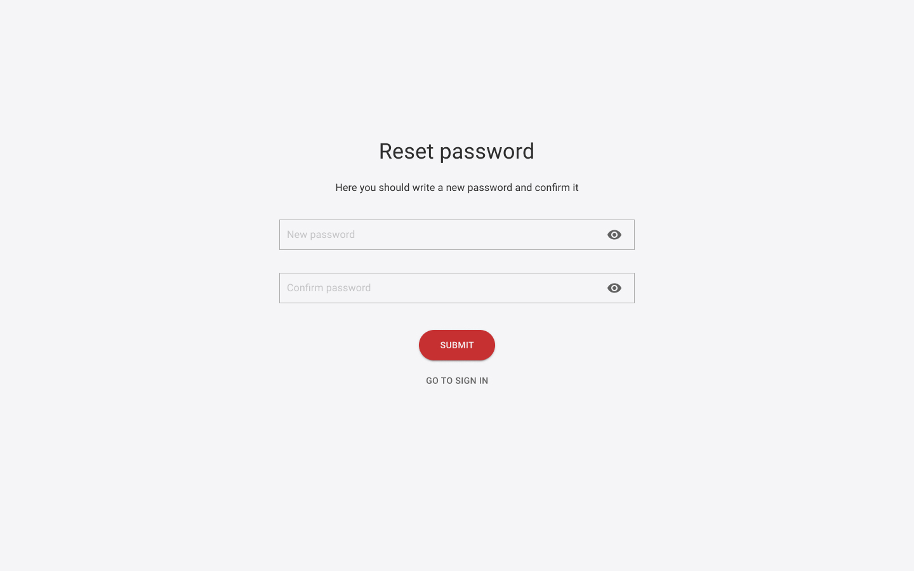

# Reset Password Page

## Purpose

Allows users to create a new password after initiating the password recovery process.

The page completes the password reset flow using a secure password reset token or code provided by the backend.

---

## Scope

This page is available to users who have successfully accessed the password reset flow.

The page behavior and content are identical for all user types.

The page must only allow password changes when a valid and non-expired password reset credential is provided.

---

## Behavior

The page allows users to:

- Enter a new password
- Confirm the new password
- Show or hide password values
- Submit the new password
- Complete the password recovery flow
- Navigate to the Sign In page
The password reset flow should use the reset token or code obtained from the password recovery email.

The reset credential must be validated by the backend before the password can be changed.

After a successful password reset:

- the user's password must be updated
- the reset credential must become invalid
- the user should be informed that the password was successfully changed
- the user should be redirected according to the application's authentication strategy

---

## Design Reference

Figma: CV Builder – [Reset Password](https://www.figma.com/design/m3zxmLv79A6MsHCuAIQAoo/CV-Builder?node-id=21482-6665&t=shHYMaieyngmRTaD-0)

---

## Layout

- Password reset form must be centered on the page
- Supports Light and Dark themes
- Layout must be fully responsive on desktop and tablet devices
- Form elements must maintain consistent spacing and alignment

---

## Content

### Page Header

Title:

`Reset password`

Subtitle:

`Here you should write a new password and confirm it`

Requirements:

- Must be centered above the form
- Text must remain readable across supported themes

---

### New Password Field

Input field: `New Password`

Requirements:

- Field is masked by default
- Includes password visibility toggle
- Supports:
  - default
  - hover
  - focus
  - error states
Validation:

- Field is required
- Password must contain 8 to 128 characters, with at least one letter and one digit
- Password must satisfy the password policy defined by the application
Example validation messages:

- `Password is required`
- `Password must be 8 to 128 characters long and contain a letter and a digit`

---

### Confirm Password Field

Input field: `Confirm Password`

Requirements:

- Field is masked by default
- Includes password visibility toggle
- Supports:
  - default
  - hover
  - focus
  - error states
Validation:

- Field is required
- Value must match the New Password field
Example validation messages:

- `Confirm Password is required`
- `Passwords do not match`

---

### Primary Action

Button: `SUBMIT`

Requirements:

- Completes the password reset request
- Sends the new password and reset credential to the backend through the GraphQL API
- Updates the user's password after successful backend validation
- Supports:
  - default
  - hover
  - pressed
  - disabled states
  - loading state
While the request is being processed:

- the button must indicate a loading state
- duplicate password reset requests must be prevented
- entered values must be preserved
After a successful password reset:

- the user must be informed that the password was successfully changed
- the reset credential must become invalid
- the user should be redirected according to the application's authentication strategy

---

### Secondary Action

Button: `GO TO SIGN IN`

Requirements:

- Navigates user to the Sign In page
- Supports:
  - default
  - hover
  - focus states
  - disabled states

---

# Password Reset API

The frontend must complete the password reset flow through the backend GraphQL API.

The API should provide a mutation for resetting the user's password.

The request should contain:

- the password reset token or code
- the new password
The backend must:

- validate the reset credential
- verify that it exists
- verify that it has not expired
- verify that it has not already been used
- identify the associated user
- validate the new password according to the application password policy
- securely hash the new password
- update the user's password
- invalidate the reset credential
- return an appropriate success or error response
The exact GraphQL mutation and response structure should be defined by the team.

---

## Reset Credential Validation

The password reset credential must be validated on the backend.

The backend must reject:

- missing reset credentials
- invalid reset credentials
- expired reset credentials
- already-used reset credentials
The frontend must not determine whether a reset credential is valid by itself.

The reset credential should not expose sensitive user information.

---

## Password Update

After successful validation of the reset credential:

- the new password must be securely hashed before being stored
- the previous password must no longer be valid
- the plain-text password must never be stored
- the plain-text password must not be logged
- the password reset credential must be invalidated after successful use
The password update and reset credential invalidation should be handled as one consistent backend operation.

---

## Authentication After Password Reset

The application should follow the authentication strategy defined by the backend architecture after a successful password reset.

If automatic authentication is implemented:

- the backend must establish a valid authenticated session
- the frontend must update its authentication state
- the user must be redirected to the appropriate authenticated area
If automatic authentication is not implemented:

- the user must be redirected to the Sign In page
- the user should receive a confirmation that the password was successfully changed
The team should document the selected authentication behavior as part of the application architecture.

---

## Existing Sessions

The backend should define how existing authenticated sessions are handled after a password reset.

The selected strategy should prevent previously issued authentication credentials from providing unintended access after a password change where required by the application's security model.

The team should document this behavior as part of the authentication architecture.

---

## Validation & Error Handling

### Client-side validation

- Invalid input should be validated before sending the request
- Validation messages must be displayed inline when possible
- The request must not be sent when required fields are invalid

### Server-side validation

The backend must validate the password reset request independently of frontend validation.

Client-side validation must not be treated as a security mechanism.

### Invalid Reset Credential

Invalid or expired reset credentials must display a user-friendly error message.

Examples:

- `This password reset link is invalid`
- `This password reset link has expired`
The application must not expose sensitive information about the associated account.

### Server Errors

Unexpected backend or network errors must display a user-friendly error message.

Example:

`Something went wrong. Please try again later`

Failed requests must not clear the entered password values.

---

## Loading & Network States

The page must handle:

- password reset request in progress
- successful password reset
- invalid reset credential
- expired reset credential
- password validation errors
- network errors
- unexpected server errors
The user must receive appropriate visual feedback for each state.

---

## Security Requirements

- Password reset credentials must be validated on the backend
- Reset credentials must be single-use
- Reset credentials must expire
- Reset credentials must not expose sensitive user information
- New passwords must be securely hashed before being stored
- Passwords must never be stored in plain text
- Password values must not be logged
- Reset credentials must not be logged
- Password reset operations must be performed by the backend
- The backend must enforce the password reset flow independently of frontend restrictions
- Previously issued authentication credentials must be handled according to the application's password-change security strategy

---

## Accessibility & Responsiveness

- Full keyboard navigation support is required
- Interactive elements must provide visible focus states
- Form fields must include accessible labels
- Text must remain readable in all supported themes
- Layout and controls must scale correctly across supported screen sizes
- Validation and error messages must be accessible to assistive technologies

---

## Acceptance Criteria

| ID | Description |
|---|---|
| AC-1 | Reset Password page is accessible through the password recovery flow |
| AC-2 | Page displays the title and instructional text |
| AC-3 | New Password field is masked by default |
| AC-4 | Confirm Password field is masked by default |
| AC-5 | Password must contain 8 to 128 characters, with at least one letter and one digit (same rule as the server) |
| AC-6 | Confirm Password must match New Password |
| AC-7 | Password visibility toggle functions correctly |
| AC-8 | Validation messages are displayed for invalid input |
| AC-9 | Clicking `SUBMIT` sends the password reset request through the GraphQL API |
| AC-10 | Loading state is displayed while the request is being processed |
| AC-11 | Duplicate password reset requests are prevented while the request is processing |
| AC-12 | Backend validates the reset credential independently of frontend validation |
| AC-13 | Invalid reset credentials are rejected |
| AC-14 | Expired reset credentials are rejected |
| AC-15 | Already-used reset credentials are rejected |
| AC-16 | Successful password reset securely updates the user's password |
| AC-17 | The new password is securely hashed before being stored |
| AC-18 | The reset credential becomes invalid after successful password reset |
| AC-19 | The previous password can no longer be used after a successful password reset |
| AC-20 | Successful password reset follows the authentication strategy defined by the application |
| AC-21 | If automatic authentication is implemented, the user is authenticated after successful password reset |
| AC-22 | If automatic authentication is not implemented, the user is redirected to the Sign In page |
| AC-23 | Appropriate error messages are displayed for invalid or expired reset credentials |
| AC-24 | Unexpected server errors display a user-friendly error message |
| AC-25 | Failed requests do not clear entered password values |
| AC-26 | Clicking `GO TO SIGN IN` navigates to the Sign In page |
| AC-27 | Page supports Light and Dark themes |
| AC-28 | Page is responsive across supported devices |
| AC-29 | Page supports keyboard navigation and visible focus states |

