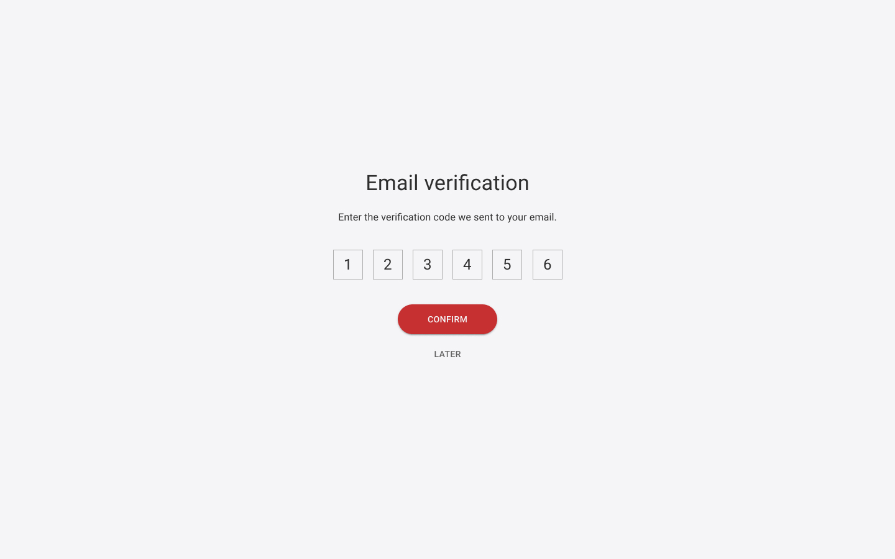

# Verification Page

## Purpose

Allows users to verify their email address using a one-time verification code sent to their email.

The verification flow must be handled by both the frontend and backend. The frontend is responsible for collecting and displaying the verification code, while the backend validates the code, verifies email ownership, updates the user's verification status, and enforces expiration and single-use rules.

---

## Scope

This page is available to users who have successfully completed the account registration process and have not yet verified their email address.

The page behavior and content are identical for all user types.

Authenticated or already verified users must not be able to use the verification flow for an already verified email address.

---

## Behavior

The page allows users to:

- Enter a verification code received by email
- Confirm email ownership
- Complete the account verification process
- Continue to the application without completing verification
- Automatically update the account verification status after successful verification
The verification status must be stored on the backend and associated with the corresponding user account.

If the user chooses `LATER`, the user may continue to the application according to the application's authentication and authorization rules. Access to functionality that requires a verified email must remain restricted until verification is completed.

---

## Design Reference

Figma: CV Builder – [Email Verification](https://www.figma.com/design/m3zxmLv79A6MsHCuAIQAoo/CV-Builder?node-id=21513-263&t=iySRJkYK6txkSEzy-0)

---

## Layout

- Verification form must be centered on the page
- Supports Light and Dark themes
- Layout must be fully responsive on desktop and tablet devices
- Form elements must maintain consistent spacing and alignment

---

## Content

### Page Header

Title:

`Email verification`

Subtitle:

`Enter the verification code we sent to your email.`

Requirements:

- Must be centered above the form
- Text must remain readable across supported themes

---

### Verification Code Field

Input: `OTP Code`

Requirements:

- Accepts a 6-digit numeric verification code
- Supports OTP-style input fields
- Automatically moves focus to the next input when a digit is entered
- Supports pasting a complete 6-digit code
- Supports:
  - default
  - focus
  - error states
- The frontend must not be responsible for determining whether the code is valid or expired
- Verification validity must always be determined by the backend
Validation:

- Verification code is required
- Verification code must contain exactly 6 digits
- Verification code is valid for 10 minutes
- Verification code can be used only once
Example validation messages:

- `Verification code is required`
- `Please enter a valid 6-digit code`
- `Verification code has expired`
- `Invalid verification code`
- `Verification code has already been used`

---

## Verification API

Email verification must be implemented through a GraphQL mutation.

The verification request should contain the verification credential and the information required to identify the verification attempt according to the backend authentication architecture.

The backend must:

1. Validate the verification request
1. Locate the corresponding user/account
1. Validate that the verification code exists
1. Validate that the code has not expired
1. Validate that the code has not already been used
1. Confirm ownership of the email address
1. Update the user's email verification status
1. Invalidate the verification code
1. Return the result of the verification operation
The frontend must handle the GraphQL response and display the appropriate success or error state.

---

## Verification Code

Verification codes must be generated and managed by the backend.

Requirements:

- Code must be generated using a secure mechanism
- Code must contain exactly 6 digits
- Code expires after 10 minutes
- Code must be single-use
- Used or expired codes must be rejected
- Verification codes must not be exposed in application logs
- The backend must prevent verification using an invalid or expired code
The exact storage and generation implementation is defined by the backend architecture.

---

## Account Verification

After successful verification:

- The user's email must be marked as verified in the database
- The verification code must become invalid immediately
- The account must transition to the verified state
- Protected functionality requiring email verification becomes available
- The user is redirected to the application
The frontend must not determine or persist the verification status independently of the backend.

---

## Resend Verification Code

The page should provide a way to request a new verification code.

Requirements:

- User can request a new verification code
- A new code invalidates the previous verification code
- A new code has its own expiration period
- The user receives the new code by email
- The request must be performed through a GraphQL mutation
- The UI must provide loading and success/error states
- Repeated requests must be rate-limited by the backend
Example UI messages:

`Verification code sent`

`Please wait before requesting another code`

`Something went wrong. Please try again later`

The exact cooldown period and rate-limiting strategy are defined by the backend implementation.

---

## Primary Action

Button: `CONFIRM`

Requirements:

- Submits the verification request through GraphQL
- Shows a loading state while the request is being processed
- Prevents duplicate submissions
- Verifies the user's email address through the backend
- Activates the verified account state after successful verification
- Redirects the user to the application after successful verification
- Supports:
  - default
  - hover
  - pressed
  - disabled
  - loading states

---

## Secondary Action

Button: `LATER`

Requirements:

- Navigates the user to the application's main page
- Does not complete email verification
- Does not change the user's verification status
- Must not bypass backend authorization rules
- Functionality that requires a verified email remains unavailable until verification
- Supports:
  - default
  - hover
  - focus states

---

## Validation & Error Handling

Validation must be implemented on both frontend and backend.

### Client-side validation

The frontend should validate:

- Code is provided
- Code contains exactly 6 digits
Client-side validation is intended for user experience and must not replace server-side validation.

### Server-side validation

The backend must validate:

- Verification request
- Code format
- Code existence
- Code expiration
- Code single-use status
- Corresponding user/account
- Current email verification status
The frontend must correctly handle backend validation errors.

Requirements:

- Validation messages must be displayed inline when possible
- Failed verification attempts must not unnecessarily clear entered values
- Expired verification codes must display an appropriate error
- Invalid verification codes must display an appropriate error
- Already-used codes must be rejected
- Server errors must display a user-friendly error message
- Sensitive backend information must not be exposed to the user
Example error messages:

- `Invalid verification code`
- `Verification code has expired`
- `Verification code has already been used`
- `Email is already verified`
- `Something went wrong. Please try again later`

---

## Loading & Network States

The page must handle asynchronous verification states.

Requirements:

- `CONFIRM` shows a loading state while verification is in progress
- Duplicate verification requests are prevented
- Resend action shows a loading state
- Temporary network failures are handled gracefully
- User-entered code is preserved when a request fails
- Successful verification disables further verification attempts before redirecting

---

## Security

The verification flow must follow the backend security requirements.

Requirements:

- Verification codes must be generated securely
- Codes must expire after 10 minutes
- Codes must be single-use
- Used codes must be invalidated
- Verification codes must not be logged
- Verification operations must be performed on the backend
- Rate limiting must be applied to verification and resend operations
- Sensitive verification information must not be returned unnecessarily by the API
- The backend must enforce the user's verification status for protected operations
- The frontend must not be treated as a trusted source for verification status

---

## Accessibility & Responsiveness

- Full keyboard navigation support is required
- Interactive elements must provide visible focus states
- OTP inputs must be keyboard accessible
- OTP input must support pasting a complete code
- Text must remain readable in all supported themes
- Layout and controls must scale correctly across supported screen sizes
- Appropriate labels and accessible names must be provided for OTP inputs and actions

---

## Acceptance Criteria

| ID | Description |
|---|---|
| AC-1 | Email Verification page is accessible after successful registration |
| AC-2 | Page displays title and instructional text |
| AC-3 | OTP input accepts a 6-digit verification code |
| AC-4 | Verification code is valid for 10 minutes |
| AC-5 | OTP input supports entering and pasting a complete code |
| AC-6 | Verification code is validated by the backend |
| AC-7 | Expired verification codes are rejected |
| AC-8 | Already-used verification codes are rejected |
| AC-9 | Clicking `CONFIRM` sends the verification request through GraphQL |
| AC-10 | Verification request displays a loading state |
| AC-11 | Duplicate verification requests are prevented |
| AC-12 | Successful verification updates the user's verification status |
| AC-13 | Successful verification invalidates the verification code |
| AC-14 | Successful verification redirects the user to the application |
| AC-15 | Clicking `LATER` navigates the user to the application's main page without verifying the email |
| AC-16 | Unverified users cannot access functionality that requires email verification |
| AC-17 | User can request a new verification code |
| AC-18 | Resend verification requests are rate-limited |
| AC-19 | A newly generated verification code invalidates the previous code |
| AC-20 | User-friendly error messages are displayed when verification fails |
| AC-21 | Failed requests do not unnecessarily clear the entered code |
| AC-22 | Page supports Light and Dark themes |
| AC-23 | Page is responsive across supported devices |
| AC-24 | Page supports keyboard navigation and visible focus states |

