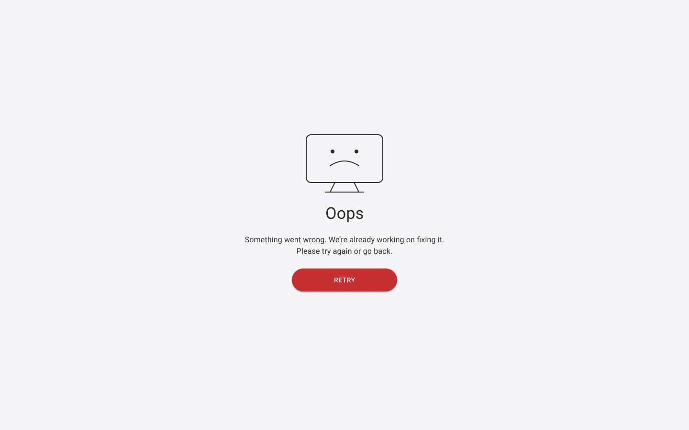

# No Internet Page

## Purpose

Displayed when the application cannot load content due to missing network connection or request failure.

---

## Scope

This page applies to both **Admin and User roles**.

There are no role-based differences in layout, content, or behavior.

---

## Behavior

Page is shown when:

- Network request fails due to connection issues
- No internet connection is detected
- Content cannot be loaded from server

---

## Design Reference

Figma: CV Builder – [No Internet Error](https://www.figma.com/design/m3zxmLv79A6MsHCuAIQAoo/CV-Builder?node-id=21482-1570&t=bVJj7VwkbTDpGdCV-0)

---

## Content

### Error Icon

- Display a product-consistent illustration indicating connection or loading failure

### Message

`Oops! Something went wrong. We're already working on fixing it. Please try again.`

- Must be concise and user-friendly
- Center-aligned
- Key phrase may be visually emphasized

### Primary Action

Button: `RETRY`

- Reloads the failed request
- Must have default / hover / pressed states

---

## Accessibility & Responsiveness

- Text must remain readable in both themes
- Keyboard navigation must be supported
- Interactive elements must provide clear visual feedback
- Layout must remain centered and proportional on all screen sizes

---

## Acceptance Criteria

| ID | Description |
|---|---|
| AC-1 | Page is shown on network failure or no internet connection |
| AC-2 | Page contains an error icon |
| AC-3 | Displays retry message and `RETRY` button |
| AC-4 | Retry triggers content reload |
| AC-5 | Supports Light/Dark themes |
| AC-6 | Fully responsive across devices |
| AC-7 | Content is centered |

