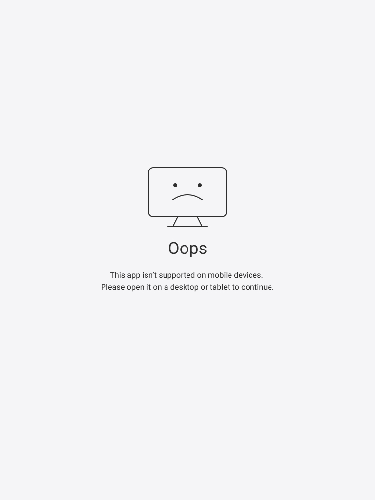

# Device Error Page

## Purpose

Displayed when the application is opened on devices with a screen width smaller than `768px`.

---

## Scope

This page applies to both **Admin and User roles**.

There are no role-based differences in layout, content, or behavior.

---

## Behavior

Page is shown when:

- Device screen width is smaller than `768px`
- Application is opened on unsupported mobile devices
- Viewport width becomes smaller than `768px` after resizing

---

## Design Reference

Figma: CV Builder – Mobile Unsupported

---

## Content

### Error Icon

- Display a product-consistent illustration indicating unsupported mobile usage

### Message

`This app isn’t supported on mobile devices. Please open it on a desktop or tablet to continue.`

- Must be concise and user-friendly
- Center-aligned
- Key phrase may be visually emphasized

---

## Accessibility & Responsiveness

- Text must remain readable in both themes
- Keyboard navigation must be supported
- Interactive elements must provide clear visual feedback
- Layout must remain centered and proportional on supported screen sizes

---

## Acceptance Criteria

| ID | Description |
|---|---|
| AC-1 | Page is shown when viewport width is smaller than `768px` |
| AC-2 | Page contains an informational icon |
| AC-3 | Page displays unsupported device message |
| AC-4 | Supports Light/Dark themes |
| AC-5 | Content is centered |

