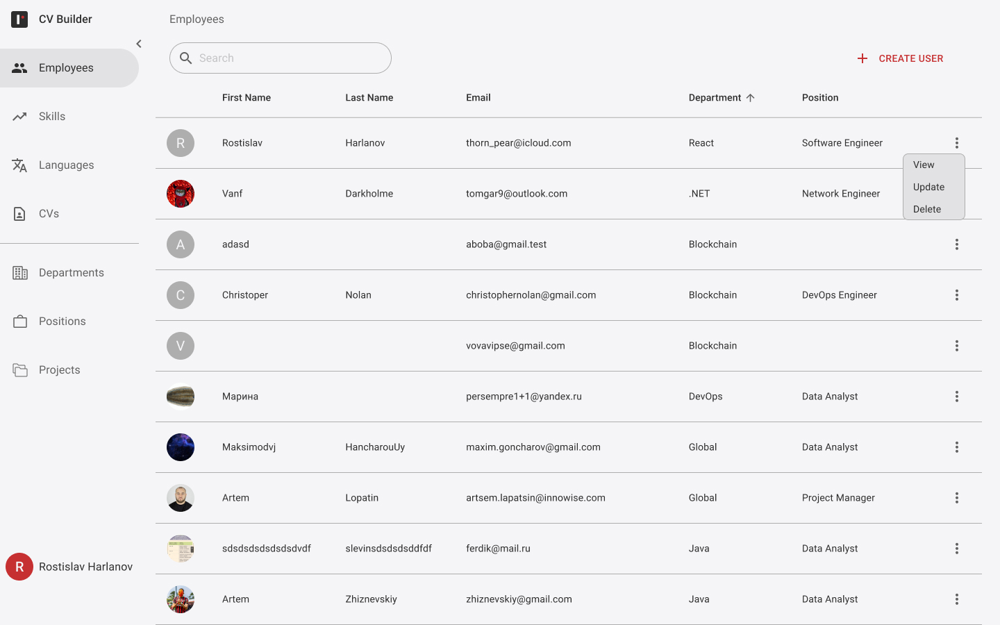

# Users Page

## Purpose

Allows users to view employee information within the organization.

The page behavior differs depending on the user's role.

### Employee

Can:

- View employees list
- Search employees
- Sort employees
- Navigate through paginated results
- Open employee details

### Admin

Can:

- View employees list
- Search employees
- Sort employees
- Navigate through paginated results
- Create users
- Update users
- Delete users
- Open employee details
All permissions must be enforced by the backend. Frontend role-based UI restrictions must not be considered a security mechanism.

---

## Scope

This page is available for both **Admin** and **Employee** roles.

Role-based permissions apply.

### Employee permissions

Employees can:

- Read the employees list
- Search employees
- Sort employees
- Navigate through pagination
- View employee details
Employees cannot:

- Create users
- Update users
- Delete users

### Admin permissions

Admins can:

- Read the employees list
- Search employees
- Sort employees
- Navigate through pagination
- View employee details
- Create users
- Update users
- Delete users
The backend must validate the authenticated user's permissions for every protected operation.

---

## Behavior

The page allows users to:

- View a paginated list of employees
- Search employees
- Sort employees
- Open employee profiles
Additionally, Admin users can:

- Create new users
- Edit existing users
- Delete users
All user data must be loaded from the backend.

The frontend must not use hardcoded employee data as the source of truth.

---

## Design Reference

Figma: CV Builder – [Users](https://www.figma.com/design/m3zxmLv79A6MsHCuAIQAoo/CV-Builder?node-id=21482-6755&t=iySRJkYK6txkSEzy-0)

---

## Layout

- Page must follow the standard application layout structure
- Sidebar navigation remains visible and accessible
- Users content is displayed in the main content area
- Layout must be fully responsive across desktop and tablet devices
- Supports Light and Dark themes

---

## Navigation

### Sidebar

The page is available through:

- `Employees`
Requirements:

- Navigation item is visible for both Admin and Employee roles
- Active navigation item must be visually highlighted
- Navigation state must persist during page refresh
- Access to the page must be protected by authentication
- Backend authorization rules must determine which operations the current user can perform

---

## GraphQL Integration

All user data operations must be performed through GraphQL.

The frontend must communicate with the backend using GraphQL queries and mutations.

### Required operations

The implementation should provide operations for:

- Fetching users
- Searching users
- Sorting users
- Paginating users
- Creating a user
- Updating a user
- Deleting a user
The exact GraphQL schema and naming conventions are defined by the backend implementation.

The frontend must correctly handle:

- Successful responses
- Validation errors
- Authorization errors
- Not-found errors
- Conflict errors
- Network errors
- Unexpected server errors

---

## Users Query

The users list must be requested from the backend.

The request should support:

- Pagination
- Search
- Sorting
Search, sorting, and pagination must be applied on the backend.

The frontend must not be required to load the entire users dataset before applying these operations.

The API response should provide enough information for the frontend to render:

- Current page
- Page size
- Users for the current page
- Total number of matching users
- Pagination information required by the UI

---

## Content

### Page Header

The page contains:

- Back navigation button
- Page title: `Employees`
- Search field
Additionally, for Admin users:

- `CREATE USER` button

---

## Search

Search field placeholder:

`Search`

Requirements:

- Filters employees by:
  - First Name
  - Last Name
  - Email
- Search is case-insensitive
- Search is performed through the backend
- Search updates results without a full page reload
- Empty search displays all employees
- Search works together with sorting and pagination
The frontend may debounce search requests to avoid unnecessary API calls.

When the search criteria changes, pagination should be reset to the first page.

---

## Create User Action (Admin Only)

Button:

`CREATE USER`

Requirements:

- Visible only for Admin users
- Opens Create User modal
- Supports:
  - default
  - hover
  - pressed
  - disabled states
The backend must independently verify that the current user has permission to create users.

A user must not be able to create another user by directly calling the GraphQL API without the required permission.

---

## Users Table

The table displays the following columns:

| Column | Description |
|---|---|
| Avatar | User avatar or initials |
| First Name | User first name |
| Last Name | User last name |
| Email | User email |
| Department | Assigned department |
| Position | Assigned position |

Requirements:

- Data is loaded from the backend
- Supports sorting
- Supports pagination
- Supports empty state
- Supports loading state
- Supports error state
- Table reflects the current backend data

---

## Sorting

Supports sorting by:

- First Name
- Last Name
- Department
- Position
Requirements:

- Sorting is performed by the backend
- Sort direction must be supported where applicable
- Sorting works together with search and pagination
- Changing sorting resets pagination to the first page
- The current sorting state is visually indicated
The backend must validate the requested sort field rather than accepting arbitrary database fields from the client.

---

## User Actions

### Employee Role

Each row contains:

- Navigation icon
Requirements:

- Clicking the icon opens User Details page
- No edit or delete actions are available
- Backend must prevent Employee users from performing update/delete operations even if such requests are manually sent

---

### Admin Role

Each row contains a three-dot action menu.

Clicking the menu opens:

- `View`
- `Update`
- `Delete`
Requirements:

- Menu opens near the selected row
- Only one menu may be open at a time
- Menu closes when:
  - clicking outside
  - selecting an action
  - pressing Escape
The availability of actions in the UI must correspond to the current user's permissions, but backend authorization remains the final security boundary.

---

## View User

### Trigger

Available for:

- Employee role
- Admin role
Opened from:

- Navigation arrow
- View action
Requirements:

- Opens User Details page
- Displays full user information available to the current role
- User data is loaded from the backend
- User details must not expose sensitive information such as password hashes or authentication credentials

---

# Create User Modal

## Trigger

Opened from:

`CREATE USER`

---

## Content

Title:

`Create user`

Fields:

### Email

Input field:

`Email`

Requirements:

- Required field
- Must contain a valid email address
- Email must be unique
- Uniqueness must be checked by the backend
- Database must enforce email uniqueness

---

### Password

Input field:

`Password`

Requirements:

- Required field
- Masked by default
- Includes visibility toggle
- Minimum length: 6 characters
Security requirements:

- Password must be transmitted securely
- Password must be hashed by the backend before being stored
- Password must never be stored in plaintext
- Password hash must never be returned to the frontend
- Password must not be logged

---

### First Name

Input field:

`First Name`

Requirements:

- Required field

---

### Last Name

Input field:

`Last Name`

Requirements:

- Required field

---

### Department

Select field:

`Department`

Requirements:

- Required field
- Displays available departments
- Available departments must be loaded from the backend or another defined source of truth

---

### Position

Select field:

`Position`

Requirements:

- Required field
- Displays available positions
- Available positions must be loaded from the backend or another defined source of truth

---

### Role

Select field:

`Role`

Available values:

- `Admin`
- `Employee`
Requirements:

- Required field
- Backend must validate that the requested role is supported
- Only users with the required permission can assign the Admin role

---

## Validation

Validation must be implemented on both frontend and backend.

### Client-side validation

Rules:

- Email is required
- Email must be valid
- Password is required
- Password must contain at least 6 characters
- First Name is required
- Last Name is required
- Department is required
- Position is required
- Role is required
Example messages:

- `Email is required`
- `Invalid email address`
- `Password is required`
- `Password must contain at least 6 characters`
- `First name is required`
- `Last name is required`
- `Department is required`
- `Position is required`
- `Role is required`
Client-side validation is intended for user experience and must not replace server-side validation.

### Backend validation

The backend must independently validate:

- Required fields
- Email format
- Email uniqueness
- Password policy
- First Name
- Last Name
- Department
- Position
- Role
- Current user's authorization

---

## Actions

Buttons:

- `CANCEL`
- `CREATE`
Requirements:

- CREATE remains disabled until all required fields are valid
- Clicking CREATE sends a GraphQL mutation
- Loading state is displayed during creation
- Duplicate submissions are prevented
- Successful creation adds the new user to the table
- Modal closes after successful creation
- Failed requests keep the entered values
- Backend errors are displayed in a user-friendly way
The newly created user must be persisted in the database.

---

# Update User Modal

## Trigger

Opened from:

`Update`

---

## Content

Title:

`Update user`

Fields:

- Email
- Password
- First Name
- Last Name
- Department
- Position
- Role
Requirements:

- Existing values are loaded from the backend
- Email field is disabled
- Password field is disabled
- Department can be changed
- Position can be changed
- Role can be changed
The password must not be loaded from the backend.

If password changes are required in the future, they should be implemented through a dedicated password-change/reset flow rather than returning or editing the existing password through this form.

---

## Validation

Validation rules are identical to Create User except disabled fields are excluded from validation.

The backend must independently validate all mutable fields and the current user's permissions.

---

## Actions

Buttons:

- `CANCEL`
- `SAVE`
Requirements:

- SAVE sends a GraphQL mutation
- Loading state is displayed during update
- Duplicate submissions are prevented
- SAVE updates the selected user
- Modal closes after successful update
- Updated data appears in the table after successful backend response
- Failed requests do not clear entered values
- Backend errors are displayed in a user-friendly way
The updated user must be persisted in the database.

---

# Delete User Modal

## Trigger

Opened from:

`Delete`

---

## Content

Title:

`Delete user`

Message:

`Are you sure you want to delete user {firstName} {lastName}?`

Where:

- `{firstName}` = selected user's first name
- `{lastName}` = selected user's last name

---

## Actions

Buttons:

- `CANCEL`
- `CONFIRM`
Requirements:

- CANCEL closes the modal without changes
- CONFIRM sends a GraphQL mutation
- Loading state is displayed while deletion is in progress
- Duplicate deletion requests are prevented
- Backend verifies that the current user has permission to delete the selected user
- Deleted user is removed from the table after successful backend response
- Modal closes after successful deletion
The deletion must be persisted in the database.

The implementation must define how attempts to delete protected users are handled.

For example, the backend may prevent:

- Deleting the currently authenticated Admin
- Deleting the last remaining Admin
- Deleting a protected/system account
The exact business rules should be defined by the team.

---

# Pagination

Requirements:

- Available when results exceed page size
- Pagination is performed by the backend
- Allows navigation between pages
- Current page must be visually highlighted
- Search and sorting must work together with pagination
- Changing search or sorting resets pagination to the first page
- Pagination state is synchronized with the current query
- Empty pages are handled correctly if data changes between requests

---

# States

## Loading State

Displayed while users are being loaded.

Requirements:

- Table structure remains visible
- Loading indicator is displayed
- User actions are appropriately disabled while required data is loading
- Initial loading and subsequent list updates are handled consistently

---

## Empty State

Displayed when:

- No users exist
- Search returns no results
Example message:

`No users found`

The UI should distinguish between an empty dataset and a failed request.

---

## Error State

Displayed when data cannot be loaded.

Requirements:

- Error message is shown
- Retry action is available
- Retry repeats the failed GraphQL request
- Existing search/sorting/pagination state is preserved where possible

---

# Validation & Error Handling

The frontend must handle errors returned by the GraphQL API.

### Create errors

Examples:

- Invalid input
- Email already exists
- Unauthorized
- Forbidden
- Server error
- Network error

### Update errors

Examples:

- Invalid input
- User not found
- Unauthorized
- Forbidden
- Server error
- Network error

### Delete errors

Examples:

- User not found
- Unauthorized
- Forbidden
- User cannot be deleted
- Server error
- Network error
Requirements:

- Validation errors must be displayed inline where applicable
- System errors must be displayed in a user-friendly way
- Failed requests must not clear entered values
- Successful operations must update the UI only after the backend confirms the operation
- The frontend must not assume that an operation succeeded before receiving a successful backend response
- Authorization errors must not be presented as generic validation errors

---

# Authorization & Security

Role-based access control must be enforced on the backend.

Requirements:

- Unauthenticated users cannot access the page
- Employee users can only perform allowed read operations
- Employee users cannot create users
- Employee users cannot update users
- Employee users cannot delete users
- Admin permissions are checked on the backend
- GraphQL mutations must perform authorization checks
- Sensitive user information must not be returned unnecessarily
- Passwords must never be returned by user queries
- Password hashes must never be exposed to the frontend
- Passwords must never be logged
- User data must be validated on the server
Frontend visibility of buttons and menus is not considered sufficient authorization.

---

# Database Requirements

Users must be persisted in the database.

The database model should support at least:

- User identity
- Email
- Password hash
- First Name
- Last Name
- Role
- Department
- Position
- Email verification status
- Required timestamps
Requirements:

- Email must be unique
- Role must use a controlled set of values
- Required relationships must be enforced
- User records must not contain plaintext passwords
- Database constraints should prevent invalid data where applicable
Department and Position relationships should be modeled according to the project's domain model.

---

# Accessibility & Responsiveness

- Full keyboard navigation support is required
- Interactive elements must provide visible focus states
- Form controls must include accessible labels
- Modal dialogs must trap keyboard focus
- Escape key closes action menus and modals
- Content must remain readable in both Light and Dark themes
- Layout must scale correctly across supported screen sizes
- Tables and action menus must remain usable on supported tablet layouts

---

# Acceptance Criteria

| ID | Description |
|---|---|
| AC-1 | Users page is accessible for authenticated Admin and Employee roles |
| AC-2 | Employees navigation item is visible for both roles |
| AC-3 | Users table displays Avatar, First Name, Last Name, Email, Department, and Position columns |
| AC-4 | Users are loaded from the backend through GraphQL |
| AC-5 | Search filters users by name and email |
| AC-6 | Search is performed by the backend |
| AC-7 | Users can be sorted by supported columns |
| AC-8 | Sorting is performed by the backend |
| AC-9 | Pagination is performed by the backend |
| AC-10 | Search, sorting, and pagination work together |
| AC-11 | CREATE USER button is visible only for Admin users |
| AC-12 | Backend prevents unauthorized users from creating users |
| AC-13 | CREATE USER button opens Create User modal |
| AC-14 | Administrator can create a new user |
| AC-15 | User creation requires Email, Password, First Name, Last Name, Department, Position, and Role |
| AC-16 | Password must contain at least 6 characters |
| AC-17 | Password is securely hashed before being stored |
| AC-18 | Password hashes are never returned to the frontend |
| AC-19 | Email uniqueness is validated by the backend and enforced by the database |
| AC-20 | Employee users can only perform operations allowed by their role |
| AC-21 | Employee users cannot create, update, or delete users |
| AC-22 | Admin action menu contains View, Update, and Delete actions |
| AC-23 | View action opens User Details page |
| AC-24 | Update action opens Update User modal |
| AC-25 | Email field is disabled during user update |
| AC-26 | Existing password is never returned to the frontend |
| AC-27 | Administrator can update an existing user |
| AC-28 | User updates are persisted in the database |
| AC-29 | Delete action opens Delete User confirmation modal |
| AC-30 | Backend verifies authorization before deleting a user |
| AC-31 | Confirming deletion removes the user after successful backend response |
| AC-32 | User deletion is persisted in the database |
| AC-33 | Validation errors are displayed inline |
| AC-34 | GraphQL errors are handled appropriately |
| AC-35 | Loading, Empty, and Error states are supported |
| AC-36 | Failed requests do not unnecessarily clear entered form values |
| AC-37 | Retry repeats the failed request |
| AC-38 | Page supports Light and Dark themes |
| AC-39 | Page is responsive across supported devices |
| AC-40 | Keyboard accessibility is fully supported |

