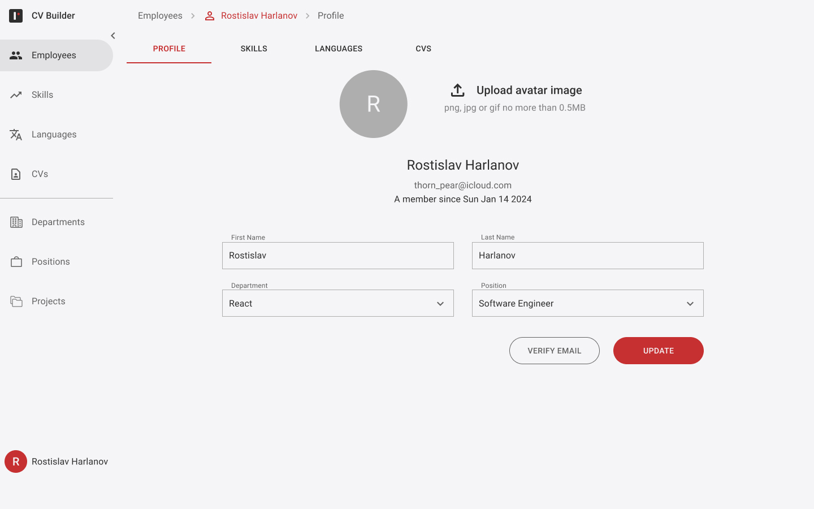

# User Profile Page

## Purpose

Allows viewing and managing user profile information.

The available functionality depends on:

- current user's role
- whose profile is being viewed
- backend authorization rules
The frontend must reflect the available permissions in the UI, but all permissions must also be enforced by the backend.

---

## Scope

The Profile tab is available on the User Details page.

The tab is available for:

- Admin
- Employee
Role-based and ownership-based permissions apply.

### Employee — own profile

Can:

- View profile information
- Update profile information
- Upload or change avatar
- Initiate email verification

### Employee — another user's profile

Can:

- View profile information
Cannot:

- Update profile information
- Upload avatar
- Initiate email verification

### Admin

Can:

- View profile information
- Update profile information
- Upload or change avatar for any user
Email verification can only be initiated for the profile owner.

All authorization rules must be validated by the backend.

---

## Behavior

The page allows users to:

- View user avatar
- View first name
- View last name
- View email address
- View member since date
- View department
- View position
Depending on permissions, users may also:

- Update profile information
- Upload avatar image
- Initiate email verification
All profile information must be loaded from the backend.

The frontend must not use locally stored profile data as the source of truth.

---

## Design Reference

Figma: CV Builder – [User Details – Profile (Admin)](https://www.figma.com/design/m3zxmLv79A6MsHCuAIQAoo/CV-Builder?node-id=21482-29537&t=iySRJkYK6txkSEzy-0) and [User Details – Profile (User)](https://www.figma.com/design/m3zxmLv79A6MsHCuAIQAoo/CV-Builder?node-id=21482-29335&t=iySRJkYK6txkSEzy-0)

---

## Layout

Page must follow the User Details layout structure.

The Profile tab is displayed inside the User Details page.

Requirements:

- User avatar is displayed at the top of the page
- User full name is displayed below the avatar
- Email address is displayed below the full name
- Membership date is displayed below the email
- Profile fields are displayed in a two-column layout
- Layout must be responsive across desktop and tablet devices
- Supports Light and Dark themes

---

## Navigation

The Profile tab is available from:

`Profile`

Requirements:

- Active tab must be visually highlighted
- Tab state must persist after page refresh when possible
- User Details access must require authentication
- Backend must validate whether the current user can access the requested profile

---

# GraphQL Integration

All profile data operations must be performed through GraphQL.

The implementation should provide operations for:

- Fetching a user profile
- Updating profile information
- Uploading/updating an avatar
- Initiating email verification
The exact GraphQL schema and naming conventions are defined by the backend implementation.

The frontend must correctly handle:

- Successful responses
- Validation errors
- Authorization errors
- Not-found errors
- File upload errors
- Network errors
- Unexpected server errors

---

# Profile Query

The profile information must be loaded from the backend.

The response should provide the information required to render the Profile tab:

- User ID
- Avatar
- First Name
- Last Name
- Email
- Member Since
- Department
- Position
- Email verification status
- Available permissions where required by the application
Sensitive information must not be included in the response.

The backend must not return:

- Password
- Password hash
- Authentication credentials
- Verification tokens
- Other sensitive security information

---

# Content

## Profile Information

The page displays:

- Avatar
- First Name
- Last Name
- Email
- Member Since
- Department
- Position
Requirements:

- All displayed values must reflect current backend data
- Email address is displayed as read-only
- Member Since date is displayed as read-only
- Sensitive account information must not be displayed

---

## Avatar

Displays the user's profile image.

Requirements:

- If no avatar exists, display user initials placeholder
- Avatar is displayed using a circular format
- Avatar updates after successful upload
- Avatar URL/reference must come from the backend
- The frontend must not treat a local preview as a successful upload

---

## Department

Displays the department assigned to the user.

Requirements:

- Department name is displayed
- Department selection is available only when editing is permitted
- Available departments must come from the application's source of truth
- Backend validates the selected department

---

## Position

Displays the position assigned to the user.

Requirements:

- Position name is displayed
- Position selection is available only when editing is permitted
- Available positions must come from the application's source of truth
- Backend validates the selected position

---

# Permissions

## Employee Viewing Own Profile

Available actions:

- Update profile
- Upload avatar
- Initiate email verification
The backend must verify that the requested profile belongs to the authenticated user.

---

## Employee Viewing Another User Profile

Available actions:

- View profile information
Restricted actions:

- Update profile
- Upload avatar
- Initiate email verification
Requirements:

- Profile fields must be read-only
- Upload avatar control must not be displayed
- UPDATE button must not be displayed
- VERIFY EMAIL button must not be displayed
- Backend must reject unauthorized update/upload/verification requests even if they are manually sent to the API

---

## Admin Viewing Any Profile

Available actions:

- Update profile
- Upload avatar
Requirements:

- Functionality is available for any user profile
- Email remains read-only
- Email verification can only be initiated for the profile owner
- Backend must validate Admin permissions for update and avatar operations

---

# Update Profile

## Editable Fields

### First Name

Text field

Requirements:

- Required
- Maximum length: 100 characters
- Backend must validate the value

---

### Last Name

Text field

Requirements:

- Required
- Maximum length: 100 characters
- Backend must validate the value

---

### Department

Select field

Requirements:

- Required
- Displays available departments
- Backend validates that the selected department exists and can be assigned

---

### Position

Select field

Requirements:

- Required
- Displays available positions
- Backend validates that the selected position exists and can be assigned

---

## Read-Only Fields

Fields:

- Email
- Member Since
Requirements:

- Values cannot be edited
- Read-only styling follows design specifications
- Backend must not accept unauthorized changes to these fields through this profile update operation

---

## Validation

Validation must be implemented on both frontend and backend.

### Client-side validation

Rules:

- First Name is required
- First Name maximum length is 100 characters
- Last Name is required
- Last Name maximum length is 100 characters
- Department is required
- Position is required
Example messages:

- `First name is required`
- `First name must not exceed 100 characters`
- `Last name is required`
- `Last name must not exceed 100 characters`
- `Department is required`
- `Position is required`
Client-side validation is intended for user experience and must not replace server-side validation.

### Server-side validation

The backend must independently validate:

- Required fields
- Field lengths
- Department
- Position
- User existence
- Current user's authorization
- Ownership rules where applicable

---

## Actions

Button:

`UPDATE`

Requirements:

- Available only when editing is permitted
- Disabled until at least one value is changed
- Disabled when validation errors exist
- Sends a GraphQL mutation
- Displays loading state while the request is processed
- Prevents duplicate submissions
- Successful update refreshes displayed data from the backend
- Failed requests do not clear entered values
- Backend errors are displayed in a user-friendly way
The updated profile must be persisted in the database.

---

# Upload Avatar

## Trigger

Opened from:

`Upload avatar image`

Requirements:

- Available for profile owner
- Available for Admin
- Hidden for Employees viewing another user's profile
- Backend authorization is required

---

## Supported Formats

Allowed file types:

- PNG
- JPG
- JPEG
- GIF
Requirements:

- Unsupported file types must be rejected
- File type must be validated on both frontend and backend
- Backend must not rely only on the file extension supplied by the client

---

## File Size Validation

Maximum file size: `5 MB`

Requirements:

- Files exceeding the limit must be rejected
- File size must be validated on the backend
- Validation message must be displayed
Example:

`File size must not exceed 5 MB`

---

## Upload Behavior

Requirements:

- Upload begins after file selection
- Upload progress may be displayed
- Successfully uploaded image replaces existing avatar
- Avatar preview may be displayed immediately after selection
- Avatar is considered updated only after successful backend response
- Failed uploads display an error message
- Failed uploads do not remove the existing avatar
The uploaded file must be stored using the application's file storage strategy.

The user database record should store a reference to the avatar rather than embedding the image itself into the user record.

The exact storage implementation is defined by the backend architecture.

---

# Verify Email

## Trigger

Opened from:

`VERIFY EMAIL`

Requirements:

- Available only for the profile owner
- Hidden for Admin when viewing another user's profile
- Hidden for Employees viewing another user's profile
- Must not be available when the email is already verified

---

## Behavior

Clicking `VERIFY EMAIL` initiates the existing email verification flow.

Requirements:

1. Frontend sends a GraphQL request to initiate verification
1. Backend verifies that the current user can initiate the operation
1. Backend generates a new verification credential
1. Previous active verification credentials are invalidated where applicable
1. Verification credential receives an expiration time
1. Verification email is sent to the registered email address
1. User is redirected to the Email Verification page
1. The actual email verification is completed through the Verification Page
The `VERIFY EMAIL` action must not mark the email as verified by itself.

---

## Verification Flow

The verification flow must use the same verification mechanism defined for the Email Verification page.

Requirements:

- Verification code is generated securely
- Verification code expires after the configured period
- Verification code is single-use
- Backend validates the code
- Successful verification updates the user's email verification status
- Used verification credentials are invalidated

---

## Success

Example notification:

`Verification email has been sent`

After the verification request succeeds, the user is redirected to the Email Verification page.

---

## Error Handling

Requirements:

- Failed requests display an error message
- User remains on the current page when the verification request fails
- Duplicate verification requests are prevented
- Rate limiting is handled by the backend
- Existing profile data remains unchanged
Example:

`Failed to send verification email`

---

# States

## Loading State

Displayed while profile information is being loaded.

Requirements:

- Skeleton loaders or loading indicators are displayed
- Layout structure remains visible when possible
- User actions are appropriately disabled while required data is loading

---

## Empty State

Displayed when optional profile information is missing.

Examples:

- No avatar uploaded
- Department not assigned
- Position not assigned
Requirements:

- Placeholder values follow design specifications
- Missing optional data must not cause the entire profile to fail

---

## Error State

Displayed when profile information cannot be loaded.

Requirements:

- Error message is shown
- Retry action is available
- Retry repeats the failed GraphQL request
- Current navigation state is preserved
Example:

`Failed to load profile information`

---

# Validation & Error Handling

The frontend must handle errors returned by the GraphQL API.

### Update errors

Examples:

- Invalid input
- User not found
- Unauthorized
- Forbidden
- Invalid department
- Invalid position
- Server error
- Network error

### Avatar upload errors

Examples:

- Unsupported file type
- File too large
- Unauthorized
- Forbidden
- Storage error
- Network error

### Email verification errors

Examples:

- Email already verified
- Unauthorized
- Rate limit exceeded
- Email delivery failure
- Server error
- Network error
Requirements:

- Validation errors must be displayed inline where applicable
- System errors must be displayed in a user-friendly way
- Failed requests must not clear entered values
- UI must only reflect a successful update after the backend confirms the operation
- Authorization errors must not be treated as ordinary validation errors

---

# Authorization & Security

All profile permissions must be enforced by the backend.

Requirements:

- Unauthenticated users cannot access protected profile operations
- Employee users can update only their own profile
- Employee users cannot update another user's profile
- Employee users cannot upload an avatar for another user
- Employee users cannot initiate verification for another user
- Admin users can update profiles according to their permissions
- Admin users can upload avatars for users according to their permissions
- Email remains read-only through the profile update operation
- Password information must never be returned by the profile query
- Verification tokens/codes must never be returned through profile queries
- Sensitive information must not be logged
- Backend authorization is the final security boundary
Frontend visibility of buttons and fields is not considered sufficient authorization.

---

# Database Requirements

The user profile must be persisted in the database.

The user model should support at least:

- User ID
- First Name
- Last Name
- Email
- Password hash
- Avatar reference
- Department reference
- Position reference
- Role
- Email verification status
- Member Since / creation timestamp
- Updated timestamp
Requirements:

- Email must remain unique
- Password must be stored only as a secure hash
- Avatar should be stored as a reference to the configured file storage
- Department and Position relationships must be valid
- Email verification status must be stored on the backend
- Creation timestamp must not be editable through the profile form

---

# Accessibility & Responsiveness

Requirements:

- Full keyboard navigation support
- Visible focus states
- Accessible labels for form controls
- File upload control is keyboard accessible
- Modal/dialog interactions, if used, must trap keyboard focus appropriately
- Content remains readable in Light and Dark themes
- Layout scales correctly across supported screen sizes
- Validation and error messages are accessible to assistive technologies

---

# Acceptance Criteria

| ID | Description |
|---|---|
| AC-1 | Profile tab is available on the User Details page |
| AC-2 | Profile information is loaded from the backend |
| AC-3 | Users can view avatar, personal information, department, and position |
| AC-4 | Employees can edit only their own profile |
| AC-5 | Employees viewing another user's profile have read-only access |
| AC-6 | Admins can edit permitted fields of any user profile |
| AC-7 | Backend enforces profile ownership and role-based permissions |
| AC-8 | First Name is a required field |
| AC-9 | Last Name is a required field |
| AC-10 | First Name and Last Name cannot exceed 100 characters |
| AC-11 | Department is a required field |
| AC-12 | Position is a required field |
| AC-13 | Email is read-only |
| AC-14 | Member Since is read-only |
| AC-15 | UPDATE button is displayed only when editing is permitted |
| AC-16 | Successful profile update is persisted in the database |
| AC-17 | Successful update refreshes displayed profile information |
| AC-18 | Avatar upload is available only when permitted |
| AC-19 | Supported avatar formats are PNG, JPG, JPEG, and GIF |
| AC-20 | Avatar upload rejects files larger than 5 MB |
| AC-21 | Avatar file type and size are validated by the backend |
| AC-22 | Successful avatar upload updates the stored avatar reference |
| AC-23 | Failed avatar uploads preserve the existing avatar |
| AC-24 | VERIFY EMAIL is available only for the profile owner |
| AC-25 | VERIFY EMAIL is unavailable when the email is already verified |
| AC-26 | Verification request is sent through GraphQL |
| AC-27 | Verification request does not directly mark the email as verified |
| AC-28 | Verification email is sent successfully through the backend flow |
| AC-29 | Email verification is completed through the Email Verification flow |
| AC-30 | Profile queries never return passwords or password hashes |
| AC-31 | Profile queries never return verification tokens or other sensitive credentials |
| AC-32 | Loading, Empty and Error states are supported |
| AC-33 | Validation errors are displayed inline |
| AC-34 | Failed requests do not unnecessarily clear entered values |
| AC-35 | Retry repeats the failed profile request |
| AC-36 | Page supports Light and Dark themes |
| AC-37 | Page is responsive across supported devices |
| AC-38 | Keyboard accessibility is fully supported |

