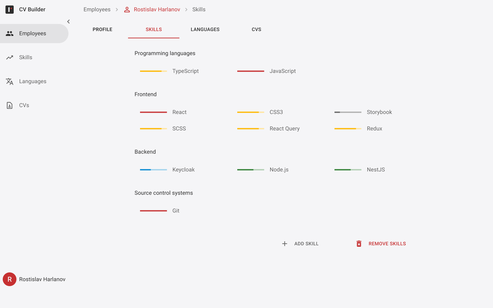

# User Skills Page

## Purpose

Allows viewing and managing user skills.

The available functionality depends on:

- current user's role
- whose profile is being viewed
- backend authorization rules
The frontend must reflect the available permissions in the UI, but all permissions must also be enforced by the backend.

---

## Scope

The Skills tab is available on the User Details page.

The tab is available for:

- Admin
- Employee
Role-based and ownership-based permissions apply.

### Employee — own profile

Can:

- View skills
- Add skills
- Update skill mastery
- Remove skills

### Employee — another user's profile

Can:

- View skills
Cannot:

- Add skills
- Update skills
- Remove skills

### Admin

Can:

- View skills
- Add skills
- Update skills
- Remove skills
for any user profile.

All permissions must be validated by the backend.

---

## Behavior

The page allows users to:

- View assigned skills
- View skills grouped by category
- View skill mastery levels
Depending on permissions, users may also:

- Add skills
- Update skill mastery
- Remove skills
All skill data must be loaded from the backend.

The frontend must not use locally stored skill data as the source of truth.

---

## Design Reference

Figma: CV Builder – [User Details – Skills](https://www.figma.com/design/m3zxmLv79A6MsHCuAIQAoo/CV-Builder?node-id=21482-30801&t=iySRJkYK6txkSEzy-0)

---

## Layout

Page must follow the User Details layout structure.

The Skills tab is displayed inside the User Details page.

Requirements:

- Skills are grouped by category
- Categories are displayed as separate sections
- Skills are displayed within their category group
- Layout must be responsive across desktop and tablet devices
- Supports Light and Dark themes

---

## Navigation

The Skills tab is available from:

`Skills`

Requirements:

- Active tab must be visually highlighted
- Tab state must persist after page refresh when possible
- Access to the User Details page must require authentication
- Backend must validate whether the current user can access the requested profile

---

# GraphQL Integration

All skill data operations must be performed through GraphQL.

The implementation should provide operations for:

- Fetching a user's skills
- Adding a skill to a user
- Updating a user's skill mastery
- Removing one or multiple skills
The exact GraphQL schema and naming conventions are defined by the backend implementation.

The frontend must correctly handle:

- Successful responses
- Validation errors
- Authorization errors
- Not-found errors
- Conflict errors
- Network errors
- Unexpected server errors

---

# Skills Query

The user's assigned skills must be loaded from the backend.

The response should provide enough information to render:

- Skill
- Skill category
- Skill mastery level
- Skill assignment identifier where required for update/delete operations
Skills must be grouped by category for display.

The backend should return only skills assigned to the requested user.

Sensitive information must not be included in the response.

---

# Content

## Skill Groups

Skills are grouped by category.

Examples:

- Programming Languages
- Frontend
- Backend
- Databases
- DevOps
- Source Control Systems
Requirements:

- Each category displays its name
- Skills belonging to the category are displayed below it
- Categories are displayed only when they contain skills
- Category information comes from the backend domain model

---

## Skill Item

Each skill displays:

- Skill Name
- Skill Mastery Level
Requirements:

- Visual representation follows design specifications
- Mastery level is clearly visible
- Skill information reflects the current backend state
- Skill items are editable only when the current user has permission

---

# Permissions

## Employee Viewing Own Profile

Available actions:

- Add Skill
- Update Skill
- Remove Skills
The backend must verify that the requested user profile belongs to the authenticated Employee.

---

## Employee Viewing Another User Profile

Available actions:

- View skills
Restricted actions:

- Add Skill
- Update Skill
- Remove Skills
Requirements:

- Management buttons must not be displayed
- Skill items must not be editable
- Clicking a skill does not open Update Skill modal
- Backend must reject unauthorized skill mutations even if they are manually sent to the API

---

## Admin Viewing Any Profile

Available actions:

- Add Skill
- Update Skill
- Remove Skills
Requirements:

- Functionality is available regardless of whose profile is being viewed
- Backend must verify Admin permissions for every management operation

---

# Add Skill

## Trigger

Opened from:

`ADD SKILL`

Requirements:

- Available for profile owner
- Available for Admin
- Hidden for Employees viewing another user's profile
- Backend authorization is required

---

# Add Skill Modal

## Content

Title:

`Add skill`

Fields:

### Skill

Select field

Requirements:

- Required
- Displays available skills
- Already assigned skills should not be available for selection
- Available skills must come from the backend
- Backend must validate that the selected skill exists
The list of selectable skills should exclude skills already assigned to the user.

This is a UI optimization and must not replace the backend uniqueness check.

---

### Skill Mastery

Select field

Available values:

- Beginner
- Elementary
- Intermediate
- Advanced
- Expert
Requirements:

- Required
- Value must be one of the supported mastery levels

---

## Validation

Validation must be implemented on both frontend and backend.

### Client-side validation

Rules:

- Skill is required
- Skill Mastery is required
Example messages:

- `Skill is required`
- `Skill mastery is required`

### Server-side validation

The backend must independently validate:

- User exists
- Skill exists
- Skill mastery is valid
- Skill is not already assigned to the user
- Current user's permissions
- Profile ownership where applicable

---

## Actions

Buttons:

- `CANCEL`
- `ADD`
Requirements:

- ADD remains disabled until all required fields are valid
- Clicking ADD sends a GraphQL mutation
- Loading state is displayed
- Duplicate submissions are prevented
- Successful creation adds the skill to the appropriate category
- Modal closes after successful creation
- Failed requests preserve entered values
- Backend errors are displayed in a user-friendly way
The skill assignment must be persisted in the database.

---

# Update Skill

## Trigger

Opened by clicking a skill item.

Requirements:

Available for:

- Profile owner
- Admin
Not available for:

- Employees viewing another user's profile
The backend must independently verify that the current user can update the selected skill assignment.

---

# Update Skill Modal

## Content

Title:

`Update skill`

Fields:

### Skill

Select field

Requirements:

- Disabled
- Displays currently selected skill
- Skill itself cannot be changed during this operation

---

### Skill Mastery

Select field

Available values:

- Beginner
- Elementary
- Intermediate
- Advanced
- Expert
Requirements:

- Required
- Value must be one of the supported mastery levels

---

## Validation

Validation must be implemented on both frontend and backend.

Rules:

- Skill Mastery is required
- Skill Mastery must be a supported value
Example message:

- `Skill mastery is required`
The backend must also verify:

- Skill assignment exists
- Assignment belongs to the selected user
- Current user has permission to update it

---

## Actions

Buttons:

- `CANCEL`
- `SAVE`
Requirements:

- SAVE sends a GraphQL mutation
- Loading state is displayed
- Duplicate submissions are prevented
- SAVE updates the selected skill
- Modal closes after successful update
- Updated value appears after successful backend response
- Failed requests preserve entered values
The updated mastery level must be persisted in the database.

---

# Remove Skills

## Trigger

Opened from:

`REMOVE SKILLS`

Requirements:

- Available for profile owner
- Available for Admin
- Hidden for Employees viewing another user's profile

---

# Selection Mode

Clicking REMOVE SKILLS enables selection mode.

Requirements:

- Multiple skills can be selected
- Selected skills are visually highlighted
- Selected count is displayed on the Remove button
Example:

`REMOVE (3)`

The frontend should track selected skill assignment identifiers rather than relying only on display names.

---

## Actions

Buttons:

- `CANCEL`
- `REMOVE`
Requirements:

- REMOVE is disabled when no skills are selected
- REMOVE opens Remove Skills confirmation modal
- CANCEL exits selection mode without changing backend data

---

# Remove Skills Modal

## Content

Title:

`Remove skills`

Message:

`Are you sure you want to remove {count} skills?`

Where:

- `{count}` = number of selected skills

---

## Actions

Buttons:

- `CANCEL`
- `CONFIRM`
Requirements:

- CANCEL closes the modal without changes
- CONFIRM sends a GraphQL mutation
- Multiple selected skills should be removed through a batch operation where supported
- Loading state is displayed during removal
- Duplicate removal requests are prevented
- Skills are removed from the UI after successful backend response
- Modal closes after successful removal
- Selection mode exits automatically
- Failed requests preserve the current selection
The removal must be persisted in the database.

---

# Database Model

The skill domain should be modeled using separate entities for skills and user skill assignments.

At minimum, the backend should support:

### Skill

- Skill ID
- Skill name
- Skill category
- Required timestamps where applicable

### User Skill

- Assignment ID
- User ID
- Skill ID
- Mastery level
- Required timestamps where applicable
The relationship between User and Skill should be represented explicitly.

Requirements:

- A user cannot have the same skill assigned more than once
- Skill references must point to existing skills
- Mastery level must use a controlled set of values
- Appropriate database constraints must be used
A unique constraint should prevent duplicate `(userId, skillId)` assignments.

---

# Skill Categories

Skill categories should be represented consistently in the backend domain model.

Requirements:

- A skill belongs to a valid category
- Categories are not duplicated for every user skill assignment
- The frontend receives category information from the backend
- Categories with no assigned skills are not displayed
The exact category model may be implemented as an entity or controlled value depending on the project architecture.

---

# States

## Loading State

Displayed while skills are being loaded.

Requirements:

- Skill groups remain visible when possible
- Loading indicators or skeletons are displayed
- Management actions are appropriately disabled while required data is loading

---

## Empty State

Displayed when the user has no assigned skills.

Example message:

`No skills added yet`

Requirements:

- Empty state is displayed instead of skill groups
- Users with permission to manage skills can still access `ADD SKILL`

---

## Error State

Displayed when skills cannot be loaded.

Requirements:

- Error message is shown
- Retry action is available
- Retry repeats the failed GraphQL request
- Existing tab/navigation state is preserved
Example:

`Failed to load skills`

---

# Validation & Error Handling

The frontend must handle errors returned by the GraphQL API.

### Add errors

Examples:

- Invalid skill
- Skill already assigned
- Invalid mastery level
- User not found
- Unauthorized
- Forbidden
- Server error
- Network error

### Update errors

Examples:

- Skill assignment not found
- Invalid mastery level
- Unauthorized
- Forbidden
- Server error
- Network error

### Remove errors

Examples:

- Skill assignment not found
- Unauthorized
- Forbidden
- Server error
- Network error
Requirements:

- Validation errors must be displayed inline where applicable
- System errors must be displayed in a user-friendly way
- Failed requests must not unnecessarily clear entered values
- UI must reflect successful operations only after backend confirmation
- Authorization errors must not be treated as ordinary validation errors
If a selected skill was removed or changed before a removal request is processed, the backend response must be handled gracefully and the UI must be synchronized with the current backend state.

---

# Authorization & Security

All skill management permissions must be enforced by the backend.

Requirements:

- Unauthenticated users cannot access protected skill operations
- Employee users can manage skills only for their own profile
- Employee users cannot modify another user's skills
- Admin users can manage skills for permitted user profiles
- GraphQL mutations must perform authorization checks
- Skill IDs supplied by the client must be validated
- Users cannot assign arbitrary or nonexistent skills
- Users cannot bypass duplicate skill restrictions
- Mastery levels must be validated on the server
- Sensitive information must not be returned unnecessarily
Frontend visibility of management controls is not considered sufficient authorization.

---

# Accessibility & Responsiveness

Requirements:

- Full keyboard navigation support
- Visible focus states
- Accessible labels for form controls
- Modal dialogs must trap keyboard focus
- Escape key closes modals
- Selection mode must be keyboard accessible
- Selected skills must have an accessible selected state
- Content remains readable in Light and Dark themes
- Layout scales correctly across supported screen sizes

---

# Acceptance Criteria

| ID | Description |
|---|---|
| AC-1 | Skills tab is available on the User Details page |
| AC-2 | Skills are loaded from the backend |
| AC-3 | Skills are grouped by category |
| AC-4 | Users can view assigned skills and mastery levels |
| AC-5 | Employees can manage skills only on their own profile |
| AC-6 | Employees viewing another user's profile have read-only access |
| AC-7 | Admins can manage skills on permitted user profiles |
| AC-8 | Backend enforces role and profile ownership permissions |
| AC-9 | ADD SKILL action opens Add Skill modal |
| AC-10 | Skill and Skill Mastery fields are required |
| AC-11 | Available skills are loaded from the backend |
| AC-12 | Already assigned skills cannot be assigned again |
| AC-13 | Backend prevents duplicate skill assignments |
| AC-14 | Successfully adding a skill persists the assignment in the database |
| AC-15 | Successfully adding a skill updates the page |
| AC-16 | Clicking a skill opens Update Skill modal when permitted |
| AC-17 | Skill field is disabled during update |
| AC-18 | Skill mastery must use a supported value |
| AC-19 | Successfully updating a skill persists the new mastery level |
| AC-20 | Successfully updating a skill refreshes displayed data |
| AC-21 | REMOVE SKILLS action enables selection mode |
| AC-22 | Multiple skills can be selected for removal |
| AC-23 | Selected skill count is displayed |
| AC-24 | Remove action opens confirmation modal |
| AC-25 | Confirming removal sends a backend request |
| AC-26 | Selected skills are removed after successful backend response |
| AC-27 | Skill removal is persisted in the database |
| AC-28 | Failed removal preserves the current selection where possible |
| AC-29 | Loading, Empty, and Error states are supported |
| AC-30 | Validation errors are displayed inline |
| AC-31 | GraphQL errors are handled appropriately |
| AC-32 | Retry repeats the failed skills request |
| AC-33 | Page supports Light and Dark themes |
| AC-34 | Page is responsive across supported devices |
| AC-35 | Keyboard accessibility is fully supported |

