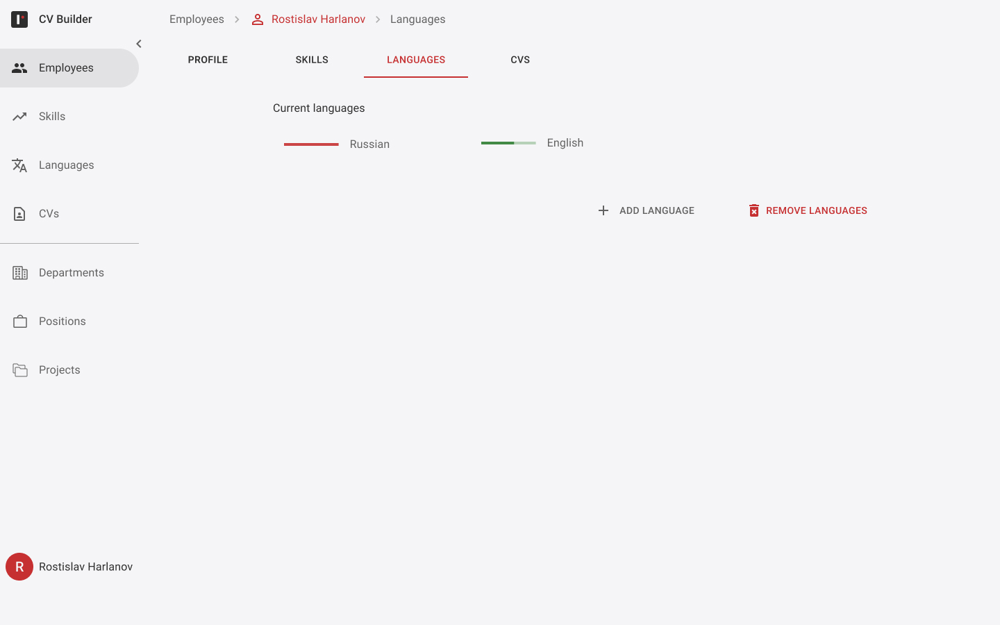

# User Languages Page

## Purpose

Allows viewing and managing languages assigned to a user.

The available functionality depends on:

- current user's role
- whose profile is being viewed
The page is part of the User Details flow and uses the application's existing authentication, authorization, GraphQL, and data-management architecture.

The backend is the source of truth for user language assignments, proficiency levels, validation and authorization.

---

## Employee

### Viewing Own Profile

Can:

- View languages
- Add languages
- Update language proficiency
- Remove languages

### Viewing Another User Profile

Can:

- View languages only
Cannot:

- Add languages
- Update languages
- Remove languages

---

## Admin

Can:

- View languages
- Add languages
- Update language proficiency
- Remove languages
for any user profile.

All permissions must be validated by the backend.

Frontend permission checks are used only to control the user interface and must not be treated as a security mechanism.

---

# Scope

The Languages tab is available on the User Details page.

The tab is available for:

- Admin
- Employee
Role-based permissions apply.

The page uses the existing GraphQL data layer for loading and modifying user language data.

---

# Behavior

The page allows users to:

- View assigned languages
- View language proficiency levels
Depending on permissions, users may also:

- Add languages
- Edit language proficiency
- Remove languages
The backend is the source of truth for language assignments.

The UI must be updated only after successful backend operations.

The page must display only languages assigned to the selected user.

---

# Design Reference

Figma: CV Builder – [User Details – Languages](https://www.figma.com/design/m3zxmLv79A6MsHCuAIQAoo/CV-Builder?node-id=21482-31464&t=iySRJkYK6txkSEzy-0)

---

# Layout

Page must follow the User Details layout structure.

The Languages tab is displayed inside the User Details page.

Requirements:

- Languages are displayed under a single section
- Section title: `Current Languages`
- Layout must be responsive across desktop and tablet devices
- Supports Light and Dark themes
- Management controls are displayed only when the current user has permission

---

# Navigation

The Languages tab is available from:

`Languages`

Requirements:

- Active tab must be visually highlighted
- Tab state must persist after page refresh when possible
- Navigation must use the existing User Details navigation flow
- The selected user context must be preserved when navigating between User Details tabs

---

# GraphQL Integration

The page must use the existing GraphQL architecture for all language-related data operations.

The frontend must not access the database directly.

The frontend must not load the entire user/language dataset and perform authorization or filtering locally.

## Required Operations

The implementation must provide GraphQL operations equivalent to:

- Load languages assigned to the selected user
- Load available languages when adding a language
- Add a language assignment
- Update language proficiency
- Remove one or more language assignments
The exact GraphQL operation and field names should follow the conventions already used by the application.

## Query Requirements

The language query must:

- Accept the selected user/profile context
- Return only language assignments belonging to that user
- Return the language entity information required by the UI
- Return proficiency information
- Enforce authorization on the backend

## Mutation Requirements

All mutations must:

- Validate the authenticated user
- Validate access to the target user profile
- Validate the target language or language assignment
- Validate proficiency values
- Persist changes before returning success
- Return an appropriate GraphQL error when the operation fails

---

# Content

## Current Languages

The page displays all languages assigned to the selected user.

Each language displays:

- Language Name
- Language Proficiency Level
Available proficiency levels:

- A1
- A2
- B1
- B2
- C1
- C2
- Native
Requirements:

- Languages are displayed in a consistent format
- Proficiency level is clearly visible
- Only languages assigned to the selected user are displayed
- Global Language catalog data is not modified from this page

---

# Data Model

Languages should be represented as a separate reference entity.

## Language

Example fields:

- `id`
- `name`
- `createdAt`
- `updatedAt`
The Language entity represents the global language catalog.

---

## UserLanguage

The relationship between a user and a language should be represented separately.

Example fields:

- `id`
- `userId`
- `languageId`
- `proficiency`
- `createdAt`
- `updatedAt`
Relationship:

`User -> UserLanguage -> Language`

A user must not have the same language assigned more than once.

The database should enforce uniqueness for:

`userId + languageId`

The proficiency level should use a controlled set of values:

- `A1`
- `A2`
- `B1`
- `B2`
- `C1`
- `C2`
- `Native`
The implementation should use an appropriate database constraint or enum representation to prevent invalid proficiency values from being persisted.

---

# Permissions

## Employee Viewing Own Profile

Available actions:

- Add Language
- Update Language
- Remove Languages
The backend must verify that the target profile belongs to the authenticated Employee.

The client must not be able to modify another user's language assignments by changing the target user ID.

---

## Employee Viewing Another User Profile

Available actions:

- View languages
Restricted actions:

- Add Language
- Update Language
- Remove Languages
Requirements:

- Management buttons must not be displayed
- Language items must not be editable
- Clicking a language does not open the Update Language modal
- Selection mode cannot be activated
The backend must reject management operations even if an unauthorized request is sent manually.

---

## Admin Viewing Any Profile

Available actions:

- Add Language
- Update Language
- Remove Languages
Requirements:

- Functionality is available regardless of whose profile is being viewed, subject to the application's existing Admin authorization rules
- Backend authorization allows authorized Admin users to manage languages for the selected profile

---

# Add Language

## Trigger

Opened from:

`ADD LANGUAGE`

Requirements:

- Available for the profile owner
- Available for Admin users
- Hidden for Employees viewing another user's profile

---

# Add Language Modal

## Content

Title:

`Add language`

### Language

Select field.

Requirements:

- Required
- Displays available languages
- Already assigned languages must not be available for selection
- Selected language must correspond to an existing Language entity
The frontend should exclude already assigned languages from the list.

The backend must independently prevent duplicate assignments.

---

### Language Proficiency

Select field.

Available values:

- A1
- A2
- B1
- B2
- C1
- C2
- Native
Requirements:

- Required
- Only supported proficiency values can be submitted

---

# Validation

Validation messages must be displayed inline.

Rules:

- Language is required
- Language proficiency is required
Example messages:

- `Language is required`
- `Language proficiency is required`
Validation must be performed on both frontend and backend.

The frontend validation exists for immediate user feedback.

Backend validation is authoritative.

---

# Actions

Buttons:

- `CANCEL`
- `ADD`
Requirements:

- `ADD` remains disabled until all required fields are valid
- Clicking `ADD` sends the language creation operation
- Loading state is displayed while the request is in progress
- Duplicate submissions are prevented
- Successful creation adds the language to the list
- Modal closes after successful creation
- The UI must not display the language as created before backend confirmation
If the request fails:

- Modal remains open
- Entered values are preserved
- Appropriate error is displayed
- User can retry
If the backend reports that the language has already been assigned:

- The current language data should be refreshed
- The duplicate assignment must not be created
- The user should receive an appropriate error or conflict message

---

# Update Language

## Trigger

Opened by clicking a language item.

Available for:

- Profile owner
- Admin
Not available for:

- Employees viewing another user's profile

---

# Update Language Modal

## Content

Title:

`Update language`

### Language

Select field.

Requirements:

- Disabled
- Displays currently selected language
- Cannot be changed
The Language reference is immutable during the update operation.

---

### Language Proficiency

Select field.

Available values:

- A1
- A2
- B1
- B2
- C1
- C2
- Native
Requirements:

- Required
- Pre-populated with the current proficiency level
- Editable

---

# Validation

Validation messages must be displayed inline.

Rules:

- Language proficiency is required
- Proficiency must belong to the supported set of values
Example message:

`Language proficiency is required`

Backend validation must also verify that the submitted proficiency value is supported.

---

# Actions

Buttons:

- `CANCEL`
- `SAVE`
Requirements:

- `SAVE` is available only when the form contains a valid value
- `SAVE` sends the update operation
- Loading state is displayed while the request is in progress
- Duplicate submissions are prevented
- Successful update closes the modal
- Updated proficiency appears on the page after successful backend confirmation
If the request fails:

- Modal remains open
- Entered values are preserved
- Appropriate error is displayed
- User can retry
If the language assignment no longer exists:

- The current language data should be refreshed
- The stale assignment should be removed from the UI
- The user should receive an appropriate message when necessary

---

# Remove Languages

## Trigger

Opened from:

`REMOVE LANGUAGES`

Requirements:

- Available for the profile owner
- Available for Admin users
- Hidden for Employees viewing another user's profile

---

# Selection Mode

Clicking `REMOVE LANGUAGES` enables selection mode.

Requirements:

- Multiple languages can be selected
- Selected languages are visually highlighted
- Selected count is displayed on the Remove button
Example:

`REMOVE (3)`

The selection must use the IDs of the corresponding `UserLanguage` assignments rather than only Language IDs.

This allows the backend to identify the exact relationships being removed.

---

# Actions

Buttons:

- `CANCEL`
- `REMOVE`
Requirements:

- `REMOVE` is disabled when no languages are selected
- `REMOVE` opens the confirmation modal
- `CANCEL` exits selection mode without changes
- Selection mode does not modify persisted data

---

# Remove Languages Modal

## Trigger

Opened from:

`REMOVE`

---

## Content

Title:

`Remove languages`

Message:

`Are you sure you want to remove {count} languages?`

Where:

- `{count}` = number of selected languages

---

# Actions

Buttons:

- `CANCEL`
- `CONFIRM`
Requirements:

- `CANCEL` closes the modal without changes
- `CONFIRM` sends the remove operation
- Loading state is displayed while the request is in progress
- Duplicate submissions are prevented
- Languages are removed from the list only after successful backend confirmation
- Modal closes after successful removal
- Selection mode exits automatically
If the request fails:

- Selected languages remain visible
- Appropriate error is displayed
- User can retry
If one or more selected assignments no longer exist:

- The page should refresh the current language data
- Stale selections should be removed
- The operation must not remove unrelated language assignments

---

# Backend Authorization

Every management operation must be authorized on the backend.

## Employee

An Employee may modify language assignments only for their own profile.

The backend determines the authenticated user from the existing authentication context.

The backend must not rely on a user ID supplied by the client to determine ownership.

## Admin

An Admin may modify language assignments for any user profile they are authorized to manage.

The backend must not rely on:

- hidden buttons
- disabled controls
- frontend role checks
- user IDs supplied by the client
as the security mechanism.

---

# Backend Validation

The backend must validate the following.

## User

- Target user exists
- Target user can be accessed according to the existing authorization rules
- Current user has permission to manage the target profile

## Language

- Language exists
- Language is a valid Language entity
- Language is not already assigned during creation

## Proficiency

- Value belongs to the supported proficiency set
- Invalid enum/string values are rejected

## User Language

For update/remove operations:

- Assignment exists
- Assignment belongs to the selected user
- Current user has permission to modify the selected user's profile
For create operations:

- Language exists
- Language is not already assigned to the selected user
- Database uniqueness constraint prevents duplicate assignments

---

# Database Integrity

The database must protect the integrity of User Language relationships.

Requirements:

- `UserLanguage.userId` references an existing User
- `UserLanguage.languageId` references an existing Language
- `(userId, languageId)` is unique
- `proficiency` contains only supported values
- Removing a UserLanguage assignment must not remove the global Language entity
- Updating proficiency must not modify the global Language entity
The global Language catalog must be managed independently from User Details.

---

# States

## Loading State

Displayed while languages are being loaded.

Requirements:

- Languages section remains visible when possible
- Loading indicators or skeletons are displayed
- Management actions must not allow duplicate operations while the initial data is loading

---

## Empty State

Displayed when the user has no assigned languages.

Example message:

`No languages added yet`

Requirements:

- Empty state is displayed instead of the language list
- `ADD LANGUAGE` remains available when the current user has permission

---

## Error State

Displayed when languages cannot be loaded.

Requirements:

- Error message is shown
- Retry action is available
Example:

`Failed to load languages`

Retry should repeat the failed data request using the existing GraphQL/data-loading flow.

---

## Mutation Loading State

Displayed while Add, Update or Remove operations are in progress.

Requirements:

- Corresponding action is disabled
- Duplicate submissions are prevented
- Existing language data remains visible where possible
- The UI must not display the mutation as successful before backend confirmation

---

## Unauthorized State

If the backend determines that the current user cannot access the selected profile, the page must handle the authorization error appropriately.

Example:

`You are not authorized to access this profile`

The application must not expose language data after an authorization failure.

---

# Validation & Error Handling

Requirements:

- Failed create requests must display an appropriate system error
- Failed update requests must display an appropriate system error
- Failed delete requests must display an appropriate system error
- Validation errors must be displayed inline
- Failed requests must not clear entered values
- Loading states must prevent duplicate submissions
- Unauthorized operations must be rejected by the backend
- Not-found assignments must be handled gracefully
- Duplicate language assignments must be rejected
- Invalid proficiency values must be rejected
- Network and GraphQL errors must not be presented as successful operations
- Errors must not expose sensitive backend or database information

---

# Data Consistency

The backend is the source of truth.

Requirements:

- UI state must not be treated as persisted data
- Successful operations update the UI using the backend response or by refetching the affected data
- Failed operations must not leave the UI in a state that incorrectly indicates success
- Cancelled operations must not change persisted data
- Stale selections must be handled gracefully
- Language ownership must remain associated with the correct user
- Removing a UserLanguage assignment must not remove the global Language
- The page must not optimistically display a successful mutation unless the application's existing architecture explicitly supports rollback

---

# Out of Scope

The following functionality is not required:

- Language search
- Language sorting
- Pagination
- Language proficiency history
- Language certificates
- Language ratings
- Audit history
- Custom proficiency levels
- Creating new languages from the User Details page
- Editing the global Language dictionary
The Language catalog is treated as existing reference data.

---

# Accessibility & Responsiveness

Requirements:

- Full keyboard navigation support
- Visible focus states
- Accessible labels for form controls
- Modal dialogs must trap keyboard focus
- Escape key closes modals
- Content remains readable in Light and Dark themes
- Layout scales correctly across supported screen sizes
- Selection mode is fully keyboard accessible
- Selected languages expose an appropriate selected state
- Validation and system errors are accessible to assistive technologies
- Interactive language items must have accessible names and states
- Confirmation dialogs must clearly communicate the destructive action

---

# Acceptance Criteria

| ID | Description |
|---|---|
| AC-1 | Languages tab is available on the User Details page |
| AC-2 | Languages are displayed under the `Current Languages` section |
| AC-3 | Users can view assigned languages and proficiency levels |
| AC-4 | Employees can manage languages only on their own profile |
| AC-5 | Employees viewing another user's profile have read-only access |
| AC-6 | Admins can manage languages on any authorized user profile |
| AC-7 | `ADD LANGUAGE` action opens Add Language modal when permitted |
| AC-8 | Language and Language Proficiency fields are required |
| AC-9 | Frontend and backend validate language assignment input |
| AC-10 | Already assigned languages are excluded from available language options |
| AC-11 | Backend and database prevent duplicate language assignments |
| AC-12 | Successfully adding a language updates the page |
| AC-13 | Clicking a language opens Update Language modal when permitted |
| AC-14 | Language field is disabled during update |
| AC-15 | Backend verifies authorization before updating a language |
| AC-16 | Successfully updating a language refreshes displayed data |
| AC-17 | `REMOVE LANGUAGES` action enables selection mode |
| AC-18 | Multiple languages can be selected for removal |
| AC-19 | Selected count is displayed on the Remove action |
| AC-20 | Remove action opens confirmation modal |
| AC-21 | Backend verifies authorization before removing languages |
| AC-22 | Confirming removal deletes selected UserLanguage assignments |
| AC-23 | Removing a UserLanguage assignment does not delete the global Language |
| AC-24 | Loading, Empty, Mutation Loading and Error states are supported |
| AC-25 | Unauthorized access and management operations are handled correctly |
| AC-26 | Validation errors are displayed inline |
| AC-27 | Failed requests do not clear entered form values |
| AC-28 | Unauthorized management operations are rejected by the backend |
| AC-29 | Stale or already removed language assignments are handled gracefully |
| AC-30 | Language data operations use the application's existing GraphQL architecture |
| AC-31 | The backend validates that the target user exists |
| AC-32 | The backend validates that the selected Language exists |
| AC-33 | The backend validates proficiency against the supported values |
| AC-34 | The database enforces uniqueness for `userId + languageId` |
| AC-35 | UserLanguage relationships reference valid User and Language entities |
| AC-36 | Employee ownership is determined from the authenticated user context |
| AC-37 | Client-supplied user IDs cannot bypass backend authorization |
| AC-38 | UI reflects successful backend operations only |
| AC-39 | Page supports Light and Dark themes |
| AC-40 | Page is responsive across supported devices |
| AC-41 | Keyboard accessibility is fully supported |
| AC-42 | Modals and selection controls follow accessible interaction patterns |

