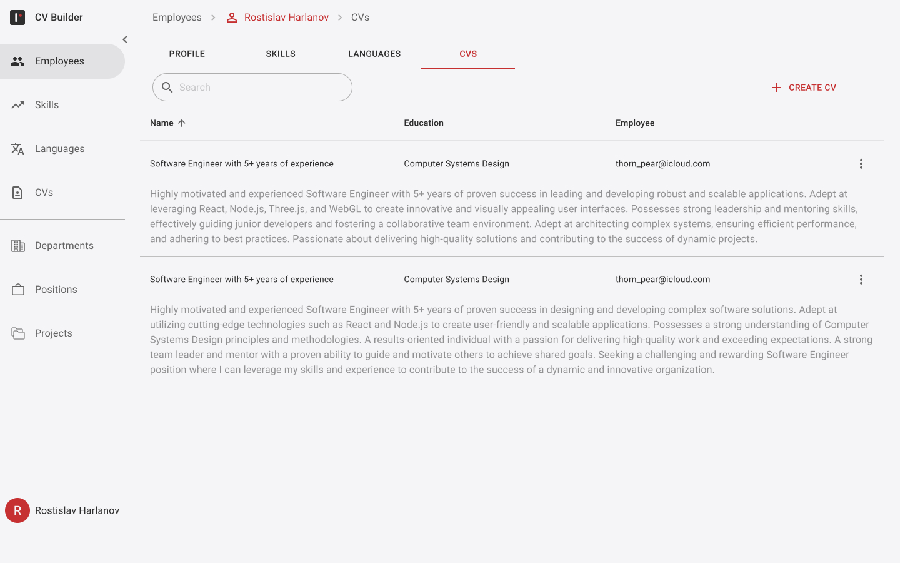

# User CVs Page




## Purpose

Allows administrators to manage CVs created for a specific employee.

The page displays only CVs belonging to the employee currently selected in the User Details flow.

The page is part of the existing **User Details** flow and uses the existing authentication, authorization, GraphQL, state management, and design system architecture.

The backend is the source of truth for CV data.


---


## Scope

The CVs tab is available on the User Details page.

The tab is available only for:

- Admin
The page is always scoped to the employee currently selected in the User Details flow.

All CV operations must be performed within this employee context.

The Admin must not be able to use this page to create or modify a CV for another employee by changing a client-supplied user ID.


---


## Behavior

The page allows administrators to:

- View CVs belonging to the selected employee
- Search CVs by name
- Sort CVs by name
- Open CV details
- Create CVs
- Update CVs
- Delete CVs
When the page is opened:

1. The application identifies the employee selected in the User Details flow.
1. The application requests CVs belonging to that employee.
1. The backend returns only CVs that belong to the selected employee.
1. The CV list is displayed.
1. The Admin can search and sort the list.
1. The Admin can open CV details.
1. The Admin can create, update, or delete CVs.
1. The UI is updated only after successful backend operations.
The selected employee remains the context for all CV operations.


---


## Design Reference

Figma: CV Builder – [User Details – CVs](https://www.figma.com/design/m3zxmLv79A6MsHCuAIQAoo/CV-Builder?node-id=21482-30549&t=iySRJkYK6txkSEzy-0)


---


## Layout

The page must follow the existing User Details layout structure.

The CVs tab is displayed inside the User Details page.

Requirements:

- Search field is displayed above the list
- Create CV action is displayed above the list
- CVs are displayed in a table layout
- Table supports sorting by Name
- Actions are available for each CV row
- Layout is responsive across supported desktop and tablet screen sizes
- Light and Dark themes are supported
- Existing table, modal, form, button, dropdown and state components should be reused where possible

---


## Navigation

The CVs tab is available from:

`CVs`

Requirements:

- Active tab is visually highlighted
- Navigation follows the existing User Details flow
- Selected employee context is preserved when switching between User Details tabs
- Opening a CV navigates to the CV Details page
- Returning from CV Details preserves the selected employee context
- Refreshing the page preserves the selected employee context when supported by the existing routing architecture

---


# GraphQL Integration

The page must use the existing **GraphQL data layer**.

The frontend must not access the database directly.

The frontend must not introduce a separate data-access pattern specifically for CVs.

The backend must provide the operations required to:

- load CVs for the selected employee
- load a selected CV
- create a CV
- update a CV
- delete a CV
The exact GraphQL operation names, input types, fragments, and response structure must follow the existing project architecture.


---


## Data Flow

```plain text
User Details
    ↓
Selected Employee
    ↓
CVs Tab
    ↓
GraphQL
    ↓
Backend
    ↓
CV data for selected Employee
```

All create, update, and delete operations must be confirmed by the backend before the UI treats them as successful.

The frontend must not assume that a mutation succeeded based only on the local state.


---


# CV Query

The CV list must be loaded using the currently selected employee context.

The backend must return only CVs belonging to the selected employee.

The client must not:

- load CVs for all employees and filter them locally
- determine CV ownership only on the frontend
- use client-side filtering as an authorization mechanism

---


## Query Requirements

The CV query should support:

- selected employee context
- search by CV name
- sorting by CV name
- the existing pagination mechanism if pagination is introduced by the shared table architecture
The backend must validate:

- selected employee
- search input
- requested sort field
- requested sort direction
- authorization

---


# Content


## CV List

The page displays CV records belonging to the selected employee.

The table contains:

| Column | Description |
|---|---|
| Name | CV name |
| Education | CV education value |
| Employee | Employee email |

Requirements:

- Only CVs belonging to the selected employee are displayed
- Records are displayed in a tabular layout
- Each row displays a CV summary
- Each row contains an actions menu
- Employee information must correspond to the selected employee
- The frontend must not use the Employee column to determine ownership

---


# Search

Search field placeholder:

`Search`

Requirements:

- Searches by CV Name only
- Search is case-insensitive
- Search updates results without a full page reload
- Empty search displays all CVs belonging to the selected employee
- Search uses the existing GraphQL/data-fetching architecture
For large datasets, search must be performed on the backend.

The frontend must not retrieve all CVs and filter them locally as the primary search mechanism.

When the search value changes:

- the relevant CV query is executed again
- pagination is reset if pagination is used
- the selected employee context remains unchanged

---


# Sorting

Supported sorting:


### Name

Requirements:

- Sorts CVs alphabetically
- Supports ascending order
- Supports descending order
- Current sort direction is visually indicated
- Sorting is performed through the existing data-fetching architecture
The backend must validate the requested sort field and direction.

The client must not be able to request arbitrary database fields as sort fields.


---


# Actions Menu

Each CV row contains an actions menu.

Available actions:

- `View`
- `Edit`
- `Delete`
Requirements:

- Actions menu is displayed for every CV row
- Only one menu can be open at a time
- Menu closes when:
  - clicking outside
  - selecting an action
  - pressing Escape
- Actions are available only to authorized Admin users

---


# Permissions


## Admin

The Admin can:

- View CVs
- Search CVs
- Sort CVs
- Open CV details
- Create CVs
- Update CVs
- Delete CVs
Frontend restrictions are used for UX only.

The backend must independently enforce Admin permissions for:

- CV queries
- CV creation
- CV update
- CV deletion
The backend must also verify that the requested CV belongs to the employee currently selected in the User Details flow.


---


# View CV


## Trigger

Opened from:

`View`


---


## Behavior

Requirements:

- Opens the selected CV Details page
- Preserves the selected employee context
- Passes the selected CV context through the existing routing architecture
- CV Details loads the CV from the backend
- Backend verifies that the CV exists
- Backend verifies that the CV belongs to the selected employee
- Backend verifies that the current user is authorized to view it
The CV Details page must use the backend as the source of truth.

It must not rely only on the CV data previously displayed in the table.


---


## Not Found

If the CV no longer exists:

- CV Details must display the appropriate not-found state
- The application must not display stale CV data as current data
- The relevant CV list should be refreshed or invalidated when appropriate

---


# Add CV

The Admin can create a new CV for the selected employee.

The new CV must automatically be associated with the employee currently selected in the User Details flow.

The Admin must not be able to change the CV owner through the Create CV form.

The employee association must be determined and validated by the backend.

The backend must not trust an arbitrary client-supplied employee ID as proof of the selected employee context.


---


# Add CV Modal


## Content

Title:

`Create CV`


### Name

Text input.

Requirements:

- Required
- Maximum length: 255 characters

---


### Education

Text input.

Requirements:

- Required
- Maximum length: 255 characters

---


### Description

Textarea.

Requirements:

- Required

---


# Validation

Validation messages must be displayed inline.


## Frontend Validation

Rules:

- Name is required
- Education is required
- Description is required
- Name must not exceed 255 characters
- Education must not exceed 255 characters
Example messages:

- `Name is required`
- `Education is required`
- `Description is required`
Frontend validation is intended for immediate user feedback.

It must not replace backend validation.


---


## Backend Validation

The backend must independently validate:

- selected employee exists
- current user is authorized to create a CV
- Name is valid
- Education is valid
- Description is valid
- CV is associated with the correct employee
The backend must reject invalid requests even if frontend validation was bypassed.


---


# Create Actions

Buttons:

- `CANCEL`
- `CREATE`
Requirements:

- `CREATE` remains disabled while required fields are invalid
- Clicking `CREATE` sends the GraphQL mutation
- Loading state is displayed while the request is in progress
- Duplicate submissions are prevented
- Successful creation adds the CV to the list after backend confirmation
- Modal closes after successful creation
- Search/sort state is preserved when possible
- Failed requests do not clear entered values
If creation fails:

- Modal remains open
- Entered values remain available
- Appropriate error is displayed
- Admin can retry

---


# Update CV


## Trigger

Opened from:

`Edit`

Requirements:

- Available from the CV actions menu
- Available only for Admin users
- The selected CV is updated in the context of the currently selected employee
- CV ownership cannot be changed through the Update CV form

---


# Update CV Modal


## Content

Title:

`Update CV`


### Name

Text input.

Requirements:

- Required
- Maximum length: 255 characters
- Pre-populated with the current value

---


### Education

Text input.

Requirements:

- Required
- Maximum length: 255 characters
- Pre-populated with the current value

---


### Description

Textarea.

Requirements:

- Required
- Pre-populated with the current value

---


# Update Validation


## Frontend Validation

Rules:

- Name is required
- Education is required
- Description is required
- Name must not exceed 255 characters
- Education must not exceed 255 characters
Example messages:

- `Name is required`
- `Education is required`
- `Description is required`

---


## Backend Validation

The backend must verify:

- CV exists
- CV belongs to the selected employee
- Current user has permission to update the CV
- Name is valid
- Education is valid
- Description is valid
The backend must not allow the update operation to change CV ownership.


---


# Update Actions

Buttons:

- `CANCEL`
- `SAVE`
Requirements:

- `SAVE` sends the update mutation
- Loading state is displayed while the request is in progress
- Duplicate submissions are prevented
- Modal closes after successful update
- Updated values appear in the list after backend confirmation
- Failed requests do not clear entered values
- The UI must not display updated values as persisted before backend confirmation

---


# Delete CV

The Admin can delete CVs from the list.

Deletion is a destructive operation and must always require confirmation.

The existing application pattern for destructive actions should be reused.


---


# Delete Trigger

Delete can be initiated from:

`Delete`

The delete operation must use the selected CV record.

The backend must verify that:

- the CV exists
- the CV belongs to the selected employee
- the current user is authorized to delete it

---


# Delete Confirmation


## Content

Title:

`Delete CV`

Message:

`Are you sure you want to delete CV {name}?`

Where:

- `{name}` is the selected CV name
Buttons:

- `CANCEL`
- `CONFIRM`

---


# Delete Behavior

Requirements:

- `CANCEL` closes the modal without changes
- `CONFIRM` sends the delete mutation
- Loading state is displayed while deletion is in progress
- Duplicate deletion requests are prevented
- CV is removed from the list only after successful backend confirmation
- Modal closes after successful deletion
- Failed deletion does not incorrectly remove the CV from the list
If the CV was already deleted by another operation:

- The application must handle the not-found response gracefully
- Relevant CV data should be refreshed
- The UI must not display the deleted CV as an existing record

---


# Database Model

CV should be represented as a separate entity associated with a User.


## CV

Example fields:

- `id`
- `userId`
- `name`
- `education`
- `description`
- `createdAt`
- `updatedAt`

---


## Relationship

One User can have multiple CVs.

```plain text
User
 └── CV[]
```

Each CV must belong to exactly one User.

The relationship must be enforced by the backend/database.

The exact ORM implementation and field naming should follow the existing project architecture.


---


# Database Integrity

Requirements:

- `CV.userId` references an existing User
- CV cannot exist without a valid owner
- CV operations must respect the User → CV relationship
- Backend must verify ownership before modifying a CV
- Deleting a CV must not delete the User
- CV data belonging to another employee must not be returned through the selected employee's CV query
If the database supports foreign-key constraints, the relationship should be enforced at the database level as well.


---


# CV Data Security

The CV response must expose only data required by the CV management flow.

The response must not expose:

- passwords
- password hashes
- access tokens
- refresh tokens
- verification tokens
- other authentication credentials
- unrelated sensitive user information
The Employee email may be returned for the table's Employee column when permitted by the existing application data model.


---


# States


## Loading State

Displayed while CVs are being loaded.

Requirements:

- Table structure remains visible when possible
- Loading indicators or skeletons are displayed
- Actions that require loaded data are disabled where appropriate

---


## Empty State

Displayed when the selected employee has no CVs.

Example:

`No CVs found`

Requirements:

- Empty state is displayed instead of table rows
- `CREATE CV` remains available to the Admin

---


## No Search Results

Displayed when the search query returns no CVs.

Example:

`No CVs found`

Requirements:

- Search value remains visible
- Admin can clear the search
- Clearing the search restores the CV list

---


## Error State

Displayed when CVs cannot be loaded.

Example:

`Failed to load CVs`

Requirements:

- Error message is displayed
- Retry action is available
- Retry repeats the failed GraphQL query

---


## Mutation Loading State

Create, Update and Delete operations must display loading states.

Requirements:

- Duplicate operations are prevented
- Relevant controls are disabled while the operation is running
- Entered form values are preserved if the operation fails
- UI does not display a successful mutation before backend confirmation

---


## Unauthorized State

If the backend rejects access to the page or operation:

- The application must display the appropriate authorization state
- CV data must not be exposed
- Management controls must not remain usable
Example:

`You are not authorized to access this page`


---


# Validation & Error Handling

Requirements:

- Validation errors are displayed inline
- Failed create requests display an appropriate system error
- Failed update requests display an appropriate system error
- Failed delete requests display an appropriate system error
- Unauthorized errors are handled
- Forbidden errors are handled
- Not-found errors are handled
- Network errors are handled
- GraphQL/server errors are handled
- Failed requests do not clear entered form values
- Errors must not expose internal database or server details

---


## Data Errors

If a CV no longer exists when the Admin attempts to:

- View it
- Update it
- Delete it
the application must:

- handle the not-found response
- avoid displaying the operation as successful
- refresh or invalidate relevant CV data when appropriate
- remove stale data from the UI when confirmed by the backend

---


# Data Consistency

The backend is the source of truth.

After successful mutations:

- Relevant CV data must be updated
- Existing GraphQL cache/state must be invalidated or updated according to the application architecture
- The UI must not rely on an unconfirmed local mutation

### Create

The new CV appears in the list only after successful backend confirmation.


### Update

Updated values appear only after the backend confirms the update.


### Delete

The CV disappears from the list only after successful backend confirmation.

If the CV is changed or deleted by another request while the page is open, stale data must be handled gracefully.


---


# Backend Authorization & Security

Authorization must be enforced on the backend for every protected operation.

The backend must verify:

- current user is authenticated
- current user has the Admin role
- selected employee exists
- requested CV exists
- requested CV belongs to the selected employee
- current user is authorized to perform the requested operation
Frontend controls such as:

- hiding the CVs tab
- hiding Create/Edit/Delete buttons
- disabling actions
are UX mechanisms only.

They must not be treated as security controls.

The backend must not trust a client-supplied `userId` as proof of ownership.


---


# Backend Validation


## Create

The backend must validate:

- selected employee
- Admin authorization
- Name
- Education
- Description
- CV ownership
The created CV must belong to the selected employee.


---


## Update

The backend must validate:

- CV existence
- CV ownership
- selected employee
- Admin authorization
- Name
- Education
- Description
The operation must not allow changing `userId`.


---


## Delete

The backend must validate:

- CV existence
- CV ownership
- selected employee
- Admin authorization

---


## Invalid Employee

If the selected employee does not exist, the operation must be rejected.


---


## Wrong Employee

If the requested CV belongs to another employee, the operation must be rejected.

The backend must not allow an Admin to bypass the selected employee context by supplying another user's CV ID.


---


## Invalid Fields

If required fields are missing or exceed the allowed limits, the operation must be rejected.


---


# Accessibility & Responsiveness

Requirements:

- Full keyboard navigation support
- Visible focus states
- Accessible labels for form controls
- Action menus are keyboard accessible
- Escape closes open menus and modals
- Modal dialogs trap keyboard focus
- Validation errors are accessible to assistive technologies
- Destructive actions clearly communicate their consequences
- Content remains readable in Light and Dark themes
- Table remains usable across supported screen sizes
- Existing accessible components should be reused where possible

---


# Acceptance Criteria

| ID | Description |
|---|---|
| AC-1 | CVs tab is available only to Admin users |
| AC-2 | Only CVs belonging to the selected employee are displayed |
| AC-3 | CV list displays Name, Education and Employee columns |
| AC-4 | Search filters CVs by Name only |
| AC-5 | Search is case-insensitive |
| AC-6 | Empty search displays all CVs belonging to the selected employee |
| AC-7 | CV list supports sorting by Name |
| AC-8 | Sorting supports ascending and descending order |
| AC-9 | Current sort direction is visually indicated |
| AC-10 | View action opens the CV Details page |
| AC-11 | CV Details loads the selected CV from the backend |
| AC-12 | Backend verifies that the CV belongs to the selected employee |
| AC-13 | Create CV action opens the Create CV modal |
| AC-14 | Name, Education and Description are required |
| AC-15 | Name and Education cannot exceed 255 characters |
| AC-16 | Frontend validation is implemented |
| AC-17 | Backend validation is implemented |
| AC-18 | Newly created CV is automatically associated with the selected employee |
| AC-19 | Client cannot change CV ownership through the Create CV form |
| AC-20 | Successfully creating a CV updates the list after backend confirmation |
| AC-21 | Duplicate create requests are prevented |
| AC-22 | Edit action opens the Update CV modal |
| AC-23 | Update CV modal is pre-populated with existing values |
| AC-24 | CV ownership cannot be changed during update |
| AC-25 | Backend verifies CV ownership during update |
| AC-26 | Successfully updating a CV updates displayed data after backend confirmation |
| AC-27 | Delete action opens the confirmation modal |
| AC-28 | Delete confirmation displays the selected CV name |
| AC-29 | Delete operation requires explicit confirmation |
| AC-30 | CV is removed from the list only after successful backend confirmation |
| AC-31 | Failed deletion does not incorrectly remove the CV from the list |
| AC-32 | Backend authorization is enforced for all protected operations |
| AC-33 | Backend verifies that the selected employee exists |
| AC-34 | Backend verifies that the requested CV exists |
| AC-35 | Backend rejects operations when the CV belongs to another employee |
| AC-36 | Client-supplied user IDs cannot bypass backend authorization |
| AC-37 | Loading state is supported |
| AC-38 | Empty state is supported |
| AC-39 | No Search Results state is supported |
| AC-40 | Error state is supported |
| AC-41 | Create, Update and Delete operations display loading states |
| AC-42 | Validation errors are displayed inline |
| AC-43 | Failed requests do not clear entered form values |
| AC-44 | Unauthorized, forbidden and not-found errors are handled |
| AC-45 | GraphQL and network errors are handled |
| AC-46 | UI reflects successful backend operations only |
| AC-47 | CV → User relationship is enforced by the backend/database |
| AC-48 | CV data does not expose authentication credentials |
| AC-49 | Existing GraphQL and state-management architecture is used |
| AC-50 | Selected employee context is preserved throughout the CV management flow |
| AC-51 | Light and Dark themes are supported |
| AC-52 | Page is responsive across supported screen sizes |
| AC-53 | Keyboard accessibility is fully supported |
| AC-54 | Action menus and modals follow accessible interaction patterns |

