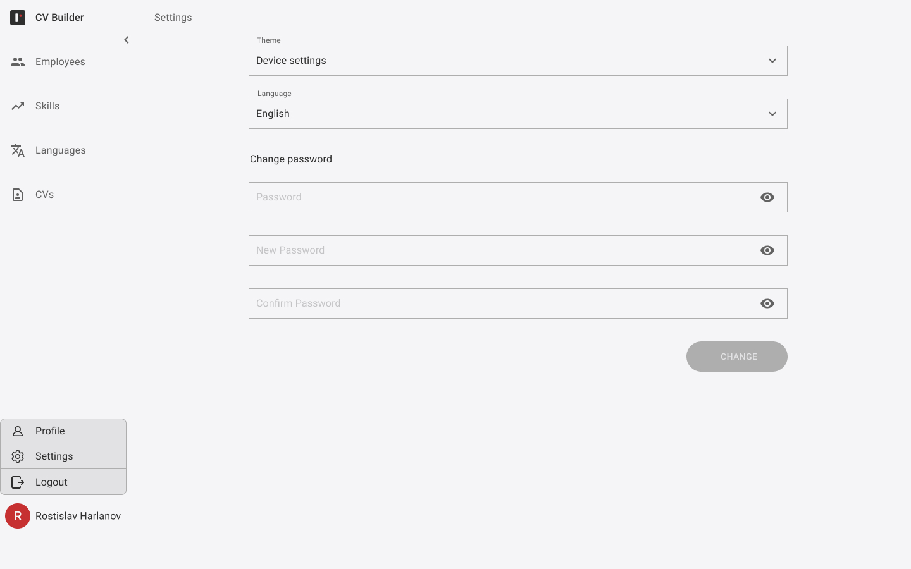

# Settings page




## Purpose

Allows authenticated users to manage their application preferences and account password.

The page is part of the existing authenticated application flow and uses the existing:

- authentication
- authorization
- GraphQL
- state management
- internationalization
- preference management
- design system
architecture.

The backend is the source of truth for password changes and for any preferences that are persisted on the backend.

A user can only manage their own settings.


---


# Scope

The Settings page is available to:

- Admin
- User
Both roles have the same:

- layout
- content
- functionality
- permissions
Users can manage:

- application theme
- application language
- account password
A user must not be able to modify another user's password or preferences through the Settings page.


---


# Behavior

The page allows users to:

- Change application theme
- Change application language
- Change their account password
- Show or hide password values
- Submit password changes
The page uses the currently authenticated user context.

The frontend must not use a client-supplied user ID as proof of ownership.

For password changes and backend-persisted preferences, the backend must identify the authenticated user from the existing authentication context.

When a preference is changed:

1. The new value is validated according to the existing application rules.
1. The preference is updated using the existing preference architecture.
1. The application reflects the new preference.
1. If the preference is persisted on the backend, the UI reflects the backend-confirmed value.
When the password is changed:

1. The user enters the current password.
1. The user enters the new password.
1. The user confirms the new password.
1. Client-side validation is performed.
1. The request is sent through GraphQL.
1. The backend verifies the current password and validates the new password.
1. The backend securely stores the new password hash.
1. The UI handles the result according to the existing authentication architecture.

---


# Design Reference

Figma: CV Builder – [Settings](https://www.figma.com/design/m3zxmLv79A6MsHCuAIQAoo/CV-Builder?node-id=21482-33403&t=iySRJkYK6txkSEzy-0)

The Figma design is the visual source of truth for:

- Settings page layout
- Theme selector
- Language selector
- Change Password form
- Password visibility controls
- Change button
- Profile menu
- Typography
- Spacing
- Form states
- Responsive behavior

---


# Layout

The page must follow the standard application layout.

Requirements:

- Existing sidebar navigation remains visible
- Settings content is displayed in the main content area
- Settings content is centered according to the existing layout system
- Theme and language preferences are displayed as settings controls
- Password fields are displayed in the Change Password section
- The page is responsive across desktop, tablet and mobile devices
- Light and Dark themes are supported
- Existing form, select, button and menu components should be reused where possible

---


# Navigation


## Sidebar

The existing sidebar navigation remains available.

The Settings page is opened through the existing application navigation.

The page must reuse the existing routing and navigation architecture.


---


## Profile Menu

Clicking the user profile section opens a contextual menu containing:

- `Profile`
- `Settings`
- `Logout`
Requirements:

- Menu opens above the profile section
- `Settings` navigates to the Settings page
- `Profile` follows the existing Profile navigation
- `Logout` uses the existing logout flow
- Menu closes when:
  - clicking outside
  - selecting a navigation item
  - pressing Escape
The profile menu supports:

- hover states
- focus states
- keyboard navigation
The page must reuse the existing authentication and logout logic.

No separate logout or authentication flow should be introduced.


---


# GraphQL Integration

The page must use the existing **GraphQL data layer** for backend operations.

GraphQL integration is required for password changes.

GraphQL integration is also required for preferences when the existing application architecture persists preferences on the backend.

Required backend operation:

- Change authenticated user's password
If preferences are backend-persisted, the existing preference query/mutation mechanism should be reused.

The exact GraphQL operation names, input types, fragments and response structures must follow the existing project conventions.

The frontend must not access the database directly.


---


# Preferences Architecture

Theme and language preferences must use the existing application preference architecture.

The implementation must first determine where the existing application stores these values.


## Client-Side Preferences

If preferences are intentionally stored only on the current device/session:

- reuse the existing client-side state/storage mechanism
- do not introduce unnecessary GraphQL mutations
- apply changes through the existing global application state

## Backend-Persisted Preferences

If preferences are intended to follow the user across devices and sessions:

- store them using the existing user/preference architecture
- associate preferences with the authenticated user
- validate changes on the backend
- ensure users cannot modify another user's preferences
The implementation should not introduce a separate backend operation for every individual preference unless required by the existing architecture.


---


# Theme Selector

Select field:

`Theme`

Available options:

- Light
- Dark
- Device settings
Requirements:

- Displays the currently selected theme
- Allows the user to select a different theme
- Theme changes are reflected throughout the application
- Existing theme management must be reused
- Selected value is persisted according to the existing preference architecture
If the preference is backend-persisted:

- the backend associates the theme with the authenticated user
- another user's theme cannot be modified
- the saved value is restored when the user starts a new session/device
If the preference is client-side only:

- the existing client-side persistence mechanism remains the source of truth

---


# Language Selector

Select field:

`Language`

Available options:

- English
- French
- German
- Italian
- Polish
- Portuguese
- Russian
- Spanish
- Ukrainian
Requirements:

- Displays the currently selected language
- Allows the user to select a different language
- Language changes are reflected throughout the application
- Existing internationalization architecture must be reused
- Selected value is persisted according to the existing preference architecture
If the language is backend-persisted:

- the backend associates the preference with the authenticated user
- another user's language cannot be modified
- the saved value is restored when the user starts a new session/device

---


# Change Password

The user can change their own account password.

The password change must use the existing authentication and security architecture.

The backend is responsible for:

- identifying the authenticated user
- verifying the current password
- validating the new password
- securely hashing the new password
- storing the password hash
- applying the existing session/authentication behavior
The frontend must never be responsible for verifying whether the current password is correct.


---


# Change Password Form

The form contains:

- `Password`
- `New Password`
- `Confirm Password`

---


## Password

Requirements:

- Required
- Masked by default
- Contains a visibility toggle
- Visibility toggle switches between hidden and visible states

---


## New Password

Requirements:

- Required
- Masked by default
- Contains a visibility toggle
- Visibility toggle switches between hidden and visible states
- Must satisfy the application's password security requirements

---


## Confirm Password

Requirements:

- Required
- Masked by default
- Contains a visibility toggle
- Visibility toggle switches between hidden and visible states
- Must match `New Password`

---


# Password Field States

Password fields must support:

- default
- hover
- focus
- error
- disabled/loading where applicable
Visibility toggle controls must remain accessible in every supported state.


---


# Password Validation

Validation messages must be displayed inline below the corresponding field.


## Frontend Validation

Rules:

- Password is required
- New Password is required
- Confirm Password is required
- New Password and Confirm Password must match
- New Password must meet the application's security requirements
Example messages:

- `Password is required`
- `New password is required`
- `Confirm password is required`
- `Passwords do not match`
- `Password does not meet the security requirements`
Frontend validation provides immediate user feedback.

It must not replace backend validation.


---


# Backend Password Validation

The backend must repeat all security-relevant validation.

The backend must:

- identify the authenticated user from the authentication context
- verify the current password
- validate the new password
- validate password confirmation where applicable
- securely hash the new password
- update the authenticated user's password
- never store the plaintext password
The backend must not trust:

- a user ID supplied by the client
- frontend validation
- disabled controls
- hidden fields
as authorization or security mechanisms.


---


# Change Action

Button:

`CHANGE`

Requirements:

- Submits the password change through the existing GraphQL layer
- Remains disabled until client-side validation passes
- Displays:
  - default state
  - hover state
  - pressed state
  - disabled state
  - loading state
- Prevents duplicate password-change requests
- Uses the existing application button component where possible
While the request is in progress:

- `CHANGE` is disabled
- Duplicate submissions are prevented
- Entered values remain available
After successful password change:

- Existing success feedback is displayed
- Form is reset according to the existing application pattern
- Session/authentication behavior follows the existing authentication architecture
The Settings page must not introduce separate session management logic.


---


# Password Change Security

The password change operation must be protected by the existing authentication and authorization system.

Requirements:

- Only the authenticated user can change their own password
- Current password must be verified by the backend
- New password must be securely hashed
- Plaintext passwords must never be stored
- Passwords must never be returned in GraphQL responses
- Passwords must not be logged
- Password hashes must not be returned to the frontend
- Access tokens must not be exposed by the Settings page
- Refresh tokens must not be exposed by the Settings page
- Existing secure transport and authentication mechanisms must be used

---


# Session Handling

After a successful password change, session behavior must follow the existing authentication architecture.

If the application:

- invalidates existing sessions
- rotates tokens
- requires re-authentication
- keeps the current session active
the Settings page must use that existing behavior.

The page must not implement an independent session invalidation or token-management mechanism.


---


# Permissions

Both Admin and User have the same permissions on this page.


## User

Can:

- View their own Settings
- Change their own theme
- Change their own language
- Change their own password

## Admin

Can:

- View their own Settings
- Change their own theme
- Change their own language
- Change their own password
An Admin cannot use this page to change:

- another user's password
- another user's theme
- another user's language
- another user's preferences
The backend must enforce these ownership rules.


---


# Backend Authorization

For password changes, the backend must derive the target user from the authenticated user context.

The client must not be able to specify an arbitrary target user.

For backend-persisted preferences, the backend must also determine the target user from the authenticated context.

For example, a request such as:

```plain text
changePassword(userId, currentPassword, newPassword)
```

must not treat `userId` as the source of authorization.

The authenticated session must determine which account is being modified.


---


# Data Model

If preferences are persisted on the backend, the existing User model may contain or reference user preferences.

Conceptually:

```plain text
User
 └── Preferences
      ├── theme
      └── language
```

Possible preference values:


### Theme

- `LIGHT`
- `DARK`
- `SYSTEM`

### Language

- supported application language code
The exact database structure should follow the existing project architecture.

A separate Settings entity is not required if the existing User model or Preferences structure already supports these values.


---


# Password Data

Password information remains part of the existing authentication/User model.

The database must store only the secure password hash.

The database must never store the plaintext password.

The password hash must never be returned through GraphQL.


---


# States


## Initial Loading State

If preferences need to be loaded from the backend, display an appropriate loading state while the data is being retrieved.

If theme and language are entirely client-side, no unnecessary backend loading state should be introduced.


---


# Password Change Loading State

Displayed while the password update request is in progress.

Requirements:

- `CHANGE` is disabled
- Duplicate submissions are prevented
- Entered values remain available
- The user cannot submit another password-change request simultaneously

---


# Preference Update State

If preferences are persisted through the backend, preference updates must have appropriate loading/error handling.

Requirements:

- Prevent conflicting duplicate requests
- Do not display a persisted value as successful before backend confirmation
- Preserve the selected value when an operation fails
- Display an appropriate error when persistence fails
If preferences are client-side only, the existing application state/storage behavior should be used.


---


# Success State

After a successful password change:

- Existing application success feedback is displayed
- Password form is reset according to the existing application pattern
- Session behavior follows the existing authentication architecture
After a successful theme change:

- New theme is applied throughout the application
After a successful language change:

- New language is applied throughout the application

---


# Error State

The page must handle:

- validation errors
- incorrect current password
- unauthorized errors
- forbidden errors
- server errors
- GraphQL errors
- network errors
- preference persistence errors
Errors must follow the existing application error-handling pattern.


---


# Validation & Error Handling

Requirements:

- Password validation errors are displayed inline
- Server validation errors are displayed inline where possible
- Incorrect current password displays an appropriate error
- Failed password updates display an appropriate system error
- Failed preference updates display an appropriate system error
- Failed requests do not incorrectly display the new value as persisted
- Duplicate requests are prevented
- Network and GraphQL errors are handled
- Authentication errors are handled
- Error messages must not expose sensitive authentication information
Example:

`Current password is incorrect`

The application must not expose unnecessary information about authentication state or account credentials.


---


# Data Consistency

The backend is the source of truth for:

- password changes
- backend-persisted preferences

## Password

After successful password change:

- New password hash is stored by the backend
- Old password no longer authenticates the account
- Existing session behavior is applied
- UI does not treat the password as changed before backend confirmation

## Preferences

If preferences are persisted on the backend:

- Saved value must match the selected value
- Refreshing the application restores the saved preference
- Preference belongs to the authenticated user
- Another user cannot modify the preference
If preferences are client-side only:

- Existing client-side state/storage remains the source of truth
- No unnecessary backend synchronization is introduced

---


# Accessibility

Requirements:

- Full keyboard navigation support
- Visible focus states
- Accessible labels for all form controls
- Password visibility toggles have accessible names
- Select controls are keyboard accessible
- Profile menu is keyboard accessible
- Escape closes the profile menu
- Validation errors are accessible to assistive technologies
- Success and error feedback is announced appropriately where supported
- Disabled and loading states are communicated to assistive technologies
- Text remains readable in both Light and Dark themes

---


# Responsiveness

Requirements:

- Desktop layout follows the Figma design
- Tablet layout remains usable
- Mobile layout remains usable
- Form controls adapt to available width
- Sidebar/navigation follows the existing responsive application behavior
- Profile menu remains accessible on smaller screens
- No horizontal scrolling is introduced for normal page content

---


# Out of Scope

The following functionality is not required:

- Changing email
- Changing first name
- Changing last name
- Changing user role
- Changing another user's password
- Changing another user's preferences
- Two-factor authentication
- Session/device management
- Notification preferences
- Account deletion
- Password reset
Password reset is handled by the existing:

**Forgot Password / Reset Password** flow.


---


# Acceptance Criteria

| ID | Description |
|---|---|
| AC-1 | Settings page is accessible for both Admin and User roles |
| AC-2 | Admin and User have the same Settings page layout and functionality |
| AC-3 | Users can manage only their own settings |
| AC-4 | Theme selector provides Light, Dark and Device settings options |
| AC-5 | Current theme is displayed correctly |
| AC-6 | Changing the theme updates the application theme |
| AC-7 | Theme persistence follows the existing application preference architecture |
| AC-8 | Language selector provides all supported languages |
| AC-9 | Current language is displayed correctly |
| AC-10 | Changing the language updates the application language |
| AC-11 | Language persistence follows the existing application preference architecture |
| AC-12 | Password fields are masked by default |
| AC-13 | Each password field provides a visibility toggle |
| AC-14 | Password visibility toggles between hidden and visible states |
| AC-15 | Password fields support default, hover, focus and error states |
| AC-16 | Current password is required |
| AC-17 | New password is required |
| AC-18 | Confirm password is required |
| AC-19 | New password and Confirm Password must match |
| AC-20 | New password must meet the application's security requirements |
| AC-21 | Password validation errors are displayed inline |
| AC-22 | Password change is submitted through the existing GraphQL architecture |
| AC-23 | Backend identifies the target account from the authenticated user context |
| AC-24 | Client-supplied user IDs cannot be used to change another user's password |
| AC-25 | Backend verifies the current password |
| AC-26 | Backend validates the new password |
| AC-27 | New password is securely hashed before storage |
| AC-28 | Plaintext passwords are never stored |
| AC-29 | Passwords and password hashes are never returned through GraphQL |
| AC-30 | Passwords are not written to application logs |
| AC-31 | `CHANGE` remains disabled until client-side validation passes |
| AC-32 | `CHANGE` displays a loading state during the password-change request |
| AC-33 | Duplicate password-change requests are prevented |
| AC-34 | Successful password changes reset the form according to the existing application pattern |
| AC-35 | Session behavior after password change follows the existing authentication architecture |
| AC-36 | Incorrect current password is handled with an appropriate error |
| AC-37 | Failed password requests do not incorrectly clear entered values |
| AC-38 | GraphQL, server and network errors are handled |
| AC-39 | Backend-persisted preferences are associated with the authenticated user |
| AC-40 | Users cannot modify another user's backend-persisted preferences |
| AC-41 | Existing authentication, authorization, GraphQL and state-management architecture is reused |
| AC-42 | Existing internationalization architecture is reused |
| AC-43 | Existing theme-management architecture is reused |
| AC-44 | No unnecessary separate API operation is introduced for each individual preference |
| AC-45 | Profile menu contains Profile, Settings and Logout |
| AC-46 | Profile menu closes when clicking outside |
| AC-47 | Profile menu closes when an item is selected |
| AC-48 | Profile menu closes when Escape is pressed |
| AC-49 | Profile menu supports keyboard navigation and focus states |
| AC-50 | Initial loading state is displayed when backend-persisted preferences are being loaded |
| AC-51 | Password mutation loading state prevents duplicate submissions |
| AC-52 | Preference update errors are handled according to the existing error pattern |
| AC-53 | Successful theme and language changes are reflected throughout the application |
| AC-54 | Backend-persisted preferences are restored after application refresh |
| AC-55 | Page supports Light and Dark themes |
| AC-56 | Page is responsive across desktop, tablet and mobile |
| AC-57 | All form controls have accessible labels |
| AC-58 | Password visibility controls have accessible names |
| AC-59 | Validation and system errors are accessible to keyboard and assistive technology users |
| AC-60 | Settings page does not expose access tokens, refresh tokens, password hashes or other authentication credentials |

