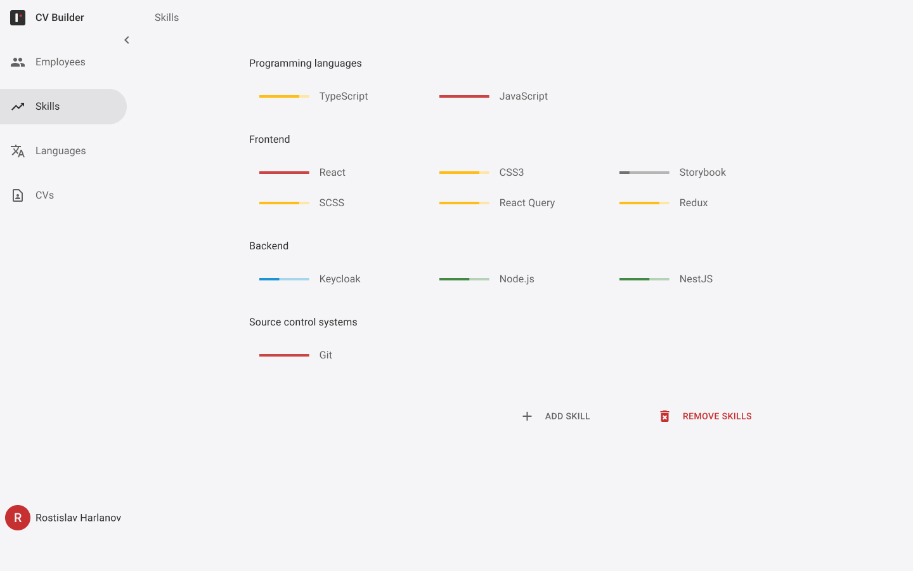

# Skills Page

## Purpose

Allows users to manage their personal skill set by adding, updating, and removing skills with proficiency levels.

The page manages skills assigned to the **currently authenticated user**.

This specification covers personal skill management only.

Administrative management of the global skill catalog and skill categories is handled by a separate Admin page.

---

## Scope

This page is available for authenticated **User** and **Admin** roles.

Both roles can manage skills belonging to their own profile.

### User permissions

Users can:

- Read their own skills
- Add skills to their own profile
- Update proficiency levels of their own skills
- Remove skills from their own profile
Users cannot:

- Modify another user's skills
- Create or modify global skill definitions
- Create or modify skill categories

### Admin permissions

Admins can:

- Read their own skills
- Add skills to their own profile
- Update proficiency levels of their own skills
- Remove skills from their own profile
Unless explicitly defined by the separate administrative skills-management specification, Admin users must not modify another user's personal skills through this page.

The backend must validate that the authenticated user can only modify skills belonging to their own profile.

Frontend role-based restrictions must not be considered a security mechanism.

---

## Behavior

The page allows users to:

- View their assigned skills grouped by category
- View skill proficiency levels
- Add a new skill
- Update an existing skill's proficiency level
- Enter skill selection mode
- Select multiple skills
- Remove selected skills after confirmation
All skill data must be loaded from the backend.

The frontend must not use hardcoded user skills as the source of truth.

The backend must determine which skills are assigned to the authenticated user.

---

## Design Reference

Figma: CV Builder – [Skills (User)](https://www.figma.com/design/m3zxmLv79A6MsHCuAIQAoo/CV-Builder?node-id=21482-30801&t=V7uXKk8xz7rQVmQ2-0)

---

## Layout

- Page must follow the standard application layout structure
- Sidebar navigation remains visible and accessible
- Skills are displayed in the main content area
- Skills are grouped by category
- Categories are displayed vertically
- Skills are displayed under their corresponding category
- Layout must be fully responsive across desktop and tablet devices
- Supports Light and Dark themes

---

## Navigation

### Sidebar

The page must be accessible through the appropriate profile/navigation item defined by the application.

Requirements:

- Navigation item is available for authenticated users
- Active navigation item must be visually highlighted
- Navigation state must persist during page refresh
- Access to the page must be protected by authentication
- Unauthenticated users must not be able to access personal skills data
The backend must determine the authenticated user from the current authentication context.

The client must not provide an arbitrary user ID to access another user's skills unless such access is explicitly supported by the API.

---

## GraphQL Integration

All skill operations must be performed through GraphQL.

The frontend must communicate with the backend using GraphQL queries and mutations.

### Required operations

The implementation should provide operations for:

- Fetching the current user's skills
- Fetching available skills
- Fetching skill categories where required
- Adding a skill to the current user's profile
- Updating the current user's skill proficiency
- Removing one or multiple skills from the current user's profile
The exact GraphQL schema and naming conventions are defined by the backend implementation.

The frontend must correctly handle:

- Successful responses
- Validation errors
- Authorization errors
- Not-found errors
- Conflict errors
- Network errors
- Unexpected server errors

---

## Skills Query

The user's assigned skills must be requested from the backend.

The query should return enough information for the frontend to render:

- Skill ID
- Skill name
- Skill category
- Skill category ID where applicable
- Skill proficiency/mastery
- Any additional data required by the UI
The backend should return skills already associated with the authenticated user.

The frontend must not fetch all users and filter their skills locally.

The current user's identity must be determined from the authenticated session/token on the backend.

---

## Available Skills Query

The Add Skill modal must load available skills from the backend.

The response should provide enough information to:

- Display available skills
- Identify each skill uniquely
- Determine the skill category
- Prevent invalid skill IDs from being submitted
The frontend must not rely on a hardcoded list of available skills.

If the backend provides categories separately, the category information must also be loaded from the backend.

---

# Content

## Page Header

The page contains:

- Back navigation button where required by the application layout
- Page title: `Skills`
Actions:

- `ADD SKILL`
- `REMOVE SKILLS`
The Remove Skills action activates selection mode.

---

## Skill Categories

Skills must be displayed grouped by categories.

Examples:

- Programming Languages
- Frontend
- Backend
- Source Control Systems
Requirements:

- Categories are displayed as section headers
- Skills are displayed under the corresponding category
- Category information is loaded from the backend
- Empty categories must not be displayed
- A skill must be displayed under the category assigned to it by the backend
The frontend must not allow a user to arbitrarily assign a skill to a category.

---

## Skill Item

Each skill displays:

- Skill name
- Skill proficiency indicator
- Edit action
- Selection control when removal mode is active
Requirements:

- Proficiency level must be visually represented
- Skill item supports editing
- Skill item supports selection mode
- Selected skills must be visually highlighted
- Skill ID must be associated with the corresponding item
- Skill data must come from the backend

---

# Skill Mastery

The available proficiency levels are:

- `Novice`
- `Advanced`
- `Competent`
- `Proficient`
- `Expert`
The backend must define and validate the supported proficiency values.

The frontend must not be able to submit arbitrary mastery values.

The visual representation of each mastery level must follow the design reference.

---

# Add Skill Action

Button:

`ADD SKILL`

Requirements:

- Visible when the page is not in removal mode
- Opens Add Skill modal
- Supports:
  - default
  - hover
  - pressed
  - disabled states
The backend must independently verify that the authenticated user can modify their own skills.

---

# Add Skill Modal

## Trigger

Opened from:

`ADD SKILL`

---

## Content

Title:

`Add skill`

### Skill

Select field containing available skills.

Requirements:

- Required field
- Available skills are loaded from the backend
- Each option has a unique skill ID
- Already assigned skills should not be selectable where possible
- Backend must still prevent duplicate assignments

### Skill Mastery

Select field containing proficiency levels.

Requirements:

- Required field
- Available values are defined by the backend domain model
- Frontend displays the supported mastery values
Available values:

- `Novice`
- `Advanced`
- `Competent`
- `Proficient`
- `Expert`

---

## Validation

Validation must be implemented on both frontend and backend.

### Client-side validation

Rules:

- Skill is required
- Skill mastery is required
Example messages:

- `Skill is required`
- `Skill mastery is required`
Client-side validation is intended for user experience and must not replace server-side validation.

### Backend validation

The backend must independently validate:

- Skill ID
- Skill existence
- Skill mastery
- Duplicate skill assignment
- Current user's authorization
- Any required relationship constraints
The backend must reject a request that references a nonexistent skill.

---

## Actions

Buttons:

- `CANCEL`
- `ADD`
Requirements:

- ADD remains disabled until required fields are valid
- Clicking ADD sends a GraphQL mutation
- Loading state is displayed during creation
- Duplicate submissions are prevented
- Successful creation updates the skills list
- Modal closes after successful creation
- Failed requests keep the entered values
- Backend errors are displayed in a user-friendly way
The new user-skill relationship must be persisted in the database.

---

# Update Skill Action

## Trigger

Opened from:

`Edit`

---

# Update Skill Modal

## Content

Title:

`Update skill`

### Skill

Requirements:

- Displays selected skill
- Read-only
- Disabled
- Cannot be changed

### Skill Mastery

Requirements:

- Editable
- Displays the current mastery level
- Allows selecting another supported mastery level

---

## Validation

Validation must be implemented on both frontend and backend.

### Client-side validation

Rules:

- Skill mastery is required

### Backend validation

The backend must independently validate:

- User-skill relationship exists
- Skill mastery is supported
- Current user owns the skill assignment
- Current user is authorized to modify the assignment
The backend must reject attempts to update a skill assignment belonging to another user.

---

## Actions

Buttons:

- `CANCEL`
- `UPDATE`
Requirements:

- UPDATE sends a GraphQL mutation
- Loading state is displayed during update
- Duplicate submissions are prevented
- Successful update changes the displayed proficiency level
- Modal closes after successful update
- Failed requests do not clear entered values
- Backend errors are displayed in a user-friendly way
The updated proficiency level must be persisted in the database.

---

# Remove Skills Action

Button:

`REMOVE SKILLS`

Requirements:

- Activates skill selection mode
- Allows selecting multiple skills
- Selected skills are visually highlighted
- Add Skill action is unavailable while selection mode is active
- Delete action displays the number of selected skills
Examples:

- `DELETE (1)`
- `DELETE (3)`
- `DELETE (5)`
The displayed count must correspond to the current number of selected skills.

---

## Selection Mode

Requirements:

- User can select multiple skills
- User can deselect previously selected skills
- Selected items have a clear visual state
- Selection state is maintained until deletion or cancellation
- Selecting a skill must not modify backend data
- Selection is local UI state until the user confirms deletion

### Cancel Selection

A cancel action must:

- Exit selection mode
- Clear all selected skills
- Restore the normal page state
- Not send a backend request

---

# Remove Skills Confirmation Modal

## Trigger

Opened after the user selects one or more skills and confirms the delete action.

---

## Content

Title:

`Remove skill`

Message:

`Are you sure you want to remove {count} skills?`

Where:

- `{count}` = number of currently selected skills
Examples:

- `Are you sure you want to remove 1 skill?`
- `Are you sure you want to remove 3 skills?`

---

## Actions

Buttons:

- `CANCEL`
- `CONFIRM`
Requirements:

- CANCEL closes the modal without changes
- CONFIRM sends a GraphQL mutation
- Loading state is displayed while deletion is in progress
- Duplicate deletion requests are prevented
- Backend verifies that the selected skill assignments belong to the authenticated user
- Removed skills disappear from the list only after successful backend response
- Modal closes after successful deletion
- Selection mode is exited after successful deletion
The deletion must be persisted in the database.

The backend must reject attempts to remove skill assignments belonging to another user.

---

# Database Model

The database must persist the relationship between users and skills.

The exact schema may depend on the selected database technology, but the model should support at least:

### User

- User ID
- Other user profile fields required by the application

### Skill

- Skill ID
- Skill name
- Category relationship
- Required timestamps where applicable

### Skill Category

- Category ID
- Category name
- Required timestamps where applicable

### User Skill

Represents the relationship between a user and a skill.

Should contain at least:

- User ID
- Skill ID
- Skill mastery/proficiency
- Required timestamps
Requirements:

- A user must not have the same skill assigned more than once
- A unique constraint should exist for the `(userId, skillId)` combination
- Skill references must point to existing skills
- User references must point to existing users
- Mastery must use a controlled set of values
- Removing a user skill must not delete the global skill definition
The exact relationship and deletion behavior must be defined by the backend data model.

---

# Skill Categories

Skill categories are part of the global skill catalog.

Examples:

- Programming Languages
- Frontend
- Backend
- Source Control Systems
Requirements:

- Categories must be persisted in the database or another defined backend source of truth
- Skills must reference their category
- Users cannot modify global categories through this page
- Users cannot move skills between categories
- The backend determines the category displayed for each skill
Administrative category and skill management belongs to the separate Admin skills-management functionality.

---

# States

## Loading State

Displayed while skills or available skill options are being loaded.

Requirements:

- Loading indicator is displayed
- Page structure remains stable where possible
- Actions that depend on unavailable data are appropriately disabled
- Initial loading and subsequent updates are handled consistently

---

## Empty State

Displayed when the authenticated user has no assigned skills.

Example message:

`No skills added`

The Add Skill action remains available.

The UI should distinguish between an empty skill set and a failed request.

---

## Error State

Displayed when skills cannot be loaded.

Requirements:

- Error message is shown
- Retry action is available
- Retry repeats the failed GraphQL request
- Existing UI state is preserved where possible

---

# Validation & Error Handling

The frontend must handle errors returned by the GraphQL API.

### Add errors

Examples:

- Invalid skill
- Invalid mastery
- Skill already exists
- Unauthorized
- Forbidden
- Network error
- Server error

### Update errors

Examples:

- Skill assignment not found
- Invalid mastery
- Unauthorized
- Forbidden
- Network error
- Server error

### Delete errors

Examples:

- Skill assignment not found
- Unauthorized
- Forbidden
- Skill cannot be removed
- Network error
- Server error
Requirements:

- Validation errors must be displayed near the relevant field where applicable
- System errors must be displayed in a user-friendly way
- Failed requests must not unnecessarily clear user input
- Successful operations must update the UI only after the backend confirms the operation
- The frontend must not assume that an operation succeeded before receiving a successful backend response
- Authorization errors must not be presented as generic validation errors
- GraphQL errors must be handled consistently

---

# Authorization & Security

Authorization must be enforced on the backend.

Requirements:

- Unauthenticated users cannot access personal skills
- Authenticated users can read their own skills
- Authenticated users can add skills only to their own profile
- Authenticated users can update only their own skill assignments
- Authenticated users can remove only their own skill assignments
- Users cannot modify another user's skills by manually changing IDs in GraphQL requests
- GraphQL mutations must perform authorization checks
- Skill IDs must be validated against existing database records
- Mastery values must be validated against the allowed set
- Users cannot create arbitrary global skills through this page
- Users cannot modify skill categories through this page
- Database constraints must prevent duplicate user-skill assignments
The frontend hiding or displaying controls is not considered sufficient authorization.

---

# Accessibility & Responsiveness

- Full keyboard navigation support is required
- Interactive elements must provide visible focus states
- Form controls must include accessible labels
- Modal dialogs must trap keyboard focus
- Escape key closes open modals where appropriate
- Selected skills must have an accessible selected state
- Interactive skill actions must be keyboard accessible
- Content must remain readable in both Light and Dark themes
- Layout must scale correctly across supported screen sizes
- Skill categories and skill items must remain usable on supported tablet layouts

---

# Acceptance Criteria

| ID | Description |
|---|---|
| AC-1 | Authenticated users can access their own Skills page |
| AC-2 | Users can view their assigned skills grouped by category |
| AC-3 | Skills are loaded from the backend through GraphQL |
| AC-4 | Skill categories are provided by the backend |
| AC-5 | Skill proficiency is visually displayed |
| AC-6 | User can open the Add Skill modal |
| AC-7 | Available skills are loaded from the backend |
| AC-8 | User can add a skill to their own profile |
| AC-9 | Skill creation requires Skill and Skill Mastery |
| AC-10 | Backend validates the selected skill |
| AC-11 | Backend validates the selected mastery level |
| AC-12 | Duplicate user-skill assignments are prevented |
| AC-13 | User can open the Update Skill modal |
| AC-14 | Skill field is disabled in Update mode |
| AC-15 | User can update skill mastery |
| AC-16 | Skill updates are persisted in the database |
| AC-17 | User can enter skill removal mode |
| AC-18 | Multiple skills can be selected for deletion |
| AC-19 | Selected skills are visually highlighted |
| AC-20 | Delete action displays the number of selected skills |
| AC-21 | Confirmation modal is displayed before deletion |
| AC-22 | User can remove selected skills |
| AC-23 | Removed skills are deleted from the user's skill assignments in the database |
| AC-24 | Users cannot modify another user's skills |
| AC-25 | Backend authorization is enforced for skill mutations |
| AC-26 | Global skill definitions cannot be modified from the User Skills page |
| AC-27 | Global skill categories cannot be modified from the User Skills page |
| AC-28 | Validation errors are displayed appropriately |
| AC-29 | GraphQL errors are handled appropriately |
| AC-30 | Loading, Empty, and Error states are supported |
| AC-31 | Failed requests do not unnecessarily clear entered form values |
| AC-32 | Retry repeats the failed request |
| AC-33 | Page supports Light and Dark themes |
| AC-34 | Page is responsive across supported devices |
| AC-35 | Keyboard accessibility is fully supported |

