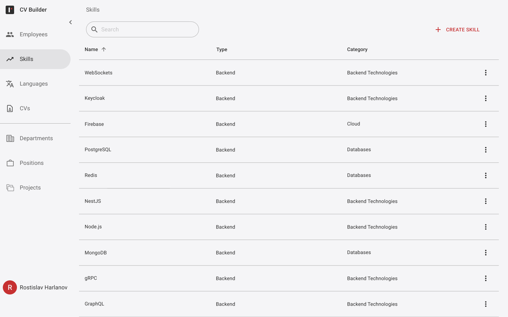

# Skills Page (admin)

## Purpose

Allows administrators to manage the global skills catalog used throughout the application.

Administrators can:

- View available skills
- Search skills
- Sort skills
- Navigate through paginated results
- Create new skills
- Update existing skills
- Delete skills
The global skills catalog is used by other parts of the application, including the User Skills page.

---

## Scope

This page is available only to authenticated users with the **Admin** role.

### Admin permissions

Admins can:

- Read the skills catalog
- Search skills
- Sort skills
- Navigate through pagination
- Create skills
- Update skills
- Delete skills

### Non-admin users

Users without Admin permissions:

- Must not be able to access this page
- Must not see the administrative `Skills` navigation item
- Must not create skills
- Must not update skills
- Must not delete skills
Frontend role-based UI restrictions must not be considered a security mechanism.

The backend must independently verify Admin permissions for every protected operation.

---

## Behavior

The page allows administrators to:

- View a paginated list of skills
- Search skills by name
- Sort skills by name
- Create new skills
- Edit existing skills
- Delete existing skills
- Navigate through pages of results
All skill data must be loaded from the backend.

The frontend must not use hardcoded skill data as the source of truth.

Search, sorting, and pagination must be performed by the backend.

---

## Design Reference

Figma: CV Builder – [Skills (Admin)](https://www.figma.com/design/m3zxmLv79A6MsHCuAIQAoo/CV-Builder?node-id=21783-5022&t=sZGSfJ9wtI0Cn2yR-0)

---

## Layout

- Page must follow the standard application layout structure
- Sidebar navigation remains visible and accessible
- Skills content is displayed in the main content area
- Layout must be fully responsive across desktop and tablet devices
- Supports Light and Dark themes

---

## Navigation

### Sidebar

The following navigation item is available only for Admin users:

- `Skills`
Requirements:

- Navigation item is visible only for Admin users
- Selecting the navigation item opens the Skills page
- Active navigation item must be visually highlighted
- Navigation state must persist during page refresh
- Access to the page must be protected by authentication
- Backend authorization must determine whether the current user can access administrative skill operations
A non-admin user must receive an authorization error if they attempt to access the corresponding GraphQL operations directly.

---

## GraphQL Integration

All skill catalog operations must be performed through GraphQL.

The frontend must communicate with the backend using GraphQL queries and mutations.

### Required operations

The implementation should provide operations for:

- Fetching skills
- Searching skills
- Sorting skills
- Paginating skills
- Creating a skill
- Updating a skill
- Deleting a skill
- Fetching available skill categories
The exact GraphQL schema and naming conventions are defined by the backend implementation.

The frontend must correctly handle:

- Successful responses
- Validation errors
- Unauthorized errors
- Forbidden errors
- Not-found errors
- Conflict errors
- Dependency/business-rule errors
- Network errors
- Unexpected server errors

---

# Skills Query

The skills list must be requested from the backend.

The request must support:

- Pagination
- Search
- Sorting
Search, sorting, and pagination must be performed on the backend.

The frontend must not be required to load the entire skills catalog before applying these operations.

The API response should provide enough information for the frontend to render:

- Current page
- Page size
- Skills for the current page
- Total number of matching skills
- Pagination information required by the UI
Each skill should provide at least:

- Skill ID
- Skill name
- Skill type
- Category ID
- Category name

---

# Skill Categories Query

The Create and Edit Skill forms require the available skill categories.

Categories must be loaded from the backend.

The response should provide:

- Category ID
- Category name
- Skill type associated with the category
Requirements:

- Category options must not be hardcoded in the frontend
- Only valid categories can be selected
- The backend must validate the submitted category ID
- The backend determines the skill type associated with the selected category

---

# Content

## Page Header

The page contains:

- Back navigation button
- Page title: `Skills`
- Search field
- `CREATE SKILL` button

---

## Search

Search field placeholder:

`Search`

Requirements:

- Filters skills by name
- Search is case-insensitive
- Search is performed through the backend
- Search updates results without a full page reload
- Empty search displays all available skills
- Search works together with sorting and pagination
- Changing the search criteria resets pagination to the first page
The frontend may debounce search requests to avoid unnecessary API calls.

---

# Create Skill Action

Button:

`CREATE SKILL`

Requirements:

- Visible only for Admin users
- Opens Create Skill modal
- Supports:
  - default
  - hover
  - pressed
  - disabled states
The backend must independently verify that the authenticated user has permission to create skills.

---

# Skills Table

The table displays the following columns:

| Column | Description |
|---|---|
| Name | Skill name |
| Type | Skill type |
| Category | Skill category |

Requirements:

- Data is loaded from the backend
- Supports sorting
- Supports pagination
- Supports empty state
- Supports loading state
- Supports error state
- Table reflects the current backend data

---

# Sorting

Supports sorting by:

- Name
Requirements:

- Sorting is performed by the backend
- Sort direction must be supported
- Sorting works together with search and pagination
- Changing sorting resets pagination to the first page
- Current sorting state is visually indicated
- Backend validates the requested sort field
The backend must not accept arbitrary database fields as sorting parameters.

---

# Row Actions

Each row contains a three-dot action menu.

Clicking the menu opens:

- `Edit`
- `Delete`
Requirements:

- Menu opens near the selected row
- Only one menu may be open at a time
- Menu closes when:
  - clicking outside
  - selecting an action
  - pressing Escape
The backend remains the final authorization boundary for all actions.

---

# Create Skill Modal

## Trigger

Opened from:

`CREATE SKILL`

---

## Content

Title:

`Create skill`

### Skill Name

Input field:

`Skill`

Requirements:

- Required field
- Supports:
  - default
  - focus
  - error
  - disabled states

### Category

Select field:

`Category`

Requirements:

- Required field
- Available categories are loaded from the backend
- Displays valid skill categories
- Selected category determines the skill type
- Type is not directly editable
- Supports:
  - default
  - focus
  - error
  - disabled states

### Skill Type

The skill type is derived from the selected category.

Requirements:

- Type is not directly editable by the administrator
- Type must be determined by the backend domain model
- Frontend may display the resulting type if required by the design
- Backend must not trust a client-provided type if it can be derived from the category
The category is the source of truth for determining the skill type.

---

# Create Skill Validation

Validation must be implemented on both frontend and backend.

## Client-side validation

Rules:

- Skill name is required
- Category is required
Example messages:

- `Skill is required`
- `Category is required`
Client-side validation is intended for user experience and must not replace server-side validation.

## Backend validation

The backend must independently validate:

- Skill name
- Skill name format and allowed length
- Category ID
- Category existence
- Skill name uniqueness
- Current user's Admin authorization
The database must enforce uniqueness where applicable.

---

# Create Skill Actions

Buttons:

- `CANCEL`
- `CREATE`
Requirements:

- CREATE remains disabled until required fields are valid
- Clicking CREATE sends a GraphQL mutation
- Loading state is displayed during creation
- Duplicate submissions are prevented
- Successful creation updates the skills table
- Modal closes after successful creation
- Failed requests keep entered values
- Backend errors are displayed in a user-friendly way
The newly created skill must be persisted in the database.

---

# Update Skill Modal

## Trigger

Opened from:

`Edit`

---

## Content

Title:

`Edit skill`

Fields:

### Skill Name

Requirements:

- Existing value is loaded from the backend
- Editable
- Required

### Category

Requirements:

- Existing category is loaded from the backend
- Editable
- Required
- Available categories are loaded from the backend
- Changing the category updates the derived skill type

### Skill Type

Requirements:

- Derived from the selected category
- Not directly editable
- Must remain consistent with the selected category

---

# Update Skill Validation

The validation rules are the same as Create Skill.

The backend must additionally validate:

- Skill exists
- Category exists
- Skill name uniqueness
- Current user's Admin authorization
- Any existing relationships or business rules affected by changing the category
If the skill name is unique except for the skill currently being edited, the update must be allowed.

For example, updating:

`React`

to:

`React.js`

should not be rejected simply because the current record itself already has the same value before the update.

---

# Update Skill Actions

Buttons:

- `CANCEL`
- `SAVE`
Requirements:

- SAVE sends a GraphQL mutation
- Loading state is displayed during update
- Duplicate submissions are prevented
- Successful update changes the selected skill
- Modal closes after successful update
- Updated data appears in the table after successful backend response
- Failed requests do not clear entered values
- Backend errors are displayed in a user-friendly way
The updated skill must be persisted in the database.

---

# Delete Skill Modal

## Trigger

Opened from:

`Delete`

---

## Content

Title:

`Delete skill`

Message:

`Are you sure you want to delete skill {name}?`

Where:

- `{name}` = selected skill name

---

## Actions

Buttons:

- `CANCEL`
- `CONFIRM`
Requirements:

- CANCEL closes the modal without changes
- CONFIRM sends a GraphQL mutation
- Loading state is displayed while deletion is in progress
- Duplicate deletion requests are prevented
- Backend verifies Admin authorization
- Deleted skill is removed from the table only after successful backend response
- Modal closes after successful deletion
The deletion must be persisted in the database.

---

# Skill Deletion & Relationships

Skills are global entities and may be referenced by user skill assignments.

Before deleting a skill, the backend must define and enforce the application's deletion policy.

Possible approaches include:

- Prevent deletion while the skill is assigned to users
- Remove all related user-skill assignments as part of a controlled cascade
- Soft-delete the skill while preserving historical relationships
The implementation must use one clearly defined strategy.

The frontend must correctly display the corresponding backend error when deletion is not allowed.

For example:

`Skill cannot be deleted because it is assigned to users`

The frontend must not assume that a skill can always be deleted simply because the Delete action is visible.

---

# Pagination

Requirements:

- Available when results exceed page size
- Pagination is performed by the backend
- Allows navigation between pages
- Current page must be visually highlighted
- Search and sorting work together with pagination
- Changing search or sorting resets pagination to the first page
- Pagination state is synchronized with the current query
- Empty pages are handled correctly if data changes between requests

---

# States

## Loading State

Displayed while skills are being loaded.

Requirements:

- Table structure remains visible
- Loading indicator is displayed
- Actions that depend on unavailable data are appropriately disabled
- Initial loading and subsequent list updates are handled consistently

---

## Empty State

Displayed when:

- No skills exist
- Search returns no results
Example message:

`No skills found`

The UI should distinguish between an empty dataset and a failed request.

---

## Error State

Displayed when the skills list cannot be loaded.

Requirements:

- Error message is shown
- Retry action is available
- Retry repeats the failed GraphQL request
- Existing search/sorting/pagination state is preserved where possible

---

# Validation & Error Handling

The frontend must handle errors returned by the GraphQL API.

## Create errors

Examples:

- Invalid skill name
- Category not found
- Skill already exists
- Unauthorized
- Forbidden
- Server error
- Network error

## Update errors

Examples:

- Invalid input
- Skill not found
- Category not found
- Skill already exists
- Unauthorized
- Forbidden
- Server error
- Network error

## Delete errors

Examples:

- Skill not found
- Unauthorized
- Forbidden
- Skill cannot be deleted because it is in use
- Server error
- Network error
Requirements:

- Validation errors must be displayed inline where applicable
- System errors must be displayed in a user-friendly way
- Failed requests must not clear entered values
- Successful operations must update the UI only after backend confirmation
- The frontend must not assume that an operation succeeded before receiving a successful backend response
- Authorization errors must not be presented as generic validation errors
- Business-rule errors must be displayed appropriately

---

# Authorization & Security

Role-based access control must be enforced on the backend.

Requirements:

- Unauthenticated users cannot access the administrative Skills page
- Employee/User roles cannot perform administrative skill operations
- Only Admin users can read the administrative skills catalog through protected operations
- Only Admin users can create skills
- Only Admin users can update skills
- Only Admin users can delete skills
- GraphQL queries and mutations must perform authorization checks
- Backend must validate all incoming skill data
- Backend must validate category IDs
- Backend must validate skill uniqueness
- Backend must not trust a client-provided skill type when it can be derived from the category
- Database constraints must prevent duplicate skill names where required
Frontend visibility of the `Skills` navigation item, Create button, and action menu is not sufficient authorization.

A user must not be able to bypass authorization by manually sending GraphQL requests.

---

# Database Requirements

The database must persist the global skill catalog.

The data model should support at least:

### Skill

- Skill ID
- Skill name
- Category ID
- Skill type or derived type according to the domain model
- Required timestamps

### Skill Category

- Category ID
- Category name
- Skill type
- Required timestamps
Requirements:

- Skill name must be unique
- Category must reference an existing category
- Category must determine the skill type
- Required fields must not be nullable
- Database constraints should prevent invalid relationships
- Skill deletion behavior must be explicitly defined
- Existing User Skill relationships must be handled according to the selected deletion strategy
If skill type is fully derivable from category, storing it redundantly in the Skill table is optional and should be justified by the domain model.

---

# Accessibility & Responsiveness

- Full keyboard navigation support is required
- Interactive elements must provide visible focus states
- Form controls must include accessible labels
- Modal dialogs must trap keyboard focus
- Escape key closes action menus and modals
- Content must remain readable in both Light and Dark themes
- Layout must scale correctly across supported screen sizes
- Table and action menus must remain usable on supported tablet layouts

---

# Acceptance Criteria

| ID | Description |
|---|---|
| AC-1 | Skills Admin page is accessible only to authenticated Admin users |
| AC-2 | Skills navigation item is visible only for Admin users |
| AC-3 | Non-admin users cannot access protected administrative skill operations |
| AC-4 | Skills table displays Name, Type, and Category columns |
| AC-5 | Skills are loaded from the backend through GraphQL |
| AC-6 | Search filters skills by name |
| AC-7 | Search is performed by the backend |
| AC-8 | Search is case-insensitive |
| AC-9 | Skills can be sorted by Name |
| AC-10 | Sorting is performed by the backend |
| AC-11 | Pagination is performed by the backend |
| AC-12 | Search, sorting, and pagination work together |
| AC-13 | CREATE SKILL button opens Create Skill modal |
| AC-14 | Administrator can create a new skill |
| AC-15 | Skill creation requires Name and Category |
| AC-16 | Available categories are loaded from the backend |
| AC-17 | Category determines the skill Type |
| AC-18 | Backend validates skill name uniqueness |
| AC-19 | Row action menu contains Edit and Delete actions |
| AC-20 | Edit action opens Edit Skill modal |
| AC-21 | Existing skill data is loaded into the Edit Skill modal |
| AC-22 | Administrator can update an existing skill |
| AC-23 | Category can be changed during skill update |
| AC-24 | Skill Type is updated according to the selected Category |
| AC-25 | Skill updates are persisted in the database |
| AC-26 | Delete action opens Delete Skill confirmation modal |
| AC-27 | Backend verifies Admin authorization before deletion |
| AC-28 | Skill deletion follows the defined relationship/dependency policy |
| AC-29 | Successfully deleted skills are removed from the table |
| AC-30 | Skill deletion is persisted in the database |
| AC-31 | Validation errors are displayed inline |
| AC-32 | GraphQL errors are handled appropriately |
| AC-33 | Business-rule errors are displayed appropriately |
| AC-34 | Loading, Empty, and Error states are supported |
| AC-35 | Failed requests do not unnecessarily clear entered form values |
| AC-36 | Retry repeats the failed request |
| AC-37 | Page supports Light and Dark themes |
| AC-38 | Page is responsive across supported devices |
| AC-39 | Keyboard accessibility is fully supported |

