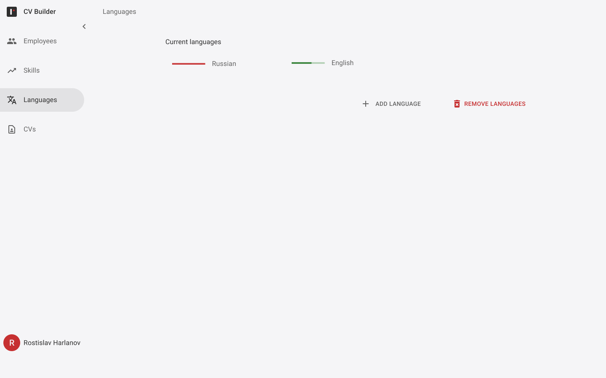

# Languages Page

## Purpose

Allows users to manage their personal language knowledge and proficiency levels.

The page manages languages assigned to the **currently authenticated user**.

This specification covers personal language management only.

Administrative management of the global language catalog is handled by a separate Admin page.

---

## Scope

This page is available to authenticated **User** and **Admin** roles.

Both roles can manage languages belonging to their own profile.

### User permissions

Users can:

- Read their own languages
- Add languages to their own profile
- Update proficiency levels of their own languages
- Remove languages from their own profile
Users cannot:

- Modify another user's languages
- Create or modify global language definitions

### Admin permissions

Admins can:

- Read their own languages
- Add languages to their own profile
- Update proficiency levels of their own languages
- Remove languages from their own profile
Unless explicitly defined by the separate administrative Languages specification, Admin users must not modify another user's personal languages through this page.

The backend must validate that the authenticated user can only modify language assignments belonging to their own profile.

Frontend role-based restrictions must not be considered a security mechanism.

---

## Behavior

The page allows users to:

- View assigned languages
- View language proficiency levels
- Add a new language
- Update an existing language's proficiency level
- Enter language selection mode
- Select multiple languages
- Remove selected languages after confirmation
All language data must be loaded from the backend.

The frontend must not use hardcoded user language data as the source of truth.

The backend must determine which languages are assigned to the authenticated user.

---

## Design Reference

Figma: CV Builder – [Languages (User)](https://www.figma.com/design/m3zxmLv79A6MsHCuAIQAoo/CV-Builder?node-id=21482-31464&t=V7uXKk8xz7rQVmQ2-0)

---

## Layout

- Page must follow the standard application layout structure
- Sidebar navigation remains visible and accessible
- Languages are displayed in the main content area
- Languages are displayed within a single section
- Layout must be fully responsive across desktop and tablet devices
- Supports Light and Dark themes

---

## Navigation

### Sidebar

The page must be accessible through the appropriate profile/navigation item defined by the application.

Requirements:

- Navigation item is available for authenticated users
- Active navigation item must be visually highlighted
- Navigation state must persist during page refresh
- Access to the page must be protected by authentication
- Unauthenticated users must not be able to access personal language data
The backend must determine the authenticated user from the current authentication context.

The client must not provide an arbitrary user ID to access another user's languages unless such access is explicitly supported by the API.

---

## GraphQL Integration

All language operations must be performed through GraphQL.

The frontend must communicate with the backend using GraphQL queries and mutations.

### Required operations

The implementation should provide operations for:

- Fetching the current user's languages
- Fetching available languages
- Adding a language to the current user's profile
- Updating the current user's language proficiency
- Removing one or multiple languages from the current user's profile
The exact GraphQL schema and naming conventions are defined by the backend implementation.

The frontend must correctly handle:

- Successful responses
- Validation errors
- Authorization errors
- Not-found errors
- Conflict errors
- Network errors
- Unexpected server errors

---

# Languages Query

The user's assigned languages must be requested from the backend.

The query should return enough information for the frontend to render:

- Language ID
- Language name
- Language proficiency
- User-language assignment ID where applicable
The backend should return languages already associated with the authenticated user.

The frontend must not fetch all users and filter their languages locally.

The current user's identity must be determined from the authenticated session/token on the backend.

---

# Available Languages Query

The Add Language modal must load available languages from the backend.

The response should provide enough information to:

- Display available languages
- Identify each language uniquely
- Prevent invalid language IDs from being submitted
The frontend must not rely on a hardcoded list of available languages.

---

# Content

## Page Header

The page contains:

- Back navigation button where required by the application layout
- Page title: `Languages`
Actions:

- `ADD LANGUAGE`
- `REMOVE LANGUAGES`
The Remove Languages action activates selection mode.

---

## Current Languages

Section title:

`Current Languages`

Requirements:

- Displays all languages assigned to the authenticated user
- Each language displays its proficiency level
- Languages must be visually separated and easily identifiable
- Language data is loaded from the backend

---

## Language Item

Each language displays:

- Language name
- Language proficiency
- Edit action
- Selection control when removal mode is active
Examples:

- `English — C1`
- `German — B2`
- `French — Native`
Requirements:

- Language item supports editing
- Language item supports selection mode
- Selected languages must be visually highlighted
- Language ID must be associated with the corresponding item
- Language data must come from the backend

---

# Language Proficiency

The available proficiency levels are:

- `A1`
- `A2`
- `B1`
- `B2`
- `C1`
- `C2`
- `Native`
The backend must define and validate the supported proficiency values.

The frontend must not be able to submit arbitrary proficiency values.

---

# Add Language Action

Button:

`ADD LANGUAGE`

Requirements:

- Visible when the page is not in removal mode
- Opens Add Language modal
- Supports:
  - default
  - hover
  - pressed
  - disabled states
The backend must independently verify that the authenticated user can modify their own languages.

---

# Add Language Modal

## Trigger

Opened from:

`ADD LANGUAGE`

---

## Content

Title:

`Add language`

### Language

Select field containing available languages.

Requirements:

- Required field
- Available languages are loaded from the backend
- Each option has a unique language ID
- Already assigned languages should not be selectable where possible
- Backend must still prevent duplicate assignments

### Language Proficiency

Select field containing proficiency levels.

Requirements:

- Required field
- Available values are defined by the backend domain model
Available values:

- `A1`
- `A2`
- `B1`
- `B2`
- `C1`
- `C2`
- `Native`

---

# Add Language Validation

Validation must be implemented on both frontend and backend.

## Client-side validation

Rules:

- Language is required
- Language proficiency is required
Example messages:

- `Language is required`
- `Language proficiency is required`
Client-side validation is intended for user experience and must not replace server-side validation.

## Backend validation

The backend must independently validate:

- Language ID
- Language existence
- Language proficiency
- Duplicate language assignment
- Current user's authorization
- Any required relationship constraints
The backend must reject a request that references a nonexistent language.

---

# Add Language Actions

Buttons:

- `CANCEL`
- `ADD`
Requirements:

- ADD remains disabled until required fields are valid
- Clicking ADD sends a GraphQL mutation
- Loading state is displayed during creation
- Duplicate submissions are prevented
- Successful creation updates the languages list
- Modal closes after successful creation
- Failed requests keep the entered values
- Backend errors are displayed in a user-friendly way
The new user-language relationship must be persisted in the database.

---

# Update Language Action

## Trigger

Opened from:

`Edit`

---

# Edit Language Modal

## Content

Title:

`Edit language`

### Language

Requirements:

- Displays selected language
- Read-only
- Disabled
- Cannot be changed

### Language Proficiency

Requirements:

- Editable
- Displays the current proficiency level
- Allows selecting another supported proficiency level
Available values:

- `A1`
- `A2`
- `B1`
- `B2`
- `C1`
- `C2`
- `Native`

---

# Update Language Validation

Validation must be implemented on both frontend and backend.

## Client-side validation

Rules:

- Language proficiency is required

## Backend validation

The backend must independently validate:

- User-language relationship exists
- Language proficiency is supported
- Current user owns the language assignment
- Current user is authorized to modify the assignment
The backend must reject attempts to update a language assignment belonging to another user.

---

# Update Language Actions

Buttons:

- `CANCEL`
- `SAVE`
Requirements:

- SAVE sends a GraphQL mutation
- Loading state is displayed during update
- Duplicate submissions are prevented
- Successful update changes the displayed proficiency level
- Modal closes after successful update
- Failed requests do not clear entered values
- Backend errors are displayed in a user-friendly way
The updated proficiency level must be persisted in the database.

---

# Remove Languages Action

Button:

`REMOVE LANGUAGES`

Requirements:

- Activates language selection mode
- Allows selecting multiple languages
- Selected languages are visually highlighted
- Add Language action is unavailable while selection mode is active
- Remove action displays the number of selected languages
Examples:

- `REMOVE (1)`
- `REMOVE (3)`
- `REMOVE (5)`
The displayed count must correspond to the current number of selected languages.

---

# Selection Mode

Requirements:

- User can select multiple languages
- User can deselect previously selected languages
- Selected items have a clear visual state
- Selection state is maintained until removal or cancellation
- Selecting a language must not modify backend data
- Selection is local UI state until the user confirms removal

### Cancel Selection

A cancel action must:

- Exit selection mode
- Clear all selected languages
- Restore the normal page state
- Not send a backend request

---

# Remove Languages Confirmation Modal

## Trigger

Opened after the user selects one or more languages and confirms the Remove action.

---

## Content

Title:

`Remove language`

Message:

`Are you sure you want to remove {count} languages?`

Where:

- `{count}` = number of currently selected languages
Examples:

- `Are you sure you want to remove 1 language?`
- `Are you sure you want to remove 3 languages?`

---

## Actions

Buttons:

- `CANCEL`
- `CONFIRM`
Requirements:

- CANCEL closes the modal without changes
- CONFIRM sends a GraphQL mutation
- Loading state is displayed while removal is in progress
- Duplicate removal requests are prevented
- Backend verifies that the selected language assignments belong to the authenticated user
- Removed languages disappear from the list only after successful backend response
- Modal closes after successful removal
- Selection mode is exited after successful removal
The removal must be persisted in the database.

The backend must reject attempts to remove language assignments belonging to another user.

---

# Database Model

The database must persist the relationship between users and languages.

The exact schema may depend on the selected database technology, but the model should support at least:

### User

- User ID
- Other user profile fields required by the application

### Language

- Language ID
- Language name
- Required timestamps where applicable

### User Language

Represents the relationship between a user and a language.

Should contain at least:

- User ID
- Language ID
- Language proficiency
- Required timestamps
Requirements:

- A user must not have the same language assigned more than once
- A unique constraint should exist for the `(userId, languageId)` combination
- Language references must point to existing languages
- User references must point to existing users
- Proficiency must use a controlled set of values
- Removing a user language must not delete the global language definition
The exact relationship and deletion behavior must be defined by the backend data model.

---

# Language Catalog

Languages are global entities used throughout the application.

Examples:

- English
- German
- French
- Spanish
Requirements:

- Languages must be persisted in the database or another defined backend source of truth
- Users cannot modify global language definitions through this page
- Users cannot rename languages through this page
- Users cannot create arbitrary global languages through this page
- The backend determines which languages are available for assignment
Administrative language catalog management belongs to the separate Admin Languages functionality.

---

# States

## Loading State

Displayed while assigned languages or available language options are being loaded.

Requirements:

- Loading indicator is displayed
- Page structure remains stable where possible
- Actions that depend on unavailable data are appropriately disabled
- Initial loading and subsequent updates are handled consistently

---

## Empty State

Displayed when the authenticated user has no assigned languages.

Example message:

`No languages added`

The Add Language action remains available.

The UI should distinguish between an empty language list and a failed request.

---

## Error State

Displayed when languages cannot be loaded.

Requirements:

- Error message is shown
- Retry action is available
- Retry repeats the failed GraphQL request
- Existing UI state is preserved where possible

---

# Validation & Error Handling

The frontend must handle errors returned by the GraphQL API.

## Add errors

Examples:

- Invalid language
- Invalid proficiency
- Language already exists
- Unauthorized
- Forbidden
- Network error
- Server error

## Update errors

Examples:

- Language assignment not found
- Invalid proficiency
- Unauthorized
- Forbidden
- Network error
- Server error

## Remove errors

Examples:

- Language assignment not found
- Unauthorized
- Forbidden
- Language cannot be removed
- Network error
- Server error
Requirements:

- Validation errors must be displayed near the relevant field where applicable
- System errors must be displayed in a user-friendly way
- Failed requests must not unnecessarily clear user input
- Successful operations must update the UI only after the backend confirms the operation
- The frontend must not assume that an operation succeeded before receiving a successful backend response
- Authorization errors must not be presented as generic validation errors
- GraphQL errors must be handled consistently

---

# Authorization & Security

Authorization must be enforced on the backend.

Requirements:

- Unauthenticated users cannot access personal languages
- Authenticated users can read their own languages
- Authenticated users can add languages only to their own profile
- Authenticated users can update only their own language assignments
- Authenticated users can remove only their own language assignments
- Users cannot modify another user's languages by manually changing IDs in GraphQL requests
- GraphQL mutations must perform authorization checks
- Language IDs must be validated against existing database records
- Proficiency values must be validated against the allowed set
- Users cannot create or modify global language definitions through this page
- Database constraints must prevent duplicate user-language assignments
The frontend hiding or displaying controls is not considered sufficient authorization.

---

# Accessibility & Responsiveness

- Full keyboard navigation support is required
- Interactive elements must provide visible focus states
- Form controls must include accessible labels
- Modal dialogs must trap keyboard focus
- Escape key closes open modals where appropriate
- Selected languages must have an accessible selected state
- Interactive language actions must be keyboard accessible
- Content must remain readable in both Light and Dark themes
- Layout must scale correctly across supported screen sizes
- Language items and actions must remain usable on supported tablet layouts

---

# Acceptance Criteria

| ID | Description |
|---|---|
| AC-1 | Authenticated users can access their own Languages page |
| AC-2 | Users can view their assigned languages |
| AC-3 | Languages are loaded from the backend through GraphQL |
| AC-4 | Available languages are loaded from the backend |
| AC-5 | Language proficiency is displayed for each assigned language |
| AC-6 | User can open the Add Language modal |
| AC-7 | User can add a language to their own profile |
| AC-8 | Language creation requires Language and Language Proficiency |
| AC-9 | Backend validates the selected language |
| AC-10 | Backend validates the selected proficiency |
| AC-11 | Duplicate user-language assignments are prevented |
| AC-12 | User can open the Edit Language modal |
| AC-13 | Language field is disabled in Edit mode |
| AC-14 | User can update language proficiency |
| AC-15 | Language updates are persisted in the database |
| AC-16 | User can enter language removal mode |
| AC-17 | Multiple languages can be selected for removal |
| AC-18 | Selected languages are visually highlighted |
| AC-19 | Remove action displays the number of selected languages |
| AC-20 | Confirmation modal is displayed before removal |
| AC-21 | User can remove selected languages |
| AC-22 | Removed languages are deleted from the user's language assignments in the database |
| AC-23 | Users cannot modify another user's languages |
| AC-24 | Backend authorization is enforced for language mutations |
| AC-25 | Global language definitions cannot be modified from the User Languages page |
| AC-26 | Validation errors are displayed appropriately |
| AC-27 | GraphQL errors are handled appropriately |
| AC-28 | Loading, Empty, and Error states are supported |
| AC-29 | Failed requests do not unnecessarily clear entered form values |
| AC-30 | Retry repeats the failed request |
| AC-31 | Page supports Light and Dark themes |
| AC-32 | Page is responsive across supported devices |
| AC-33 | Keyboard accessibility is fully supported |

