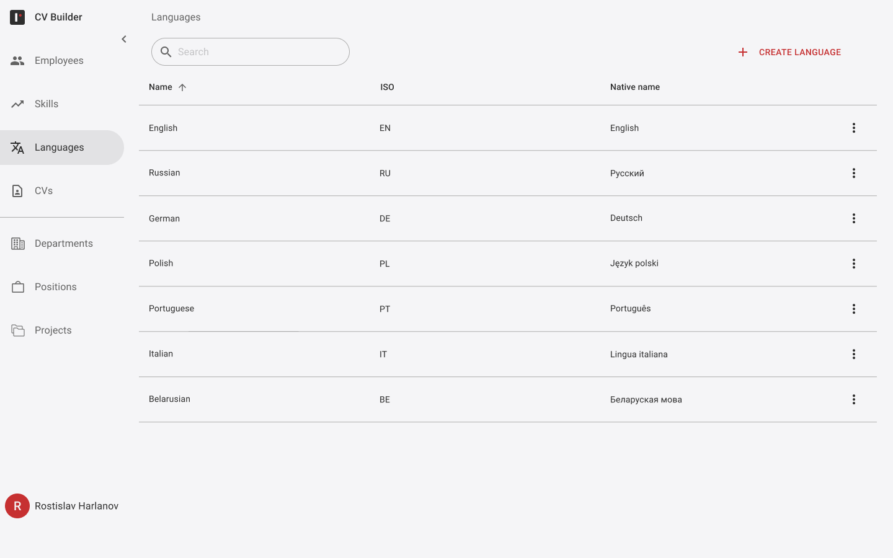

# Languages Page (admin)




## Purpose

Allows administrators to manage the global language catalog available throughout the application.

Administrators can:

- View all available languages
- Search languages
- Sort languages
- Create new languages
- Edit existing languages
- Delete languages
The language catalog is a shared system-level resource. Languages created or updated on this page become available to users throughout the application.


---


## Scope

This page is available only to users with the **Admin** role.

Administrators can manage the global language catalog.

Regular users must not have access to this page or its management operations.

The page is responsible for managing language definitions only. Assigning languages to individual users is handled separately on the **Languages Page (User)**.


---


## Behavior

The page allows administrators to:

- View a paginated list of languages
- Search languages by name
- Sort languages by Name and ISO
- Create new languages
- Edit existing languages
- Delete existing languages
- Navigate through pages of results
- View loading, empty, and error states
Search, sorting, and pagination must be performed on the backend so that the page can work efficiently with a large language catalog.


---


## Design Reference

Figma: CV Builder – [Languages (Admin)](https://www.figma.com/design/m3zxmLv79A6MsHCuAIQAoo/CV-Builder?node-id=21482-12074&t=sZGSfJ9wtI0Cn2yR-0)


---


## Layout

- Page must follow the standard application layout structure.
- Sidebar navigation remains visible and accessible.
- Languages content is displayed in the main content area.
- Layout must be fully responsive across desktop and tablet devices.
- Supports Light and Dark themes.

---


## Navigation


### Sidebar

The following navigation item is visible only for Admin users:

- `Languages`
Requirements:

- Selecting the navigation item opens the Languages page.
- Active navigation item must be visually highlighted.
- Navigation state must persist during page refresh.
- Backend authorization must prevent non-admin users from accessing the page data even if they navigate directly to the route.

---


## GraphQL Integration

The frontend communicates with the backend through GraphQL.

The backend is responsible for:

- Retrieving languages
- Applying search filters
- Applying sorting
- Applying pagination
- Creating languages
- Updating languages
- Deleting languages
- Validating language data
- Enforcing uniqueness constraints
- Enforcing Admin authorization
- Applying business rules related to language deletion
The frontend must not implement the language catalog as a client-only data source.


---


## Languages Query

The page must use a GraphQL query to retrieve languages.

The query should support:

- Search
- Sorting
- Pagination

---


## Create Language Mutation

Creating a language must be performed through a GraphQL mutation.

The mutation receives:

- Name
- ISO
- Native Name
The backend must:

- Validate all required fields.
- Normalize the ISO code.
- Check for duplicate language names.
- Check for duplicate ISO codes.
- Persist the language in the database.
- Return the created language.

---


## Update Language Mutation

Updating a language must be performed through a GraphQL mutation.

The backend must:

- Validate the updated values.
- Normalize the ISO code.
- Check uniqueness constraints.
- Update the selected language.
- Return the updated language.

---


## Delete Language Mutation

Deleting a language must be performed through a GraphQL mutation.

The backend must:

- Verify that the language exists.
- Verify that the administrator has permission to delete it.
- Apply the application's language deletion business rules.
- Remove or deactivate the language according to the configured deletion policy.
The frontend must correctly display any business-rule error returned by the backend.


---


## Content


### Page Header

The page contains:

- Back navigation button
- Page title: `Languages`
- Search field
- Create action button

---


## Search

Search field placeholder:

`Search`

Requirements:

- Filters languages by name.
- Search is case-insensitive.
- Search is performed on the backend.
- Search updates results without a full page reload.
- Empty search displays all available languages.
- Starting a new search resets pagination to the first page.
- Search must work together with sorting and pagination.
The frontend must pass the search value to the GraphQL query rather than filtering only the currently loaded page.


---


## Create Language Action

Button:

`CREATE LANGUAGE`

Requirements:

- Visible only for Admin users.
- Opens Create Language modal.
- Supports:
  - default
  - hover
  - pressed states

---


## Languages Table

The table displays the following columns:

| Column | Description |
|---|---|
| Name | Language name |
| ISO | ISO language code |
| Native Name | Native language name |
| Actions | Available row actions |

Examples:

| Name | ISO | Native Name |
|---|---|---|
| English | EN | English |
| German | DE | Deutsch |
| Ukrainian | UK | Українська |

Requirements:

- Data is displayed in tabular format.
- Supports sorting by Name.
- Supports sorting by ISO.
- Sorting is performed on the backend.
- Supports pagination.
- Supports loading state.
- Supports empty state.
- Supports error state.

---


## Sorting

The table supports sorting by:

- Name
- ISO
Requirements:

- Clicking a sortable column changes the sorting state.
- Current sorting direction is visually indicated.
- Sorting is performed by the backend.
- Sorting works together with search.
- Sorting works together with pagination.
- Changing the sorting resets pagination to the first page.
The backend must apply sorting to the complete result set before pagination.


---


## Row Actions

Each row contains an action menu represented by a three-dot icon.

Clicking the menu opens a contextual menu containing:

- `Edit`
- `Delete`
Requirements:

- Menu opens near the selected row.
- Only one menu may be open at a time.
- Menu closes when:
  - clicking outside
  - selecting an action
  - pressing Escape

---


# Create Language


## Create Language Modal


### Trigger

Opened from:

`CREATE LANGUAGE`


### Content

Title:

`Create language`

Fields:


### Name

Input field:

`Name`

Requirements:

- Required field.
- Supports:
  - default
  - focus
  - error
  - disabled states

### ISO

Input field:

`ISO`

Example:

`EN`

Requirements:

- Required field.
- Accepts a language ISO code.
- Value is automatically converted to uppercase.
- Maximum length: 5 characters.
- Supports:
  - default
  - focus
  - error
  - disabled states
The frontend may normalize the value for immediate feedback, but the backend must also normalize and validate the value.


### Native Name

Input field:

`Native Name`

Requirements:

- Required field.
- Supports:
  - default
  - focus
  - error
  - disabled states

---


## Create Language Validation

Validation messages must be displayed inline where applicable.

Rules:

- Name is required.
- ISO is required.
- Native Name is required.
- Duplicate language names are not allowed.
- Duplicate ISO codes are not allowed.
- ISO must not exceed 5 characters.
Example messages:

- `Name is required`
- `ISO is required`
- `Native name is required`
- `Language already exists`
- `ISO code already exists`
Client-side validation provides immediate feedback.

All validation rules must also be enforced on the backend.


---


## Create Language Actions

Buttons:

- `CANCEL`
- `CREATE`
Requirements:

- `CREATE` remains disabled until all required client-side fields are valid.
- Clicking `CREATE` sends the mutation to the backend.
- Loading state is displayed while the request is in progress.
- Successful creation updates the languages table.
- Modal closes after successful creation.
- Backend validation errors are displayed without clearing entered values.
- The language must persist after page refresh.

---


# Update Language


## Edit Language Modal


### Trigger

Opened from:

`Edit`


### Content

Title:

`Edit language`

Fields:

- Name
- ISO
- Native Name
Requirements:

- Existing values are prefilled.
- Same validation rules as Create Language.
- The selected language ID must be associated with the update operation.
- The frontend must not rely on the language name or ISO alone to identify the record.

---


## Update Language Validation

The backend must validate:

- Required fields.
- ISO length.
- Language name uniqueness.
- ISO uniqueness.
When checking uniqueness, the currently edited language must be excluded from the duplicate check.

For example, saving an unchanged language must not produce a duplicate error against itself.


---


## Update Language Actions

Buttons:

- `CANCEL`
- `SAVE`
Requirements:

- `SAVE` sends the update mutation.
- Loading state is displayed while the request is in progress.
- Successful update closes the modal.
- Updated data appears in the table.
- Updated data persists after page refresh.
- Failed requests do not clear entered values.

---


# Delete Language


## Delete Language Modal


### Trigger

Opened from:

`Delete`


### Content

Title:

`Delete language`

Message:

`Are you sure you want to delete language {name}?`

Where:

- `{name}` = selected language name.

---


## Delete Language Actions

Buttons:

- `CANCEL`
- `CONFIRM`
Requirements:

- `CANCEL` closes the modal without changes.
- `CONFIRM` sends the delete mutation.
- Loading state is displayed while deletion is in progress.
- Successful deletion removes the language from the table.
- Modal closes after successful deletion.
- Deleted language must no longer be returned by the languages query.
If the language cannot be deleted because it is referenced by user data, the backend must return an appropriate business-rule error and the frontend must display it without closing the modal prematurely or losing the current page state.


---


# Pagination

Requirements:

- Pagination is available when results exceed the configured page size.
- Allows navigation between pages.
- Current page must be visually highlighted.
- Pagination is performed by the backend.
- Search and sorting work together with pagination.
- Changing search or sorting resets pagination to the first page.
- The backend returns the total number of matching languages so that the frontend can render pagination correctly.
Example conceptual query variables:

```plain text
search = "ger"
sortBy = NAME
sortOrder = ASC
page = 2
pageSize = 20
```


---


# States


## Loading State

Displayed while languages are being loaded.

Requirements:

- Table structure remains visible.
- Loading indicator is displayed.
- Existing data should not unnecessarily disappear when changing sorting or pagination if the UI can preserve it during the request.
- Create, Edit, and Delete actions must show an appropriate loading state while their mutations are executing.

---


## Empty State

Displayed when:

- No languages exist.
- Search returns no results.
Example message:

`No languages found`

When search returns no results, the UI should clearly indicate that the current filters/search produced no matching languages.


---


## Error State

Displayed when language data cannot be loaded.

Requirements:

- Error message is shown.
- Retry action is available.
- Existing search/sorting/pagination state is preserved where possible.
- Failed requests must not silently produce an empty table.

---


# Validation & Error Handling

Frontend validation must provide immediate feedback for form fields.

Backend validation is mandatory and is the final validation boundary.

The system must handle:

- Required field errors.
- Invalid ISO values.
- ISO length violations.
- Duplicate language names.
- Duplicate ISO codes.
- Language not found.
- Unauthorized access.
- Forbidden operations.
- Failed create requests.
- Failed update requests.
- Failed delete requests.
- Network or server errors.
- Business-rule errors when deleting a language that is still referenced.
Requirements:

- Validation errors are displayed inline where applicable.
- System and business-rule errors are displayed clearly.
- Failed requests must not clear entered values.
- Backend errors must not be exposed as raw technical errors when a user-friendly message can be provided.
- Mutations must not leave the UI in a state that differs from the persisted backend state.

---


# Authorization & Security

The Languages Admin page is protected by the **Admin** role.

Authorization must be enforced on the backend.

Requirements:

- Only authenticated Admin users can query the admin language-management operations.
- Only Admin users can create languages.
- Only Admin users can update languages.
- Only Admin users can delete languages.
- The backend must not rely on the frontend hiding buttons or navigation items as a security mechanism.
- Direct requests to protected GraphQL operations from non-admin users must be rejected.
- The server must validate ownership/authorization context before performing every mutation.
The frontend should hide Admin-only navigation and actions for non-admin users, but backend authorization remains the final security boundary.


---


# Database Model


## Language

The global language catalog should contain a language entity similar to:

```plain text
Language
- id
- name
- iso
- nativeName
- createdAt
- updatedAt
```

Recommended constraints:

- `name` must be unique.
- `iso` must be unique.
- `name` is required.
- `iso` is required.
- `nativeName` is required.
The exact database field names may differ depending on the backend implementation.


---


## User Language Relationship

The global `Language` entity can be referenced by user language records.

Conceptually:

```plain text
User
  |
  | 1:N
  v
UserLanguage
  |
  | N:1
  v
Language
```

`UserLanguage` may contain:

```plain text
UserLanguage
- id
- userId
- languageId
- proficiency
```

The relationship should enforce uniqueness for:

```plain text
(userId, languageId)
```


---


## Language Deletion Policy

Because languages may be referenced by users, the application must define how deletion behaves when a language is already in use.

One of the following policies must be implemented explicitly:

1. Prevent deletion while the language is referenced.
1. Remove dependent user-language relationships through a controlled cascade.
1. Use soft deletion and exclude inactive languages from the available catalog.
The chosen policy must be enforced by the backend and database layer.

The frontend must handle the resulting business-rule response correctly.


---


# Accessibility & Responsiveness

- Full keyboard navigation support is required.
- Interactive elements must provide visible focus states.
- Form controls must include accessible labels.
- Action menus must be keyboard accessible.
- Modal dialogs must trap keyboard focus.
- Escape key closes action menus and modals.
- Focus should return to the triggering element after closing a modal or action menu.
- Content must remain readable in both Light and Dark themes.
- Table content must remain usable across supported screen sizes.
- Layout must scale correctly across desktop and tablet devices.
- Buttons and interactive controls must have accessible names.

---


# Acceptance Criteria

| ID | Description |
|---|---|
| AC-1 | Languages page is accessible only for Admin users |
| AC-2 | Languages navigation item is visible for Admin users |
| AC-3 | Non-admin users cannot access protected language-management GraphQL operations |
| AC-4 | Languages table displays Name, ISO, and Native Name columns |
| AC-5 | Languages are loaded from the backend |
| AC-6 | Search filters languages by name |
| AC-7 | Search is case-insensitive |
| AC-8 | Search is performed on the backend |
| AC-9 | Languages can be sorted by Name and ISO |
| AC-10 | Sorting is performed on the backend |
| AC-11 | Pagination is available when required |
| AC-12 | Search, sorting, and pagination work together |
| AC-13 | CREATE LANGUAGE button opens Create Language modal |
| AC-14 | Administrator can create a new language |
| AC-15 | Language creation requires Name, ISO, and Native Name |
| AC-16 | ISO values are normalized to uppercase |
| AC-17 | ISO cannot exceed 5 characters |
| AC-18 | Duplicate language names are rejected by the backend |
| AC-19 | Duplicate ISO codes are rejected by the backend |
| AC-20 | Row action menu contains Edit and Delete actions |
| AC-21 | Only one row action menu can be open at a time |
| AC-22 | Edit action opens Edit Language modal |
| AC-23 | Existing language data is prefilled in the Edit modal |
| AC-24 | Administrator can update an existing language |
| AC-25 | Update validation prevents duplicate names and ISO codes |
| AC-26 | Delete action opens Delete Language confirmation modal |
| AC-27 | Confirming deletion sends the delete mutation |
| AC-28 | Successfully deleted languages are removed from the table |
| AC-29 | Language deletion follows the defined relationship/dependency policy |
| AC-30 | Backend authorization is enforced for all Admin operations |
| AC-31 | Validation errors are displayed inline |
| AC-32 | Create, update, and delete request errors are handled correctly |
| AC-33 | Failed requests do not clear entered form values |
| AC-34 | Loading, Empty, and Error states are supported |
| AC-35 | Retry is available when the language list fails to load |
| AC-36 | Language data persists after page refresh |
| AC-37 | Page supports Light and Dark themes |
| AC-38 | Page is responsive across supported devices |
| AC-39 | Keyboard accessibility is fully supported |
| AC-40 | Modal and action-menu focus behavior is accessible |
| AC-41 | Language records are persisted in the database |
| AC-42 | Language name and ISO uniqueness are enforced at the database/backend level |
| AC-43 | User-language relationships remain consistent with the language deletion policy |


