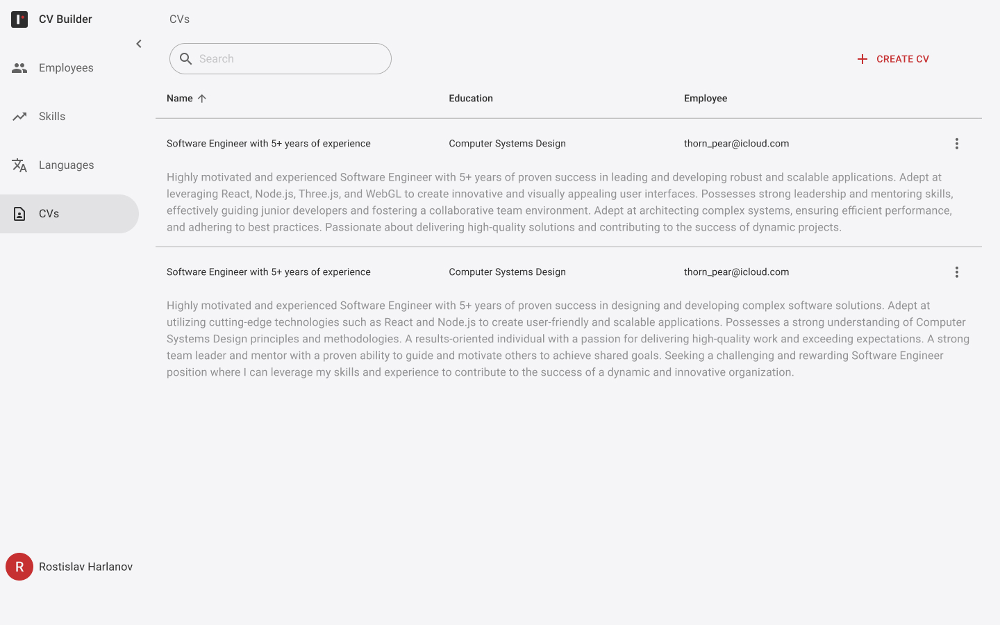

# CVs Page




## Purpose

Allows users to manage CVs.

The available functionality depends on the current user's role.


### Employee

Can:

- View own CVs
- Search own CVs
- Sort own CVs
- Navigate through paginated results
- View CV details
- Create CVs
- Update own CVs
- Delete own CVs
Employees must not be able to access or modify CVs belonging to other users.


### Admin

Can:

- View all CVs
- Search CVs
- Sort CVs
- Navigate through paginated results
- View CV details
- Create CVs
- Update any CV
- Delete any CV
All permissions must be enforced by the backend. Frontend role-based UI restrictions must not be considered a security mechanism.


---


## Scope

This page is available for both **Admin** and **Employee** roles.

Role-based permissions apply.


### Employee permissions

Employees can:

- Read their own CVs
- Search their own CVs
- Sort their own CVs
- Navigate through pagination
- View their own CV details
- Create CVs
- Update their own CVs
- Delete their own CVs
Employees cannot:

- Read CVs belonging to other users
- Update CVs belonging to other users
- Delete CVs belonging to other users
The backend must determine the ownership of the CV using the authenticated user rather than trusting an employee ID supplied by the frontend.


### Admin permissions

Admins can:

- Read all CVs
- Search CVs
- Sort CVs
- Navigate through pagination
- View any CV
- Create CVs
- Update any CV
- Delete any CV
The backend must validate the authenticated user's Admin permissions for every protected operation.


---


## Behavior

The page allows users to:

- View CVs
- Search CVs
- Sort CVs
- Navigate through paginated results
- Open CV details
Additionally, both Admin and Employee users can:

- Create CVs
Employees can:

- Update their own CVs
- Delete their own CVs
Admins can:

- Update any CV
- Delete any CV
The displayed dataset depends on the current user's role.

All CV data must be loaded from the backend.

The frontend must not use hardcoded CV data as the source of truth.


---


## Design Reference

Figma: CV Builder – [CVs page](https://www.figma.com/design/m3zxmLv79A6MsHCuAIQAoo/CV-Builder?node-id=21482-32412&t=QBCvpz02MoYfuwpY-0)


---


## Layout

- Page must follow the standard application layout structure
- Sidebar navigation remains visible and accessible
- CVs content is displayed in the main content area
- Search field is displayed above the table
- `CREATE CV` action is displayed above the table
- CVs are displayed in a table layout
- Table supports sorting
- Layout must be fully responsive across desktop and tablet devices
- Supports Light and Dark themes

---


## Navigation


### Sidebar

The page is available through:

- `CVs`
Requirements:

- Navigation item is visible for both Admin and Employee roles
- Active navigation item must be visually highlighted
- Navigation state must persist during page refresh
- Access to the page must be protected by authentication
- Backend authorization rules must determine which CV operations the current user can perform

---


## GraphQL Integration

All CV data operations must be performed through GraphQL.

The frontend must communicate with the backend using GraphQL queries and mutations.


### Required operations

The implementation should provide operations for:

- Fetching CVs
- Searching CVs
- Sorting CVs
- Paginating CVs
- Fetching a single CV
- Creating a CV
- Updating a CV
- Deleting a CV
The exact GraphQL schema and naming conventions are defined by the backend implementation.

The frontend must correctly handle:

- Successful responses
- Validation errors
- Authentication errors
- Authorization errors
- Not-found errors
- Conflict errors where applicable
- Network errors
- Unexpected server errors

---


## CVs Query

The CV list must be requested from the backend.

The request should support:

- Pagination
- Search
- Sorting
Search, sorting, and pagination must be applied on the backend.

The frontend must not be required to load the entire CV dataset before applying these operations.


### Employee

The backend must return only CVs owned by the authenticated employee.

The frontend must not be responsible for filtering another user's CVs out of the response.


### Admin

The backend may return CVs belonging to all users.

The API response should provide enough information for the frontend to render:

- Current page
- Page size
- CVs for the current page
- Total number of matching CVs
- Pagination information required by the UI

---


## Content


### Page Header

The page contains:

- Page title: `CVs`
- Search field
- `CREATE CV` button
The `CREATE CV` button is available for both Admin and Employee users.


---


## Search

Search field placeholder:

`Search`


### Employee

Searches CVs by:

- Name
Requirements:

- Search is case-insensitive
- Search is performed through the backend
- Search updates results without a full page reload
- Empty search displays all CVs belonging to the authenticated employee
- Search works together with sorting and pagination
- Employees cannot use search to access CVs belonging to other users

### Admin

Searches CVs by:

- Name
- Employee email
Requirements:

- Search is case-insensitive
- Search is performed through the backend
- Search updates results without a full page reload
- Empty search displays all CVs
- Search works together with sorting and pagination
The frontend may debounce search requests to avoid unnecessary API calls.

When search criteria changes, pagination should be reset to the first page.

The backend must apply the appropriate search scope based on the authenticated user's role.


---


## CVs Table

The table displays the following columns:

| Column | Description |
|---|---|
| Name | CV name |
| Education | Education information |
| Employee | CV owner's email |

Requirements:

- Data is loaded from the backend
- Supports sorting
- Supports pagination
- Supports empty state
- Supports loading state
- Supports error state
- Table reflects the current backend data

### Employee View

Requirements:

- Only CVs owned by the authenticated employee are displayed
- Employee column displays the current user's email

### Admin View

Requirements:

- CVs belonging to all users are displayed
- Employee column displays the CV owner's email
The backend must enforce the visibility rules.


---


## Sorting

Supports sorting by:

- Name
Requirements:

- Sorting is performed by the backend
- Supports ascending order
- Supports descending order
- Sorting works together with search and pagination
- Changing sorting resets pagination to the first page
- Current sorting state is visually indicated
- The backend must validate the requested sort field
The backend must not accept arbitrary database fields from the client as sort fields.


---


## CV Actions

Each CV row contains a three-dot action menu.

Available actions:

- `View`
- `Edit`
- `Delete`
Requirements:

- Actions menu is displayed for every CV row
- Menu opens near the selected row
- Only one menu may be open at a time
- Menu closes when:
  - clicking outside
  - selecting an action
  - pressing Escape
The frontend should display only actions available to the current user.

However, backend authorization remains the final security boundary.


### Employee

Employees may perform:

- View own CV
- Edit own CV
- Delete own CV
Employees must not be able to access another user's CV through manually constructed GraphQL requests.


### Admin

Admins may perform:

- View any CV
- Edit any CV
- Delete any CV

---


# Create CV


## Trigger

Opened from:

`CREATE CV`

Available for:

- Employee
- Admin
The backend must verify that the authenticated user has permission to create a CV.

For Employee users, the CV owner must be derived from the authenticated user rather than supplied as an arbitrary user ID by the client.


---


## Create CV Modal


### Content

Title:

`Create CV`

Fields:


### Name

Text input:

`Name`

Requirements:

- Required
- Maximum length: 255 characters

---


### Education

Text input:

`Education`

Requirements:

- Required
- Maximum length: 255 characters

---


### Description

Textarea:

`Description`

Requirements:

- Required

---


## Validation

Validation must be implemented on both frontend and backend.


### Client-side validation

Rules:

- Name is required
- Name must not exceed 255 characters
- Education is required
- Education must not exceed 255 characters
- Description is required
Example messages:

- `Name is required`
- `Name must not exceed 255 characters`
- `Education is required`
- `Education must not exceed 255 characters`
- `Description is required`
Client-side validation is intended for user experience and must not replace server-side validation.


### Backend validation

The backend must independently validate:

- Required fields
- Name length
- Education length
- Description
- Authenticated user's authorization
- CV ownership

---


## Actions

Buttons:

- `CANCEL`
- `CREATE`
Requirements:

- CREATE remains disabled until all required fields are valid
- Clicking CREATE sends a GraphQL mutation
- Loading state is displayed during creation
- Duplicate submissions are prevented
- Successful creation adds the new CV to the table
- Modal closes after successful creation
- Failed requests keep the entered values
- Backend errors are displayed in a user-friendly way
The newly created CV must be persisted in the database.


---


# View CV


## Trigger

Opened from:

`View`


---


## Behavior

Requirements:

- Opens CV Details page
- Selected CV data is loaded from the backend
- Full CV information available to the current user is displayed
- Employee users can only view CVs they own
- Admin users can view any CV
- Backend authorization is checked before returning the CV
A user must not be able to retrieve another employee's CV by manually modifying the CV identifier in a GraphQL request.

The CV details response must contain only information the authenticated user is authorized to access.


---


# Update CV


## Trigger

Opened from:

`Edit`

Available for:

- Employee — own CVs only
- Admin — any CV

---


## Update CV Modal


### Content

Title:

`Update CV`

Fields:


### Name

Text input:

`Name`

Requirements:

- Required
- Maximum length: 255 characters
- Pre-populated with the current value

---


### Education

Text input:

`Education`

Requirements:

- Required
- Maximum length: 255 characters
- Pre-populated with the current value

---


### Description

Textarea:

`Description`

Requirements:

- Required
- Pre-populated with the current value

---


## Validation

Validation must be implemented on both frontend and backend.


### Client-side validation

Rules:

- Name is required
- Name must not exceed 255 characters
- Education is required
- Education must not exceed 255 characters
- Description is required
Example messages:

- `Name is required`
- `Name must not exceed 255 characters`
- `Education is required`
- `Education must not exceed 255 characters`
- `Description is required`

### Backend validation

The backend must independently validate:

- Required fields
- Name length
- Education length
- Description
- CV existence
- Current user's authorization
- CV ownership for Employee users

---


## Actions

Buttons:

- `CANCEL`
- `SAVE`
Requirements:

- SAVE sends a GraphQL mutation
- Loading state is displayed during update
- Duplicate submissions are prevented
- SAVE updates the selected CV
- Modal closes after successful update
- Updated data appears in the table after successful backend response
- Failed requests do not clear entered values
- Backend errors are displayed in a user-friendly way
The updated CV must be persisted in the database.


---


# Delete CV


## Trigger

Opened from:

`Delete`

Available for:

- Employee — own CVs only
- Admin — any CV

---


## Delete CV Modal


### Content

Title:

`Delete CV`

Message:

`Are you sure you want to delete CV {name}?`

Where:

- `{name}` = selected CV name

---


## Actions

Buttons:

- `CANCEL`
- `CONFIRM`
Requirements:

- CANCEL closes the modal without changes
- CONFIRM sends a GraphQL mutation
- Loading state is displayed while deletion is in progress
- Duplicate deletion requests are prevented
- Backend verifies that the current user has permission to delete the selected CV
- Employee users can only delete their own CVs
- Admin users can delete any CV
- Deleted CV is removed from the table after successful backend response
- Modal closes after successful deletion
The deletion must be persisted in the database.

The frontend must not remove the CV permanently before receiving successful confirmation from the backend.


---


# Pagination

Requirements:

- Available when results exceed page size
- Pagination is performed by the backend
- Allows navigation between pages
- Current page must be visually highlighted
- Search and sorting must work together with pagination
- Changing search or sorting resets pagination to the first page
- Pagination state is synchronized with the current query
- Empty pages are handled correctly if data changes between requests
Employee pagination must operate only on CVs belonging to the authenticated employee.

Admin pagination must operate on the full CV dataset available to Admin users.


---


# States


## Loading State

Displayed while CVs are being loaded.

Requirements:

- Table structure remains visible
- Loading indicator or skeleton is displayed
- User actions are appropriately disabled while required data is loading
- Initial loading and subsequent list updates are handled consistently

---


## Empty State


### Employee

Displayed when the authenticated employee has no CVs.

Example message:

`You have no CVs yet`


### Admin

Displayed when no CVs match the current query.

Example message:

`No CVs found`

The UI should distinguish between an empty dataset and a failed request.


---


## No Search Results State

Displayed when the current search does not match any CVs.

Example message:

`No CVs found`

Requirements:

- Search value remains visible
- Existing sorting state remains applied
- User can modify or clear the search
- The UI must not treat an empty search result as a server error

---


## Error State

Displayed when CVs cannot be loaded.

Example message:

`Failed to load CVs`

Requirements:

- Error message is shown
- Retry action is available
- Retry repeats the failed GraphQL request
- Existing search/sorting/pagination state is preserved where possible

---


# Validation & Error Handling

The frontend must handle errors returned by the GraphQL API.


### Create errors

Examples:

- Invalid input
- Unauthorized
- Forbidden
- Validation error
- Server error
- Network error

### Update errors

Examples:

- Invalid input
- CV not found
- Unauthorized
- Forbidden
- Server error
- Network error

### Delete errors

Examples:

- CV not found
- Unauthorized
- Forbidden
- Server error
- Network error

### View errors

Examples:

- CV not found
- Unauthorized
- Forbidden
- Server error
- Network error
Requirements:

- Validation errors must be displayed inline where applicable
- System errors must be displayed in a user-friendly way
- Failed requests must not clear entered values
- Successful operations must update the UI only after the backend confirms the operation
- The frontend must not assume that an operation succeeded before receiving a successful backend response
- Authorization errors must not be presented as generic validation errors
- Not-found errors must be handled separately from authorization errors where applicable

---


# Authorization & Security

Role-based access control must be enforced on the backend.

Requirements:

- Unauthenticated users cannot access the page
- Employees can only access CVs they own
- Employees can create CVs
- Employees can update only their own CVs
- Employees can delete only their own CVs
- Admins can access all CVs
- Admins can create CVs
- Admins can update any CV
- Admins can delete any CV
- GraphQL queries must enforce CV ownership rules
- GraphQL mutations must perform authorization checks
- The backend must derive the authenticated employee identity from the authentication context
- The backend must not trust a user ID supplied by an Employee to determine CV ownership
- CV identifiers must not be treated as sufficient authorization
- CV data must be validated on the server
Frontend visibility of buttons and menus is not considered sufficient authorization.


---


# Database Requirements

CVs must be persisted in the database.

The database model should support at least:

- CV identity
- CV name
- Education
- Description
- Owner/user relationship
- Required timestamps
Example conceptual model:

```plain text
CV
├── id
├── name
├── education
├── description
├── userId
├── createdAt
└── updatedAt
```

Requirements:

- Every CV must belong to a user
- `userId` must reference an existing user
- Required CV fields must not be nullable where business rules require them
- Name must not exceed 255 characters
- Education must not exceed 255 characters
- Referential integrity must be maintained
- Created and updated timestamps must be persisted
- CV ownership must be represented in the database rather than inferred from frontend state
The exact database schema and relationship implementation depend on the backend technology and ORM used by the project.


---


# Accessibility & Responsiveness

- Full keyboard navigation support is required
- Interactive elements must provide visible focus states
- Form controls must include accessible labels
- Modal dialogs must trap keyboard focus
- Escape key closes action menus and modals
- Content must remain readable in both Light and Dark themes
- Layout must scale correctly across supported screen sizes
- Tables and action menus must remain usable on supported tablet layouts

---


# Acceptance Criteria

| ID | Description |
|---|---|
| AC-1 | CVs page is accessible for authenticated Admin and Employee roles |
| AC-2 | CVs navigation item is visible for both roles |
| AC-3 | Employees see only CVs belonging to the authenticated user |
| AC-4 | Admins can see CVs belonging to all users |
| AC-5 | CVs table displays Name, Education, and Employee columns |
| AC-6 | CVs are loaded from the backend through GraphQL |
| AC-7 | Employee search works by CV Name |
| AC-8 | Admin search works by CV Name and Employee email |
| AC-9 | Search is performed by the backend |
| AC-10 | CVs can be sorted by Name |
| AC-11 | Sorting is performed by the backend |
| AC-12 | Pagination is performed by the backend |
| AC-13 | Search, sorting, and pagination work together |
| AC-14 | CREATE CV button is available for Admin and Employee users |
| AC-15 | CREATE CV opens the Create CV modal |
| AC-16 | Name, Education, and Description are required fields |
| AC-17 | Name and Education cannot exceed 255 characters |
| AC-18 | Client-side validation is implemented for CV creation |
| AC-19 | Backend validates CV creation input |
| AC-20 | Users can create CVs |
| AC-21 | Created CVs are persisted in the database |
| AC-22 | View action opens the CV Details page |
| AC-23 | Employee users cannot view CVs belonging to other users |
| AC-24 | Admin users can view any CV |
| AC-25 | Edit action opens the Update CV modal |
| AC-26 | Employees can update only their own CVs |
| AC-27 | Admins can update any CV |
| AC-28 | CV updates are validated by the backend |
| AC-29 | CV updates are persisted in the database |
| AC-30 | Delete action opens the Delete CV confirmation modal |
| AC-31 | Delete confirmation displays the selected CV name |
| AC-32 | Employees can delete only their own CVs |
| AC-33 | Admins can delete any CV |
| AC-34 | Backend verifies authorization before deleting a CV |
| AC-35 | Deleted CVs are removed from the table after successful backend response |
| AC-36 | CV deletion is persisted in the database |
| AC-37 | Employees cannot access another user's CV by manually modifying GraphQL requests |
| AC-38 | Validation errors are displayed inline |
| AC-39 | GraphQL errors are handled appropriately |
| AC-40 | Loading, Empty, No Search Results, and Error states are supported |
| AC-41 | Failed requests do not unnecessarily clear entered form values |
| AC-42 | Retry repeats the failed request |
| AC-43 | Page supports Light and Dark themes |
| AC-44 | Page is responsive across supported devices |
| AC-45 | Keyboard accessibility is fully supported |

