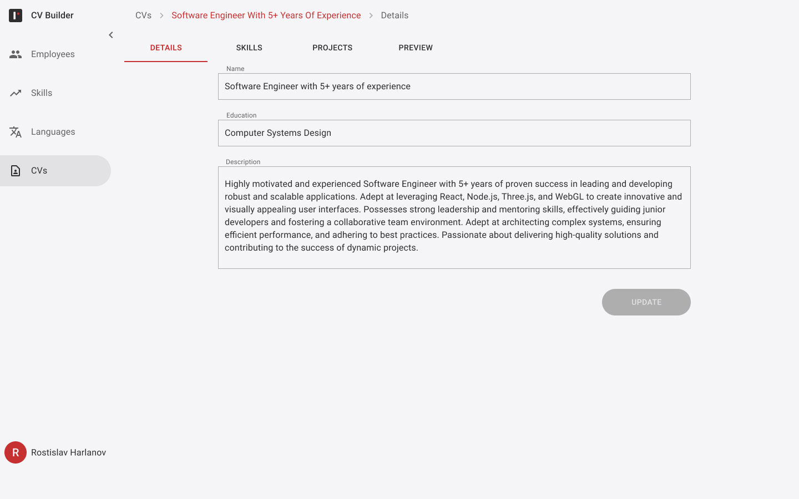

# CV Details Page




## Purpose

Allows users to view and update general CV information.

The page contains the main CV metadata and serves as the entry point for managing CV content.

Available tabs:

- Details
- Skills
- Projects
- Preview
The available functionality depends on the current user's permissions for the selected CV.


### Employee

Can:

- View own CV
- Update own CV
- Navigate between CV tabs
Cannot:

- View CVs belonging to other users
- Update CVs belonging to other users

### Admin

Can:

- View any CV
- Update any CV
- Navigate between CV tabs
All permissions must be enforced by the backend. Frontend role-based UI restrictions must not be considered a security mechanism.


---


## Scope

The CV Details page is available for authenticated:

- Admin
- Employee
Role-based permissions apply.

Users can access only CVs they are authorized to view or manage.

The backend must verify access to the selected CV for every request.

The frontend must not assume that possession of a CV identifier grants access to the CV.


---


## Behavior

The page allows users to:

- View CV information
- Update CV information
- Navigate between CV tabs
The page displays:

- Name
- Education
- Description
Changes are saved using the `UPDATE` action.

The selected CV must be loaded from the backend.

The frontend must not use hardcoded CV data as the source of truth.


---


## Design Reference

Figma: CV Builder – [CV Details](https://www.figma.com/design/m3zxmLv79A6MsHCuAIQAoo/CV-Builder?node-id=21482-33244&t=QBCvpz02MoYfuwpY-0)


---


## Layout

- Page follows the standard CV Details layout
- Sidebar navigation remains available where applicable
- Breadcrumbs are displayed above the CV content
- Tab navigation is displayed at the top of the page
- Details tab is active by default
- Form content is displayed below the tab navigation
- Form fields are displayed in a vertical layout
- `UPDATE` action is displayed below the form
- Layout must be fully responsive across desktop and tablet devices
- Supports Light and Dark themes

---


## Navigation


### Tabs

Available tabs:

- `Details`
- `Skills`
- `Projects`
- `Preview`
Requirements:

- Details tab is active by default
- Active tab must be visually highlighted
- Clicking a tab navigates to the corresponding CV section
- Current tab state must be represented in the URL or routing state
- Refreshing the page should preserve the current tab where supported by the routing implementation
- Access to every CV tab must respect the authorization rules for the selected CV
The implementation must prevent users from bypassing CV authorization by directly navigating to another tab URL.


---


### Breadcrumbs

Example:

`CVs > {CV Name} > Details`

Requirements:

- Displays the current CV name
- Clicking `CVs` returns to the CVs page
- Current page is visually highlighted
- CV name is loaded from the backend
- Breadcrumb must not expose CV information the current user is not authorized to access

---


## GraphQL Integration

All CV information operations must be performed through GraphQL.

The frontend must communicate with the backend using GraphQL queries and mutations.


### Required operations

The implementation should provide operations for:

- Fetching a CV by ID
- Updating a CV
The exact GraphQL schema and naming conventions are defined by the backend implementation.

The frontend must correctly handle:

- Successful responses
- Validation errors
- Authentication errors
- Authorization errors
- Not-found errors
- Network errors
- Unexpected server errors
The backend must verify the authenticated user's access to the selected CV before returning or modifying its data.


---


## CV Query

The selected CV must be requested from the backend using its identifier.

The response should provide the information required to render:

- CV name
- Education
- Description
- CV owner information where required by the UI
- Any information required for the CV navigation

### Employee

The backend must return the CV only when it belongs to the authenticated employee.

An Employee must not be able to retrieve another employee's CV by changing the CV identifier in the GraphQL request.


### Admin

The backend may return any CV to an authorized Admin.

The backend must still verify that the authenticated user has the required Admin permission.

The frontend must not implement ownership checks as the primary security mechanism.


---


## Content


### CV Information Form

The form contains the following fields.


---


### Name

Text input:

`Name`

Requirements:

- Required
- Maximum length: 255 characters
- Pre-populated with the current CV value

---


### Education

Text input:

`Education`

Requirements:

- Required
- Maximum length: 255 characters
- Pre-populated with the current CV value

---


### Description

Textarea:

`Description`

Requirements:

- Required
- Pre-populated with the current CV value

---


## Validation

Validation must be implemented on both frontend and backend.


### Client-side validation

Rules:

- Name is required
- Name must not exceed 255 characters
- Education is required
- Education must not exceed 255 characters
- Description is required
Example messages:

- `Name is required`
- `Name must not exceed 255 characters`
- `Education is required`
- `Education must not exceed 255 characters`
- `Description is required`
Client-side validation is intended for user experience and must not replace server-side validation.


### Backend validation

The backend must independently validate:

- Required fields
- Name length
- Education length
- Description
- CV existence
- Current user's authentication
- Current user's authorization
- CV ownership for Employee users

---


# Update CV


## Trigger

Button:

`UPDATE`

Available for:

- Employee — own CV only
- Admin — any authorized CV
The frontend may hide or disable the UPDATE action when the current user does not have update permissions.

Backend authorization remains mandatory regardless of frontend behavior.


---


## Update Button State

Requirements:

- Disabled when no changes have been made
- Enabled when at least one field value differs from the saved data
- Disabled when validation errors exist
- Disabled while an update request is in progress
- Returns to the appropriate state after a successful or failed request
The frontend should compare the current form state with the latest successfully loaded/saved CV data.


---


## Actions

Button:

`UPDATE`

Requirements:

- Clicking UPDATE sends a GraphQL mutation
- Loading state is displayed while the request is in progress
- Duplicate submissions are prevented
- Successful update refreshes the saved CV state
- Updated values remain visible after successful save
- Failed requests do not clear entered values
- Backend errors are displayed in a user-friendly way
The updated CV must be persisted in the database.

The frontend must update the saved state only after receiving a successful backend response.


---


## Permissions


### Employee

Employees can:

- View their own CV
- Update their own CV
- Navigate between tabs of their own CV
Employees cannot:

- View another user's CV
- Update another user's CV
- Bypass ownership checks through direct GraphQL requests
The backend must determine CV ownership using the authenticated user.


### Admin

Admins can:

- View any CV
- Update any CV
- Navigate between tabs of authorized CVs
The backend must verify the Admin permission before allowing protected operations.


---


## Authorization & Security

Role-based access control and CV ownership must be enforced on the backend.

Requirements:

- Unauthenticated users cannot access CV details
- Employee users can access only their own CVs
- Employee users can update only their own CVs
- Admin users can access authorized CVs
- Admin users can update any CV
- GraphQL CV queries must perform authorization checks
- GraphQL CV update mutations must perform authorization checks
- The backend must derive the current user from the authentication context
- The backend must not trust a user ID supplied by the client to determine ownership
- A CV ID alone must not grant access to the CV
- Unauthorized access attempts must not return the requested CV data
- Sensitive information not required by the page must not be returned
Frontend visibility of the UPDATE button is not considered sufficient authorization.


---


## Database Requirements

The CV must be persisted in the database.

The database model should support at least:

- CV identity
- CV name
- Education
- Description
- Owner/user relationship
- Created timestamp
- Updated timestamp
Example conceptual model:

```plain text
CV
├── id
├── name
├── education
├── description
├── userId
├── createdAt
└── updatedAt
```

Requirements:

- Every CV must belong to a user
- `userId` must reference an existing user
- Required fields must not be nullable where required by business rules
- Name must not exceed 255 characters
- Education must not exceed 255 characters
- CV ownership must be represented in the database
- Updated timestamp must change when CV information is successfully modified
- Referential integrity must be maintained
The exact schema and relationship implementation depend on the backend technology and ORM used by the project.


---


## States


### Loading State

Displayed while CV information is being loaded.

Requirements:

- Form structure remains visible when possible
- Loading indicators or skeletons are displayed
- Form controls are not submitted while required data is still loading
- Tab navigation is handled consistently while the CV is loading

---


### Saving State

Displayed while CV updates are being submitted.

Requirements:

- UPDATE button displays a loading state
- Duplicate submissions are prevented
- Form remains visible during the save operation
- User-entered values remain visible
- Navigation away from the page should be handled consistently while saving

---


### Error State

Displayed when CV information cannot be loaded.

Example:

`Failed to load CV details`

Requirements:

- Error message is shown
- Retry action is available
- Retry repeats the failed GraphQL request
- Existing route/CV identifier is preserved
- Authorization errors are handled separately from generic server errors

### Not Found State

Displayed when the requested CV does not exist.

Example:

`CV not found`

The UI must not display an empty form when the requested CV does not exist.


### Unauthorized State

Displayed when the authenticated user does not have permission to access the selected CV.

The application must not expose the requested CV data.

The exact UI behavior for unauthorized access should follow the application's global authorization/error-handling strategy.


---


# Validation & Error Handling

The frontend must handle errors returned by the GraphQL API.


### Load errors

Examples:

- CV not found
- Unauthorized
- Forbidden
- Server error
- Network error

### Update errors

Examples:

- Invalid input
- CV not found
- Unauthorized
- Forbidden
- Server error
- Network error
Requirements:

- Validation errors must be displayed inline
- System errors must be displayed in a user-friendly way
- Failed requests must not clear entered values
- User changes must remain visible after validation errors
- Failed save operations must not reset the form
- Successful updates must update the UI only after the backend confirms the operation
- Authorization errors must not be presented as generic validation errors
- Not-found errors must be handled separately where applicable
- Retry must repeat the failed request

---


## Accessibility & Responsiveness

- Full keyboard navigation support is required
- Interactive elements must provide visible focus states
- All form controls must have accessible labels
- Tab navigation must be keyboard accessible
- Active tab must have an appropriate accessible state
- Form validation errors must be associated with their corresponding controls
- Content must remain readable in both Light and Dark themes
- Layout must scale correctly across supported screen sizes
- The form must remain usable on supported tablet layouts

---


# Acceptance Criteria

| ID | Description |
|---|---|
| AC-1 | CV Details page is available for authenticated Admin and Employee users |
| AC-2 | Users can access only CVs they are authorized to view |
| AC-3 | Employee users can access only their own CVs |
| AC-4 | Admin users can access authorized CVs |
| AC-5 | CV information is loaded from the backend through GraphQL |
| AC-6 | Details tab is active by default |
| AC-7 | Navigation tabs Details, Skills, Projects, and Preview are displayed |
| AC-8 | Active tab is visually indicated |
| AC-9 | Current tab is represented in the routing state |
| AC-10 | Breadcrumb displays `CVs > {CV Name} > Details` |
| AC-11 | Clicking `CVs` returns to the CVs page |
| AC-12 | Page contains Name, Education, and Description fields |
| AC-13 | Existing CV values are loaded from the backend and pre-populated |
| AC-14 | Name field is required |
| AC-15 | Education field is required |
| AC-16 | Description field is required |
| AC-17 | Name supports a maximum length of 255 characters |
| AC-18 | Education supports a maximum length of 255 characters |
| AC-19 | Client-side validation is implemented |
| AC-20 | Backend validates CV update input |
| AC-21 | UPDATE is disabled when no changes have been made |
| AC-22 | UPDATE becomes enabled after modifying valid form data |
| AC-23 | UPDATE is disabled when validation errors exist |
| AC-24 | UPDATE displays a loading state during submission |
| AC-25 | Duplicate update submissions are prevented |
| AC-26 | Clicking UPDATE sends a GraphQL mutation |
| AC-27 | Successful update changes the CV information |
| AC-28 | CV updates are persisted in the database |
| AC-29 | Employee users can update only their own CVs |
| AC-30 | Admin users can update any authorized CV |
| AC-31 | Backend authorization is enforced for CV queries |
| AC-32 | Backend authorization is enforced for CV update mutations |
| AC-33 | Employee users cannot access another user's CV by changing the CV identifier |
| AC-34 | Validation errors are displayed inline |
| AC-35 | Failed updates do not clear entered form values |
| AC-36 | Failed updates do not reset the form |
| AC-37 | Loading, Saving, Error, Not Found and Unauthorized states are supported |
| AC-38 | Retry repeats failed requests |
| AC-39 | Page supports Light and Dark themes |
| AC-40 | Page is responsive across supported devices |
| AC-41 | Keyboard accessibility is fully supported |


