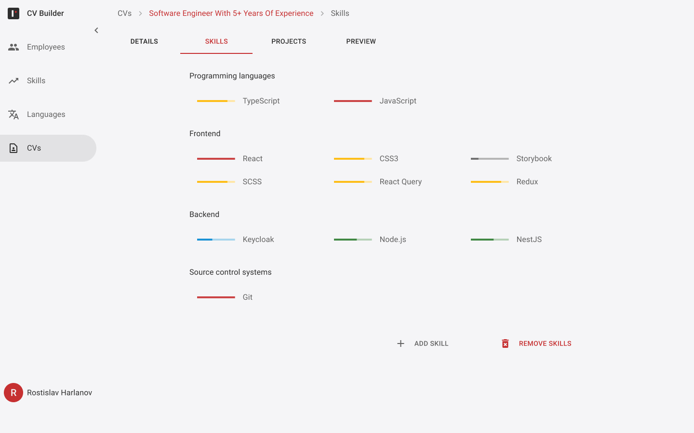

# CV Skills Page




## Purpose

Allows users to manage skills included in a specific CV.

The page displays only skills assigned to the selected CV.

Skills available for addition are limited to skills already assigned to the CV owner.

Available tabs:

- Details
- Skills
- Projects
- Preview
The available functionality depends on the current user's permissions for the selected CV.


### Employee

Can:

- View skills assigned to own CVs
- Add skills to own CVs
- Update skills in own CVs
- Remove skills from own CVs
- Navigate between CV tabs
Employees cannot:

- Access skills belonging to CVs owned by other users
- Modify another user's CV skills

### Admin

Can:

- View skills of any authorized CV
- Add skills to any CV
- Update skills in any CV
- Remove skills from any CV
- Navigate between CV tabs
All permissions must be enforced by the backend. Frontend role-based UI restrictions must not be considered a security mechanism.


---


## Scope

The CV Skills page is available for authenticated:

- Admin
- Employee
Role-based permissions apply.

Users can manage skills only for CVs they are authorized to edit.

The backend must verify access to the selected CV before allowing any skill operation.

The frontend must not treat possession of a CV identifier as sufficient authorization.


---


## Behavior

The page allows users to:

- View CV skills
- Add skills to the CV
- Update skills in the CV
- Remove skills from the CV
- Navigate between CV tabs
Skills are displayed grouped by category.

The available skills for addition are determined by the skills assigned to the CV owner.

The frontend must load CV skills and available skills from the backend.

The frontend must not use hardcoded skills or categories as the source of truth.


---


## Design Reference

Figma: CV Builder – [CV Skills](https://www.figma.com/design/m3zxmLv79A6MsHCuAIQAoo/CV-Builder?node-id=21482-33660&t=QBCvpz02MoYfuwpY-0)


---


## Layout

- Page follows the standard CV Details layout
- Sidebar navigation remains available where applicable
- Breadcrumbs are displayed above the CV content
- Tab navigation is displayed at the top of the page
- Skills tab is active
- Skills content is displayed below the tab navigation
- Skills are grouped by category
- `ADD SKILL` and `REMOVE SKILLS` actions are displayed according to the user's permissions
- Layout must be fully responsive across desktop and tablet devices
- Supports Light and Dark themes

---


## Navigation


### Tabs

Available tabs:

- `Details`
- `Skills`
- `Projects`
- `Preview`
Requirements:

- Skills tab is active when the page is opened
- Active tab must be visually highlighted
- Clicking another tab navigates to the corresponding CV section
- Current tab state must be represented in the URL or routing state
- Refreshing the page should preserve the current tab where supported
- Access to every CV tab must respect authorization rules for the selected CV
The implementation must prevent users from bypassing CV authorization by directly navigating to another CV tab URL.


---


### Breadcrumbs

Example:

`CVs > {CV Name} > Skills`

Requirements:

- Displays the current CV name
- Clicking `CVs` returns to the CVs page
- Current page is visually highlighted
- CV name is loaded from the backend
- Breadcrumb must not expose CV information the current user is not authorized to access

---


## GraphQL Integration

All CV skill operations must be performed through GraphQL.

The frontend must communicate with the backend using GraphQL queries and mutations.


### Required operations

The implementation should provide operations for:

- Fetching CV skills
- Fetching available skills for the CV owner
- Adding a skill to a CV
- Updating a CV skill where supported
- Removing one or more skills from a CV
The exact GraphQL schema and naming conventions are defined by the backend implementation.

The frontend must correctly handle:

- Successful responses
- Validation errors
- Authentication errors
- Authorization errors
- Not-found errors
- Conflict errors
- Network errors
- Unexpected server errors
The backend must verify access to the selected CV before executing protected operations.


---


## CV Skills Query

The CV skills list must be requested from the backend.

The response should provide enough information for the frontend to render:

- Skill name
- Skill category
- Skill mastery level
- Skill identifier
- CV-skill relationship identifier where required

### Employee

The backend must return skills only for CVs belonging to the authenticated employee.

An Employee must not be able to retrieve skills from another user's CV by modifying the CV identifier in a GraphQL request.


### Admin

The backend may return skills for any CV the Admin is authorized to access.

The backend must still verify the authenticated user's Admin permissions.


---


## Available Skills Query

The Add Skill flow must request available skills from the backend.

Available skills are limited to skills already assigned to the CV owner.

Requirements:

- Available skills are loaded from the backend
- Only skills assigned to the CV owner are returned
- Skills already assigned to the selected CV are excluded from the selectable options
- The frontend must not rely on client-side filtering as the only protection against invalid skill assignment
- Backend validation must prevent assigning a skill that is not available to the CV owner
- Backend validation must prevent duplicate skill assignments
The source of truth for the owner's available skills must be the backend.


---


## Content


### Skill Groups

Skills are grouped by category.

Example categories:

- Programming Languages
- Frontend
- Backend
- Databases
- DevOps
- Source Control Systems
Requirements:

- Category name is displayed as a section header
- Skills belonging to the category are displayed below the header
- Categories without skills are not displayed
- Category information is loaded from the backend
- Skill ordering within categories follows the defined backend or product ordering
The frontend must not assume that the example categories represent the complete set of available categories.


---


### Skill Item

Each skill displays:

- Skill Name
- Skill Mastery Level
Requirements:

- Skill mastery level is clearly visible
- Visual representation follows design specifications
- Skill has an accessible interactive state
- Clicking a skill opens the Update Skill modal when the current user has permission to edit the CV

---


# Add Skill


## Trigger

Button:

`ADD SKILL`

Available for:

- Employee — own CVs
- Admin — any authorized CV
The backend must verify that the authenticated user has permission to modify the selected CV.


---


## Add Skill Modal


### Content

Title:

`Add skill`

Field:


### Skill

Select field:

`Skill`

Requirements:

- Required
- Options are loaded from the backend
- Displays only skills already assigned to the CV owner
- Skills already assigned to the current CV are excluded
- The selected skill must have a valid skill identifier
- The frontend must not allow arbitrary skill identifiers to be submitted


### Skill mastery

Select field

Label:

`Skill mastery`

Requirements:

- Optional (Figma shows the field in the Add skill modal; Figma takes precedence over this document)
- Values: Beginner, Elementary, Intermediate, Advanced, Expert
- When no value is chosen, the skill is added without a mastery and the backend sets the level
- When a value is chosen, it is sent with the skill

---


## Validation

Validation must be implemented on both frontend and backend.


### Client-side validation

Rules:

- Skill is required
- A skill must be selected before submission
Example message:

`Skill is required`


### Backend validation

The backend must independently validate:

- Skill identifier
- Skill existence
- CV existence
- CV ownership/access
- Whether the skill belongs to the CV owner's available skills
- Whether the skill is already assigned to the CV
- Current user's authorization
Client-side validation must not replace server-side validation.


---


## Actions

Buttons:

- `CANCEL`
- `ADD`
Requirements:

- ADD remains disabled until a valid skill is selected
- Clicking ADD sends a GraphQL mutation
- Loading state is displayed during creation
- Duplicate submissions are prevented
- Successful addition adds the skill to the appropriate category
- Modal closes after successful addition
- Failed requests keep the selected value
- Backend errors are displayed in a user-friendly way
The CV-skill relationship must be persisted in the database.


---


# Update Skill


## Trigger

Opened by clicking an existing skill.

Available for:

- Employee — own CVs
- Admin — any authorized CV
The backend must verify that the current user has permission to update the selected CV skill.


---


## Update Skill Modal


### Content

Title:

`Update skill`


### Skill

Select field:

`Skill`

Requirements:

- Displays the current skill
- Required
- Available options are loaded from the backend
- Only skills assigned to the CV owner may be considered valid
- Skills already assigned to the current CV must not be selectable as duplicate assignments
According to the current requirements, the Skill field is **disabled during update**.

Therefore, the current implementation does not change the underlying skill association.

If skill replacement is required in the future, the backend and UI must explicitly define the replacement behavior and validation rules.


---


## Actions

Buttons:

- `CANCEL`
- `SAVE`
Requirements:

- SAVE sends the appropriate GraphQL mutation when an updateable skill property exists
- Loading state is displayed during the request
- Duplicate submissions are prevented
- Modal closes after successful update
- Updated value appears in the list after successful backend response
- Failed requests do not clear entered values
If the Skill field remains disabled and no other editable fields are introduced, the implementation must not perform a meaningless mutation.


---


# Remove Skills


## Trigger

Button:

`REMOVE SKILLS`

Available for:

- Employee — own CVs
- Admin — any authorized CV
The backend must verify that the authenticated user has permission to modify the selected CV.


---


## Selection Mode

Requirements:

- Clicking `REMOVE SKILLS` enables selection mode
- Skills become selectable
- Multiple skills can be selected
- Selected skills are visually highlighted
- Each selected skill is identified by its backend identifier
- Selection is cleared when selection mode is cancelled
Actions displayed:

- `CANCEL`
- `REMOVE ({count})`
Where:

- `{count}` = number of selected skills
Requirements:

- REMOVE remains disabled when no skills are selected
- `count` reflects the current number of selected skills
- Selecting and deselecting skills updates the count immediately
- Selection mode can be cancelled without modifying the CV

---


# Remove Skills Modal


## Content

Title:

`Remove skills`

Message:

`Are you sure you want to remove {count} skills?`

Where:

- `{count}` = number of selected skills

---


## Actions

Buttons:

- `CANCEL`
- `CONFIRM`
Requirements:

- CANCEL closes the modal without changes
- CONFIRM sends a GraphQL mutation
- Loading state is displayed while removal is in progress
- Duplicate removal requests are prevented
- Backend verifies authorization for the selected CV
- Backend verifies that the selected CV-skill relationships exist
- Removed skills disappear from the list after successful backend response
- Modal closes after successful removal
- Selection mode exits automatically after successful removal
- Failed requests do not silently remove skills from the UI
The CV-skill relationships must be removed from the database.

The frontend must not permanently remove skills before receiving successful confirmation from the backend.


---


# Permissions


## Employee

Employees can:

- View skills assigned to their own CVs
- Add skills to their own CVs
- Update skills in their own CVs
- Remove skills from their own CVs
Employees cannot:

- Access skills belonging to CVs owned by other users
- Add skills to another user's CV
- Update skills in another user's CV
- Remove skills from another user's CV
The backend must determine CV ownership using the authenticated user.


---


## Admin

Admins can:

- View skills of any authorized CV
- Add skills to any authorized CV
- Update skills in any authorized CV
- Remove skills from any authorized CV
Backend authorization is required for every protected operation.


---


# Authorization & Security

Role-based access control and CV ownership must be enforced on the backend.

Requirements:

- Unauthenticated users cannot access CV skills
- Employee users can access only skills belonging to their own CVs
- Employee users can modify only their own CV skills
- Admin users can access CV skills for authorized CVs
- Admin users can modify CV skills for any authorized CV
- GraphQL queries must perform CV ownership/authorization checks
- GraphQL mutations must perform authorization checks
- The backend must derive the current user from the authentication context
- The backend must not trust a user ID supplied by the client to determine CV ownership
- A CV ID alone must not grant access
- A skill ID alone must not grant permission to modify a CV-skill relationship
- Backend must validate that a selected skill is available to the CV owner
- Backend must prevent duplicate CV-skill relationships
- Backend must validate that all selected skills belong to the requested CV before bulk removal
Frontend visibility of buttons, menus, and selection controls is not considered sufficient authorization.


---


# Database Requirements

The database must persist the relationship between CVs and skills.

The domain model should support at least:

```plain text
CV
├── id
├── name
├── education
├── description
├── userId
├── createdAt
└── updatedAt

Skill
├── id
├── name
├── categoryId
└── ...

SkillCategory
├── id
├── name
└── ...

CVSkill
├── cvId
├── skillId
└── ...
```

The exact model depends on the backend technology and ORM used by the project.


### CVSkill relationship

Requirements:

- A CV can contain multiple skills
- A skill can belong to multiple CVs
- `cvId` must reference an existing CV
- `skillId` must reference an existing Skill
- Duplicate `CVSkill` relationships must not be allowed
- A composite unique constraint on `(cvId, skillId)` should be used where supported
- Removing a skill from a CV removes the relationship rather than deleting the global Skill entity
- Deleting a CV must not unintentionally delete the global Skill entity
- Referential integrity must be maintained

### Skill ownership/availability

The database must support determining which skills are assigned to a CV owner.

The exact relationship depends on the project's existing domain model.

The backend must use this relationship when validating Add Skill requests.


---


# States


## Loading State

Displayed while CV skills are being loaded.

Requirements:

- Page structure remains visible when possible
- Loading indicators or skeletons are displayed
- Skill actions are appropriately disabled while required data is loading
- Initial loading and subsequent list updates are handled consistently

---


## Empty State

Displayed when the CV contains no skills.

Example:

`No skills added yet`

Requirements:

- Empty state is displayed instead of skill groups
- `ADD SKILL` remains available for users who have permission to modify the CV
- The empty state is not treated as an error

---


## Error State

Displayed when CV skills cannot be loaded.

Example:

`Failed to load skills`

Requirements:

- Error message is shown
- Retry action is available
- Retry repeats the failed GraphQL request
- Existing route state is preserved where possible

---


## Mutation Loading States

Add, update, and remove operations must have their own loading states.

Requirements:

- Duplicate submissions are prevented
- Relevant controls are disabled during mutation
- Existing skill data remains visible during mutation
- UI state is updated only after successful backend confirmation

---


# Validation & Error Handling

The frontend must handle errors returned by the GraphQL API.


### Add errors

Examples:

- Invalid skill
- Skill not found
- Skill not available to CV owner
- Skill already assigned
- CV not found
- Unauthorized
- Forbidden
- Server error
- Network error

### Update errors

Examples:

- Invalid input
- Skill not found
- CV skill relationship not found
- CV not found
- Unauthorized
- Forbidden
- Server error
- Network error

### Remove errors

Examples:

- CV not found
- Skill relationship not found
- Unauthorized
- Forbidden
- Server error
- Network error
Requirements:

- Validation errors must be displayed inline where applicable
- System errors must be displayed in a user-friendly way
- Failed requests must not clear entered values
- Failed mutations must not leave the UI in a state that differs from the confirmed backend state
- Successful operations must update the UI only after the backend confirms the operation
- Authorization errors must not be presented as generic validation errors
- Not-found errors must be handled separately where applicable
- Retry must repeat the failed request where retry is applicable

---


# Accessibility & Responsiveness

- Full keyboard navigation support is required
- Interactive elements must provide visible focus states
- Form controls must include accessible labels
- Skill items must have accessible interactive states
- Selection mode must be fully keyboard accessible
- Selected skills must expose their selected state to assistive technologies
- Modal dialogs must trap keyboard focus
- Escape key closes modals
- Escape or `CANCEL` exits selection mode where applicable
- Validation errors must be associated with their corresponding controls
- Content must remain readable in both Light and Dark themes
- Layout must scale correctly across supported screen sizes
- Skill groups and selection controls must remain usable on supported tablet layouts

---


# Acceptance Criteria

| ID | Description |
|---|---|
| AC-1 | CV Skills page is available for authenticated Admin and Employee users |
| AC-2 | Users can access only CVs they are authorized to manage |
| AC-3 | Employee users can access only skills belonging to their own CVs |
| AC-4 | Admin users can access skills belonging to authorized CVs |
| AC-5 | Skills are loaded from the backend through GraphQL |
| AC-6 | Skills tab is active when the page is opened |
| AC-7 | Navigation tabs Details, Skills, Projects, and Preview are displayed |
| AC-8 | Active tab is visually indicated |
| AC-9 | Breadcrumb displays `CVs > {CV Name} > Skills` |
| AC-10 | Skills are grouped by category |
| AC-11 | Categories without skills are not displayed |
| AC-12 | Skill items display Skill Name and Skill Mastery Level |
| AC-13 | ADD SKILL is available only to users who can modify the selected CV |
| AC-14 | Add Skill options are loaded from the backend |
| AC-15 | Add Skill options contain only skills assigned to the CV owner |
| AC-16 | Skills already assigned to the CV cannot be selected again |
| AC-17 | Skill field is required |
| AC-18 | Backend validates skill availability before adding it to a CV |
| AC-19 | Users can add skills to CVs they are authorized to modify |
| AC-20 | Successfully added skills appear in the appropriate category |
| AC-21 | Clicking an existing skill opens the Update Skill modal |
| AC-22 | Update Skill is available only to users who can modify the selected CV |
| AC-23 | Skill field displays the current skill during update |
| AC-24 | Skill field is disabled during update according to the current requirements |
| AC-25 | Backend authorization is enforced for CV skill updates |
| AC-26 | REMOVE SKILLS is available only to users who can modify the selected CV |
| AC-27 | REMOVE SKILLS enables selection mode |
| AC-28 | Multiple skills can be selected |
| AC-29 | Selected skills are visually highlighted |
| AC-30 | REMOVE displays the current number of selected skills |
| AC-31 | REMOVE is disabled when no skills are selected |
| AC-32 | Remove confirmation displays the number of selected skills |
| AC-33 | Backend verifies authorization before removing skills |
| AC-34 | Confirming removal removes the selected CV-skill relationships |
| AC-35 | Removed skills disappear after successful backend response |
| AC-36 | Removing a skill from a CV does not delete the global Skill entity |
| AC-37 | Duplicate CV-skill relationships are prevented |
| AC-38 | Employees cannot access or modify skills belonging to another user's CV |
| AC-39 | Validation errors are displayed inline |
| AC-40 | GraphQL errors are handled appropriately |
| AC-41 | Loading, Empty, Error, and mutation loading states are supported |
| AC-42 | Failed mutations do not unnecessarily clear entered values |
| AC-43 | UI state is updated only after successful backend confirmation |
| AC-44 | Page supports Light and Dark themes |
| AC-45 | Page is responsive across supported devices |
| AC-46 | Keyboard accessibility is fully supported |

