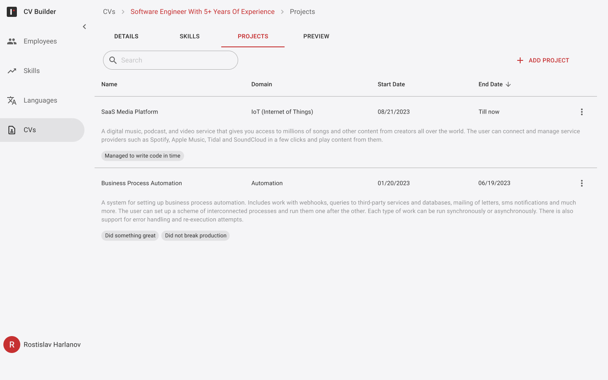

# CV Projects Page




## Purpose

Allows users to manage projects included in a specific CV.

Projects added to a CV are based on existing projects from the Projects catalog and contain CV-specific information such as:

- participation period
- roles
- responsibilities
The available functionality depends on the current user's permissions for the selected CV.

The backend is the source of truth for project data, CV-project relationships, validation and authorization.


---


## Scope

The Projects tab is available on the CV Details page.

The page is available for:

- Admin
- Employee
Role-based permissions apply.

Users can manage only CVs they are permitted to edit.

Employees can manage projects only in their own CVs.

Administrators can manage projects in CVs they are authorized to access.

The frontend must not be considered a security boundary. All authorization checks must be enforced on the backend.


---


## Behavior

The page allows users to:

- View projects assigned to the CV
- Search projects
- Sort projects
- Add projects to the CV
- Update CV project information
- Manage project roles within the CV
- Remove projects from the CV
Projects displayed on this page belong only to the selected CV.

All project data and CV-project relationships must be loaded from the backend.

Changes must be persisted in the database before the UI treats them as successful.


---


## Design Reference

Figma: CV Builder – [CV Projects](https://www.figma.com/design/m3zxmLv79A6MsHCuAIQAoo/CV-Builder?node-id=21482-33925&t=QBCvpz02MoYfuwpY-0)


---


## Layout

Page must follow the standard CV Details layout.

Requirements:

- Breadcrumb navigation is displayed at the top
- CV navigation tabs are displayed below breadcrumbs
- Search field is displayed above the table
- `ADD PROJECT` action is displayed above the table
- Projects are displayed in a table layout
- Layout must be responsive across desktop and tablet devices
- Supports Light and Dark themes

---


## Navigation


### Breadcrumbs

Example:

`CVs > {CV name} > Projects`

Requirements:

- Displays current CV name
- Clicking `CVs` returns to the CVs page
- Current page is visually highlighted

### Tabs

Available tabs:

- Details
- Skills
- Projects
- Preview
Requirements:

- Projects tab is highlighted when active
- Clicking another tab navigates to the corresponding section
- Active tab state persists during navigation

---


## GraphQL Integration

All CV project data must be retrieved and modified through GraphQL operations.

The frontend must not directly access the database.


### Required Operations

The implementation must provide operations equivalent to:

- Query CV projects
- Search CV projects
- Sort CV projects
- Query the available Projects catalog
- Query active roles
- Add a project to a CV
- Update a CV project
- Remove a project from a CV
The exact GraphQL schema and naming conventions may follow the project's existing conventions.


### Backend Requirements

The backend must:

- Validate the selected CV
- Validate the selected Project
- Validate selected roles
- Validate project participation dates
- Validate the user's permissions for the CV
- Prevent unauthorized access to another user's CV
- Prevent duplicate project assignments
- Persist CV-project changes in the database
- Return appropriate GraphQL errors for failed operations
The backend must derive the current user from the authenticated request context.

The client must not be able to bypass authorization by providing another user's ID or manipulating CV identifiers.


---


## Content


### Projects Table

The table displays the following columns:

| Column | Description |
|---|---|
| Name | Project name |
| Domain | Project domain |
| Start Date | Participation start date |
| End Date | Participation end date |

Under each row a detail line shows the project description and the CV-specific responsibilities as tags (one tag per line of the text). The table has no Responsibilities column and no line under the last row (Figma wins over this document, decided 2026-11-23; Figma: `docs/images/figma/desktop-1440/light/frame-46.png`).

Requirements:

- Displays only projects assigned to the current CV
- Data is displayed in tabular format
- Supports sorting
- Supports empty state
- Supports loading state
- Supports error state
Project information such as Name and Domain comes from the referenced Project entity.

CV-specific information such as Responsibilities and participation dates comes from the CV-project relationship.


---


## Search

Search field placeholder:

`Search`

Search must be performed against CV projects belonging to the selected CV.


### Search Fields

Search supports:

- Name
- Domain
Requirements:

- Search is case-insensitive
- Search updates results without a full page reload
- Empty search displays all CV projects
- Search must not return projects belonging to another CV
Search should be implemented on the backend rather than filtering the complete dataset only on the client.


---


## Sorting

Supported columns:

- Name
- Start Date
- End Date
Requirements:

- Supports ascending order
- Supports descending order
- Current sort direction is visually indicated
- Sorting is applied to the projects belonging to the selected CV
- Sorting should be performed by the backend

---


## Actions Menu

Each project row contains a three-dot action menu.

Available actions:

- Update
- Delete
Requirements:

- Menu opens near the selected row
- Only one menu may be open at a time
- Menu closes when:
  - clicking outside
  - selecting an action
  - pressing Escape
Actions must be available only when the current user has permission to modify the selected CV.


---


# Add Project


## Trigger

Opened from:

`ADD PROJECT`


---


## Add Project Modal


### Content

Title:

`Add project`


---


### Project

Select field

Label:

`Name`

Requirements:

- Required
- Displays projects from the Projects catalog
- Selecting a project automatically populates:
  - Domain
  - Description
  - Environment
  - Project Start Date
  - Project End Date
- Projects already assigned to the CV must not be available for duplicate assignment
The selected Project represents an existing catalog entity.

The backend must verify that the selected Project exists and can be assigned to the selected CV.


---


### Domain

Input field

Requirements:

- Required
- Auto-populated from the selected Project
- Disabled
- Value must come from the Project catalog
The client must not be able to modify the catalog value through the disabled field.

The backend must use the stored Project data as the source of truth.


---


### Start Date

Date picker

Requirements:

- Required
- Editable
- Cannot be earlier than the selected project's start date
- Cannot be later than the selected project's end date
The backend must repeat these validations regardless of frontend validation.


---


### End Date

Date picker

Requirements:

- Editable
- Cannot be earlier than selected Start Date
- Cannot be later than the selected project's end date
If End Date is optional according to the existing domain model, the backend may allow an empty value. Otherwise it must be validated according to the project requirements.


---


### Description

Textarea

Requirements:

- Required
- Auto-populated from selected Project
- Disabled
- Value comes from the Project catalog
The description belongs to the referenced Project and must not be modified through the CV Project form.


---


### Environment

Multi-select / tags field

Requirements:

- Required
- Auto-populated from selected Project
- Disabled
- Displays the project's technology stack
Environment data belongs to the referenced Project.

The backend must use the stored Project information as the source of truth.


---


### Roles

Multi-select field

Requirements:

- Required
- Displays all active roles available in the system
- Supports selecting multiple roles
- At least one role must be selected
The backend must validate that every selected role exists and is currently allowed to be assigned.


---


### Responsibilities

Textarea

Requirements:

- Optional
- Editable
- Stores CV-specific responsibilities
- Must not modify the global Project entity

---


## Validation

Validation messages must be displayed inline.

Rules:

- Project is required
- Start Date is required
- Start Date must be within project duration
- End Date must be within project duration
- End Date cannot be earlier than Start Date
- At least one role is required
Example messages:

- `Project is required`
- `Start date is required`
- `Start date must be within project duration`
- `End date must be within project duration`
- `End date cannot be earlier than start date`
- `At least one role must be selected`
Frontend validation improves UX but does not replace backend validation.


---


## Actions

Buttons:

- `CANCEL`
- `ADD`
Requirements:

- `ADD` remains disabled until all required fields are valid
- Successful creation adds the project and selected roles to the CV
- Modal closes after successful creation
- The new project appears in the table after the backend confirms successful creation
- Failed creation must not clear entered values

---


# Update Project


## Trigger

Opened from:

`Update`


---


## Update Project Modal


### Content

Title:

`Update project`


---


### Project

Select field

Requirements:

- Displays selected Project
- Disabled
- Cannot be changed
The Project reference must remain immutable during the update operation.


---


### Domain

Input field

Requirements:

- Disabled
- Loaded from the selected Project
- Cannot be modified as CV-specific data

---


### Description

Textarea

Requirements:

- Disabled
- Loaded from the selected Project
- Cannot be modified as CV-specific data

---


### Environment

Multi-select / tags field

Requirements:

- Disabled
- Loaded from the selected Project
- Cannot be modified as CV-specific data

---


### Start Date

Date picker

Requirements:

- Editable
- Must remain within the selected Project's duration
Backend validation is required even when the frontend prevents invalid dates.


---


### End Date

Date picker

Requirements:

- Editable
- Must remain within the selected Project's duration
- Cannot be earlier than Start Date

---


### Roles

Multi-select field

Requirements:

- Required
- Displays all active roles available in the system
- Pre-populated with currently assigned roles
- Supports selecting multiple roles
- Editable
- At least one role must remain selected
Updating roles must modify the CV-project relationship and must not modify the global Project entity.


---


### Responsibilities

Textarea

Requirements:

- Optional
- Editable
- Stores CV-specific responsibilities

---


## Validation

Validation rules are identical to Add Project.

The backend must validate:

- CV-project existence
- User authorization
- Start Date
- End Date
- Date range against the referenced Project
- Selected roles
- At least one role
- Responsibilities data

---


## Actions

Buttons:

- `CANCEL`
- `SAVE`
Requirements:

- `SAVE` remains disabled until at least one editable value is changed
- Successful update refreshes displayed data immediately
- Updated roles are saved with the CV Project
- Modal closes after successful update
- Failed update does not clear entered values
- UI reflects the persisted backend state after successful update

---


# Delete Project


## Trigger

Opened from:

`Delete`


---


## Delete Project Modal


### Content

Title:

`Remove project`

Message:

`Are you sure you want to remove project {name}?`

Where:

- `{name}` = selected Project name

---


## Actions

Buttons:

- `CANCEL`
- `CONFIRM`
Requirements:

- `CANCEL` closes modal without changes
- `CONFIRM` removes the selected project from the CV
- Project is removed from the table after successful deletion
- Modal closes after successful deletion
- Failed deletion must leave the project visible
- Removing a project from a CV must not delete the global Project from the Projects catalog

---


# Permissions


## Employee

Can:

- View projects in own CV
- Add projects to own CV
- Update projects in own CV
- Remove projects from own CV
Cannot:

- Access CVs belonging to other users
- Modify Projects catalog entities through this page
The backend must determine the employee's identity from the authenticated request.


---


## Admin

Can:

- View projects in any CV they are authorized to access
- Add projects to any authorized CV
- Update projects in any authorized CV
- Remove projects from any authorized CV
Admin access must still be validated on the backend.


---


# Database Requirements

The Projects catalog and CV-specific project data must be represented separately.


### Project

Represents a reusable project from the Projects catalog.

Conceptually contains:

- `id`
- `name`
- `domain`
- `description`
- `environment`
- `startDate`
- `endDate`
- other existing catalog fields

---


### CVProject

Represents a project assignment to a specific CV.

Conceptually contains:

- `id`
- `cvId`
- `projectId`
- `startDate`
- `endDate`
- `responsibilities`
- `createdAt`
- `updatedAt`
`CVProject` references:

- one CV
- one Project

---


### CVProjectRole

If roles are modeled as a many-to-many relationship, the implementation should use a relationship entity equivalent to:

- `cvProjectId`
- `roleId`
Requirements:

- A CV Project can have multiple roles
- A role can be assigned to multiple CV Projects
- Duplicate role assignments for the same CV Project must be prevented
- Removing a CV Project must remove its role relationships
- Removing a CV Project must not delete the global Role entity

---


### Relationships

Conceptually:

```plain text
User
  └── CV
       └── CVProject
            ├── Project
            └── CVProjectRole
                 └── Role
```

The database must enforce referential integrity between these entities.

A Project must not be duplicated in the same CV.

A unique constraint equivalent to:

`(cvId, projectId)`

should be used to prevent duplicate CV-project relationships.


---


# States


## Loading State

Displayed while CV projects are being loaded.

Requirements:

- Table remains visible when possible
- Loading indicators or skeletons are displayed
- Search and sorting controls must not cause inconsistent UI states while data is loading

---


## Empty State

Example message:

`No projects added yet`

Requirements:

- Empty state is displayed instead of table rows
- `ADD PROJECT` remains available to users who have edit permissions

---


## No Search Results State

Example message:

`No projects found`

Requirements:

- Search value remains visible
- User can clear the search and return to the complete project list

---


## Error State

Displayed when projects cannot be loaded.

Requirements:

- Error message is shown
- Retry action is available
Example:

`Failed to load projects`


---


## Mutation States

Add, update and delete operations must expose an appropriate loading state.

Requirements:

- Prevent accidental duplicate submissions
- Disable the corresponding submit action while the mutation is in progress
- Display an error if the mutation fails
- Keep user-entered values when possible
- Refresh or update the affected data only after successful backend confirmation

---


## Not Found State

Displayed when the selected CV does not exist or cannot be retrieved.

Example:

`CV not found`

The page must not attempt to load or modify projects for a non-existent CV.


---


## Unauthorized State

Displayed when the authenticated user does not have permission to access the selected CV.

Example:

`You are not authorized to access this CV`

The frontend must not expose CV project data after an authorization failure.


---


# Validation & Error Handling

Requirements:

- Failed add requests must display a system error
- Failed update requests must display a system error
- Failed delete requests must display a system error
- Validation errors must be displayed inline
- Failed requests must not clear entered values
- Backend validation errors must be mapped to the appropriate form fields where possible
- Unauthorized operations must be rejected by the backend
- Non-existent CVs or Projects must be handled as errors
- Duplicate Project assignments must be rejected
- Invalid role assignments must be rejected
- Invalid participation dates must be rejected
- The UI must not display a successful mutation state before the backend confirms the operation

---


# Authorization & Security

The backend must enforce authorization for every protected GraphQL operation.

Requirements:

- Employee can access only their own CVs
- Admin can access CVs according to their permissions
- Authorization must be checked for queries and mutations
- The backend must derive the current user from the authentication context
- Client-supplied user IDs must not be trusted for ownership checks
- Client-side hidden buttons must not be treated as authorization
- A user must not be able to add, update or delete projects in another user's CV by manipulating GraphQL variables
- Project references must be validated on the backend
- Role references must be validated on the backend
- Database constraints must protect against duplicate CV-project relationships

---


# Accessibility & Responsiveness

Requirements:

- Full keyboard navigation support
- Visible focus states
- Accessible labels for form controls
- Modal dialogs must trap keyboard focus
- Escape key closes action menus and modals
- Content remains readable in Light and Dark themes
- Layout scales correctly across supported screen sizes
- Tables remain usable on smaller supported screens
- Form validation messages are associated with their corresponding controls
- Interactive controls have accessible names
- Loading and error states are accessible to assistive technologies

---


# Acceptance Criteria

| ID | Description |
|---|---|
| AC-1 | Projects tab is available on the CV Details page |
| AC-2 | Only projects assigned to the selected CV are displayed |
| AC-3 | Projects table displays Name, Domain, Start Date and End Date columns; the project description and the responsibilities as tags are under each row |
| AC-4 | Search filters projects by Name and Domain |
| AC-5 | Search is case-insensitive |
| AC-6 | Projects can be sorted by Name, Start Date and End Date |
| AC-7 | `ADD PROJECT` opens Add Project modal |
| AC-8 | Project selection automatically populates Domain, Description and Environment |
| AC-9 | Users can assign one or more roles to a CV Project |
| AC-10 | Assigned roles can be updated |
| AC-11 | Domain field is disabled |
| AC-12 | Description field is disabled |
| AC-13 | Environment field is disabled |
| AC-14 | Project and Start Date are required fields |
| AC-15 | Project dates must remain within the selected project's duration |
| AC-16 | At least one role must be selected when adding or updating a CV Project |
| AC-17 | Responsibilities field is optional |
| AC-18 | Update action opens Update Project modal |
| AC-19 | Project field cannot be changed during update |
| AC-20 | `SAVE` button remains disabled until changes are made |
| AC-21 | Delete action opens Remove Project modal |
| AC-22 | Confirming deletion removes the project from the CV |
| AC-23 | Removing a project from a CV does not delete the Project from the Projects catalog |
| AC-24 | Validation errors are displayed inline |
| AC-25 | Loading, Empty, No Search Results, Not Found, Unauthorized and Error states are supported |
| AC-26 | Add, update and delete operations display appropriate loading states |
| AC-27 | Failed mutations do not clear entered form values |
| AC-28 | Backend validates CV-project permissions for all protected operations |
| AC-29 | Employees can manage projects only in their own CVs |
| AC-30 | Administrators can manage projects in authorized CVs |
| AC-31 | The backend prevents duplicate Project assignments to the same CV |
| AC-32 | The backend validates that selected Projects exist |
| AC-33 | The backend validates that selected Roles exist and can be assigned |
| AC-34 | Project participation dates are validated against the Project catalog duration |
| AC-35 | CV-specific Responsibilities are stored on the CV-project relationship |
| AC-36 | CV-specific participation dates are stored on the CV-project relationship |
| AC-37 | Project catalog data is not modified when CV-specific project information is changed |
| AC-38 | CV-project role relationships are persisted in the database |
| AC-39 | Removing a CV Project removes its relationship and assigned role relationships without deleting the global Project or Role |
| AC-40 | Search and sorting operate only on projects belonging to the selected CV |
| AC-41 | Successful mutations update the displayed data after backend confirmation |
| AC-42 | Failed backend operations display an appropriate error state |
| AC-43 | Page supports Light and Dark themes |
| AC-44 | Page is responsive across supported devices |
| AC-45 | Keyboard accessibility is fully supported |
| AC-46 | Modal dialogs, menus and form controls have appropriate accessibility behavior |

