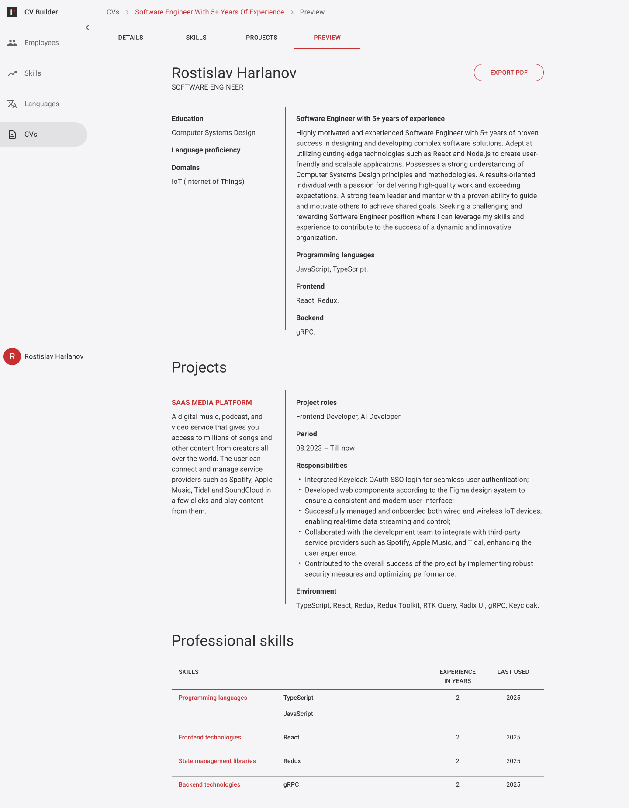

# CV Preview Page

## Purpose

Allows users to preview the generated CV before exporting or sharing it.

The Preview page aggregates information from all CV sections and displays it in a resume-like format.

Users cannot edit CV data directly on this page.

The backend is the source of truth for all CV data used to generate the preview.

The preview must represent the current persisted state of:

- CV Details
- CV Skills
- CV Projects
- User Languages
- User Profile information
Derived information such as skill experience and last usage must be calculated from the persisted backend data.

---

## Scope

The CV Preview page is available for:

- Admin
- Employee
Role-based permissions apply.

Employees can preview only their own CVs.

Administrators can preview CVs they are authorized to access.

Users without permission must not be able to retrieve CV preview data through GraphQL or generate a PDF for an unauthorized CV.

---

## Behavior

The page allows users to:

- View the generated CV preview
- Review CV content before export
- Export CV as PDF
The preview is generated from:

- CV Details
- CV Skills
- CV Projects
- User Languages
- User Profile information
No editing functionality is available on this page.

All information displayed in the preview must be loaded from the backend.

The frontend must not independently reconstruct the CV from unrelated client-side state when a backend preview operation is available.

---

## Design Reference

Figma: CV Builder – [CV Preview](https://www.figma.com/design/m3zxmLv79A6MsHCuAIQAoo/CV-Builder?node-id=21482-32929&t=iySRJkYK6txkSEzy-0)

---

## Layout

Requirements:

- Breadcrumb navigation is displayed at the top
- CV navigation tabs are displayed below breadcrumbs
- CV content is rendered in a printable resume layout
- `EXPORT PDF` action is displayed in the page header
- Layout must be responsive across desktop and tablet devices
- Supports Light and Dark themes
The printable document layout must remain readable independently of the application navigation controls.

---

## Navigation

### Breadcrumbs

Example:

`CVs > {CV name} > Preview`

Requirements:

- Displays current CV name
- Clicking `CVs` returns to the CVs page
- Current page is highlighted

### Tabs

Available tabs:

- Details
- Skills
- Projects
- Preview
Requirements:

- Preview tab is highlighted when active
- Switching tabs preserves the current CV context
- Navigation must not allow a user to access a CV they are not authorized to view

---

## GraphQL Integration

The Preview page must use GraphQL to retrieve the data required to generate the CV preview.

### Preview Query

The implementation must provide a GraphQL query equivalent to:

`CV Preview`

The query must return all information required to render the preview, including:

- CV information
- Employee profile information
- Employee position/assignment information
- Education
- Languages and proficiency levels
- CV skills
- Skill categories
- CV projects
- Project information
- CV project roles
- CV project participation dates
- CV project responsibilities
- Project environments
- Calculated skill experience
- Calculated last used year
The exact GraphQL schema and naming conventions may follow the project's existing conventions.

### Backend Aggregation

The backend should aggregate the required information for the selected CV rather than requiring the frontend to perform multiple unrelated requests and combine the results manually.

The backend must ensure that all returned entities belong to or are legitimately associated with the selected CV/user.

### PDF Operation

PDF generation may be implemented through a dedicated backend operation, for example:

`generateCVPdf`

The operation must:

- Validate the current user's permission to access the CV
- Generate the PDF from the same persisted data used by the Preview
- Return the generated file or a downloadable response according to the project's architecture
- Fail with an appropriate error if the CV cannot be accessed or required data is unavailable

---

# Content

The page displays a generated CV document.

Content is divided into sections.

---

## Header Section

Displays:

- Full Name
- Position
Example:

- Rostislav Harlanov
- Software Engineer
Requirements:

- Full Name is loaded from the employee profile
- Position is loaded from the employee assignment
- Data must correspond to the employee who owns the selected CV

---

## General Information Section

### Education

Requirements:

- Displays the CV Education value
- Displays the persisted value from the selected CV

---

### Language Proficiency

Requirements:

- Displays all languages assigned to the employee
- Displays proficiency level for each language
- Language data is loaded from the employee's persisted profile data
Example:

- English — C1
- German — B2

---

### Domains

Requirements:

- Displays project domains associated with the CV
- Duplicate domains must not be repeated
- Domains must be derived only from projects assigned to the current CV
Example:

- IoT
- FinTech
- Healthcare
If multiple CV projects use the same domain, the domain appears only once.

---

# Summary Section

## CV Name

Requirements:

- Displays CV Name

---

## Description

Requirements:

- Displays CV Description

---

# Skills Section

Displays skills grouped by category.

Example groups:

- Programming Languages
- Frontend Technologies
- Backend Technologies
- Databases
- Cloud Technologies
Requirements:

- Only skills assigned to the CV are displayed
- Skills are grouped by category
- Categories without skills are hidden
- Skills must be loaded from the selected CV
- Skills belonging to another CV must not be included

---

# Projects Section

Displays all projects assigned to the CV.

Projects must be displayed using the persisted CV-project relationships.

For each project, the following information is displayed.

---

## Project Header

Displays:

- Project Name
- Project Description
Requirements:

- Loaded from the referenced Project entity
- Project data must correspond to the Project assigned to the current CV

---

## Project Details

### Project Role

Requirements:

- Displays project roles
- Roles are loaded from the CV-project role relationships
- Multiple roles are displayed when available
- Section is hidden when the project has no assigned roles
Examples:

- Team Lead
- Solution Architect
- Backend Developer

---

### Period

Requirements:

- Displays participation dates from the CV Project assignment
- Must use CV-specific Start Date and End Date rather than the global Project dates
Format:

`MM.YYYY – MM.YYYY` (with an en dash)

If End Date is not specified:

`MM.YYYY – Till now`

The wording `Till now` follows the Figma design. The backend builds this text (`period`), so the preview and the PDF show the same value.

---

### Responsibilities

Requirements:

- Displays responsibilities entered in the CV Project
- Responsibilities are CV-specific
- If responsibilities are empty, the section is hidden

---

### Environment

Requirements:

- Displays project technology stack
- Loaded from Project data
- Environment is not modified by the CV Preview

---

# Professional Skills Section

Displays a skills table.

Columns:

| Column | Description |
|---|---|
| Skills Category | Skill category |
| Skill | Skill name |
| Experience in Years | Automatically calculated experience |
| Last Used | Automatically calculated last usage year |

Requirements:

- Displays only skills assigned to the CV
- Skills are grouped by category
- Categories are visually separated
- Table supports large datasets
- Experience and Last Used values are calculated from projects included in the current CV

---

# Experience in Years Calculation

Experience must be calculated automatically for each skill assigned to the CV.

The calculation must be based on the Project Environment values of projects assigned to the current CV.

### Calculation Rules

For each CV skill:

1. Find all projects included in the current CV.
1. Check the Environment of each project.
1. A skill is considered used in a project if the skill appears in the project's Environment.
1. Find the earliest project where the skill appears in the Environment.
1. Use that project's CV-specific `Start Date` as the beginning of the experience period.
1. Calculate the duration from that Start Date until the current date.
1. Convert the duration to full years.
1. Round down to the nearest whole year.
If the skill does not appear in the Environment of any project included in the CV, no experience is calculated for that skill.

### Important

Only projects assigned to the current CV participate in the calculation.

Projects belonging to another CV must not affect the result.

The calculation should be performed by the backend or by a shared domain/service layer so that the Preview and PDF use the same result.

### Example

Candidate skills in 2026:

`JavaScript, TypeScript, React, Angular`

Project environments:

- Project 1 (`01.03.2022`): `React, JavaScript`
- Project 2 (`01.06.2023`): `TypeScript, Node.js`
Result:

- React → `4 years`
- JavaScript → `4 years`
- TypeScript → `3 years`
- Angular → no experience
- Node.js → no experience

---

# Last Used Calculation

Last Used must be calculated automatically for each CV skill.

### Calculation Rules

For each CV skill:

1. Find all projects included in the current CV where the skill appears in the Environment.
1. Select the most recent matching project.
1. Use that project's End Date.
1. If the project is currently active and has no End Date, use the current year.

### Example

Project A:

- React
- End Date: `12.2023`
Project B:

- React
- End Date: `06.2025`
Result:

`Last Used = 2025`

If the skill is used in an active project:

Project:

- React
- End Date: Present
Result:

`Last Used = Current Year`

---

# Skill Usage Source

Requirements:

- Skill usage is determined from Project Environment values
- A skill is considered used if it exists in at least one project's Environment list
- Only projects assigned to the current CV participate in calculations
- The global Project catalog must not be searched for unrelated projects
- Skills not used by any project included in the CV must not receive an experience or Last Used value
The matching logic must use the canonical skill/project environment representation used by the backend.

---

# Data Consistency

The Preview must represent a consistent snapshot of the selected CV.

Requirements:

- CV data must come from persisted backend data
- Skills must belong to the selected CV
- Projects must belong to the selected CV
- Project roles must belong to the corresponding CV Project
- Project-specific dates must come from the CV Project relationship
- Project description and environment must come from the Project entity
- Employee information must belong to the CV owner
- Calculated skill information must be based only on the selected CV's projects
The frontend must not trust arbitrary IDs returned by URL parameters or client state to access another user's CV.

---

# Export PDF

## Trigger

Button:

`EXPORT PDF`

Requirements:

- Available for Admin and Employee users with access to the selected CV
- Visible on Preview page only
- Disabled while preview data is unavailable
- Disabled or shows a loading state while PDF generation is in progress

---

## Behavior

Requirements:

- Generates a PDF version of the displayed CV
- PDF content matches the preview content
- Download starts automatically after successful generation
- File name should include the CV name
Example:

`software-engineer-with-5-years-of-experience.pdf`

The generated PDF must use the same underlying data and calculation rules as the Preview page.

The PDF generation process must not allow a user to generate a document for a CV they are not authorized to access.

---

# Permissions

## Employee

Can:

- View Preview of own CVs
- Export own CVs as PDF
Cannot:

- Access CVs belonging to other users
- Generate PDFs for another user's CV
Authorization must be enforced on the backend.

---

## Admin

Can:

- View Preview of authorized CVs
- Export authorized CVs as PDF
Admin permissions must be validated on every protected GraphQL operation.

---

# Authorization & Security

The backend must enforce authorization for both preview retrieval and PDF generation.

Requirements:

- Employee can access only their own CVs
- Admin can access CVs according to their permissions
- Authorization must be checked for the Preview query
- Authorization must be checked for PDF generation
- Client-supplied user IDs must not be trusted for ownership checks
- CV ownership must be resolved from the authenticated user and persisted CV relationship
- A user must not be able to access another CV by changing the CV ID in the URL
- A user must not be able to generate a PDF for an unauthorized CV by manipulating GraphQL variables
- Backend must validate that all aggregated entities belong to the selected CV or its owner
Hiding the Preview tab or `EXPORT PDF` button in the frontend is not sufficient authorization.

---

# States

## Loading State

Displayed while CV preview data is being loaded.

Requirements:

- Page structure remains visible
- Loading indicators or skeletons are displayed
- `EXPORT PDF` is disabled while required preview data is unavailable

---

## Empty State

Displayed when required CV data is missing.

Example:

`CV preview is not available`

Requirements:

- Export action is disabled
- User can navigate back to other CV sections
- The application must not generate an incomplete PDF

---

## Error State

Example:

`Failed to load CV preview`

Requirements:

- Error message is displayed
- Retry action is available
- Export action is unavailable until the preview data has been successfully loaded

---

## Unauthorized State

Displayed when the current user does not have permission to access the selected CV.

Example:

`You are not authorized to access this CV`

Requirements:

- CV data is not displayed
- Export is unavailable
- Backend authorization error is handled by the frontend

---

## PDF Generation State

Displayed while the PDF is being generated.

Requirements:

- `EXPORT PDF` cannot trigger multiple simultaneous requests
- Loading state is visible
- User receives an error if PDF generation fails
- The Preview content remains available while PDF generation is in progress

---

# Validation & Error Handling

Requirements:

- Failed Preview requests display an appropriate system error
- Failed PDF generation displays an appropriate system error
- Unauthorized access is rejected by the backend
- Missing CV data is handled gracefully
- Missing optional project responsibilities do not cause an error
- Missing project End Date is handled according to the active-project rules
- Failed PDF generation must not navigate away from the Preview page
- The UI must not indicate a successful export until PDF generation succeeds
- Errors must not expose sensitive backend or database information to the user

---

# Accessibility & Responsiveness

Requirements:

- Full keyboard navigation support
- Visible focus states
- Accessible labels for interactive controls
- `EXPORT PDF` is keyboard accessible
- Loading and error states are accessible to assistive technologies
- Content remains readable in Light and Dark themes
- Layout scales correctly across supported screen sizes
- Resume content remains readable on tablet and desktop screens
- Tables remain usable with large datasets
- Heading hierarchy is semantically correct
- Color must not be the only method used to communicate information

---

# Database Requirements

The Preview page must use existing persisted entities rather than storing a duplicated CV document unless the project architecture explicitly requires a generated snapshot.

The implementation should conceptually use:

### User

Contains:

- profile information
- position/assignment information
- languages

### CV

Contains:

- CV name
- education
- description
- owner reference

### CVSkill

Represents skills assigned to the CV.

### Skill

Contains:

- skill name
- category

### SkillCategory

Contains:

- category name

### CVProject

Represents a Project assigned to a CV.

Contains:

- CV reference
- Project reference
- CV-specific Start Date
- CV-specific End Date
- Responsibilities

### Project

Contains reusable catalog information such as:

- name
- domain
- description
- environment

### CVProjectRole

Represents roles assigned to a specific CV Project.

### Role

Contains the available system roles.

The Preview must retrieve these relationships through the backend rather than duplicating their data in a separate frontend model.

---

# Acceptance Criteria

| ID | Description |
|---|---|
| AC-1 | Preview tab is available within CV Details |
| AC-2 | Preview displays employee name and position |
| AC-3 | Preview displays Education information |
| AC-4 | Preview displays employee languages and proficiency levels |
| AC-5 | Preview displays unique project domains |
| AC-6 | Preview displays CV Name and Description |
| AC-7 | Preview displays CV skills grouped by category |
| AC-8 | Categories without skills are hidden |
| AC-9 | Preview displays all projects assigned to the CV |
| AC-10 | Project period uses CV Project participation dates |
| AC-11 | Project roles are displayed when available |
| AC-12 | Empty Roles sections are hidden |
| AC-13 | Responsibilities are displayed when provided |
| AC-14 | Empty Responsibilities sections are hidden |
| AC-15 | Environment is displayed for every project |
| AC-16 | Professional Skills table displays category, skill, experience years, and last used year |
| AC-17 | Experience in Years is calculated from the earliest project where the skill was used |
| AC-18 | Last Used is calculated from the most recent project where the skill was used |
| AC-19 | Only projects included in the current CV participate in skill calculations |
| AC-20 | Users can export an authorized CV as PDF |
| AC-21 | Exported PDF matches the Preview content |
| AC-22 | Exported file name contains the CV name |
| AC-23 | Employees can access only their own CV previews |
| AC-24 | Admins can access previews for authorized CVs |
| AC-25 | Loading, Empty, Unauthorized and Error states are supported |
| AC-26 | Export is disabled when preview data is unavailable |
| AC-27 | PDF generation displays an appropriate loading state |
| AC-28 | Multiple PDF generation requests cannot be triggered simultaneously |
| AC-29 | Preview data is retrieved through GraphQL |
| AC-30 | PDF generation validates user authorization on the backend |
| AC-31 | Backend authorization prevents access to another user's CV by changing the CV ID |
| AC-32 | Preview contains only skills assigned to the selected CV |
| AC-33 | Preview contains only projects assigned to the selected CV |
| AC-34 | Project roles displayed in the Preview belong to the corresponding CV Project |
| AC-35 | Project-specific participation dates are taken from the CV Project relationship |
| AC-36 | Project description and environment are taken from the referenced Project |
| AC-37 | Duplicate project domains are removed from the General Information section |
| AC-38 | Experience in Years uses the earliest matching project in the current CV |
| AC-39 | Experience in Years is calculated from the matching project's Start Date to the current date |
| AC-40 | Experience in Years is displayed as completed whole years rounded down |
| AC-41 | Skills without matching project Environment entries do not receive calculated experience |
| AC-42 | Last Used uses the most recent matching project in the current CV |
| AC-43 | Last Used uses the project's End Date |
| AC-44 | Active projects without an End Date use the current year for Last Used |
| AC-45 | Only Project Environment values are used as the source of skill usage |
| AC-46 | Failed Preview requests display an appropriate error |
| AC-47 | Failed PDF generation displays an appropriate error |
| AC-48 | Missing required preview data disables PDF export |
| AC-49 | Unauthorized users cannot generate a PDF for an inaccessible CV |
| AC-50 | Preview supports Light and Dark themes |
| AC-51 | Preview is responsive across supported devices |
| AC-52 | Keyboard accessibility is fully supported |
| AC-53 | Loading, error and export states are accessible to assistive technologies |

