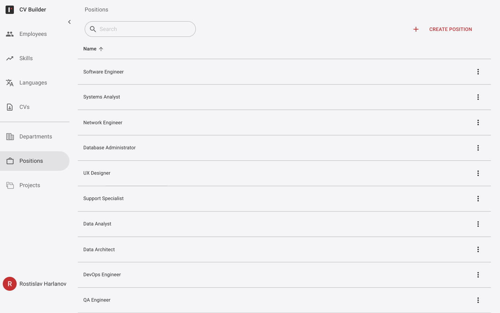

# Positions Page




## Purpose

Allows administrators to manage the global list of positions used throughout the application.

Administrators can:

- View positions
- Search positions
- Sort positions
- Create new positions
- Edit existing positions
- Delete positions
Positions are shared system-level entities and may be referenced by employees, departments, projects, or other entities in the application.


---


## Scope

This page is available only to users with the **Admin** role.

Users without Admin permissions must not have access to this page or its management operations.

The page is responsible for managing the global position catalog. Assigning positions to employees or other entities is handled by the corresponding features.


---


## Behavior

The page allows administrators to:

- View a paginated list of positions
- Search positions by name
- Sort positions by name
- Create new positions
- Edit existing positions
- Delete positions
- Navigate through pages of results
Search, sorting, and pagination must be performed on the backend.

The frontend must not filter or sort only the currently loaded page.


---


## Design Reference

Figma: CV Builder – [Positions](https://www.figma.com/design/m3zxmLv79A6MsHCuAIQAoo/CV-Builder?node-id=21482-36171&t=QBCvpz02MoYfuwpY-0)


---


## Layout

- Page follows the standard application layout.
- Sidebar navigation remains visible.
- Position list is displayed in the main content area.
- Supports Light and Dark themes.
- Fully responsive across desktop and tablet devices.

---


## Navigation


### Sidebar Navigation

Requirements:

- The `Positions` navigation item must be visible only for Admin users.
- Selecting `Positions` opens the Positions page.
- The active navigation item must be visually highlighted.
- Navigation state must persist after page refresh.
- Backend authorization must protect the page data even if a non-admin user accesses the route directly.

---


## GraphQL Integration

The frontend communicates with the backend through GraphQL.

The backend is responsible for:

- Retrieving positions
- Applying search
- Applying sorting
- Applying pagination
- Creating positions
- Updating positions
- Deleting positions
- Validating position data
- Enforcing position name uniqueness
- Enforcing Admin authorization
- Checking whether a position can be deleted
The frontend must not treat the position catalog as client-only data.


---


## Positions Query

The page must use a GraphQL query to retrieve positions.

The query should support:

- Search
- Sorting
- Pagination
Example conceptual structure:

```graphql
query Positions(
  $search: String
  $sortBy: PositionSortField
  $sortOrder: SortOrder
  $page: Int
  $pageSize: Int
) {
  positions(
    search: $search
    sortBy: $sortBy
    sortOrder: $sortOrder
    page: $page
    pageSize: $pageSize
  ) {
    items {
      id
      name
    }
    total
    page
    pageSize
  }
}
```

The exact GraphQL schema may differ depending on the backend implementation.


---


## Create Position Mutation

Creating a position must be performed through a GraphQL mutation.

The backend must:

- Validate the position name.
- Normalize the name according to the application's rules.
- Check for duplicate position names.
- Persist the position.
- Return the created position.
Example conceptual structure:

```graphql
mutation CreatePosition($input: CreatePositionInput!) {
  createPosition(input: $input) {
    id
    name
  }
}
```


---


## Update Position Mutation

Updating a position must be performed through a GraphQL mutation.

The backend must:

- Verify that the position exists.
- Validate the new name.
- Check the uniqueness constraint.
- Exclude the current position from the duplicate check.
- Persist the updated position.
- Return the updated position.

---


## Delete Position Mutation

Deleting a position must be performed through a GraphQL mutation.

The backend must:

- Verify that the position exists.
- Verify that the administrator has permission to delete it.
- Check whether the position is referenced by other entities.
- Reject deletion when the position is currently in use.
- Delete the position only when the business rules allow it.
The frontend must correctly handle the business-rule error returned by the backend.


---


# Content


## Page Header

Title:

`Positions`

Requirements:

- Display page title above the position list.
- Display the search field.
- Display the `CREATE POSITION` action.

---


## Create Position Action

Button:

`CREATE POSITION`

Requirements:

- Visible only to Admin users.
- Opens the Create Position modal.
- Includes:
  - default
  - hover
  - pressed
  - disabled states

---


## Search

Search field:

`Search`

Requirements:

- Allows searching positions by name.
- Search is case-insensitive.
- Search is performed on the backend.
- Search results update without a full page reload.
- Empty search displays all positions.
- Search works across the complete position catalog.
- Starting a new search resets pagination to the first page.
The frontend must pass the search value to the GraphQL query instead of filtering only the currently loaded table rows.


---


## Sorting

Sortable column:

`Name`

Requirements:

- Positions can be sorted alphabetically.
- Supports:
  - ascending order
  - descending order
- Active sort direction must be visually indicated.
- Sorting is performed on the backend.
- Sorting works together with search.
- Sorting works together with pagination.
- Changing the sorting resets pagination to the first page.
The backend must apply sorting before pagination.


---


## Positions Table

Columns:

- Name
- Actions
Requirements:

- Display position name.
- Display an action menu for each position.
- Rows remain readable across supported themes.
- Table data is loaded from the backend.
- Table supports loading, empty, and error states.

---


## Row Actions

Each row contains an action menu represented by an actions icon.

The menu contains:

- `Edit`
- `Delete`
Requirements:

- Menu opens when clicking the actions icon.
- Only one action menu can be opened at a time.
- Menu closes when:
  - user clicks outside
  - action is selected
  - user presses Escape

---


# Create Position


## Create Position Modal

Title:

`Create position`


### Fields

Position  <!-- header_4 -->

Input field:

`Position`

Requirements:

- Required field.
- Supports:
  - default
  - focus
  - error
  - disabled states.

---


## Create Position Validation

Rules:

- Position name is required.
- Position name must be unique.
- Backend must enforce the uniqueness constraint.
Example messages:

- `Position name is required`
- `Position already exists`
Client-side validation should provide immediate feedback.

Backend validation is mandatory and is the final validation boundary.


---


## Create Position Actions

Buttons:

- `CREATE`
- `CANCEL`
Requirements:

- `CREATE` remains disabled until required client-side validation passes.
- Clicking `CREATE` sends the create mutation.
- Loading state is displayed while the request is in progress.
- Successful creation updates the position table.
- Modal closes after successful creation.
- Failed requests do not clear entered values.
- Created position persists after page refresh.

---


# Update Position


## Edit Position Modal

Title:

`Edit position`


### Fields

Position  <!-- header_4 -->

Requirements:

- Current position name is prefilled.
- Position name is required.
- Position name must be unique.
- Existing position ID is used to identify the record being updated.

---


## Update Position Validation

The backend must validate:

- Required position name.
- Position name uniqueness.
When checking uniqueness, the currently edited position must be excluded from the duplicate check.

For example, saving a position without changing its name must not produce a duplicate error against itself.


---


## Update Position Actions

Buttons:

- `SAVE`
- `CANCEL`
Requirements:

- `SAVE` sends the update mutation.
- Loading state is displayed while the request is in progress.
- Successful update closes the modal.
- Updated position data appears in the table.
- Updated data persists after page refresh.
- Failed requests do not clear entered values.

---


# Delete Position


## Delete Position Modal

Title:

`Delete position`

Message:

`Are you sure you want to delete position {Position Name}?`

Where:

- `{Position Name}` = selected position name.
Requirements:

- Position name must be displayed in the confirmation message.
- Modal includes:
  - `CONFIRM`
  - `CANCEL`

---


## Delete Position Actions


### Cancel

`CANCEL`:

- Closes the modal.
- Does not modify the position.

### Confirm

`CONFIRM`:

- Sends the delete mutation.
- Displays a loading state while deletion is in progress.
- Permanently deletes the position only if it is not referenced by other entities.
- Removes the deleted position from the table after successful deletion.
- Closes the modal after successful deletion.
If the position is currently referenced by another entity, deletion must fail with a business-rule error.

Example:

`Position cannot be deleted because it is currently in use`

The frontend must display this error without losing the current table state.


---


# Pagination

Requirements:

- Position list supports pagination.
- Pagination is displayed when multiple pages exist.
- User can navigate between pages.
- Current page must be visually indicated.
- Pagination is performed by the backend.
- Search and sorting work together with pagination.
- Changing search or sorting resets pagination to the first page.
- Backend returns the total number of matching positions.
Example conceptual query variables:

```plain text
search = "engineer"
sortBy = NAME
sortOrder = ASC
page = 1
pageSize = 20
```


---


# States


## Loading State

Displayed while positions are being loaded.

Requirements:

- Table structure remains visible.
- Loading indicator is displayed.
- Existing table data should not unnecessarily disappear when changing search, sorting, or pagination if the UI can preserve it during the request.
- Create, Edit, and Delete operations display appropriate mutation loading states.

---


## Empty State

Displayed when:

- No positions exist.
- Search returns no results.
Example:

`No positions found`


---


## Error State

Displayed when the position list cannot be loaded.

Requirements:

- Error message is shown.
- Retry action is available.
- Search/sorting/pagination state is preserved where possible.
- Failed requests must not silently display an empty table.

---


# Validation & Error Handling

The system must handle:

- Required position name.
- Duplicate position names.
- Position not found.
- Unauthorized access.
- Forbidden operations.
- Failed create requests.
- Failed update requests.
- Failed delete requests.
- Network errors.
- Server errors.
- Business-rule errors when a position is referenced by another entity.
Example messages:

- `Position name is required`
- `Position already exists`
- `Position cannot be deleted because it is currently in use`
- `Something went wrong. Please try again later`
Requirements:

- Validation errors are displayed inline where applicable.
- System errors are displayed using user-friendly messages.
- Failed requests must not clear entered form values.
- Backend errors must not be exposed as raw technical errors when a user-friendly message can be provided.
- The frontend must remain consistent with the persisted backend state after failed or successful mutations.

---


# Authorization & Security

The Positions page is protected by the **Admin** role.

Authorization must be enforced on the backend.

Requirements:

- Only authenticated Admin users can query the position-management operations.
- Only Admin users can create positions.
- Only Admin users can update positions.
- Only Admin users can delete positions.
- Backend authorization must not rely on frontend navigation visibility.
- Direct GraphQL requests from non-admin users must be rejected.
- Every mutation must verify the authenticated user's authorization before modifying data.
The frontend should hide Admin-only navigation and actions for non-admin users, but this is not a security boundary.


---


# Database Model


## Position

The global position catalog should contain a position entity similar to:

```plain text
Position
- id
- name
- createdAt
- updatedAt
```

Recommended constraints:

- `name` is required.
- `name` is unique.
- `name` must follow the application's normalization rules.
The exact database field names may differ depending on the backend implementation.


---


## Position Relationships

Positions may be referenced by other entities in the system.

For example:

```plain text
Position
   |
   +---- Employee
   |
   +---- Department
   |
   +---- Project
   |
   +---- Other entities
```

The exact relationships depend on the application's domain model.

These relationships must be considered when implementing position deletion.


---


## Position Deletion Policy

A position that is referenced by another entity must not be deleted.

The backend must verify references before performing the deletion.

The database layer should also be configured to prevent accidental deletion that would leave invalid references.

Possible implementation approaches include:

- foreign-key constraints with restricted deletion
- explicit reference checks in the service layer
- database-level constraints combined with service-level validation
The final implementation must guarantee that deleting a position cannot leave orphaned or invalid references.


---


# Accessibility & Responsiveness

- Full keyboard navigation support is required.
- Interactive elements must provide visible focus states.
- Form controls must have accessible labels.
- Action menus must be keyboard accessible.
- Modal dialogs must trap keyboard focus while open.
- Escape key closes action menus and modals.
- Focus should return to the triggering element after closing a modal or action menu.
- Text must remain readable in all supported themes.
- Table content must remain usable across supported screen sizes.
- Layout and controls must scale correctly across desktop and tablet devices.
- Buttons and interactive controls must have accessible names.

---


# Acceptance Criteria

| ID | Description |
|---|---|
| AC-1 | Positions page is accessible only to Admin users |
| AC-2 | Positions navigation item is visible only to Admin users |
| AC-3 | Non-admin users cannot access protected position-management GraphQL operations |
| AC-4 | Position list displays position names |
| AC-5 | Position data is loaded from the backend |
| AC-6 | Search filters positions by name |
| AC-7 | Search is case-insensitive |
| AC-8 | Search is performed on the backend |
| AC-9 | Positions can be sorted by name in ascending and descending order |
| AC-10 | Sorting is performed on the backend |
| AC-11 | Position list supports pagination |
| AC-12 | Search, sorting, and pagination work together |
| AC-13 | CREATE POSITION button opens the Create Position modal |
| AC-14 | New positions can be created successfully |
| AC-15 | Position name is required when creating a position |
| AC-16 | Duplicate position names are rejected |
| AC-17 | Position name uniqueness is enforced by the backend/database |
| AC-18 | Action menu is available for each position |
| AC-19 | Only one action menu can be open at a time |
| AC-20 | Edit action opens the Edit Position modal |
| AC-21 | Existing position data is prefilled in the Edit modal |
| AC-22 | Existing positions can be edited |
| AC-23 | Position name uniqueness is validated during update |
| AC-24 | Delete action opens the Delete Position confirmation modal |
| AC-25 | Position name is displayed in the delete confirmation |
| AC-26 | Confirming deletion sends the delete mutation |
| AC-27 | Positions that are referenced by other entities cannot be deleted |
| AC-28 | The backend enforces the position deletion business rule |
| AC-29 | Successfully deleted positions are removed from the table |
| AC-30 | Validation messages are displayed for invalid input |
| AC-31 | Failed create, update, and delete requests are handled correctly |
| AC-32 | Failed requests do not clear entered form values |
| AC-33 | User-friendly error messages are displayed for failed requests |
| AC-34 | Loading, Empty, and Error states are supported |
| AC-35 | Retry is available when the position list fails to load |
| AC-36 | Position data persists after page refresh |
| AC-37 | Page supports Light and Dark themes |
| AC-38 | Page is responsive across supported devices |
| AC-39 | Keyboard accessibility is fully supported |
| AC-40 | Modal and action-menu focus behavior is accessible |
| AC-41 | Position records are persisted in the database |
| AC-42 | Position name uniqueness is enforced at the database/backend level |
| AC-43 | Position relationships remain consistent after position updates or deletion attempts |

