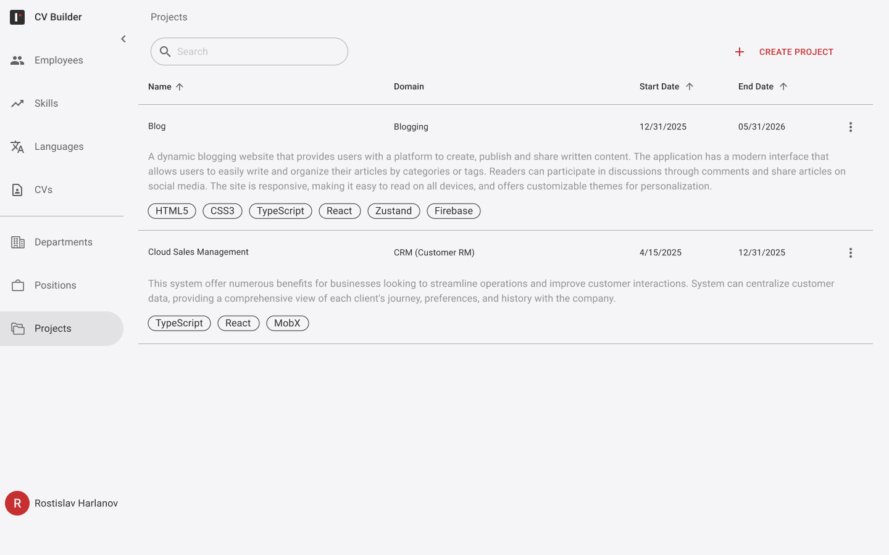

# Projects Page




## Purpose

Allows administrators to manage the global list of projects used throughout the application.

Projects can be assigned to employee CVs and referenced by other application features.

Administrators can:

- View projects
- Search projects
- Sort projects
- Create new projects
- Edit existing projects
- Delete projects

---


## Scope

This page is available only to users with the **Admin** role.

Users without Admin permissions must not have access to this page or its management operations.

The page is responsible for managing the global project catalog.

Project assignment to employee CVs is handled by the corresponding employee/CV features.


---


## Behavior

The page allows administrators to:

- View a list of projects
- Search projects by name and domain
- Sort projects by Name, Start Date, and End Date
- Create new projects
- Edit existing projects
- Delete projects
Search and sorting must be performed on the backend.

The frontend must not filter or sort only the currently loaded project data.


---


## Design Reference

Figma: CV Builder – [Projects](https://www.figma.com/design/m3zxmLv79A6MsHCuAIQAoo/CV-Builder?node-id=21482-37397&t=TLShHNzbO8d6SgrH-0)


---


## Layout

- Page follows the standard application layout.
- Sidebar navigation remains visible.
- Project list is displayed in the main content area.
- Supports Light and Dark themes.
- Fully responsive across desktop and tablet devices.

---


## Navigation


### Sidebar Navigation

Requirements:

- The `Projects` navigation item must be visible only for Admin users.
- Selecting `Projects` opens the Projects page.
- The active navigation item must be visually highlighted.
- Navigation state must persist after page refresh.
- The navigation item appears in the left sidebar together with other administration sections.
- Backend authorization must protect project-management operations even if a non-admin user accesses the route directly.

---


## GraphQL Integration

The frontend communicates with the backend through GraphQL.

The backend is responsible for:

- Retrieving projects
- Applying search
- Applying sorting
- Creating projects
- Updating projects
- Deleting projects
- Retrieving available technologies
- Validating project data
- Validating date relationships
- Managing project-technology relationships
- Enforcing Admin authorization
The frontend must not treat projects or technologies as client-only data.


---


## Projects Query

The page must use a GraphQL query to retrieve projects.

The query should support:

- Search
- Sorting
Example conceptual structure:

```graphql
query Projects(
  $search: String
  $sortBy: ProjectSortField
  $sortOrder: SortOrder
) {
  projects(
    search: $search
    sortBy: $sortBy
    sortOrder: $sortOrder
  ) {
    items {
      id
      name
      domain
      startDate
      endDate
      description
      technologies {
        id
        name
      }
    }
    total
  }
}
```

The exact GraphQL schema may differ depending on the backend implementation.


---


## Available Technologies Query

The Environment field must use data from the backend rather than a hardcoded frontend list.

Example conceptual structure:

```graphql
query Technologies {
  technologies {
    id
    name
  }
}
```

The exact name of the query/entity may differ depending on the backend implementation.


---


## Create Project Mutation

Creating a project must be performed through a GraphQL mutation.

The mutation receives:

- Name
- Domain
- Start Date
- End Date
- Description
- Selected technologies
The backend must:

- Validate required fields.
- Validate field lengths.
- Validate date relationships.
- Verify selected technologies.
- Create the project.
- Create/update project-technology relationships.
- Return the created project.
Example conceptual structure:

```graphql
mutation CreateProject($input: CreateProjectInput!) {
  createProject(input: $input) {
    id
    name
    domain
    startDate
    endDate
    description
    technologies {
      id
      name
    }
  }
}
```


---


## Update Project Mutation

Updating a project must be performed through a GraphQL mutation.

The backend must:

- Verify that the project exists.
- Validate all updated fields.
- Validate the date relationship.
- Verify selected technologies.
- Update project data.
- Synchronize project-technology relationships.
- Return the updated project.

---


## Delete Project Mutation

Deleting a project must be performed through a GraphQL mutation.

The backend must:

- Verify that the project exists.
- Verify Admin authorization.
- Apply the project's deletion policy.
- Remove the project and its dependent relationships according to the configured database rules.
If projects can be referenced by employee CVs or other entities, the backend must apply an explicit deletion policy rather than relying on frontend behavior.


---


# Content


## Page Header

Title:

`Projects`

Requirements:

- Display page title above the project list.
- Display the search field.
- Display the `CREATE PROJECT` action.

---


## Create Project Action

Button:

`CREATE PROJECT`

Requirements:

- Visible only to Admin users.
- Opens the Create Project modal.
- Supports:
  - default
  - hover
  - pressed states

---


## Search

Search field:

`Search`

Requirements:

- Allows searching projects by:
  - project name
  - domain
- Search is case-insensitive.
- Search is performed on the backend.
- Search works across all projects.
- Search results update without a full page reload.
- Empty search returns all projects.
The frontend must pass the search value to the GraphQL query instead of filtering only the currently loaded project list.


---


## Sorting

Sortable columns:

- Name
- Start Date
- End Date
Requirements:

- Projects can be sorted by Name.
- Projects can be sorted by Start Date.
- Projects can be sorted by End Date.
- Each field supports:
  - ascending order
  - descending order
- Active sort direction must be visually indicated.
- Sorting is performed on the backend.
- Sorting works together with search.
- Changing sorting updates the project query without a full page reload.
Date sorting must use actual date values rather than formatted display strings.


---


## Projects List

Columns:

- Name
- Domain
- Start Date
- End Date
- Actions
Additional project information:

- Description is displayed below the main project information.
- Technologies/environment are displayed as tags.
Requirements:

- Display project name.
- Display project domain.
- Display project start date.
- Display project end date.
- Display project description.
- Display project technologies as tags.
- Display an action menu for each project.
- Rows remain readable across supported themes and screen sizes.

---


## Environment Tags

Environment represents the technologies associated with the project.

Requirements:

- Display selected technologies as tags/chips.
- Tags support long values without breaking the layout.
- Multiple tags wrap correctly on smaller screens.
- Tags remain readable in both Light and Dark themes.
Examples:

- HTML5
- CSS3
- TypeScript
- React
- Zustand
- Firebase

---


## Row Actions

Each project row contains an action menu represented by an actions icon.

The menu contains:

- `Edit`
- `Delete`
Requirements:

- Menu opens when clicking the actions icon.
- Only one action menu can be open at a time.
- Menu closes when:
  - user clicks outside
  - action is selected
  - user presses Escape

---


# Create Project


## Create Project Modal

Title:

`Create project`


### Fields

- Name
- Domain
- Start Date
- End Date
- Description
- Environment

---


## Name

Requirements:

- Required.
- Maximum length: 100 characters.
- Supports:
  - default
  - focus
  - error
  - disabled states.

---


## Domain

Requirements:

- Required.
- Maximum length: 100 characters.
- Supports:
  - default
  - focus
  - error
  - disabled states.

---


## Start Date

Requirements:

- Required.
- Date picker is available.
- Value must represent a valid date.
- Supports:
  - default
  - focus
  - error
  - disabled states.

---


## End Date

Requirements:

- Required.
- Date picker is available.
- Value must represent a valid date.
- End Date cannot be earlier than Start Date.
- Supports:
  - default
  - focus
  - error
  - disabled states.
The date relationship must be validated on both frontend and backend.


---


## Description

Requirements:

- Required.
- Maximum length: 2000 characters.
- Supports multiline input.
- Supports:
  - default
  - focus
  - error
  - disabled states.

---


## Environment

Requirements:

- Optional.
- Supports selecting multiple technologies.
- Technologies are loaded from the backend.
- Supports removing selected technologies.
- Selected technologies are displayed as tags.
- Duplicate technologies cannot be selected for the same project.

---


## Create Project Validation

Rules:

- Name is required.
- Name must not exceed 100 characters.
- Domain is required.
- Domain must not exceed 100 characters.
- Start Date is required.
- End Date is required.
- End Date cannot be earlier than Start Date.
- Description is required.
- Description must not exceed 2000 characters.
- Selected technologies must exist in the technology catalog.
Example messages:

- `Project name is required`
- `Project name must not exceed 100 characters`
- `Domain is required`
- `Domain must not exceed 100 characters`
- `Start date is required`
- `End date is required`
- `End date must be later than start date`
- `Description is required`
- `Description must not exceed 2000 characters`
Client-side validation should provide immediate feedback.

All validation rules must also be enforced on the backend.


---


## Create Project Actions

Buttons:

- `CREATE`
- `CANCEL`
Requirements:

- `CREATE` remains disabled until required client-side validation passes.
- Clicking `CREATE` sends the create mutation.
- Loading state is displayed while the request is in progress.
- Successful creation updates the project list.
- Modal closes after successful creation.
- Failed requests do not clear entered values.
- Created project persists after page refresh.

---


# Update Project


## Edit Project Modal

Title:

`Update project`


### Fields

- Name
- Domain
- Start Date
- End Date
- Description
- Environment
Requirements:

- All current project values are prefilled.
- Same validation rules as Create Project.
- Existing project ID is used to identify the record being updated.
- Existing technologies are correctly preselected.

---


## Update Project Validation

The backend must validate:

- Required fields.
- Maximum field lengths.
- Valid dates.
- Start/End Date relationship.
- Selected technology IDs.
- Valid project ID.
The frontend must display validation errors inline where possible.


---


## Update Project Actions

Buttons:

- `UPDATE`
- `CANCEL`
Requirements:

- `UPDATE` sends the update mutation.
- Loading state is displayed while the request is in progress.
- Successful update closes the modal.
- Updated project data appears in the list.
- Updated project data persists after page refresh.
- Failed requests do not clear entered values.

---


# Delete Project


## Delete Project Modal

Title:

`Delete project`

Message:

`Are you sure you want to delete project {Project Name}?`

Where:

- `{Project Name}` = selected project name.
Requirements:

- Project name must be displayed in the confirmation message.
- Modal includes:
  - `CONFIRM`
  - `CANCEL`

---


## Delete Project Actions


### Cancel

`CANCEL`:

- Closes the modal.
- Does not modify the project.

### Confirm

`CONFIRM`:

- Sends the delete mutation.
- Displays a loading state while deletion is in progress.
- Permanently deletes the project according to the application's deletion policy.
- Removes the deleted project from the list after successful deletion.
- Closes the modal after successful deletion.
If the project cannot be deleted because it is referenced by another entity, the backend must return a business-rule error and the frontend must display it appropriately.


---


# States


## Loading State

Displayed while projects or technologies are being loaded.

Requirements:

- Project list structure remains visible while projects are loading.
- Loading indicator is displayed.
- Technology selector displays an appropriate loading state while technologies are being loaded.
- Create, Update, and Delete operations display appropriate mutation loading states.
- Users must not be able to submit the same mutation multiple times while it is in progress.

---


## Empty State

Displayed when:

- No projects exist.
- Search returns no results.
Example:

`No projects found`


---


## Error State

Displayed when:

- Projects cannot be loaded.
- Technologies cannot be loaded.
- A mutation fails.
Requirements:

- Error message is shown.
- Retry action is available where applicable.
- Existing search and sorting state is preserved where possible.
- Failed requests must not silently display an empty project list.
- Failed form requests must not clear entered values.

---


# Validation & Error Handling

The system must handle:

- Required project name.
- Project name length violations.
- Required domain.
- Domain length violations.
- Required start date.
- Required end date.
- Invalid date values.
- End date earlier than start date.
- Required description.
- Description length violations.
- Invalid technology IDs.
- Project not found.
- Unauthorized access.
- Forbidden operations.
- Failed create requests.
- Failed update requests.
- Failed delete requests.
- Network errors.
- Server errors.
- Business-rule errors related to project deletion.
Example messages:

- `Project name is required`
- `Domain is required`
- `Start date is required`
- `End date is required`
- `End date must be later than start date`
- `Description is required`
- `Something went wrong. Please try again later`
Requirements:

- Validation errors are displayed inline where applicable.
- System and business-rule errors are displayed using user-friendly messages.
- Failed requests must not clear entered form values.
- Backend errors must not be exposed as raw technical errors when a user-friendly message can be provided.
- Frontend state must remain consistent with the persisted backend state after successful or failed mutations.

---


# Authorization & Security

The Projects page is protected by the **Admin** role.

Authorization must be enforced on the backend.

Requirements:

- Only authenticated Admin users can query project-management operations.
- Only Admin users can create projects.
- Only Admin users can update projects.
- Only Admin users can delete projects.
- Only authorized users can access the technology catalog required by the project form.
- Backend authorization must not rely on frontend navigation visibility.
- Direct GraphQL requests from non-admin users must be rejected.
- Every mutation must verify the authenticated user's authorization before modifying data.
The frontend should hide Admin-only navigation and actions for non-admin users, but this is not a security boundary.


---


# Database Model


## Project

The project entity should contain data similar to:

```plain text
Project
- id
- name
- domain
- startDate
- endDate
- description
- createdAt
- updatedAt
```

Recommended constraints:

- `name` is required.
- `domain` is required.
- `startDate` is required.
- `endDate` is required.
- `description` is required.
- `startDate <= endDate`.
The exact database field names may differ depending on the backend implementation.

The database should store dates as date/time values rather than formatted display strings.


---


## Technology Relationship

Environment technologies should be stored as relationships rather than as a serialized frontend-only string.

Conceptually:

```plain text
Project
   |
   | 1:N
   v
ProjectTechnology
   |
   | N:1
   v
Technology
```

`ProjectTechnology` may contain:

```plain text
ProjectTechnology
- projectId
- technologyId
```

The relationship should prevent duplicate technology assignments to the same project:

```plain text
(projectId, technologyId) UNIQUE
```

The exact relationship structure may differ depending on the database and ORM.


---


## Technology Catalog

Technologies used in the Environment field should come from a managed catalog.

The project page should not create arbitrary technology records as part of project creation unless this behavior is explicitly supported by the application's domain model.

The backend must verify that every submitted technology ID exists and is available for selection.


---


## Project Assignment Relationships

Projects may be referenced by employee CVs or other entities.

Conceptually:

```plain text
Project
   |
   +---- Employee CV
   |
   +---- Other entities
```

The exact relationships depend on the application's domain model.

These relationships must be considered when implementing project deletion.


---


## Project Deletion Policy

The application must explicitly define what happens when a project is already referenced by another entity.

Possible approaches include:

1. Prevent deletion while the project is referenced.
1. Remove dependent relationships through a controlled cascade.
1. Use soft deletion and exclude inactive projects from active project lists.
The chosen policy must be enforced by the backend and database layer.

The frontend must correctly handle any resulting business-rule error.


---


# Accessibility & Responsiveness

- Full keyboard navigation support is required.
- Interactive elements must provide visible focus states.
- Form controls must have accessible labels.
- Date pickers must be keyboard accessible.
- Technology selection must be keyboard accessible.
- Selected technology tags must provide accessible remove controls.
- Action menus must be keyboard accessible.
- Modal dialogs must trap keyboard focus while open.
- Escape key closes action menus and modals.
- Focus should return to the triggering element after closing a modal or action menu.
- Text must remain readable in all supported themes.
- Long technology names must not break the layout.
- Multiple technology tags must wrap correctly on smaller screens.
- Layout and controls must scale correctly across desktop and tablet devices.
- Buttons and interactive controls must have accessible names.

---


# Acceptance Criteria

| ID | Description |
|---|---|
| AC-1 | Projects page is accessible only to Admin users |
| AC-2 | Projects navigation item is visible only to Admin users |
| AC-3 | Non-admin users cannot access protected project-management GraphQL operations |
| AC-4 | Project list displays project name, domain, start date, end date, description, and environment tags |
| AC-5 | Project data is loaded from the backend |
| AC-6 | Search filters projects by name and domain |
| AC-7 | Search is case-insensitive |
| AC-8 | Search is performed on the backend |
| AC-9 | Projects can be sorted by Name in ascending and descending order |
| AC-10 | Projects can be sorted by Start Date in ascending and descending order |
| AC-11 | Projects can be sorted by End Date in ascending and descending order |
| AC-12 | Sorting is performed on the backend |
| AC-13 | CREATE PROJECT button opens the Create Project modal |
| AC-14 | New projects can be created successfully |
| AC-15 | Project creation requires Name, Domain, Start Date, End Date, and Description |
| AC-16 | Name cannot exceed 100 characters |
| AC-17 | Domain cannot exceed 100 characters |
| AC-18 | Description cannot exceed 2000 characters |
| AC-19 | End Date cannot be earlier than Start Date |
| AC-20 | Environment field supports selecting multiple technologies |
| AC-21 | Available technologies are loaded from the backend |
| AC-22 | Selected environment technologies are displayed as removable tags |
| AC-23 | Duplicate technologies cannot be assigned to the same project |
| AC-24 | Action menu is available for each project |
| AC-25 | Only one action menu can be open at a time |
| AC-26 | Edit action opens the Update Project modal |
| AC-27 | Edit Project modal is prefilled with current project data |
| AC-28 | Existing projects can be edited |
| AC-29 | Updated project data persists after page refresh |
| AC-30 | Delete action opens the Delete Project confirmation modal |
| AC-31 | Delete confirmation modal displays the selected project name |
| AC-32 | Confirming deletion sends the delete mutation |
| AC-33 | Project deletion follows the defined relationship/dependency policy |
| AC-34 | Validation messages are displayed for invalid input |
| AC-35 | Failed create, update, and delete requests are handled correctly |
| AC-36 | Failed requests do not clear entered form values |
| AC-37 | User-friendly error messages are displayed for failed requests |
| AC-38 | Loading, Empty, and Error states are supported |
| AC-39 | Retry is available when project data cannot be loaded |
| AC-40 | Project data persists after page refresh |
| AC-41 | Project records are persisted in the database |
| AC-42 | Project-technology relationships are persisted correctly |
| AC-43 | Duplicate project-technology relationships are prevented |
| AC-44 | Project start and end dates are stored as date/time values |
| AC-45 | Backend validates the Start Date / End Date relationship |
| AC-46 | Backend validates submitted technology IDs |
| AC-47 | Backend authorization is enforced for all Admin operations |
| AC-48 | Page supports Light and Dark themes |
| AC-49 | Page is responsive across supported devices |
| AC-50 | Keyboard navigation is supported for all interactive elements |
| AC-51 | Modal, date-picker, technology-selector, and action-menu focus behavior is accessible |
| AC-52 | Project rows remain readable across supported themes and screen sizes |


